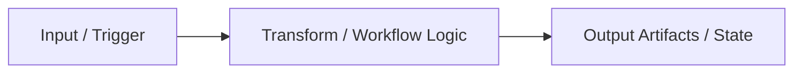

# [<TICKET-ID>] <Issue / Feature Title> — Implementation Plan

> **Issue / Source:** `https://github.com/prayogizan/JourKa/issues/<n>` (or SDD / user request)
> **Git Branch:** `<feat|fix|rpa|fe>/<ticket-id>-<slug>`
> **Epic:** `<EPIC-ID>` · **Priority / Points:** `<P0..P3> / <n> pts`
> **Project Root:** `D:\UiPathProject\JourKa\JourKa` (`project.json`)
> **Project Type:** `Modern Windows XAML Process` (`targetFramework: Windows`, `dotNetVersion: net10.0`)
> **Expression Language:** `VisualBasic` (`Option Strict On`, `Option Explicit On`)
> **Execution Autonomy:** `<interactive | autonomous>`
> **UI Targeting:** `<N/A (headless/API/InvokeCode) | OR-capture | indication-only>`

---

## 1. Skill Auto-Discovery, Routing & Auto-Creation Gate *(mandatory — execute first)*

Before designing or touching any file, audit `.agents/skills/` against the task's domains and run `Ensure-UiPathSkills.ps1` so every required skill is present and loaded in this project workspace.

```powershell
powershell -NoProfile -ExecutionPolicy Bypass -File "D:\UiPathProject\JourKa\.agents\skills\jourka-uipath-rpa\scripts\Ensure-UiPathSkills.ps1" -Audit
```

### 1.1 Active & Required Skills Matrix
| Skill Name | Scope (`D:\UiPathProject\JourKa\.agents\skills\<name>`) | Trigger / Role in This Plan | Status (`Loaded` / `Auto-Extract` / `Auto-Create`) |
|---|---|---|---|
| `jourka-uipath-rpa` | `.agents/skills/jourka-uipath-rpa/SKILL.md` | Master JourKa runbook, `InvokeCodeTool.ps1`, `Invoke-JourKaGate.ps1`, hard invariants | `Loaded` |
| `uipath-rpa` | `.agents/skills/uipath-rpa/SKILL.md` | Core UiPath XAML/InvokeCode rules (Rules 1–25), activity cards, common pitfalls, CLI reference | `<Loaded | Auto-Extract>` |
| `uipath-planner` | `.agents/skills/uipath-planner/SKILL.md` | Task derivation (`Identity` tuples), turn-budgeted execution maps, stop conditions | `<Loaded | Auto-Extract>` |
| `uipath-review` | `.agents/skills/uipath-review/SKILL.md` | Read-only quality & Workflow Analyzer audit (`ST-USG-*`, `ST-MRD-*`, `ST-NMG-*`) | `<Loaded | Auto-Extract | N/A>` |
| `jourka-interactive-html` | `.agents/skills/jourka-interactive-html/SKILL.md` | `DossierInteractiveTemplate.html` (`v2`) token contract, offline GFM parser, bilingual EN/ID UI (`JK-FE-*`, `JK-RPA-002`) | `<Loaded | Auto-Create | N/A>` |
| `<custom-skill-if-needed>` | `.agents/skills/<custom-skill>/SKILL.md` | `<New domain/package capability introduced by this ticket>` | `<Auto-Create via Ensure-UiPathSkills.ps1 | N/A>` |

### 1.2 Skill Gap Auto-Creation Decision
- **Does this ticket introduce a repeatable workflow, external API, NuGet package, or UI subsystem not covered above?** `<Yes | No>`
- **If Yes — Bootstrap Command (must run as Task `T0` before implementation):**
  ```powershell
  powershell -NoProfile -ExecutionPolicy Bypass -File "D:\UiPathProject\JourKa\.agents\skills\jourka-uipath-rpa\scripts\Ensure-UiPathSkills.ps1" `
    -CreateSkill "<new-skill-name>" `
    -Domain "<rpa|fe|test|data>" `
    -Description "<When and how the agent should activate this project-local skill>"
  ```

---

## 2. Goal, Epic Boundary & Artifact Isolation *(mandatory)*

- **Outcome in one sentence:** `<What the automation/feature achieves when done>`
- **In scope (strictly owned by this ticket):**
  - `<Deliverable 1>`
  - `<Deliverable 2>`
- **Out of scope (owned by sibling tickets — name ticket IDs to prevent scope creep):**
  - `<Sibling ticket ID>: <What it owns>`
- **Immutable Artifacts & Contracts (MUST NOT change):**
  - `<e.g., .md output bytes | legacyPdfHtml print string & Chrome flags | If_2 idempotency predicate | x:Members public argument signature | 42 committed JourKa/Output & PDF_Results files | project.json targetFramework & expressionLanguage>`

---

## 3. Codebase, Workflow & Activity Discovery *(mandatory — Rule 17 & Rule 21)*

Verified directly against live `.xaml` and `project.json` (never trust issue line numbers without checking).

### 3.1 Live Codebase Findings
| # | Finding | Verified Location (`file#Lx-Ly`) | Impact on Plan |
|---|---|---|---|
| F1 | `<e.g., Main.xaml duplicates PublishDossier logic inside InvokeCode_1>` | `[Main.xaml#L417](file:///D:/UiPathProject/JourKa/JourKa/Main.xaml#L417)` | `<Edit both or document why>` |

### 3.2 Target `InvokeCode` & Workflow Inventory
| Workflow File | Activity `IdRef` | `DisplayName` | In / Out / InOut Arguments | Missing Namespace Imports to Fully-Qualify |
|---|---|---|---|---|
| `<Main.xaml>` | `<InvokeCode_1>` | `<DisplayName>` | `<in_*, out_*, io_*>` | `<e.g., System.Text.RegularExpressions.Regex>` |

### 3.3 NuGet Package & Activity Resolution Gate (`Rule 21`)
- **Dependencies in `project.json` sufficient?** `<Yes | No — list packages to check via uip rpa packages versions>`
- **New XAML Activities Added:**
  | Activity Class | Source (`Card` / `Memory` / `Rule 21 Triple: find -> <Activity>.md -> get-default-xaml`) | Required Properties Checklist | Container `<Sequence>` Slot Needed? |
  |---|---|---|---|
  | `<ui:InvokeCode / If / TryCatch / None>` | `<common-activity-card.md>` | `<Code, Language, Arguments>` | `<Yes / No>` |

---

## 4. UiPath Common Pitfalls & Analyzer Vetting Gate *(mandatory — Rule 22)*

Vet every planned change against `.agents/skills/uipath-rpa/references/xaml/common-pitfalls.md` and `.agents/skills/jourka-uipath-rpa/references/invokecode-rules.md` before editing:

- [ ] **`Option Strict On` & `Option Explicit On` (VB.NET):** Every variable (`Dim x As <Type>`) and lambda (`Func(Of ...)` / `Action(Of ...)`) has explicit types; no implicit `Object` conversions (`CInt`, `.ToString()`).
- [ ] **Fully-Qualified CLR Types:** `System.IO.File`, `System.IO.Path`, `System.Net.WebUtility`, `System.Uri`, `System.Text.RegularExpressions.Regex` used so code compiles in workflows with minimal `NamespacesForImplementation` (e.g., `PublishDossier.xaml`).
- [ ] **`InvokeCode` Method-Body Rule:** Top-level code is inside `Sub Run(...)` — no top-level `Return <value>` (assign `out_*` arguments instead; bare `Return` inside `Sub` lambdas is allowed).
- [ ] **Safe XML Attribute Editing (`InvokeCodeTool.ps1`):** Never hand-edit multi-line `Code="..."` attributes; always run `InvokeCodeTool.ps1 extract` → edit `.local/invokecode/*.vb` → `InvokeCodeTool.ps1 inject`.
- [ ] **Studio ViewState & Container Wrappers:** Leave `sap:WorkflowViewStateService.ViewState` and `HintSize` untouched on unchanged nodes; wrap every `If.Then`, `If.Else`, `TryCatch.Try/Catch/Finally`, and `ForEach.Body` in `<Sequence>`.
- [ ] **Exception Taxonomy & Stack Preservation:** External I/O wrapped in `TryCatch`; bad input throws `BusinessRuleException`; rethrows use `Rethrow` activity (never `Throw New Exception(ex.Message)`).
- [ ] **Process & Temp-File Lifecycle:** External processes check `If Not p.WaitForExit(ms) Then p.Kill(True) : p.WaitForExit(5000)` before deleting temp files inside `Finally` (with inner `Try...Catch`).
- [ ] **Template & String Escaping:** Never use `String.Format` on HTML/CSS/JS templates (`{}` throws `FormatException`); use chained `.Replace("{{TOKEN}}", val)` and replace raw content tokens (`{{MARKDOWN_ENCODED}}`) **last**.
- [ ] **Secret Redaction & Hygiene:** API keys read only from `.env` or `EnvironmentVariableTarget.User`; any logged exception passes `.Replace(geminiApiKey, "[REDACTED]")`.

---

## 5. Issue Gaps, Ambiguities, Decisions & Stop Conditions *(mandatory)*

### 5.1 Gaps & Decisions
| # | Gap / Ambiguity / Contradiction | Decision Taken & Rationale | Needs User Input? |
|---|---|---|---|
| D1 | `<Gap description>` | `<Default option chosen + alternative option>` | `<Yes / No>` |

### 5.2 Stop Conditions *(mandatory when `Execution Autonomy: autonomous`; optional in `interactive`)*
Execution continues automatically through all tasks unless one of these hard blockers occurs:
- `uip rpa validate` or `uip rpa build` still fails after 5 structured repair attempts (Package → Structure → Type → Properties → Logic).
- Live runtime execution (`uip rpa run`) is reached without explicit user consent (`AGENTS.md` rule).
- Required external credential (`.env` `GEMINI_API_KEY` or `uip login`) or binary (`chrome.exe`, `uip.cmd`) is missing and cannot be resolved locally.
- An invariant check fails (unexpected diff in `.md`/`.pdf` artifacts or outside Change Manifest).

---

## 6. Technical Design, Data Contracts & Failure Modes *(mandatory)*

### 6.1 Architecture & Data-Flow Diagram


### 6.2 Argument, Variable & Token Contracts
| Name | Kind (`InArg` / `OutArg` / `Var` / `Token`) | Type | Producer | Consumer | Encoding / Validation Rule |
|---|---|---|---|---|---|
| `<name>` | `<kind>` | `<x:String / x:Int32 / x:Boolean>` | `<producer>` | `<consumer>` | `<HtmlEncode / EscapeDataString / Replaced Last>` |

### 6.3 Failure Modes & Degraded-Mode Fallbacks
| Failure Scenario | Detection | Recovery / Fallback Behavior | Observable Signal |
|---|---|---|---|
| `<Missing template / Timeout / Rate limit>` | `<File.Exists / WaitForExit=False / HTTP 429>` | `<Inline v2-fallback / Kill(True)+Finally delete / Model failover>` | `<data-jourka-ui="v2-fallback" / out_PdfExists=False / AbroadStatus="Error">` |

---

## 7. Strict Change Manifest *(mandatory)*

Every file to be created, edited, or deleted. `git diff --stat` at completion must be a strict subset of this table.

| File Path | Action (`new` / `edit` / `delete`) | XAML Node / `IdRef` / Section | Summary of Change |
|---|---|---|---|
| `<path>` | `<new|edit>` | `<InvokeCode_1 / N/A>` | `<Concise summary>` |

---

## 8. Turn-Budgeted Implementation Tasks (`uipath-planner` Schema) *(mandatory)*

### Task T0 — `jourka-uipath-rpa` — Ensure Project Skills & Baseline Extract
**Identity:** `jourka-uipath-rpa:JourKa:skills-and-baseline`
**Status:** `[ ] pending`
**Blocked by:** `none`
**Skill prompt:**
> Run `Ensure-UiPathSkills.ps1` to verify/create all required project skills in `.agents/skills/`, then extract target `InvokeCode` bodies into `.local/invokecode/` and snapshot `*__before.vb` baselines. Do not invent file paths or activity properties.

- [ ] Run `Ensure-UiPathSkills.ps1 -Audit` (and `-CreateSkill` / `-ExtractOfficial` if §1.2 flagged a skill gap).
- [ ] Run `InvokeCodeTool.ps1 extract` on target `.xaml` files and copy extracted `.vb` files to `*__before.vb`.
- [ ] **Validate:** Extracted `.vb` files exist in `JourKa/.local/invokecode/` and round-trip cleanly.

### Task T1 — `<skill-name>` — `<Component / Workflow Change 1>`
**Identity:** `<skill>:JourKa:<relative-file-or-subject>`
**Status:** `[ ] pending`
**Blocked by:** `T0`
**Skill prompt:**
> Load `<skill-name>`. Implement `<exact change>` in `<target file>` following §4 Pitfalls and §6 Contracts. Preserve all immutable artifacts in §2.

- [ ] `<Concrete sub-step 1 with exact file path / IdRef>`
- [ ] `<Concrete sub-step 2>`
- [ ] **Validate:** `powershell -NoProfile -ExecutionPolicy Bypass -File .agents\skills\jourka-uipath-rpa\scripts\Invoke-JourKaGate.ps1 -Files <relative-xaml> -SkipBuild` returns `No diagnostics found.`

### Task T2 — `jourka-uipath-rpa` — Full Project Gate, Invariance Proof & Functional Verification
**Identity:** `jourka-uipath-rpa:JourKa:verification-gate`
**Status:** `[ ] pending`
**Blocked by:** `T1`
**Skill prompt:**
> Run the full JourKa validate + build gate across all touched workflows, execute static invariance diffs against `*__before.vb`, verify Gherkin ACs, and check git status invariants.

- [ ] Run full gate: `powershell -NoProfile -ExecutionPolicy Bypass -File .agents\skills\jourka-uipath-rpa\scripts\Invoke-JourKaGate.ps1 -Files <comma-separated-xamls>` → must output `GATE: PASSED`.
- [ ] Run static diff proof: `git diff --no-index --word-diff <before.vb> <after.vb>` to confirm untouched legacy pipelines.
- [ ] Run offline / consent-gated runtime checks per §9.
- [ ] **Validate:** `git status --porcelain -- "JourKa/Output/**/*.md" "JourKa/Output/**/*.pdf" "PDF_Results/*.pdf"` is empty and `%TEMP%\jourka_pdf_*.html` is empty.

---

## 9. Multi-Layer Verification Matrix (`Gate != Runtime Proof`) *(mandatory)*

| Layer | Check | Command / Method | Pass Criterion |
|---|---|---|---|
| **L1 — XML & ViewState** | XAML well-formed & view-state intact | `InvokeCodeTool.ps1 inject` XML parser check + `git diff` on `.xaml` | Only target `Code="..."` / intended nodes changed |
| **L2 — Per-File Validate** | Studio activity & VB expression check | `Invoke-JourKaGate.ps1 -Files <files> -SkipBuild` (`uip rpa validate --min-severity error`) | `"No diagnostics found."` (`0` errors) |
| **L3 — Project Build** | Full project compilation & analyzer | `Invoke-JourKaGate.ps1` (`uip rpa build --output json`) | `"Result": "Success"`, `"Success": true` |
| **L4 — Static Proof** | Invariance of untouched pipelines | `git diff --no-index <before.vb> <after.vb>` | Untouched builders/prompts byte-identical |
| **L5 — Gherkin AC Map** | Every issue Gherkin scenario mapped | `AC-1 -> <Test>`, `AC-2 -> <Test>` | 100% of issue scenarios covered |
| **L6 — Runtime Proof** | Live workflow execution (**user consent required**) | `uip rpa run --file-path <workflow> --input-arguments-file <temp.json> --skip-build --output json` | `Data.hasErrors == false`, `Data.errorMessage == null`, expected outputs verified |
| **L7 — Repo Invariants** | No collateral artifact edits or temp leaks | `git status --short -- JourKa/Output PDF_Results` & `Get-ChildItem "$env:TEMP\jourka_*"` | `0` unintended edits, `0` leftover temp files |

---

## 10. Risks, Rollback & Follow-Up Tech Debt

### 10.1 Risks & Mitigations
| Risk | Likelihood | Impact | Mitigation |
|---|---|---|---|
| `<Risk>` | `<Low|Med|High>` | `<Low|Med|High>` | `<Concrete mitigation>` |

### 10.2 Rollback Procedure
- `<e.g., git checkout -- <files> before commit, or git revert <sha> after commit; no destructive schema migrations>`

### 10.3 Follow-Ups / Tech Debt (Out of Scope Here)
- **F1:** `<Follow-up item 1>`

---

## 11. Definition of Done (DoD) Gate

- [ ] All required skills verified/created in `.agents/skills/` via `Ensure-UiPathSkills.ps1`.
- [ ] *(Copy issue DoD items verbatim here)*
- [ ] `uip rpa validate` returns `0` errors on every changed `.xaml` file.
- [ ] `uip rpa build` succeeds (`"Success": true`).
- [ ] All Gherkin Acceptance Criteria verified (static + runtime/harness).
- [ ] Invariant check clean (`0` unintended `.md`/`.pdf` diffs, `0` leaked `%TEMP%` files, `git diff --stat` ⊆ §7 Change Manifest).
- [ ] Atomic Conventional Commit(s) (`<type>(<scope>): <summary>` with `Closes #<n>`).
