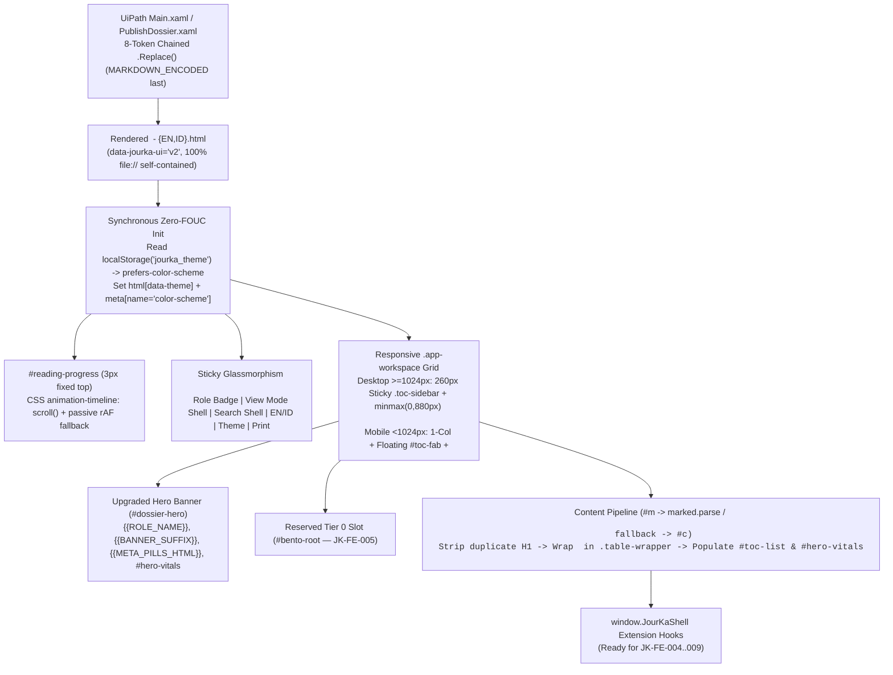

# [JK-FE-003] Master `DossierInteractiveTemplate.html` App Shell, Light/Dark Token System & Responsive Layout Grid — Implementation Plan

> **Issue / Source:** https://github.com/prayogizan/JourKa/issues/5
> **Git Branch:** `feat/jk-fe-003-interactive-app-shell-theme` *(checked out; up to date with `origin/pre-master`)*
> **Epic:** `EPIC-JK-SHELL` — Interactive HTML Shell, Theme System & Role-Agnostic Parser · **Priority / Points:** `P0 (Blocker / Foundation) / 3 pts`
> **Project Root:** `/Users/ottencoffee/ProjectLabs/Hackathon/JourKa/JourKa` (`D:\UiPathProject\JourKa\JourKa` on Windows Studio host, [project.json](file:///Users/ottencoffee/ProjectLabs/Hackathon/JourKa/JourKa/project.json))
> **Project Type:** `Modern Windows XAML Process` (`targetFramework: Windows`, `dotNetVersion: net10.0`, frontend template asset: 100% self-contained single-file HTML5/CSS/JS)
> **Expression Language:** `VisualBasic` *(no `.xaml` edits in this ticket; 8-token VB.NET `.Replace()` contract preserved verbatim)*
> **Approach:** `explore-first`
> **Execution Autonomy:** `interactive` *(pauses for user approval of this plan before mutating [DossierInteractiveTemplate.html](file:///Users/ottencoffee/ProjectLabs/Hackathon/JourKa/JourKa/Templates/DossierInteractiveTemplate.html))*
> **Delivery Model:** `standalone` *(local Studio / Robot execution; offline `file://` HTML artifact delivery)*
> **Packaging:** `standalone`
> **App Type / App State / UI Targeting:** `N/A (static HTML5 template authoring; no UiPath UIA selectors or desktop capture)`
> **Canonical Plan Path:** `JourKa/docs/plans/2026-11-20-jk-fe-003-interactive-app-shell-theme.md`

---

## Understanding (`uipath-planner` Header Prelude)

Following the completion of `JK-RPA-001` (#3) and `JK-RPA-002` (#4), both [Main.xaml](file:///Users/ottencoffee/ProjectLabs/Hackathon/JourKa/JourKa/Main.xaml) (`InvokeCode_1` and `InvokeCode_2`) and [PublishDossier.xaml](file:///Users/ottencoffee/ProjectLabs/Hackathon/JourKa/JourKa/Workflows/PublishDossier.xaml) inject 8 tokens into [DossierInteractiveTemplate.html](file:///Users/ottencoffee/ProjectLabs/Hackathon/JourKa/JourKa/Templates/DossierInteractiveTemplate.html) to produce `data-jourka-ui="v2"` interactive dossiers while keeping `.md` and `.pdf` pipelines isolated. However, [DossierInteractiveTemplate.html](file:///Users/ottencoffee/ProjectLabs/Hackathon/JourKa/JourKa/Templates/DossierInteractiveTemplate.html) is still a 59-line placeholder scaffold (`max-width: 860px`) lacking an app shell, sticky toolbar, Light/Dark design tokens, reading progress indicator, responsive 2-column grid, or table scroll wrappers.

This plan upgrades [DossierInteractiveTemplate.html](file:///Users/ottencoffee/ProjectLabs/Hackathon/JourKa/JourKa/Templates/DossierInteractiveTemplate.html) into the production-grade, 100% self-contained (`file://`-ready) HTML5 master shell for `EPIC-JK-SHELL`: semantic landmarks, WCAG 2.1 AA Light Editorial & Dark Slate CSS custom property tokens, zero-FOUC synchronous `<head>` theme initialization, a `3px` scroll-driven reading progress bar, a sticky glassmorphism `.app-toolbar`, a responsive 2-column desktop (`260px` sticky TOC + `880px` main) / 1-column mobile layout with a floating `"Sections"` FAB and drawer, an upgraded Hero Banner with an auto-computed bilingual Dossier Vital Stats Strip, and accessible responsive table wrappers. It exposes clean DOM/JS mount hooks for downstream tickets `JK-FE-004` through `JK-FE-009` without modifying any `.xaml`, `.md`, or `.pdf` files.

## Decisions & Trade-offs (`uipath-planner` Header Prelude)

- **Why single-file HTML5 template scope only (`0` `.xaml` edits):** All 8 tokens (`{{LANG_CODE}}` through `{{MARKDOWN_ENCODED}}`) and `data-jourka-ui="v2"` detection are already wired in [Main.xaml](file:///Users/ottencoffee/ProjectLabs/Hackathon/JourKa/JourKa/Main.xaml) and [PublishDossier.xaml](file:///Users/ottencoffee/ProjectLabs/Hackathon/JourKa/JourKa/Workflows/PublishDossier.xaml). Keeping `JK-FE-003` strictly inside [DossierInteractiveTemplate.html](file:///Users/ottencoffee/ProjectLabs/Hackathon/JourKa/JourKa/Templates/DossierInteractiveTemplate.html) guarantees zero RPA regression and isolates the diff.
- **Why skill loading order is `jourka-uipath-rpa` → `jourka-interactive-html` → `modern-web-guidance` → `uipath-review`:** `jourka-uipath-rpa` enforces JourKa hard invariants and artifact isolation; `jourka-interactive-html` enforces the immutable 8-token VB.NET contract and `JK-FE-003..009` boundaries; `modern-web-guidance` enforces current web platform standards (`color-scheme`, `animation-timeline: scroll()`, `@media (prefers-reduced-motion)`, WCAG contrast, and semantic landmarks); `uipath-review` / verification checks invariants before PR.
- **Why semantic badge text tokens are WCAG-calibrated alongside Issue #5's palette:** Quantitative contrast auditing against WCAG 2.1 AA (`>= 4.5:1`) showed that raw `#059669` on `#ecfdf5` (`3.58:1`), `#d97706` on `#fffbeb` (`3.07:1`), `#e11d48` on `#fff1f2` (`4.28:1`), and `#2563eb` on `#111827` (`3.43:1`) pass 3:1 non-text contrast for icons/borders but fall short of 4.5:1 for normal text. We keep Issue #5's exact hexes for surfaces/borders/icons and pair them with dedicated text tokens (`#047857`, `#b45309`, `#be123c` in Light; `#60a5fa`, `#6ee7b7`, `#fcd34d`, `#fda4af` in Dark) so every badge, link, and cell achieves `>= 4.75:1`.
- **Why `overflow-x: clip` replaces `overflow-x: hidden` on scroll ancestors:** Applying `overflow-x: hidden` on `html` or `body` disables `position: sticky` for `.app-toolbar` and `.toc-sidebar`. Using `overflow-x: clip` preserves sticky positioning while guaranteeing `0px` horizontal body overflow on `375×812` mobile viewports.

---

## 1. Skill Auto-Discovery, Routing & Auto-Creation Gate *(mandatory — execute first)*

Before editing any file during execution, audit `.agents/skills/` against the task's domains:

```powershell
# On Windows Studio host (or verify .agents/skills/ directory on macOS):
powershell -NoProfile -ExecutionPolicy Bypass -File "D:\UiPathProject\JourKa\.agents\skills\jourka-uipath-rpa\scripts\Ensure-UiPathSkills.ps1" -EnsureCore -Audit
```

### 1.1 Active & Required Skills Matrix
| Skill Name | Scope (`.agents/skills/<name>` / Plugin) | Trigger / Role in This Plan | Status (`Loaded` / `Auto-Extract` / `Auto-Create`) |
|---|---|---|---|
| `jourka-uipath-rpa` | [.agents/skills/jourka-uipath-rpa/SKILL.md](file:///Users/ottencoffee/ProjectLabs/Hackathon/JourKa/.agents/skills/jourka-uipath-rpa/SKILL.md) | Master JourKa invariants, format isolation, plan template, `Invoke-JourKaGate.ps1` | `Loaded` |
| `jourka-interactive-html` | [.agents/skills/jourka-interactive-html/SKILL.md](file:///Users/ottencoffee/ProjectLabs/Hackathon/JourKa/.agents/skills/jourka-interactive-html/SKILL.md) | Primary domain skill for `DossierInteractiveTemplate.html`, 8-token contract, `JK-FE-003..009` epic map | `Loaded` |
| `modern-web-guidance` | [modern-web-guidance/SKILL.md](file:///Users/ottencoffee/.gemini/config/plugins/modern-web-guidance-plugin/skills/modern-web-guidance/SKILL.md) | Mandatory web platform guidance (`dark-mode`, `dark-mode-toggle`, `scroll-progress-indicator`, `responsive-table`, `color`, `accessibility`, `motion`) | `Loaded` |
| `uipath-planner` | [.agents/skills/uipath-planner/SKILL.md](file:///Users/ottencoffee/ProjectLabs/Hackathon/JourKa/.agents/skills/uipath-planner/SKILL.md) | Plan & task schema (`Identity` tuples, anti-hallucination prompts, mandatory testing task) | `Loaded` |
| `uipath-rpa` | [.agents/skills/uipath-rpa/SKILL.md](file:///Users/ottencoffee/ProjectLabs/Hackathon/JourKa/.agents/skills/uipath-rpa/SKILL.md) | Reference only — confirms `0` `.xaml` mutations are required and validates VB.NET template token compatibility | `Loaded` |
| `uipath-review` | [.agents/skills/uipath-review/SKILL.md](file:///Users/ottencoffee/ProjectLabs/Hackathon/JourKa/.agents/skills/uipath-review/SKILL.md) | Read-only quality & invariant verification before PR | `Loaded` |
| `jourka-github-pr` | [.agents/skills/jourka-github-pr/SKILL.md](file:///Users/ottencoffee/ProjectLabs/Hackathon/JourKa/.agents/skills/jourka-github-pr/SKILL.md) | Standardized PR template & `Closes #5` linkage when user requests PR creation | `Loaded` |

### 1.2 Skill Gap Auto-Creation Decision
- **Does this ticket introduce a repeatable workflow, external API, NuGet package, or UI subsystem not covered above?** `No` — all 6 project-local skills (`jourka-uipath-rpa`, `jourka-interactive-html`, `uipath-planner`, `uipath-rpa`, `uipath-review`, `jourka-github-pr`) plus the installed `modern-web-guidance` plugin cover every requirement of `JK-FE-003`.

---

## 2. Goal, Epic Boundary & Artifact Isolation *(mandatory)*

- **Outcome in one sentence:** Replace the minimal placeholder in [DossierInteractiveTemplate.html](file:///Users/ottencoffee/ProjectLabs/Hackathon/JourKa/JourKa/Templates/DossierInteractiveTemplate.html) with a production-grade, 100% self-contained (`file://`-ready) HTML5 master app shell featuring Light Editorial / Dark Slate WCAG AA tokens, zero-FOUC theme persistence, a `3px` reading progress bar, sticky glassmorphism `.app-toolbar`, responsive 2-column desktop / 1-column mobile workspace with TOC rail & FAB drawer, upgraded Hero Banner with auto-computed Vital Stats Strip, and responsive table scroll wrappers.
- **In scope (strictly owned by `JK-FE-003` / Issue #5):**
  - Semantic HTML5 landmark shell (`<header>`, `<nav>`, `<aside>`, `<main>`, `<footer>`, skip link) stamped with `<html lang="{{LANG_CODE}}" data-jourka-ui="v2" data-theme="light">` and `<meta name="color-scheme" content="light dark">`, preserving `<textarea id="m" style="display:none;">{{MARKDOWN_ENCODED}}</textarea>`.
  - Complete CSS custom property token system for `:root` (Light Editorial default) and `[data-theme="dark"]` (Dark Slate), WCAG 2.1 AA (`>= 4.5:1` text, `>= 3:1` interactive boundaries), Forced Colors Mode support, and synchronous `<head>` zero-FOUC theme init reading `localStorage.getItem('jourka_theme')` with `prefers-color-scheme: dark` fallback.
  - Fixed `3px` top reading progress bar (`#reading-progress`) using CSS Scroll-Driven Animation (`@supports (animation-timeline: scroll())`) + passive `requestAnimationFrame` JS fallback (`transform: scaleX(...)` only).
  - Sticky glassmorphism `.app-toolbar` containing Role Title badge (`{{ROLE_NAME}}`), View Mode Switcher shell (`Compact` / `Expand All`), Search input shell (`Ctrl+K` with visually hidden `<label>`), Bilingual Switcher (`EN | ID` wired to `{{COUNTERPART_HREF}}`), functional Theme Toggle button, and functional Print button (`window.print()`).
  - Responsive layout grid: Desktop (`>= 1024px`) centered `max-width: 1240px`, `padding: 24px`, `260px` sticky left `.toc-sidebar` + `minmax(0, 880px)` main content column (`gap: 28px`); Tablet/Mobile (`< 1024px`) single-column (`padding: 16px`), floating bottom-right `"Sections"` FAB opening a mobile TOC drawer (`<dialog>` or accessible slide-up sheet), and `0px` horizontal body overflow.
  - Upgraded Hero Banner displaying `{{ROLE_NAME}}`, `{{BANNER_SUFFIX}}`, `{{META_PILLS_HTML}}`, and an auto-computed bilingual **Dossier Vital Stats Strip** (`N Sections · ~X min read · Y Verified Sources` / `N Bagian · ~X mnt baca · Y Sumber Terverifikasi`).
  - Editorial typography, responsive `.table-wrapper` horizontal scroll containers (`tabindex="0"`, `role="region"`, sticky `<thead>`), accessible focus rings (`:focus-visible`), touch target sizing (`>= 44px` on coarse pointers), basic `<h2>` anchor TOC population so the rail/drawer are immediately usable, and `@media (prefers-reduced-motion: no-preference)` / `reduce` motion rules.
- **Out of scope (owned by sibling tickets — do NOT creep into these):**
  - `JK-RPA-001` (#3, merged) & `JK-RPA-002` (#4, merged): Decoupled HTML/PDF pipelines in `Main.xaml` / `PublishDossier.xaml` and in-workflow `If_2.Then` HTML v2 auto-upgrade.
  - `JK-FE-004` (#6): Full pure-JS offline GFM Markdown parser (`fallbackMarkdownToHtml`), DOM link sanitization, and bilingual `SectionModel` / `classifySection()` normalizer. *(Keep current `marked.parse` + clean `<pre>` fallback in `JK-FE-003` and expose clean mount targets.)*
  - `JK-FE-005` (#7): Tier 0 dynamic 4-card Executive Bento KPI grid (`.bento-summary`) and KPI extractors. *(Reserve empty `#bento-root` slot below Hero Banner.)*
  - `JK-FE-006` (#8): Tier 1 compact-first `.dossier-card` section accordions, auto-generated TL;DR preview strips, and `sessionStorage` open-state memory.
  - `JK-FE-007` (#9): Tier 2 Portfolio Blueprint sub-cards (`<h4>` + nested `<li>`), 30/60/90 onboarding phase tabs + `localStorage` checklist, Mentor Deep-Dive expanders, and S1/AI Sentiment callout cards.
  - `JK-FE-008` (#10): ASCII-to-Stepper `.flow-stepper` converter, inline `[Jxx]`/`[Yxx]`/`[Axx]` citation popovers, and filterable Skills/Evidence tables.
  - `JK-FE-009` (#11): `IntersectionObserver` scrollspy active-section tracking with expanded-dot indicators, `Compact Summary ↔ Expand All` state orchestration, debounced `Ctrl+K` live search with auto-expand & `<mark class="search-hit">` unwrap, full `I18N` dictionary across all widgets, and full `@media print` card-expansion print overrides.
- **Immutable Artifacts & Contracts (MUST NOT change):**
  - The 8 VB.NET template tokens in [DossierInteractiveTemplate.html](file:///Users/ottencoffee/ProjectLabs/Hackathon/JourKa/JourKa/Templates/DossierInteractiveTemplate.html): `{{LANG_CODE}}`, `{{DOC_TITLE}}`, `{{ROLE_NAME}}`, `{{BANNER_SUFFIX}}`, `{{META_PILLS_HTML}}`, `{{COUNTERPART_HREF}}`, `{{COUNTERPART_LABEL}}`, `{{MARKDOWN_ENCODED}}`.
  - [JourKa/Main.xaml](file:///Users/ottencoffee/ProjectLabs/Hackathon/JourKa/JourKa/Main.xaml), [JourKa/Workflows/PublishDossier.xaml](file:///Users/ottencoffee/ProjectLabs/Hackathon/JourKa/JourKa/Workflows/PublishDossier.xaml), and [JourKa/project.json](file:///Users/ottencoffee/ProjectLabs/Hackathon/JourKa/JourKa/project.json) — **0 byte changes**.
  - All 14 `.md` files and all 14 `.pdf` files in `JourKa/Output/` plus all 14 `.pdf` files in `PDF_Results/` — **0 byte changes**.
  - `data-jourka-ui="v2"` exact attribute value on `<html>` (required by `Main.xaml` `If_3` Regex `data-jourka-ui\s*=\s*["']v2["']`).

---

## 3. Codebase, Workflow & Activity Discovery *(mandatory — Rule 17 & Rule 21)*

Verified directly against live [DossierInteractiveTemplate.html](file:///Users/ottencoffee/ProjectLabs/Hackathon/JourKa/JourKa/Templates/DossierInteractiveTemplate.html), [Main.xaml](file:///Users/ottencoffee/ProjectLabs/Hackathon/JourKa/JourKa/Main.xaml), [PublishDossier.xaml](file:///Users/ottencoffee/ProjectLabs/Hackathon/JourKa/JourKa/Workflows/PublishDossier.xaml), [project.json](file:///Users/ottencoffee/ProjectLabs/Hackathon/JourKa/JourKa/project.json), and all 14 `.md` / `.html` outputs in `JourKa/Output/`.

### 3.1 Live Codebase Findings
| # | Finding | Verified Location (`file#Lx-Ly`) | Impact on Plan |
|---|---|---|---|
| **F1** | [DossierInteractiveTemplate.html](file:///Users/ottencoffee/ProjectLabs/Hackathon/JourKa/JourKa/Templates/DossierInteractiveTemplate.html#L1-L59) already exists (created by `JK-RPA-001`) with a `TODO(JK-FE-003)` comment, all 8 tokens, `<html lang="{{LANG_CODE}}" data-jourka-ui="v2" data-theme="light">`, CDN `marked.min.js`, and a minimal 12-line render IIFE. | [DossierInteractiveTemplate.html#L1-L59](file:///Users/ottencoffee/ProjectLabs/Hackathon/JourKa/JourKa/Templates/DossierInteractiveTemplate.html#L1-L59) | Edit in place (action `edit`, not `new`); remove the `TODO(JK-FE-003)` placeholder comment and preserve all 8 tokens + `#c` / `#m` backward compatibility. |
| **F2** | `Main.xaml` (`InvokeCode_1` & `InvokeCode_2`) and `PublishDossier.xaml` (`InvokeCode_1`) all execute the identical chained `.Replace()` sequence for the 8 tokens, replacing `{{MARKDOWN_ENCODED}}` **last** with `WebUtility.HtmlEncode`. | [Main.xaml](file:///Users/ottencoffee/ProjectLabs/Hackathon/JourKa/JourKa/Main.xaml), [PublishDossier.xaml](file:///Users/ottencoffee/ProjectLabs/Hackathon/JourKa/JourKa/Workflows/PublishDossier.xaml) | Template may safely use `{{ROLE_NAME}}` multiple times (e.g., Hero `<h1>` + toolbar badge) and `{{COUNTERPART_HREF}}` / `{{COUNTERPART_LABEL}}` in the sticky toolbar because `.Replace()` replaces all occurrences. Never include literal `{{TOKEN}}` strings in JS comments or CSS. |
| **F3** | `{{META_PILLS_HTML}}` is injected as raw `<span class='pill'>...</span>` fragments (4 pills on 6 local roles; 5 pills on `Video Editor` including `<span class='pill'>Abroad (Singapore, Malaysia, United Kingdom): 1 verified</span>`). | [Video Editor - EN.html#L40](file:///Users/ottencoffee/ProjectLabs/Hackathon/JourKa/JourKa/Output/Video%20Editor/Video%20Editor%20-%20EN.html#L40), [Android Developer - ID.html#L40](file:///Users/ottencoffee/ProjectLabs/Hackathon/JourKa/JourKa/Output/Android%20Developer/Android%20Developer%20-%20ID.html#L40) | `.banner .meta .pill` CSS MUST style `<span class="pill">` children gracefully with wrapping (`flex-wrap: wrap`), readable contrast on the hero gradient in both Light and Dark modes, and no horizontal overflow on `375px` mobile. |
| **F4** | Across all 14 real `.md` files in `JourKa/Output/`, sections range from `8` (local roles) to `9` (`Video Editor`), word counts range from `2,897` to `4,745` (`~13–22 min read` at 220 WPM), unique `[Jxx]`/`[Yxx]`/`[Axx]` citations range from `8` to `17`, and each dossier contains `5–6` wide Markdown pipe tables plus ASCII `<pre><code>` blocks and long URLs. | `JourKa/Output/*/*.md` (14 files audited) | Vital Stats Strip regex (`^##\s+`, `\S+`, `\[([JYA]\d{2,})\]`) works identically across all 14 EN/ID dossiers; wrapping every rendered `<table>` in `.table-wrapper` and styling `pre { overflow-x: auto; max-width: 100%; }` + `a { overflow-wrap: anywhere; }` prevents any mobile horizontal overflow. |
| **F5** | Every `.md` file begins with `# <Role> — Entry-Level Career Dossier (Indonesia)` which duplicates the Hero Banner `<h1>` (`{{ROLE_NAME}} — {{BANNER_SUFFIX}}`). | [Video Editor - EN.html#L43](file:///Users/ottencoffee/ProjectLabs/Hackathon/JourKa/JourKa/Output/Video%20Editor/Video%20Editor%20-%20EN.html#L43) | Per WCAG single-`<h1>` best practice (`accessibility` guide), remove or hide the leading duplicate `<h1>` inside `#c` after rendering so the Hero Banner `<h1>` is the sole page `<h1>`. |
| **F6** | All 14 existing `.html` files in `JourKa/Output/` were backfilled in `JK-RPA-002` (#4) with `data-jourka-ui="v2"`. Because `Main.xaml` `If_3` checks `data-jourka-ui="v2"`, `JK-FE-003` itself only lists `JourKa/Templates/DossierInteractiveTemplate.html` as its Target File. | [JourKa/Output/*/*.html](file:///Users/ottencoffee/ProjectLabs/Hackathon/JourKa/JourKa/Output/Video%20Editor/Video%20Editor%20-%20EN.html) | Render verification fixtures into git-ignored `JourKa/.local/preview/` during testing so `JourKa/Output/` remains untouched unless the user explicitly asks to backfill all 14 outputs (see Decision `D1`). |

### 3.2 Target `InvokeCode` & Workflow Inventory
| Workflow / Template File | Activity `IdRef` / Section | Scope in `JK-FE-003` | In / Out Arguments or Tokens |
|---|---|---|---|
| [JourKa/Templates/DossierInteractiveTemplate.html](file:///Users/ottencoffee/ProjectLabs/Hackathon/JourKa/JourKa/Templates/DossierInteractiveTemplate.html) | Full single-file HTML5 template (`<head>`, `<style>`, `<body>`, `<script>`) | **Primary edit target** | Consumes all 8 immutable VB.NET injection tokens (`{{LANG_CODE}}`..`{{MARKDOWN_ENCODED}}`) |
| `JourKa/Main.xaml` & `JourKa/Workflows/PublishDossier.xaml` | `N/A` | **Read-only reference** (`0` edits) | Verified 8-token `.Replace()` compatibility + `If_3` `data-jourka-ui="v2"` regex |

### 3.3 NuGet Package & Activity Resolution Gate (`Rule 21`)
- **Dependencies in [JourKa/project.json](file:///Users/ottencoffee/ProjectLabs/Hackathon/JourKa/JourKa/project.json) sufficient?** `Yes` — no `.xaml` or `.cs` files are modified; zero NuGet packages added or updated.
- **New XAML Activities Added:** `None` (`N/A` — pure frontend template deliverable inside the JourKa UiPath project).

---

## 4. UiPath Common Pitfalls, Template Hygiene & Modern Web Vetting Gate *(mandatory — Rule 22)*

Vetted against [.agents/skills/jourka-uipath-rpa/references/invokecode-rules.md](file:///Users/ottencoffee/ProjectLabs/Hackathon/JourKa/.agents/skills/jourka-uipath-rpa/references/invokecode-rules.md), [.agents/skills/jourka-interactive-html/SKILL.md](file:///Users/ottencoffee/ProjectLabs/Hackathon/JourKa/.agents/skills/jourka-interactive-html/SKILL.md), and `modern-web-guidance` guides (`dark-mode`, `dark-mode-toggle`, `scroll-progress-indicator`, `responsive-table`, `color`, `accessibility`, `motion`):

- [ ] **Exact `v2` Stamp Contract:** First `<html>` tag matches `<html lang="{{LANG_CODE}}" data-jourka-ui="v2" data-theme="light">` so `Main.xaml` `If_3` Regex `data-jourka-ui\s*=\s*["']v2["']` matches deterministically.
- [ ] **Template Token Hygiene:** All 8 tokens appear with exact double-brace spelling; zero literal `{{TOKEN}}` names inside comments or JS strings that could get inadvertently substituted by VB.NET `.Replace()`.
- [ ] **Single-File `file://` Portability:** 100% inline `<style>` and `<script>`; zero external CSS, webfont, or JS files beyond the existing optional CDN `marked.min.js` (with graceful offline fallback).
- [ ] **Zero-FOUC Theme & Native UI Adaptation (`dark-mode`, `dark-mode-toggle`):** Include `<meta name="color-scheme" content="light dark">` in `<head>`, declare `color-scheme: light dark` on `:root` mapped to `[data-theme="light"]` / `[data-theme="dark"]`, run minimal synchronous inline `<head>` script before CSS paints (wrapped in `try/catch` for `localStorage`), listen to `matchMedia('(prefers-color-scheme: dark)')` `change` and `window` `storage` events, and never animate `scrollbar-color`.
- [ ] **Compositor-Only Scroll Progress (`scroll-progress-indicator`):** Use `@media (prefers-reduced-motion: no-preference)` + `@supports (animation-timeline: scroll())` scaling `transform: scaleX(0)` → `scaleX(1)` (`animation-timeline` declared *after* `animation` shorthand), with a passive `rAF` JS fallback only when `!CSS.supports('animation-timeline', 'scroll()')`; mark bar `aria-hidden="true"`.
- [ ] **Sticky Ancestor Hygiene:** Never place `overflow-x: hidden` on `html` or `body` (breaks `position: sticky`); use `overflow-x: clip` on outer containers and `.table-wrapper { overflow-x: auto; max-inline-size: 100%; }` on every `<table>`.
- [ ] **WCAG 2.1 AA Contrast & Forced Colors (`color`, `accessibility`):** Verify `>= 4.5:1` for all normal text/badges/links/table cells and `>= 3:1` for interactive control borders/focus rings in both Light Editorial and Dark Slate; add `@media (forced-colors: active)` border/outline fallbacks; never convey state by color alone.
- [ ] **Semantic Landmarks, Keyboard & Motion (`accessibility`, `motion`):** One `<main>`, one `<h1>`, skip link (`#main-content`), native `<button type="button">` controls, explicit `<label for="dossier-search">` (visually hidden), `:focus-visible` outlines with `outline-offset`, `>= 44px` touch targets under `@media (pointer: coarse)`, and opt-in spatial motion via `@media (prefers-reduced-motion: no-preference)` (never blanket `animation-duration: 0.01ms !important`).

---

## 5. Issue Gaps, Ambiguities, Decisions & Stop Conditions *(mandatory)*

### 5.1 Gaps & Decisions
| # | Gap / Ambiguity / Contradiction | Decision Taken & Rationale | Needs User Input? |
|---|---|---|---|
| **D1** | **Template-only vs. re-backfilling the 14 existing `JourKa/Output/*/*.html` files:** Issue #5 lists `JourKa/Templates/DossierInteractiveTemplate.html` as the sole Target File & DoD item, and all 14 existing outputs were already stamped `v2` in `JK-RPA-002` (#4). | **Default:** Edit **only** `JourKa/Templates/DossierInteractiveTemplate.html` in `JK-FE-003` and verify rendered EN/ID outputs in git-ignored `JourKa/.local/preview/` so `JourKa/Output/` stays clean until the frontend epic (`JK-FE-003..009`) completes (or re-backfill all 14 `.html` files if the user explicitly wants immediate visual propagation now). | `Optional (default: Template only)` |
| **D2** | **WCAG AA (`>= 4.5:1`) contrast on Issue #5's raw semantic hexes & Dark mode accent:** Raw `#059669/#ecfdf5` (`3.58:1`), `#d97706/#fffbeb` (`3.07:1`), `#e11d48/#fff1f2` (`4.28:1`), `#64748b/#f1f5f9` (`4.34:1`), and Dark `#2563eb/#111827` (`3.43:1`) fail 4.5:1 for body/badge text. | Keep every exact hex from Issue #5 as the base surface/accent/icon token (`--emerald: #059669`, `--amber: #d97706`, `--rose: #e11d48`, `--accent: #2563eb`) and introduce paired WCAG-AA text & dark-mode tokens (`--emerald-text: #047857`, `--amber-text: #b45309`, `--rose-text: #be123c`, `--ink-muted-subtle: #475569`; Dark `--accent: #60a5fa`, `--accent-soft: #172554`, `--emerald-text: #6ee7b7`, `--amber-text: #fcd34d`, `--rose-text: #fda4af`). | `No` |
| **D3** | **Toolbar controls (`Compact`/`Expand All`, `Ctrl+K` Search) and TOC rail whose full behaviors belong to `JK-FE-009`:** Issue #5 requires these controls in `.app-toolbar` and the `260px` sticky TOC rail + mobile `"Sections"` FAB, while `JK-FE-009` owns full search highlight/unwrap, `IntersectionObserver` scrollspy, and accordion expand/collapse orchestration. | Render the complete accessible HTML/CSS chrome for every toolbar control, the sticky `.toc-sidebar`, and the mobile `"Sections"` FAB + `<dialog>` slide-up drawer in `JK-FE-003`. Wire immediate shell behaviors now: Theme Toggle, Print (`window.print()`), Bilingual `EN | ID` link, Mobile TOC drawer open/close, and basic `<h2>` anchor links in `#toc-list`. Mark `#view-mode-group` and `#dossier-search` with `aria-disabled="true"` (focusable, non-breaking) and expose `window.JourKaShell` hooks so `JK-FE-006`..`JK-FE-009` enable them cleanly without DOM rewrites. | `No` |
| **D4** | **Computing the Hero Banner Dossier Vital Stats Strip (`N Sections · ~X min read · Y Verified Sources`) prior to `JK-FE-004`:** `JK-FE-004` will later build `SectionModel`, yet Issue #5 requires the Vital Stats Strip in the upgraded Hero Banner now. | Implement a self-contained ~25-line `computeVitalStats(rawMd, lang)` helper reading `<textarea id="m">`: counts `^##\s+` headings (`N`), `Math.max(1, Math.round(wordCount / 220))` (`~X`), and unique `\[([JYA]\d{2,})\]` citations (`Y`), rendered into `#hero-vitals` in EN (`N Sections · ~X min read · Y Verified Sources`) or ID (`N Bagian · ~X mnt baca · Y Sumber Terverifikasi`). Expose `window.JourKaShell.updateVitals(...)` so `JK-FE-004` can override it seamlessly. | `No` |
| **D5** | **Theme toggle two-state behavior with `localStorage` key `jourka_theme`:** Issue #5 requires `localStorage.getItem('jourka_theme')` with `prefers-color-scheme: dark` fallback; `dark-mode-toggle` guidance recommends removing the stored override when toggling back to match system preference. | On toggle click: compute `nextTheme = currentTheme === 'dark' ? 'light' : 'dark'`, apply `data-theme` and `<meta name="color-scheme">` immediately, and if `nextTheme !== systemTheme` persist `localStorage.setItem('jourka_theme', nextTheme)`, else `localStorage.removeItem('jourka_theme')` (all in `try/catch`). Both refreshing after overriding Light→Dark and returning to OS tracking work deterministically with zero FOUC. | `No` |
| **D6** | **Sticky positioning vs. `overflow-x: hidden`:** Issue #5 mentions `(overflow-x: hidden)` for 0px horizontal mobile overflow, which in CSS breaks `position: sticky` on descendants. | Apply `overflow-x: clip` on `html, body` (with `min-width: 0` on Grid children, `.table-wrapper { overflow-x: auto }`, `pre { overflow-x: auto }`, and `a { overflow-wrap: anywhere }`) to guarantee `document.documentElement.scrollWidth <= window.innerWidth` (`0px` overflow) while keeping `.app-toolbar` and `.toc-sidebar` genuinely sticky. | `No` |

### 5.2 Stop Conditions
Execution pauses and hands back if any hard blocker occurs:
- Any edit would require modifying `.xaml`, `.md`, `.pdf`, or `project.json` (violating `JK-FE-003` scope isolation).
- A contrast check reveals any text/badge/link/table cell under `4.5:1` (or interactive border/focus ring under `3:1`) in Light or Dark mode that cannot be resolved within the token palette.
- Browser verification at `1440×900` or `375×812` detects horizontal body overflow (`scrollWidth > clientWidth`), broken sticky behavior, console errors, or FOUC on theme reload.
- `git diff --stat` contains any file outside §7 Change Manifest.

---

## 6. Technical Design, Data Contracts & Failure Modes *(mandatory)*

### 6.1 Architecture & Data-Flow Diagram


### 6.2 Token, Design-System & DOM Extension Contracts

#### A. Immutable 8-Token VB.NET Injection Contract
| Order | Token | Target Placement in `DossierInteractiveTemplate.html` | Notes |
|---|---|---|---|
| 1 | `{{LANG_CODE}}` | `<html lang="{{LANG_CODE}}" data-jourka-ui="v2" data-theme="light">` | Drives `I18N` shell labels (`en` / `id`) and active `EN \| ID` pill highlight |
| 2 | `{{DOC_TITLE}}` | `<title>{{DOC_TITLE}}</title>` | Already `HtmlEncode`d by VB.NET |
| 3 | `{{ROLE_NAME}}` | `.toolbar-role-badge` & `.banner h1` | Replaced across all occurrences by `.Replace()` |
| 4 | `{{BANNER_SUFFIX}}` | `.banner .banner-subtitle` / `.banner h1` | `"Career Intelligence Dossier"` / `"Dosier Intelijen Karier"` |
| 5 | `{{META_PILLS_HTML}}` | `.banner .meta` | Pre-built `<span class='pill'>...</span>` tags (4 or 5 pills) |
| 6 | `{{COUNTERPART_HREF}}` | `.lang-switcher a[data-lang-counterpart]` `href` | URL-encoded sibling filename (`Video%20Editor%20-%20ID.html`) |
| 7 | `{{COUNTERPART_LABEL}}` | `.lang-switcher a[data-lang-counterpart]` text | `"ID"` or `"EN"` |
| 8 *(Last)* | `{{MARKDOWN_ENCODED}}` | `<textarea id="m" style="display:none;">{{MARKDOWN_ENCODED}}</textarea>` | Canonical raw Markdown source; replaced last |

#### B. Verified WCAG 2.1 AA CSS Custom Property Token Matrix
| CSS Token | Light Editorial (`:root`) | Dark Slate (`[data-theme="dark"]`) | Verified Contrast & Usage |
|---|---|---|---|
| `--bg-canvas` | `#f8fafc` | `#0b1120` | Viewport canvas background |
| `--bg-surface` | `#ffffff` | `#111827` | Cards, TOC rail, main editorial containers |
| `--bg-subtle` | `#f1f5f9` | `#1e293b` | Elevated surfaces, table headers, code spans, chip fills |
| `--bg-toolbar` | `rgba(255, 255, 255, 0.84)` | `rgba(17, 24, 39, 0.84)` | Sticky `.app-toolbar` glassmorphism (`backdrop-filter: blur(12px)`) |
| `--border` | `#e2e8f0` | `#1f2937` | Hairline structural card & table borders |
| `--border-control` | `#64748b` | `#64748b` | Interactive input/button borders (`4.76:1` Light / `3.73:1` Dark — WCAG 1.4.11 `>= 3:1`) |
| `--ink-primary` | `#0f172a` | `#f8fafc` | Headings & primary copy (`17.85:1` Light / `16.96:1` Dark) |
| `--ink-body` | `#334155` | `#cbd5e1` | Prose & list items (`10.35:1` Light / `11.95:1` Dark) |
| `--ink-muted` | `#64748b` | `#94a3b8` | Captions on `--bg-surface`/`--bg-canvas` (`4.76:1` Light / `6.92:1` Dark) |
| `--ink-muted-subtle` | `#475569` | `#cbd5e1` | Captions/labels on `--bg-subtle` (`6.92:1` Light / `9.85:1` Dark) |
| `--accent` | `#2563eb` | `#60a5fa` | Links, active states, progress bar (`5.17:1` Light / `6.98:1` Dark) |
| `--accent-hover` | `#1d4ed8` | `#93c5fd` | Link/button hover (`>= 6.16:1` Light / `>= 8.15:1` Dark) |
| `--accent-soft` | `#eff6ff` | `#172554` | Soft accent chips & blockquotes (`#1d4ed8` on `#eff6ff` = `6.16:1`; `#93c5fd` on `#172554` = `8.15:1`) |
| `--emerald` / `--emerald-text` / `--emerald-soft` | `#059669` / `#047857` / `#ecfdf5` | `#34d399` / `#6ee7b7` / `#064e3b` | Verified/critical badges (`5.21:1` Light / `6.38:1` Dark) |
| `--amber` / `--amber-text` / `--amber-soft` | `#d97706` / `#b45309` / `#fffbeb` | `#fbbf24` / `#fcd34d` / `#451a03` | Preferred/moderate badges (`4.84:1` Light / `10.39:1` Dark) |
| `--rose` / `--rose-text` / `--rose-soft` | `#e11d48` / `#be123c` / `#fff1f2` | `#fb7185` / `#fda4af` / `#4c0519` | Cons/warning badges (`5.72:1` Light / `8.27:1` Dark) |
| `--shadow-sm` / `--shadow-md` | `0 1px 2px rgba(15,23,42,0.06)` / `0 8px 24px rgba(15,23,42,0.08)` | `0 1px 2px rgba(0,0,0,0.35)` / `0 10px 28px rgba(0,0,0,0.45)` | Subtle card elevation |
| `--radius-sm` / `--radius-md` / `--radius-lg` / `--radius-pill` | `6px` / `12px` / `16px` / `999px` | Same | Consistent geometry across tiers |
| `--toolbar-h` | `60px` | `60px` | Sticky offset (`top: calc(var(--toolbar-h) + 20px)` on `.toc-sidebar`; `scroll-margin-top: 84px` on headings) |

#### C. Stable DOM & JS Extension Hooks Contract (for `JK-FE-004` .. `JK-FE-009`)
| Selector / Global | Element / Role | Purpose & Downstream Consumer |
|---|---|---|
| `#reading-progress` | `<div id="reading-progress" class="reading-progress" aria-hidden="true">` | `3px` fixed top scroll progress bar |
| `#app-toolbar` | `<header id="app-toolbar" class="app-toolbar">` | Sticky glassmorphism chrome housing `#toolbar-role`, `#view-mode-group`, `#dossier-search`, `#lang-switcher`, `#theme-toggle`, `#print-btn` (`JK-FE-009` wires search & view mode) |
| `#toc-sidebar` & `#toc-list` | `<aside id="toc-sidebar" class="toc-sidebar"><nav aria-label="..."><ol id="toc-list">` | Desktop `260px` sticky TOC rail (`JK-FE-009` upgrades with `IntersectionObserver` & expanded dots) |
| `#toc-fab` & `#toc-drawer` | `<button id="toc-fab" type="button">` + `<dialog id="toc-drawer" class="toc-drawer">` | Mobile `< 1024px` bottom-right `"Sections"` FAB and native `<dialog>` slide-up TOC sheet (`showModal()` gives native Escape, inert backdrop, and focus return) |
| `#dossier-hero` & `#hero-vitals` | `<section id="dossier-hero" class="banner">` + `<div id="hero-vitals" class="hero-vitals">` | Upgraded Hero Banner with `{{ROLE_NAME}}`, `{{BANNER_SUFFIX}}`, `{{META_PILLS_HTML}}`, and Vital Stats Strip |
| `#bento-root` | `<div id="bento-root" class="bento-slot" hidden>` | Reserved Tier 0 container unhidden & populated by `JK-FE-005` |
| `#c` (`#dossier-content`) & `#m` | `<div id="c" class="dossier-content">` & `<textarea id="m" style="display:none;">` | Preserves `#c` and `#m` IDs used by `JK-RPA-001/002` tests and `JK-FE-004..008` |
| `window.JourKaShell` | Frozen/structured helper object (`getTheme`, `setTheme`, `updateVitals`, `populateBasicToc`, `wrapTables`, `closeTocDrawer`, `lang`) | Clean extension surface so `JK-FE-004..009` reuse shell primitives without duplicating code |

### 6.3 Failure Modes & Degraded-Mode Fallbacks
| Failure Scenario | Detection | Recovery / Fallback Behavior | Observable Signal |
|---|---|---|---|
| `localStorage` throws `SecurityError` under restricted `file://` or private browsing | `try { ... } catch (e)` in `<head>` FOUC script and toggle handler | Theme still applies cleanly via `data-theme` + `<meta name="color-scheme">` in memory; zero uncaught console errors | Theme toggles smoothly; `console.error` count = `0` |
| `cdn.jsdelivr.net/npm/marked/marked.min.js` blocked or offline | `!(window.marked && typeof window.marked.parse === 'function')` | Renders raw Markdown inside a styled, theme-aware `<pre class="markdown-fallback">` inside `#c`, while Hero Banner, Vital Stats (computed from `#m`), Theme Toggle, and Toolbar continue working *(full offline GFM parser arrives in `JK-FE-004`)* | Readable styled fallback, `0` JS errors |
| Browser lacks CSS `animation-timeline: scroll()` | `!CSS.supports('animation-timeline', 'scroll()')` | Attaches a single `{ passive: true }` `scroll` + `resize` listener updating `#reading-progress` `transform: scaleX(...)` via `requestAnimationFrame` | Bar tracks `0%..100%` smoothly without layout thrash |
| Browser lacks `backdrop-filter` | `@supports not (backdrop-filter: blur(12px))` | `.app-toolbar` falls back to opaque `var(--bg-surface)` with crisp `1px solid var(--border)` bottom border | Fully legible toolbar in all engines |
| Wide Markdown tables or long unspaced URLs on `375×812` mobile | Rendered `<table>` > viewport width or long `<a>` URLs | Every `<table>` auto-wrapped in `<div class="table-wrapper" tabindex="0" role="region" aria-label="...">` with `overflow-x: auto`; `pre` scrolls horizontally; `a` uses `overflow-wrap: anywhere` | `document.documentElement.scrollWidth <= window.innerWidth` (`0px` overflow) |
| Windows High Contrast / Forced Colors Mode | `@media (forced-colors: active)` | Restores explicit `1px solid CanvasText` borders on cards/toolbar/pills and `2px solid Highlight` focus outlines | Every card boundary and control remains visible |

---

## 7. Strict Change Manifest *(mandatory)*

Every file to be created or edited. `git diff --stat` at completion must be a strict subset of this table (`0` `.xaml`, `0` `.md`, `0` `.pdf` files modified).

| File Path | Action (`new` / `edit` / `delete`) | Node / Section | Summary of Change |
|---|---|---|---|
| `JourKa/docs/plans/2026-11-20-jk-fe-003-interactive-app-shell-theme.md` | `new` | Full plan artifact | Canonical `uipath-planner` Non-PDD plan & tasks file saved in `JourKa/docs/plans/` |
| [JourKa/Templates/DossierInteractiveTemplate.html](file:///Users/ottencoffee/ProjectLabs/Hackathon/JourKa/JourKa/Templates/DossierInteractiveTemplate.html) | `edit` | Full single-file HTML5 template (`<head>`, `<style>`, `<body>`, `<script>`) | Replace placeholder scaffold with complete `v2` master app shell, Light/Dark WCAG AA CSS token system, zero-FOUC theme init, `3px` scroll progress bar, sticky glassmorphism `.app-toolbar`, responsive 2-column desktop / 1-column mobile layout + TOC rail & `<dialog>` FAB drawer, upgraded Hero Banner with bilingual Vital Stats Strip, and responsive `.table-wrapper` support |

*(Temporary rendered `.html` test fixtures during verification MUST be written strictly to git-ignored `JourKa/.local/preview/` and never committed.)*

---

## 8. Turn-Budgeted Implementation Tasks (`uipath-planner` Schema) *(mandatory)*

### Task T0 — `jourka-uipath-rpa` — Persist Canonical Plan, Audit Skills & Snapshot Template Baseline
**Identity:** `jourka-uipath-rpa:JourKa:skills-and-baseline`
**Status:** `[ ] pending`
**Blocked by:** `none`
**Skill prompt:**
> Load `jourka-uipath-rpa` and `jourka-interactive-html`. Save this canonical plan to `JourKa/docs/plans/2026-11-20-jk-fe-003-interactive-app-shell-theme.md`, confirm all required skills exist in `.agents/skills/`, and copy the current `JourKa/Templates/DossierInteractiveTemplate.html` baseline to `JourKa/.local/preview/DossierInteractiveTemplate__before.html` for reference. Use values, mappings, and structure exactly as documented in the plan at `JourKa/docs/plans/2026-11-20-jk-fe-003-interactive-app-shell-theme.md`. Do not infer or guess.

- [ ] Write canonical plan file `JourKa/docs/plans/2026-11-20-jk-fe-003-interactive-app-shell-theme.md`.
- [ ] Verify all 6 project-local skills exist in `.agents/skills/` (`jourka-uipath-rpa`, `jourka-interactive-html`, `uipath-planner`, `uipath-rpa`, `uipath-review`, `jourka-github-pr`) and confirm clean `git status` on branch `feat/jk-fe-003-interactive-app-shell-theme`.
- [ ] Snapshot baseline [JourKa/Templates/DossierInteractiveTemplate.html](file:///Users/ottencoffee/ProjectLabs/Hackathon/JourKa/JourKa/Templates/DossierInteractiveTemplate.html) into git-ignored `JourKa/.local/preview/DossierInteractiveTemplate__before.html`.
- [ ] **Validate:** Plan file exists at `JourKa/docs/plans/2026-11-20-jk-fe-003-interactive-app-shell-theme.md` and `JourKa/.local/preview/` is git-ignored (`git status --short` shows only the new plan file).

### Task T1 — `jourka-interactive-html` — Build Semantic HTML5 Shell, Zero-FOUC Theme Init & WCAG AA Light/Dark Token System
**Identity:** `jourka-interactive-html:JourKa:Templates/DossierInteractiveTemplate.html:tokens-and-shell`
**Status:** `[ ] pending`
**Blocked by:** `T0`
**Skill prompt:**
> Load `jourka-interactive-html` and follow the retrieved `modern-web-guidance` requirements (`dark-mode`, `dark-mode-toggle`, `color`, `accessibility`, `motion`). Author the `<head>`, zero-FOUC inline theme script, Light Editorial (`:root`) and Dark Slate (`[data-theme="dark"]`) CSS custom property token system, `@media (forced-colors: active)` fallbacks, `@media (prefers-reduced-motion)` rules, editorial typography, and semantic HTML5 landmark structure in `JourKa/Templates/DossierInteractiveTemplate.html`. Preserve all 8 immutable VB.NET tokens and `<html lang="{{LANG_CODE}}" data-jourka-ui="v2" data-theme="light">`. Use values, mappings, and structure exactly as documented in the plan at `JourKa/docs/plans/2026-11-20-jk-fe-003-interactive-app-shell-theme.md`. Do not infer or guess.

- [ ] Configure `<html lang="{{LANG_CODE}}" data-jourka-ui="v2" data-theme="light">`, `<meta charset="utf-8">`, `<meta name="viewport" content="width=device-width, initial-scale=1.0">`, `<meta name="color-scheme" content="light dark">`, and `<title>{{DOC_TITLE}}</title>`.
- [ ] Insert minimal synchronous `<head>` zero-FOUC theme script immediately after `<meta name="color-scheme">` reading `localStorage.getItem('jourka_theme')` with `window.matchMedia('(prefers-color-scheme: dark)').matches` fallback inside `try/catch`, updating both `data-theme` and `<meta name="color-scheme">` before first paint.
- [ ] Implement the complete `:root` Light Editorial and `[data-theme="dark"]` Dark Slate CSS token set from §6.2.B (including `color-scheme`, WCAG AA text & control-border tokens, `--bg-toolbar`, shadows, radii, `--toolbar-h`, `:focus-visible` outlines, `.visually-hidden` utility, `@media (forced-colors: active)`, and opt-in `@media (prefers-reduced-motion: no-preference)` motion rules).
- [ ] Author semantic landmark markup: skip link (`#main-content`), `#reading-progress` (`aria-hidden="true"`), sticky `<header id="app-toolbar" class="app-toolbar">`, `.app-workspace` containing `<aside id="toc-sidebar">` (`<nav><ol id="toc-list">`), `<main id="main-content">` (`#dossier-hero` + `#hero-vitals`, reserved `#bento-root`, `#c`, `<textarea id="m" style="display:none;">{{MARKDOWN_ENCODED}}</textarea>`), `<footer>`, mobile `#toc-fab`, and `<dialog id="toc-drawer">`.
- [ ] **Validate:** Static verification script confirms all 8 tokens are present with exact spelling, `data-jourka-ui="v2"` matches `Main.xaml`'s `If_3` Regex, and HTML/CSS parses with zero syntax errors.

### Task T2 — `jourka-interactive-html` — Implement Responsive Grid, Sticky Chrome, Progress Bar, Hero Vital Stats & Shell Runtime
**Identity:** `jourka-interactive-html:JourKa:Templates/DossierInteractiveTemplate.html:layout-and-runtime`
**Status:** `[ ] pending`
**Blocked by:** `T1`
**Skill prompt:**
> Load `jourka-interactive-html` and follow `modern-web-guidance` (`scroll-progress-indicator`, `responsive-table`, `dark-mode-toggle`, `accessibility`). Complete the responsive 2-column desktop (`>= 1024px`, `max-width: 1240px`, `260px` sticky TOC + `minmax(0, 880px)` main, `gap: 28px`) and 1-column mobile (`< 1024px`, `padding: 16px`, floating `"Sections"` FAB, `0px` body overflow via `overflow-x: clip`) CSS, sticky glassmorphism `.app-toolbar`, CSS Scroll-Driven Animation progress bar with passive `rAF` JS fallback, upgraded Hero Banner with bilingual Vital Stats Strip, responsive `.table-wrapper` enhancement, Theme Toggle + OS/cross-tab sync, Print button, mobile `<dialog>` TOC drawer, basic `<h2>` anchor TOC population, and `window.JourKaShell` hooks in `JourKa/Templates/DossierInteractiveTemplate.html`. Do not implement `JK-FE-004..009` features out of scope. Use values, mappings, and structure exactly as documented in the plan at `JourKa/docs/plans/2026-11-20-jk-fe-003-interactive-app-shell-theme.md`. Do not infer or guess.

- [ ] Style `.reading-progress` (`3px`, `position: fixed; top: 0; inset-inline: 0; z-index: 100`) with `@media (prefers-reduced-motion: no-preference)` + `@supports (animation-timeline: scroll())` (`transform: scaleX(0)` → `scaleX(1)`, `animation-timeline: scroll(root block)` declared after `animation`), plus JS fallback guarded by `!CSS.supports('animation-timeline', 'scroll()')`.
- [ ] Style `.app-toolbar` (`position: sticky; top: 0; backdrop-filter: blur(12px)` with `@supports not` opaque fallback), Role Title badge (`{{ROLE_NAME}}`), View Mode Switcher shell (`aria-disabled="true"`), Search input shell with visually hidden `<label for="dossier-search">` (`aria-disabled="true"`), Bilingual `EN | ID` segmented switcher highlighting active `{{LANG_CODE}}` and linking `{{COUNTERPART_HREF}}`, Theme Toggle button (`Sun`/`Moon` inline SVGs with `aria-hidden="true"` + localized accessible label), and Print button (`window.print()`).
- [ ] Style `.app-workspace` (`>= 1024px`: `grid-template-columns: 260px minmax(0, 880px); max-width: 1240px; padding: 24px; gap: 28px; justify-content: center;`; `< 1024px`: single column `padding: 16px`, hide `.toc-sidebar`, display `#toc-fab` bottom-right with `min-block-size: 48px`), `.banner` Hero + `#hero-vitals` strip, editorial typography, `.table-wrapper` scrollable tables (`sticky thead`, `max-inline-size: 100%`), `<pre>` horizontal scroll, and baseline `@media print` chrome hiding.
- [ ] Implement the inline `<script>` runtime:
  1. Theme controller (`getTheme`, `setTheme`, two-state toggle storing/clearing `jourka_theme` in `try/catch`, `matchMedia` `change` listener when no override is stored, `window` `storage` cross-tab sync).
  2. Bilingual shell labels (`en` / `id` for Theme toggle, Print, Sections FAB, Skip link, Vital Stats, Table scroll region label).
  3. Markdown render (`marked.parse` + styled `<pre>` offline fallback), duplicate leading `<h1>` removal inside `#c`, automatic `.table-wrapper` wrapping (`tabindex="0"`, `role="region"`, `aria-label`), `computeVitalStats(rawMd, lang)` populating `#hero-vitals`, basic `<h2>` ID assignment + `#toc-list` & mobile drawer link population, `<dialog id="toc-drawer">` open/close/backdrop-dismiss wiring, and `window.JourKaShell` export.
- [ ] **Validate:** Render test fixtures in `JourKa/.local/preview/` using the exact 8-token VB.NET replacement logic for `Android Developer` (EN/ID), `Apoteker` (EN/ID), `Kotlin Multiplatform` (EN/ID), and `Video Editor` (EN/ID); confirm `0` unreplaced `{{...}}` tokens and valid UTF-8 output.

### Task T3 — `jourka-interactive-html` — Testing & Multi-Layer Verification (MANDATORY)
**Identity:** `jourka-interactive-html:JourKa:testing`
**Status:** `[ ] pending`
**Blocked by:** `T1, T2`
**Skill prompt:**
> Load `jourka-interactive-html`, `jourka-uipath-rpa`, and `uipath-review` and run the full verification workflow end-to-end across Layers L1–L7 in §9 of the plan: happy path, edge cases (9-section Abroad role, non-tech healthcare role, offline CDN blocked, restricted `localStorage`), Gherkin AC-1 (`1440×900` Desktop & `375×812` Mobile with `0px` horizontal overflow) and AC-2 (Light/Dark toggle persistence across reload with zero FOUC and WCAG AA `>= 4.5:1` contrast), `prefers-reduced-motion`, UiPath token/Regex compatibility, and strict format-isolation invariants. Use values, mappings, and structure exactly as documented in the plan at `JourKa/docs/plans/2026-11-20-jk-fe-003-interactive-app-shell-theme.md`. Do not infer or guess.

- [ ] Run **L1 & L2** automated static checks: verify all 8 tokens, `data-jourka-ui="v2"` Regex compatibility with [Main.xaml](file:///Users/ottencoffee/ProjectLabs/Hackathon/JourKa/JourKa/Main.xaml), zero external CSS/JS dependencies besides optional `marked.min.js`, and programmatic WCAG 2.1 AA contrast (`>= 4.5:1` text, `>= 3:1` borders/focus) for every Light & Dark token pair.
- [ ] Run **L3, L4 & L5** live browser verification (headless Chrome / DevTools or browser subagent) against `file://` preview fixtures in `JourKa/.local/preview/` across the 3 archetypes (`Android Developer`, `Kotlin Multiplatform`, `Apoteker`, `Video Editor` in both `EN` & `ID`):
  - Desktop `1440×900`: 2-column sticky TOC rail + main canvas, sticky `.app-toolbar`, reading progress advances on scroll, Vital Stats Strip accurate (`8 Sections` vs `9 Sections`, exact unique `[J]/[Y]/[A]` source count).
  - Mobile `375×812`: single-column layout, floating `"Sections"` FAB opens `<dialog>` drawer and closes cleanly, `document.documentElement.scrollWidth <= window.innerWidth` (`0px` overflow), wide tables scroll inside `.table-wrapper`.
  - Theme persistence: click Theme Toggle Light → Dark, verify `jourka_theme` and Dark Slate styles, reload page and confirm immediate `data-theme="dark"` with zero FOUC and `0` console errors; verify `@media (prefers-reduced-motion: reduce)` disables spatial animations.
  - Offline degradation: block `cdn.jsdelivr.net` and confirm styled `<pre>` fallback + working Hero Vital Stats + Theme Toggle with `0` console errors.
- [ ] Run **L6 & L7** UiPath pipeline compatibility & repo invariant checks (`git status --porcelain`, verifying `0` edits to `.xaml`, `.md`, `.pdf`, or `project.json`, and `git diff --stat` ⊆ §7 Change Manifest).
- [ ] **Validate:** All L1–L7 checks pass with `0` console errors, `0px` mobile overflow, `100%` WCAG AA pass, and clean `git diff --stat`.

---

## 9. Multi-Layer Verification Matrix (`Gate != Runtime Proof`) *(mandatory)*

| Layer | Check | Command / Method | Pass Criterion |
|---|---|---|---|
| **L1 — Token & HTML5 Contract** | All 8 VB.NET tokens intact, `data-jourka-ui="v2"` exact, `0` leaked tokens | Python script applying `Main.xaml`'s exact 8-token `.Replace()` chain against `JourKa/Templates/DossierInteractiveTemplate.html` and 8 real `.md` files into `JourKa/.local/preview/` | `0` unreplaced `{{...}}` tokens; `Regex.IsMatch(..., 'data-jourka-ui\s*=\s*["\']v2["\']')` is `True`; single `<h1>` after render |
| **L2 — WCAG AA & Token Audit** | Light Editorial & Dark Slate contrast ratios + Forced Colors + Reduced Motion | Programmatic sRGB relative luminance audit across all CSS token foreground/background pairs + CSS inspection | Every text/badge/link/table-cell pair `>= 4.5:1`; interactive control borders & focus indicators `>= 3:1`; `@media (prefers-reduced-motion)` & `@media (forced-colors: active)` present |
| **L3 — Desktop & Mobile Layout (`AC-1`)** | `1440×900` Desktop 2-col & `375×812` Mobile 1-col via `file://` | Browser inspection (`1440×900` & `375×812`) on `Android Developer - EN`, `Apoteker - ID`, `Kotlin Multiplatform - EN`, `Video Editor - EN/ID` previews | Desktop: `260px` sticky TOC + `<= 880px` main; Mobile: 1 column + visible `#toc-fab` + working `<dialog>` drawer + `scrollWidth <= clientWidth` (`0px` overflow) |
| **L4 — Zero-FOUC Theme & Motion (`AC-2`)** | Theme Toggle Light ↔ Dark + reload persistence + OS fallback + Reduced Motion | Click `#theme-toggle` → inspect `html[data-theme]`, `meta[name="color-scheme"]`, `localStorage.getItem('jourka_theme')` → reload page → test `prefers-reduced-motion: reduce` | Reload paints directly in Dark Slate with zero flash and `0` console errors; reduced-motion suppresses scroll/hover spatial motion |
| **L5 — Edge Cases & Offline Proof** | Offline (`cdn.jsdelivr.net` blocked), `localStorage` exception, 9-section Abroad role (`Video Editor`), 5 pills | Test preview with network offline and mocked throwing `localStorage` | `0` uncaught JS exceptions; Hero Banner, Vital Stats (`9 Sections · ~20 min read · 17 Verified Sources`), and Theme Toggle work cleanly |
| **L6 — UiPath Pipeline Compatibility** | Zero `.xaml` changes; `Invoke-JourKaGate.ps1` unaffected | `git diff -- JourKa/Main.xaml JourKa/Workflows/PublishDossier.xaml JourKa/project.json` (plus optional `Invoke-JourKaGate.ps1` on Windows Studio host) | `0` diff lines on all `.xaml` and `project.json` files |
| **L7 — Repo Format-Isolation Invariants** | Zero collateral `.md` / `.pdf` / `Output` diffs | `git status --short -- JourKa/Output PDF_Results` & `git diff --stat` | `0` modified `.md` or `.pdf` files; changed files are a strict subset of §7 Change Manifest |

---

## 10. Risks, Rollback & Follow-Up Tech Debt

### 10.1 Risks & Mitigations
| Risk | Likelihood | Impact | Mitigation |
|---|---|---|---|
| **R1:** `overflow-x: hidden` on `html`/`body` silently breaks `position: sticky` on `.app-toolbar` and `.toc-sidebar`. | `High` *(if naive CSS used)* | `High` *(violates AC-1)* | Use `overflow-x: clip` on outer wrappers + `min-width: 0` on Grid tracks + `.table-wrapper { overflow-x: auto }`. |
| **R2:** Raw Issue #5 semantic badge colors (`#059669`, `#d97706`, `#e11d48`) or Dark `#2563eb` fail WCAG 2.1 AA (`4.5:1`) on badges/cards. | `High` | `High` *(violates AC-2)* | Use dedicated WCAG-calibrated text tokens (§6.2.B) while keeping Issue #5's exact hexes for icons/borders/surfaces; verify programmatically in L2. |
| **R3:** `localStorage` throws `SecurityError` under strict `file://` browser privacy settings, breaking the synchronous `<head>` script before page init. | `Med` | `High` | Wrap every `localStorage` read/write/remove in `try/catch` and fall back gracefully to `matchMedia('(prefers-color-scheme: dark)')` + in-memory toggle. |
| **R4:** Scope creep into `JK-FE-004..009` causes merge conflicts or bloats `JK-FE-003` PR beyond 3 story points. | `Med` | `Med` | Enforce §2 boundary strictly; expose clean DOM IDs and `window.JourKaShell` hooks (§6.2.C) for downstream tickets. |
| **R5:** Accidental `{{...}}` pattern inside template JS/CSS gets rewritten by VB.NET `.Replace()`. | `Low` | `High` | Run L1 token test script on real Markdown containing literal `{{...}}` sequences and confirm exact output integrity. |

### 10.2 Rollback Procedure
- Before commit: `git checkout -- JourKa/Templates/DossierInteractiveTemplate.html` and delete `JourKa/.local/preview/`.
- After commit: `git revert <commit-sha>` restores the prior 59-line `v2` template cleanly with zero impact on `.xaml`, `.md`, or `.pdf` artifacts.

### 10.3 Follow-Ups / Tech Debt (Out of Scope Here)
- **F1 (`JK-FE-004`, #6):** Replace the `<pre>` offline fallback with full `fallbackMarkdownToHtml()` and bilingual `SectionModel` normalizer.
- **F2 (`JK-FE-005`–`JK-FE-008`, #7–#10):** Mount Tier 0 Bento KPIs into `#bento-root`, Tier 1 accordions + Tier 2 expandables into `#c`, and ASCII steppers / citation popovers / table filters.
- **F3 (`JK-FE-009`, #11):** Activate `#view-mode-group` (`Compact`/`Expand All`), `#dossier-search` (`Ctrl+K` with `<mark class="search-hit">`), `IntersectionObserver` scrollspy TOC, full `I18N` dictionary, and full `@media print` card-expansion rules.
- **F4 (Post-Epic Output Backfill):** Once `JK-FE-003`..`JK-FE-009` are complete, re-run the HTML-only backfill across all 14 `.html` files in `JourKa/Output/` (unless requested earlier per `D1`).

---

## 11. Definition of Done (DoD) Gate

- [ ] All required skills verified in `.agents/skills/` (`jourka-uipath-rpa`, `jourka-interactive-html`, `uipath-planner`, `uipath-rpa`, `uipath-review`, `jourka-github-pr`).
- [ ] `JourKa/Templates/DossierInteractiveTemplate.html` updated with `data-jourka-ui="v2"`.
- [ ] Complete CSS custom property token system for Light and Dark modes (WCAG 2.1 AA verified `>= 4.5:1`).
- [ ] Responsive 2-column desktop (`1440×900`) / 1-column mobile (`375×812`, `0px` horizontal overflow) shell with sticky toolbar, reading progress bar, and upgraded Hero Banner with Vital Stats Strip.
- [ ] Honors `@media (prefers-reduced-motion: reduce)` / `no-preference` for accessibility.
- [ ] All Gherkin Acceptance Criteria (`AC-1` responsive layout & `AC-2` zero-FOUC theme persistence) verified via `file://` across EN/ID role archetypes.
- [ ] Format-isolation invariant check clean (`0` `.xaml`, `0` `.md`, `0` `.pdf` changes; `git diff --stat` ⊆ §7 Change Manifest).
- [ ] Atomic Conventional Commit (`feat(fe-shell): build master DossierInteractiveTemplate.html app shell, Light/Dark tokens & responsive grid` with `Closes #5`).
