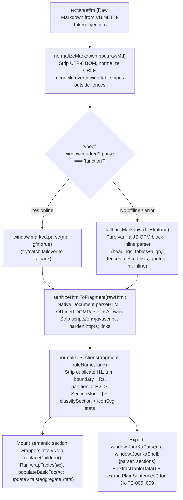

# [JK-FE-004] Role-Agnostic Client-Side Markdown Parser, Offline GFM Fallback & Bilingual Section Normalizer — Implementation Plan

> **Issue / Source:** https://github.com/prayogizan/JourKa/issues/6 (`#6`, retrieved via `github_personal` MCP)
> **Git Branch:** `feat/jk-fe-004-role-agnostic-markdown-parser` *(checked out; up to date with `origin/pre-master` at `aef1fc9`, including merged PR #14 `JK-FE-003`)*
> **Epic:** `EPIC-JK-SHELL` — Interactive HTML Shell, Theme System & Role-Agnostic Parser · **Priority / Points:** `P0 (Blocker / Foundation) / 5 pts`
> **Project Root:** `/Users/ottencoffee/ProjectLabs/Hackathon/JourKa/JourKa` (`D:\UiPathProject\JourKa\JourKa` on Windows Studio host, [project.json](file:///Users/ottencoffee/ProjectLabs/Hackathon/JourKa/JourKa/project.json))
> **Project Type:** `Modern Windows XAML Process` (`targetFramework: Windows`, `dotNetVersion: net10.0`, frontend template asset: 100% self-contained single-file HTML5/CSS/JS)
> **Expression Language:** `VisualBasic` *(no `.xaml` edits in this ticket; 8-token VB.NET `.Replace()` contract preserved verbatim)*
> **Approach:** `explore-first`
> **Execution Autonomy:** `interactive` *(pauses for user approval of this plan before mutating [DossierInteractiveTemplate.html](file:///Users/ottencoffee/ProjectLabs/Hackathon/JourKa/JourKa/Templates/DossierInteractiveTemplate.html))*
> **Delivery Model:** `standalone` *(local Studio / Robot execution; offline `file://` HTML artifact delivery)*
> **Packaging:** `standalone`
> **App Type / App State / UI Targeting:** `N/A (static HTML5 client-side JS parser/normalizer inside single-file template; no UiPath UIA selectors or desktop capture)`
> **Canonical Plan Path:** `JourKa/docs/plans/2026-11-20-jk-fe-004-role-agnostic-markdown-parser.md`

---

## Understanding (`uipath-planner` Header Prelude)

Following the completion of `JK-RPA-001` (#3 / PR #12), `JK-RPA-002` (#4 / PR #13), and `JK-FE-003` (#5 / PR #14), [DossierInteractiveTemplate.html](file:///Users/ottencoffee/ProjectLabs/Hackathon/JourKa/JourKa/Templates/DossierInteractiveTemplate.html) provides the Light/Dark WCAG AA master app shell, sticky `.app-toolbar`, reading progress bar, responsive 2-column desktop / 1-column mobile workspace, Hero Banner with Vital Stats Strip, and `window.JourKaShell` hooks. However, its content pipeline ([DossierInteractiveTemplate.html#L1183-L1204](file:///Users/ottencoffee/ProjectLabs/Hackathon/JourKa/JourKa/Templates/DossierInteractiveTemplate.html#L1183-L1204)) still calls `target.innerHTML = window.marked.parse(rawMd)` directly without HTML sanitization or external link hardening, degrades to raw monospace `<pre>` text whenever `cdn.jsdelivr.net/npm/marked/marked.min.js` is blocked or offline, and produces flat DOM nodes rather than normalized bilingual `SectionModel` objects.

This plan implements the complete client-side parsing, sanitization, normalization, and utility layer inside [DossierInteractiveTemplate.html](file:///Users/ottencoffee/ProjectLabs/Hackathon/JourKa/JourKa/Templates/DossierInteractiveTemplate.html): a Markdown pre-normalizer (BOM stripping + overflowing GFM table-pipe reconciliation discovered across 8 of 14 live dossiers), a dual-engine parser (`window.marked.parse` + pure vanilla JS `fallbackMarkdownToHtml` supporting ATX headings, GFM pipe tables with alignment, fenced code blocks, 2-level mixed/loose lists, blockquotes, horizontal rules, inline formatting, and links), defense-in-depth DOM sanitization (`Document.parseHTML` Sanitizer API + inert `DOMParser` allowlist pruning with `javascript:` stripping and `target="_blank" rel="noopener noreferrer"`), a role-agnostic bilingual `SectionModel` normalizer (`classifySection` verified 114/114 across all 14 EN/ID dossiers including 8-section, 9-section Abroad, unnumbered Indonesian headings, and future `generic` sections), and reusable `extractTableData` and `extractPlainSentences` helpers exposed via `window.JourKaParser` / `window.JourKaShell` for `JK-FE-005` through `JK-FE-009` — with `0` changes to `.xaml`, `.md`, `.pdf`, or `project.json`.

## Decisions & Trade-offs (`uipath-planner` Header Prelude)

- **Why single-file HTML5 template scope only (`0` `.xaml` edits):** All 8 VB.NET tokens (`{{LANG_CODE}}`..`{{MARKDOWN_ENCODED}}`) and `data-jourka-ui="v2"` detection in [Main.xaml](file:///Users/ottencoffee/ProjectLabs/Hackathon/JourKa/JourKa/Main.xaml) and [PublishDossier.xaml](file:///Users/ottencoffee/ProjectLabs/Hackathon/JourKa/JourKa/Workflows/PublishDossier.xaml) already deliver raw Markdown inside `<textarea id="m">`. Keeping `JK-FE-004` strictly inside [DossierInteractiveTemplate.html](file:///Users/ottencoffee/ProjectLabs/Hackathon/JourKa/JourKa/Templates/DossierInteractiveTemplate.html) eliminates RPA regression risk and preserves format isolation.
- **Why skill loading order is `jourka-uipath-rpa` → `jourka-interactive-html` → `modern-web-guidance` → `uipath-review`:** `jourka-uipath-rpa` enforces JourKa invariants and artifact isolation; `jourka-interactive-html` governs the 8-token contract and `JK-FE-004..009` boundaries; `modern-web-guidance` governs current web security and DOM APIs (`sanitize-untrusted-html`, `security`, `icons`, `js`); `uipath-review` validates invariants prior to PR.
- **Why a Markdown pre-normalizer runs before BOTH `marked.parse` and `fallbackMarkdownToHtml`:** Auditing all 14 real dossiers revealed 10 Evidence Register rows across 8 files where YouTube video titles contain unescaped `|` / `||` pipes (producing 6–7 columns in 5-column tables), which causes even CDN `marked.js` to silently drop the clickable YouTube URL cell. Pre-escaping excess interior pipes in overflowing data rows preserves 100% of Evidence Register links under both engines.
- **Why progressive native `Document.parseHTML` + inert `DOMParser` allowlist replaces direct `innerHTML`:** `DossierInteractiveTemplate.html` must stay 100% self-contained offline (`file://`), so external DOMPurify cannot be assumed. Using `Document.parseHTML` when supported and an inert `DOMParser` + strict element/attribute/URL-protocol allowlist fallback — then moving live `Node`s via `document.importNode` and `replaceChildren()` without re-serializing to `innerHTML` — prevents XSS and mutation XSS (mXSS) across all browsers.

---

## 1. Skill Auto-Discovery, Routing & Auto-Creation Gate *(mandatory — execute first)*

Before editing any file during execution, audit `.agents/skills/` against the task's domains:

```powershell
# On Windows Studio host (or verify .agents/skills/ directory on macOS):
powershell -NoProfile -ExecutionPolicy Bypass -File "D:\UiPathProject\JourKa\.agents\skills\jourka-uipath-rpa\scripts\Ensure-UiPathSkills.ps1" -EnsureCore -Audit
```

### 1.1 Active & Required Skills Matrix
| Skill Name | Scope (`.agents/skills/<name>` / Plugin) | Trigger / Role in This Plan | Status (`Loaded` / `Auto-Extract` / `Auto-Create`) |
|---|---|---|---|
| `jourka-uipath-rpa` | [.agents/skills/jourka-uipath-rpa/SKILL.md](file:///Users/ottencoffee/ProjectLabs/Hackathon/JourKa/.agents/skills/jourka-uipath-rpa/SKILL.md) | Master JourKa invariants, format isolation, plan template, `Invoke-JourKaGate.ps1` | `Loaded` |
| `jourka-interactive-html` | [.agents/skills/jourka-interactive-html/SKILL.md](file:///Users/ottencoffee/ProjectLabs/Hackathon/JourKa/.agents/skills/jourka-interactive-html/SKILL.md) | Primary domain skill for `DossierInteractiveTemplate.html`, 8-token contract, `JK-FE-003..009` epic map | `Loaded` |
| `modern-web-guidance` | [modern-web-guidance/SKILL.md](file:///Users/ottencoffee/.gemini/config/plugins/modern-web-guidance-plugin/skills/modern-web-guidance/SKILL.md) | Mandatory web platform guidance (`sanitize-untrusted-html`, `security`, `icons`, `js`) | `Loaded` |
| `uipath-planner` | [.agents/skills/uipath-planner/SKILL.md](file:///Users/ottencoffee/ProjectLabs/Hackathon/JourKa/.agents/skills/uipath-planner/SKILL.md) | Plan & task schema (`Identity` tuples, anti-hallucination prompts, mandatory testing task) | `Loaded` |
| `uipath-rpa` | [.agents/skills/uipath-rpa/SKILL.md](file:///Users/ottencoffee/ProjectLabs/Hackathon/JourKa/.agents/skills/uipath-rpa/SKILL.md) | Reference only — confirms `0` `.xaml` edits and VB.NET `.Replace()` token contract safety | `Loaded` |
| `uipath-review` | [.agents/skills/uipath-review/SKILL.md](file:///Users/ottencoffee/ProjectLabs/Hackathon/JourKa/.agents/skills/uipath-review/SKILL.md) | Read-only quality & invariant verification before PR | `Loaded` |
| `jourka-github-pr` | [.agents/skills/jourka-github-pr/SKILL.md](file:///Users/ottencoffee/ProjectLabs/Hackathon/JourKa/.agents/skills/jourka-github-pr/SKILL.md) | Standardized PR template & `Closes #6` linkage when user requests PR creation | `Loaded` |

### 1.2 Skill Gap Auto-Creation Decision
- **Does this ticket introduce a repeatable workflow, external API, NuGet package, or UI subsystem not covered above?** `No` — all 6 project-local skills plus `modern-web-guidance` cover every parsing, sanitization, normalization, and verification requirement of `JK-FE-004`.

---

## 2. Goal, Epic Boundary & Artifact Isolation *(mandatory)*

- **Outcome in one sentence:** Upgrade [DossierInteractiveTemplate.html](file:///Users/ottencoffee/ProjectLabs/Hackathon/JourKa/JourKa/Templates/DossierInteractiveTemplate.html) with a resilient dual-engine Markdown parser (`window.marked.parse` + pure-JS offline GFM fallback), defense-in-depth DOM sanitizer & link hardener, bilingual role-agnostic `SectionModel` normalizer (8-section, 9-section Abroad, and arbitrary future sections), and reusable table/sentence extraction helpers exposed for downstream `JK-FE-005`..`JK-FE-009` components.
- **In scope (strictly owned by `JK-FE-004` / Issue #6):**
  - Input pre-normalizer (`normalizeMarkdownInput`) stripping UTF-8 BOM (`\uFEFF`), normalizing line endings, and reconciling overflowing GFM pipe-table rows (`|` / `||` inside YouTube titles) so neither engine drops link columns.
  - Dual-engine parser (`parseMarkdown` + `fallbackMarkdownToHtml`): uses `window.marked.parse(rawMd)` when available (with `try/catch` failover) and invokes pure vanilla JS `fallbackMarkdownToHtml(rawMd)` automatically when `typeof window.marked === 'undefined'`, supporting ATX headings (`#`–`####`+), GFM pipe tables with alignment, fenced code blocks with HTML escaping, unordered (`-`, `*`, `+`) and ordered (`1.`) lists including nested 2-level mixed/loose lists, blockquotes (`>`), horizontal rules (`---`), bold (`**`), italic (`*` / `_`), inline code (`` ` ``), strikethrough (`~~`), and links (`[text](https://...)`).
  - Link & DOM sanitization hygiene (`sanitizeHtmlToFragment`): strips `<script>`, dangerous tags, inline `on*` handlers, and unsafe `javascript:` / `vbscript:` / `data:` hrefs; applies `target="_blank" rel="noopener noreferrer"` to all external `http://` / `https://` links; moves sanitized DOM nodes directly without mXSS `innerHTML` re-serialization.
  - Role-agnostic `SectionModel` normalizer (`normalizeSections` + `classifySection(title, index, totalSections)` + `getSectionIconSvg(sectionType)`): strips duplicate leading `<h1>`, trims orphan inter-section `<hr>` dividers, partitions DOM at every `<h2>` into structured `SectionModel` objects (`index`, `id`, `numBadge`, `rawTitle`, `cleanTitle`, `sectionType`, `iconSvg`, `nodes`, `stats: { wordCount, readMins, tableCount, subsectionCount, codeBlockCount }`), accurately classifying 8-section local, 9-section Abroad, unnumbered Indonesian, and future `generic` sections in both EN and ID.
  - Reusable extraction utilities explicitly listed in Issue #6 DoD: `extractTableData(tableEl)` and `extractPlainSentences(source, options)` / `extractPlainText(source, options)` ready for `JK-FE-005`..`JK-FE-008`.
  - Mount normalized `<section id="section-N" data-section-type="...">` containers into `#c`, wire `wrapTables`, `populateBasicToc`, and `updateVitals` from the normalized `SectionModel[]`, and export `window.JourKaParser` (plus attach `parser` and `sections` to `window.JourKaShell`).
- **Out of scope (owned by sibling tickets — do NOT creep into these):**
  - `JK-RPA-001` (#3, merged) & `JK-RPA-002` (#4, merged): Decoupled HTML/PDF pipelines in `Main.xaml` / `PublishDossier.xaml` and in-workflow `If_2.Then` HTML v2 auto-upgrade.
  - `JK-FE-003` (#5, merged): Master HTML app shell, Light/Dark CSS tokens, sticky toolbar, reading progress bar, and responsive layout grid.
  - `JK-FE-005` (#7): Tier 0 dynamic 4-card Executive Bento KPI grid (`.bento-summary`) inside `#bento-root` and KPI UI rendering. *(Only provide `extractTableData` / `extractPlainSentences` / `SectionModel[]`; keep `#bento-root` hidden.)*
  - `JK-FE-006` (#8): Tier 1 collapsed `.dossier-card` section accordions, TL;DR preview strip UI, CSS Grid `0fr -> 1fr` animations, and `sessionStorage` expand memory. *(Sections remain rendered and visible inside `#c` in `JK-FE-004`.)*
  - `JK-FE-007` (#9): Tier 2 Portfolio Blueprint sub-cards, 30/60/90 onboarding phase tabs + `localStorage` checklist, Mentor Deep-Dive expanders, and S1/AI Sentiment callout boxes.
  - `JK-FE-008` (#10): ASCII-to-Stepper `.flow-stepper` converter, inline `[Jxx]`/`[Yxx]`/`[Axx]` citation popovers, and Skills/Evidence table filter bars.
  - `JK-FE-009` (#11): `IntersectionObserver` scrollspy TOC, `Compact Summary ↔ Expand All` toggle wiring, debounced `Ctrl+K` live search + `<mark class="search-hit">`, full cross-widget `I18N`, and `@media print` card-expansion overrides.
- **Immutable Artifacts & Contracts (MUST NOT change):**
  - All 8 VB.NET template tokens in [DossierInteractiveTemplate.html](file:///Users/ottencoffee/ProjectLabs/Hackathon/JourKa/JourKa/Templates/DossierInteractiveTemplate.html): `{{LANG_CODE}}`, `{{DOC_TITLE}}`, `{{ROLE_NAME}}`, `{{BANNER_SUFFIX}}`, `{{META_PILLS_HTML}}`, `{{COUNTERPART_HREF}}`, `{{COUNTERPART_LABEL}}`, `{{MARKDOWN_ENCODED}}`.
  - Exact `<html lang="{{LANG_CODE}}" data-jourka-ui="v2" data-theme="light">` stamp (`Main.xaml` `If_3` Regex contract).
  - Existing `window.JourKaShell` methods (`lang`, `getTheme`, `setTheme`, `updateVitals`, `wrapTables`, `populateBasicToc`, `closeTocDrawer`) and DOM IDs (`#m`, `#c`, `#bento-root`, `#hero-vitals`, `#toc-list`, `#toc-drawer-list`).
  - [JourKa/Main.xaml](file:///Users/ottencoffee/ProjectLabs/Hackathon/JourKa/JourKa/Main.xaml), [JourKa/Workflows/PublishDossier.xaml](file:///Users/ottencoffee/ProjectLabs/Hackathon/JourKa/JourKa/Workflows/PublishDossier.xaml), and [JourKa/project.json](file:///Users/ottencoffee/ProjectLabs/Hackathon/JourKa/JourKa/project.json) — **0 byte changes**.
  - All 14 `.md` files and all 14 `.pdf` files in `JourKa/Output/` plus all 14 `.pdf` files in `PDF_Results/` — **0 byte changes**.

---

## 3. Codebase, Workflow & Activity Discovery *(mandatory — Rule 17 & Rule 21)*

Verified directly against live [DossierInteractiveTemplate.html](file:///Users/ottencoffee/ProjectLabs/Hackathon/JourKa/JourKa/Templates/DossierInteractiveTemplate.html), [project.json](file:///Users/ottencoffee/ProjectLabs/Hackathon/JourKa/JourKa/project.json), and an automated audit of all 14 EN/ID Markdown files across all 7 role directories in `JourKa/Output/`.

### 3.1 Live Codebase Findings
| # | Finding | Verified Location (`file#Lx-Ly`) | Impact on Plan |
|---|---|---|---|
| **F1** | [DossierInteractiveTemplate.html#L1183-L1215](file:///Users/ottencoffee/ProjectLabs/Hackathon/JourKa/JourKa/Templates/DossierInteractiveTemplate.html#L1183-L1215) currently writes `window.marked.parse(rawMd)` directly to `target.innerHTML` with zero HTML sanitization, no external link `rel="noopener noreferrer"`, and only a `<pre class="markdown-fallback">` offline fallback. | [DossierInteractiveTemplate.html#L1183-L1215](file:///Users/ottencoffee/ProjectLabs/Hackathon/JourKa/JourKa/Templates/DossierInteractiveTemplate.html#L1183-L1215) | Replace lines 1183–1215 cleanly with the modular parser/sanitizer/normalizer pipeline while keeping lines 1–1182 shell styling & controllers intact (adding only small CSS rules for table alignment classes and normalized section wrappers). |
| **F2** | Every `.md` file in `JourKa/Output/*/*.md` starts with a UTF-8 BOM (`\uFEFF`) before `# <Role> — Entry-Level Career Dossier (Indonesia)`. | `JourKa/Output/*/*.md` (14/14 files audited) | `normalizeMarkdownInput()` MUST strip leading `\uFEFF` and normalize `\r\n`/`\r` → `\n` before parsing so `# ` heading detection never fails. |
| **F3** | **10 Evidence Register rows across 8 of 14 live dossiers** contain unescaped `|` or `||` inside YouTube titles (e.g., `APOTEKER VLOG \|\| PRODUCTIVE DAY`, `Day In The Life Of A Software Engineer \| Indonesia`), producing 6–7 cells in 5-column tables. Standard GFM (`marked.js`) silently drops cells past column 5, losing the clickable YouTube URL! | [Android Developer - EN.md#L177](file:///Users/ottencoffee/ProjectLabs/Hackathon/JourKa/JourKa/Output/Android%20Developer/Android%20Developer%20-%20EN.md#L177), [Android Engineer - EN.md#L196](file:///Users/ottencoffee/ProjectLabs/Hackathon/JourKa/JourKa/Output/Android%20Engineer/Android%20Engineer%20-%20EN.md#L196), [Apoteker - EN.md#L222](file:///Users/ottencoffee/ProjectLabs/Hackathon/JourKa/JourKa/Output/Apoteker/Apoteker%20-%20EN.md#L222), [Mobile Developer - EN.md#L189](file:///Users/ottencoffee/ProjectLabs/Hackathon/JourKa/JourKa/Output/Mobile%20Developer/Mobile%20Developer%20-%20EN.md#L189) (+ ID counterparts) | `normalizeMarkdownInput()` reconciles overflowing pipe-table rows by escaping interior excess pipes (`\|`) before feeding EITHER `marked.parse` or `fallbackMarkdownToHtml`, preserving 100% of Evidence Register URLs in both online and offline modes. |
| **F4** | **3 Indonesian dossiers omit the numeric prefix on Section 8** (`## Daftar Bukti & Sumber Terverifikasi` with no `8. `), while `Video Editor` EN/ID have 9 sections inserting `## 8. Abroad...` / `## 8. Peluang Kerja Entry-Level di Luar Negeri dengan Sponsor Visa` before `## 9. Verified Evidence...`. | [Android Engineer - ID.md](file:///Users/ottencoffee/ProjectLabs/Hackathon/JourKa/JourKa/Output/Android%20Engineer/Android%20Engineer%20-%20ID.md), [Kotlin Multiplatform - ID.md](file:///Users/ottencoffee/ProjectLabs/Hackathon/JourKa/JourKa/Output/Kotlin%20Multiplatform/Kotlin%20Multiplatform%20-%20ID.md), [Mobile Developer - ID.md](file:///Users/ottencoffee/ProjectLabs/Hackathon/JourKa/JourKa/Output/Mobile%20Developer/Mobile%20Developer%20-%20ID.md), [Video Editor - ID.md](file:///Users/ottencoffee/ProjectLabs/Hackathon/JourKa/JourKa/Output/Video%20Editor/Video%20Editor%20-%20ID.md) | `cleanTitle` strips optional `^\d+\.\s*`, `numBadge` derives deterministically from `1..N`, and bilingual keyword classification verified `114/114` (`100%`) accuracy across all 14 dossiers. |
| **F5** | **106 `---` horizontal rules** act as inter-section dividers directly preceding `<h2>` headings across the 14 dossiers. | [Android Developer - EN.md#L14](file:///Users/ottencoffee/ProjectLabs/Hackathon/JourKa/JourKa/Output/Android%20Developer/Android%20Developer%20-%20EN.md#L14) (and 105 other lines) | `normalizeSections()` trims leading/trailing boundary `<hr>` elements from each section's `nodes` array so downstream Tier 1 accordions (`JK-FE-006`) never render orphan divider bars. |
| **F6** | Real dossiers mix 4 list/inline patterns: (a) loose `<ol>` items separated by blank lines with 3-space nested `*` sub-lists (`Android Engineer`, `Mobile Developer`), (b) 2-space nested `*` lists (`Android Developer`, `Kotlin Multiplatform`), (c) 2-space nested `-` lists (`Apoteker`), and (d) YouTube URLs containing `_axgQk_` (`Mobile Developer`). | [Android Engineer - EN.md#L65-L72](file:///Users/ottencoffee/ProjectLabs/Hackathon/JourKa/JourKa/Output/Android%20Engineer/Android%20Engineer%20-%20EN.md#L65-L72), [Apoteker - EN.md#L188-L193](file:///Users/ottencoffee/ProjectLabs/Hackathon/JourKa/JourKa/Output/Apoteker/Apoteker%20-%20EN.md#L188-L193), [Mobile Developer - EN.md#L62-L69](file:///Users/ottencoffee/ProjectLabs/Hackathon/JourKa/JourKa/Output/Mobile%20Developer/Mobile%20Developer%20-%20EN.md#L62-L69) | `fallbackMarkdownToHtml()` MUST support indent-stack nested lists (`<ul>`/`<ol>` mixed up to 3+ levels, preserving loose `<ol>` numbering across single blank lines) and tokenize inline code + Markdown links *before* emphasis parsing (with CommonMark intraword `_` boundary guard) so URLs are never mangled. |
| **F7** | Sections 3 & 7 often start with fenced ASCII `<pre><code>` blocks (or pure `<ul>` lists with zero `<p>` tags), Section 8/9 (`evidence`) is table-only, and prose contains abbreviations (`Apt.`, `e.g.`, `No.`, `vs.`) + inline citations (`[J01]`, `[J01, J03]`). | [Android Developer - EN.md](file:///Users/ottencoffee/ProjectLabs/Hackathon/JourKa/JourKa/Output/Android%20Developer/Android%20Developer%20-%20EN.md), [Apoteker - ID.md](file:///Users/ottencoffee/ProjectLabs/Hackathon/JourKa/JourKa/Output/Apoteker/Apoteker%20-%20ID.md) | `extractPlainSentences()` skips `<pre>`, `<table>`, headings, and `<hr>`, falls back to `<li>` when no `<p>` exists, protects EN/ID abbreviations during sentence splitting, strips citation brackets cleanly, and returns empty safely on table-only sections. |
| **F8** | Node runtime on macOS PATH defaults to `v12.22.12` (`.nvm`), while Homebrew Node `v25.9.0` is installed at `/opt/homebrew/bin/node`. | Local developer environment | Automated JS unit/integration tests in execution should invoke `/opt/homebrew/bin/node` (or Python/headless browser) cleanly without assuming default PATH is Node ≥ 18. |

### 3.2 Target `InvokeCode` & Workflow Inventory
| Workflow / Template File | Activity `IdRef` / Section | Scope in `JK-FE-004` | In / Out Arguments or Tokens |
|---|---|---|---|
| [JourKa/Templates/DossierInteractiveTemplate.html](file:///Users/ottencoffee/ProjectLabs/Hackathon/JourKa/JourKa/Templates/DossierInteractiveTemplate.html) | `<style>` (minimal table-alignment & section-wrapper utility rules) + `<script>` runtime (`#L1178-L1216`) | **Primary edit target** | Preserves all 8 immutable VB.NET tokens (`{{LANG_CODE}}`..`{{MARKDOWN_ENCODED}}`) and `window.JourKaShell` |
| [JourKa/Main.xaml](file:///Users/ottencoffee/ProjectLabs/Hackathon/JourKa/JourKa/Main.xaml) & [JourKa/Workflows/PublishDossier.xaml](file:///Users/ottencoffee/ProjectLabs/Hackathon/JourKa/JourKa/Workflows/PublishDossier.xaml) | `N/A` | **Read-only reference** (`0` edits) | Verified 8-token `.Replace()` chain & `If_3` `data-jourka-ui="v2"` regex |

### 3.3 NuGet Package & Activity Resolution Gate (`Rule 21`)
- **Dependencies in [JourKa/project.json](file:///Users/ottencoffee/ProjectLabs/Hackathon/JourKa/JourKa/project.json) sufficient?** `Yes` — zero `.xaml` or `.cs` modifications; zero NuGet packages added or updated.
- **New XAML Activities Added:** `None` (`N/A` — pure frontend single-file HTML template deliverable).

---

## 4. UiPath Common Pitfalls, Template Hygiene & Modern Web Vetting Gate *(mandatory — Rule 22)*

Vetted against [.agents/skills/jourka-uipath-rpa/references/invokecode-rules.md](file:///Users/ottencoffee/ProjectLabs/Hackathon/JourKa/.agents/skills/jourka-uipath-rpa/references/invokecode-rules.md), [.agents/skills/jourka-interactive-html/SKILL.md](file:///Users/ottencoffee/ProjectLabs/Hackathon/JourKa/.agents/skills/jourka-interactive-html/SKILL.md), and retrieved `modern-web-guidance` guides (`sanitize-untrusted-html`, `security`, `icons`, `js`):

- [ ] **Exact `v2` Stamp & 8-Token Contract:** `<html lang="{{LANG_CODE}}" data-jourka-ui="v2" data-theme="light">` and all 8 `{{TOKEN}}` placeholders remain intact; zero literal `{{...}}` strings appear inside JS code, regexes, or comments where VB.NET `.Replace()` could collide.
- [ ] **Single-File `file://` Offline Portability:** Zero new external CDN/script/CSS imports (optional `marked.min.js` remains the sole external script tag and is 100% optional via `fallbackMarkdownToHtml`).
- [ ] **Zero Dangerous DOM Sinks & No mXSS Re-Serialization (`sanitize-untrusted-html`, `security`):** Never assign unsanitized parser HTML directly to `target.innerHTML`. Parse through `Document.parseHTML` (when `'parseHTML' in Document`) or inert `new DOMParser().parseFromString(html, 'text/html')` + strict element/attribute/protocol allowlist, then move live nodes via `document.importNode` and `element.replaceChildren(...)` (`js` guide) — never serialize back to HTML and re-parse.
- [ ] **Strict URL Protocol Validation (`security`):** Strip ASCII control characters (`\u0000-\u001F`, `\u007F`) and whitespace before inspecting schemes so obfuscated `java\tscript:` or `data:text/html` hrefs are stripped; apply `target="_blank" rel="noopener noreferrer"` to every external `http://` / `https://` anchor.
- [ ] **Accessible Semantic Inline SVGs (`icons`):** Every `SectionModel.iconSvg` uses `aria-hidden="true" focusable="false"`, `viewBox="0 0 24 24"`, `fill="none"`, `stroke="currentColor"`, `stroke-width="2"` so icons stay hidden from assistive tech when paired with `<h2>` titles and inherit WCAG AA Light/Dark contrast (`>= 3:1`).
- [ ] **Table Alignment Without Inline `style`:** Because the HTML sanitizer strips inline `style` attributes as defense-in-depth, map GFM table alignment (`:---`, `:---:`, `---:`) to safe CSS classes (`col-align-left`, `col-align-center`, `col-align-right`) styled in `<style>` rather than `style="text-align:..."`.
- [ ] **Atomic DOM Updates (`js`):** Use `element.replaceChildren(...)` instead of `element.innerHTML = ''` when clearing/mounting `#c` and `#toc-list` / `#toc-drawer-list`.
- [ ] **Code-Span & Link Token Protection in Fallback Inline Parser:** Tokenize inline code spans and Markdown links *before* `**bold**` / `*italic*` / `_italic_` parsing and guard `_..._` against intraword underscores (`_axgQk_`, `snake_case`) so URLs and identifiers are never corrupted.

---

## 5. Issue Gaps, Ambiguities, Decisions & Stop Conditions *(mandatory)*

### 5.1 Gaps & Decisions
| # | Gap / Ambiguity / Contradiction | Decision Taken & Rationale | Needs User Input? |
|---|---|---|---|
| **D1** | **Template-only edit vs. re-backfilling the 14 existing `JourKa/Output/*/*.html` files:** Issue #6 lists `JourKa/Templates/DossierInteractiveTemplate.html` as the sole Target File; `JK-FE-003` kept `JourKa/Output/` untouched and verified rendered previews in git-ignored `JourKa/.local/preview/`. | **Default:** Edit **only** [DossierInteractiveTemplate.html](file:///Users/ottencoffee/ProjectLabs/Hackathon/JourKa/JourKa/Templates/DossierInteractiveTemplate.html) in `JK-FE-004` and generate rendered online + offline test fixtures in git-ignored `JourKa/.local/preview/` so `JourKa/Output/` stays clean until the frontend epic (`JK-FE-003..009`) completes (unless user explicitly requests backfilling all 14 `.html` outputs now). | `Optional (default: Template only)` |
| **D2** | **Positional heuristics vs. `generic` fallback in `classifySection(title, index, totalSections)`:** Issue #6 specifies *"Matches English and Indonesian keywords + positional heuristics"* AND *"`generic`: Fallback for any new/custom section added in future prompts so zero content is ever lost."* Blindly mapping any unmatched title by index would swallow custom future sections instead of returning `'generic'`. | Run bilingual EN/ID keyword regexes first (verified `114/114` = `100%` match across all 14 real dossiers). Apply positional heuristics **only** when a heading is uninformative/numeric-only or uses generic short labels (e.g., `"Overview"` / `"Summary"` at `index === 1`, `"Sources"` / `"References"` at `index === totalSections`, or `"International"` at `index === 8` when `totalSections === 9`). Any novel domain title (e.g., `"9. Interview Preparation & Whiteboarding"`) falls through cleanly to `'generic'`. | `No` |
| **D3** | **Unescaped pipes (`\|` / `\|\|`) inside YouTube titles breaking 5-column Evidence Register tables in 8 of 14 dossiers:** Standard GFM (`marked.js`) truncates extra cells past column 5, dropping `[Watch on YouTube](...)`. | Add a deterministic table-row normalizer inside `normalizeMarkdownInput(rawMd)` (skipping fenced code blocks) that reconciles any pipe-table row with `cells.length > headerColCount` by escaping excess interior pipes (`\|`) in the title column (`[2 .. N - (colCount - 2)]` when `colCount >= 4` and last cell has a link or `colCount === 5`; otherwise merging overflow into the final cell). Fixes **both** `marked` and `fallbackMarkdownToHtml` without touching `.md` files. | `No` |
| **D4** | **Sanitizer API availability vs. single-file `file://` portability:** `modern-web-guidance` recommends `Document.parseHTML()` (Chrome 146+, Edge 146+, Firefox 148+; unsupported in Safari) with DOMPurify as fallback, whereas JourKa forbids external runtime dependencies for offline `file://` portability. | Implement progressive two-tier sanitization: use native `Document.parseHTML(rawHtml, { sanitizer: allowlistConfig })` when `'parseHTML' in Document`, and fall back to an inert `new DOMParser().parseFromString(rawHtml, 'text/html')` + strict element/attribute/URL-protocol allowlist tree-pruner (0 external deps), importing sanitized nodes directly into a `DocumentFragment`. | `No` |
| **D5** | **Rendering normalized `SectionModel[]` in `#c` before `JK-FE-006` accordions exist:** `JK-FE-004` partitions DOM into `SectionModel[]` while `JK-FE-006` owns collapsed Tier 1 `.dossier-card` accordions. | Mount each `SectionModel` into `#c` as a clean semantic `<section id="section-N" class="dossier-section" data-section-type="..." data-section-index="N">` containing its `headingEl` (`<h2>`) and `nodes` (fully visible, preserving `JK-FE-003` visual appearance and TOC navigation), and expose the canonical `SectionModel[]` via `window.JourKaParser.getSections()` + `window.JourKaShell.sections` so `JK-FE-005`..`JK-FE-009` can upgrade them in place without re-parsing Markdown. | `No` |
| **D6** | **Handling preamble or heading-less Markdown in future Gemini runs:** What if a future prompt emits prose before the first `<h2>` or omits `<h2>` headings altogether? | Strip only a leading `<h1>` duplicating/representing the document title. Any non-`<h1>`, non-`<hr>` preamble nodes are preserved (attached as `preambleNodes` and mounted cleanly above `section-1`). If `0` `<h2>` headings exist, wrap all sanitized nodes in a single fallback `SectionModel` (`index: 1`, `id: 'section-1'`, `sectionType: 'generic'`) so zero content is ever lost. | `No` |

### 5.2 Stop Conditions / Re-plan Triggers
Execution pauses and hands back to the planner/user if any of these hard blockers occur:
- Any change would require mutating `.xaml`, `.md`, `.pdf`, or `project.json` (violating `JK-FE-004` format isolation).
- Offline `fallbackMarkdownToHtml()` output diverges structurally from `marked.parse()` on any of the 14 real dossiers in a way that breaks headings (`h2`–`h4`), GFM table cell counts/links, fenced `<pre><code>` blocks, or 2-level nested lists (including `JK-FE-007` Pattern B `<li>` + nested `<ul>` structures).
- Any XSS sanitization probe (`<script>`, ``, `<svg onload>`, `[x](javascript:alert(1))`, `[x](java\tscript:alert(1))`, `data:text/html`) survives into the live `#c` DOM.
- `classifySection()` fails to achieve `114/114` (`100%`) accuracy across all 14 EN/ID dossiers or misclassifies synthetic future custom headings away from `'generic'`.
- `git diff --stat` contains any file outside §7 Change Manifest.

---

## 6. Technical Design, Data Contracts & Failure Modes *(mandatory)*

### 6.1 Architecture & Data-Flow Diagram


### 6.2 Module, Schema & API Contracts

#### A. `SectionModel` Schema (Exact Issue #6 Contract)
| Property | Type | Exact Specification |
|---|---|---|
| `index` | `number` | 1-based sequential section number (`1..N`) |
| `id` | `string` | `'section-' + index` (e.g., `'section-1'`) |
| `numBadge` | `string` | Zero-padded 2-digit string (`'01'`..`'09'`, or `'10'`+) |
| `rawTitle` | `string` | Trimmed original `<h2>` text (e.g., `'1. Role Description & Executive Overview'` or `'Daftar Bukti & Sumber Terverifikasi'`) |
| `cleanTitle` | `string` | `rawTitle.replace(/^\d+\.\s*/, '').trim()` |
| `sectionType` | `string` | One of: `'overview' \| 'skills' \| 'roadmap' \| 'routine' \| 'salary' \| 'guidance' \| 'onboarding' \| 'abroad' \| 'evidence' \| 'generic'` |
| `iconSvg` | `string` | Self-contained `<svg aria-hidden="true" focusable="false" viewBox="0 0 24 24" fill="none" stroke="currentColor" stroke-width="2" ...>...</svg>` mapped 1:1 from `sectionType` |
| `headingEl` | `HTMLHeadingElement` | Sanitized `<h2>` element stamped with `id = section.id` and `data-section-type = section.sectionType` |
| `nodes` | `Node[]` | Ordered array of sanitized body DOM nodes belonging to this section (boundary `<hr>` dividers trimmed) |
| `stats` | `object` | `{ wordCount: number, readMins: number, tableCount: number, subsectionCount: number, codeBlockCount: number }` where `readMins = Math.max(1, Math.round(wordCount / 220))`, `subsectionCount` counts `h3, h4`, and `codeBlockCount` counts `pre` |

#### B. Bilingual `classifySection(title, index, totalSections)` Decision Table
| Priority | `sectionType` | Bilingual Keyword Regex (Case-Insensitive, tested on `cleanTitle`) | Positional Fallback Guardrail (Only if ALL keyword rules miss) |
|---|---|---|---|
| 1 | `evidence` | `/verified\s+evidence\|source\s+register\|daftar\s+bukti\|sumber\s+terverifikasi/i` | Short generic title (`/^(sources?\|references?\|bukti\|referensi)$/i`) when `index === totalSections` |
| 2 | `abroad` | `/abroad\|visa\s+sponsorship\|luar\s+negeri\|sponsor\s+visa/i` | Short generic title (`/^(international\|global\|overseas)$/i`) when `totalSections >= 9 && index === totalSections - 1` |
| 3 | `onboarding` | `/30\s*\/\s*60\s*\/\s*90\|onboarding\|rencana\s+aksi/i` | Numeric-only title when `index === 7 && totalSections >= 8` |
| 4 | `overview` | `/role\s+description\|executive\s+overview\|deskripsi\s+peran\|ringkasan\s+eksekutif/i` | Short generic title (`/^(overview\|summary\|introduction\|ringkasan\|pendahuluan)$/i`) when `index === 1` |
| 5 | `skills` | `/skillset\|competenc\|tech\s+stack\|kebutuhan\s+kompetensi\|keahlian/i` | Short generic title (`/^(skills?\|kompetensi)$/i`) when `index === 2` |
| 6 | `roadmap` | `/what\s+you\s+need\s+to\s+learn\|roadmap\|portfolio\|peta\s+jalan\s+belajar\|proyek\s+portofolio/i` | Short generic title (`/^(learning\|curriculum\|kurikulum)$/i`) when `index === 3` |
| 7 | `routine` | `/daily\s+routine\|day\s+in\s+the\s+life\|rutinitas\s+harian\|keseharian\s+kerja/i` | Short generic title (`/^(routine\|schedule\|rutinitas)$/i`) when `index === 4` |
| 8 | `salary` | `/salar\|progression\|compensation\|estimasi\s+gaji\|perjalanan\s+karier\|kompensasi/i` | Short generic title (`/^(pay\|gaji\|karier)$/i`) when `index === 5` |
| 9 | `guidance` | `/career\s+guidance\|\bpros\b\|ai\s+sentiment\|panduan\s+karier\|sentimen\s+ai\|\bpro,\s*kontra\b/i` | Short generic title (`/^(guidance\|realities\|panduan)$/i`) when `index === 6` |
| 10 | `generic` | Default fallback for all unrecognized/custom future sections | Always preserves section content without loss |

#### C. Reusable Downstream Utility & Global API Contract (`window.JourKaParser`)
| Exported Symbol | Signature | Return Value & Downstream Consumer |
|---|---|---|
| `normalizeMarkdownInput` | `(rawMd: string) => string` | BOM-stripped, `\n`-normalized Markdown with overflowing GFM table-row pipes reconciled |
| `fallbackMarkdownToHtml` | `(rawMd: string) => string` | Pure-JS offline GFM HTML string (headings, aligned pipe tables, fenced code blocks, nested 2-level mixed/loose lists, blockquotes, HRs, inline formatting & links) |
| `parseMarkdown` | `(rawMd: string, opts?: { forceFallback?: boolean }) => { html: string, engine: 'marked' \| 'fallback' }` | Dual-engine parser with `try/catch` failover and deterministic offline testability (`forceFallback: true`) |
| `sanitizeHtmlToFragment` | `(rawHtml: string) => DocumentFragment` | Defense-in-depth sanitized fragment (`Document.parseHTML` or inert `DOMParser` allowlist), unsafe protocols stripped, external `http(s)` links hardened with `target="_blank" rel="noopener noreferrer"` |
| `classifySection` | `(title: string, index?: number, totalSections?: number) => SectionType` | Deterministic bilingual semantic classifier |
| `getSectionIconSvg` | `(sectionType: SectionType) => string` | Accessible (`aria-hidden="true"`) inline SVG icon string for `JK-FE-006` cards & `JK-FE-009` TOC |
| `normalizeSections` | `(fragment: DocumentFragment \| Element, opts?: { roleName?: string, lang?: string }) => { sections: SectionModel[], preambleNodes: Node[], stats: { sections: number, wordCount: number, readMins: number, sources: number } }` | Partitions sanitized DOM into `SectionModel[]` and computes exact document vitals |
| `extractTableData` | `(tableOrContainer: Element \| SectionModel) => { headers: string[], normalizedHeaders: string[], rows: Array<{ cells: string[], htmlCells: string[], links: Array<{ text: string, href: string, colIndex: number }>, byHeader: Record<string, string>, rowEl: HTMLTableRowElement }>, rowCount: number, colCount: number }` | Used by `JK-FE-005` (Skills, Salary, Evidence Bento KPIs) and `JK-FE-008` (`evidenceMap` + filterable Skills/Evidence tables) |
| `extractPlainSentences` | `(source: SectionModel \| Node[] \| Element \| string, opts?: { maxSentences?: number, maxChars?: number, stripCitations?: boolean, fallbackToList?: boolean }) => { text: string, sentences: string[], truncated: boolean }` | Abbreviation-safe, citation-clean sentence extractor used by `JK-FE-006` TL;DR preview strips and `JK-FE-005` S1/D4 context snippet |
| `extractPlainText` | `(source: SectionModel \| Node[] \| Element \| string, opts?: { stripCitations?: boolean }) => string` | Normalized plain text extractor for stats, search indexing (`JK-FE-009`), and snippets |
| `getSections` / `engine` | `() => SectionModel[]` / `'marked' \| 'fallback'` | Exposes parsed state for `JK-FE-005..009`; also mirrored onto `window.JourKaShell.sections` and `window.JourKaShell.parser` |

#### D. HTML Sanitizer Allowlist Matrix
| Category | Permitted | Stripped / Neutralized |
|---|---|---|
| **Elements** | `h1`, `h2`, `h3`, `h4`, `h5`, `h6`, `p`, `br`, `hr`, `ul`, `ol`, `li`, `blockquote`, `pre`, `code`, `table`, `thead`, `tbody`, `tfoot`, `tr`, `th`, `td`, `strong`, `b`, `em`, `i`, `del`, `s`, `a`, `span`, `div`, `sup`, `sub` | `script`, `style`, `iframe`, `object`, `embed`, `svg`, `math`, `form`, `input`, `button`, `textarea`, `select`, `meta`, `link`, `base`, `template`, `noscript` (removed with entire subtree) |
| **Attributes** | Global: `id`, `class`, `title`; Table: `colspan`, `rowspan`; Ordered list: `start`; Anchor: `href`, `target`, `rel` | All `on*` event handlers, `style`, `src`, `srcdoc`, `formaction`, `xlink:href`, `data-*` from untrusted MD |
| **Anchor `href` Schemes** | `http:`, `https:`, `mailto:`, `#fragment`, safe relative paths (no scheme prefix) | `javascript:`, `vbscript:`, `data:`, `blob:`, `file:` (including whitespace/control-char obfuscated variants) → `href` removed |

### 6.3 Failure Modes & Degraded-Mode Fallbacks
| Failure Scenario | Detection | Recovery / Fallback Behavior | Observable Signal |
|---|---|---|---|
| CDN `marked.min.js` blocked, offline, or throws runtime error | `typeof window.marked === 'undefined'` OR `typeof window.marked.parse !== 'function'` OR `try/catch` catches exception | Automatically invokes `fallbackMarkdownToHtml(normalizedMd)` and runs the exact same sanitizer + `SectionModel` normalizer pipeline | `window.JourKaParser.engine === 'fallback'`; full headings, tables, nested lists, fences, links, TOC, and vitals render with `0` console errors |
| Unescaped `|` / `||` inside GFM table cell (e.g., YouTube titles) | Pipe-table row cell count `> headerColCount` inside `normalizeMarkdownInput` | Reconciles overflowing middle cells with `\|` before parsing | `extractTableData` returns exact `colCount === 5` and non-empty YouTube `href` on all 10 affected rows across 8 real dossiers |
| Malicious HTML / XSS payload embedded in Markdown (`<script>`, ``, `javascript:`) | `Document.parseHTML` allowlist OR inert `DOMParser` allowlist walker + protocol check | Strips unsafe elements, `on*` attributes, and non-allowlisted `href` schemes before nodes enter live DOM | `0` `<script>` tags, `0` `on*` attributes, `0` `javascript:` hrefs in `#c`; `0` alerts/executions |
| Unclosed fenced code block (` ``` `) at end of truncated Markdown | EOF reached while `inFence === true` inside `fallbackMarkdownToHtml` | Flushes accumulated escaped lines into a closed `<pre><code>...</code></pre>` | Zero crash; remaining content preserved cleanly |
| Future role with 0 `<h2>` headings or custom 10th section | `sections.length === 0` or unmatched `<h2>` title | Wraps heading-less content in single `generic` section; maps unknown `<h2>` titles to `sectionType: 'generic'` with neutral document SVG icon | `0` lost nodes; valid `SectionModel` array returned |
| Empty or whitespace-only `<textarea id="m">` | `!rawMd.trim()` | Returns `sections: []`, renders clean empty `#c`, `updateVitals({ sections: 0, readMins: 0, sources: 0 })` without `NaN` | `0` uncaught exceptions |

---

## 7. Strict Change Manifest *(mandatory)*

Every file to be created or edited. `git diff --stat` at completion must be a strict subset of this table (`0` `.xaml`, `0` `.md`, `0` `.pdf`, `0` `project.json` files modified).

| File Path | Action (`new` / `edit` / `delete`) | Node / Section | Summary of Change |
|---|---|---|---|
| `JourKa/docs/plans/2026-11-20-jk-fe-004-role-agnostic-markdown-parser.md` | `new` | Full plan artifact | Canonical `uipath-planner` Non-PDD plan & tasks file saved in `JourKa/docs/plans/` |
| [JourKa/Templates/DossierInteractiveTemplate.html](file:///Users/ottencoffee/ProjectLabs/Hackathon/JourKa/JourKa/Templates/DossierInteractiveTemplate.html) | `edit` | `<style>` (table-alignment & `.dossier-section` utility rules) + `<script>` runtime (`#L1178-L1216`) | Add `normalizeMarkdownInput`, dual-engine `parseMarkdown` + pure-JS `fallbackMarkdownToHtml`, progressive `sanitizeHtmlToFragment` + external link hardener, bilingual `SectionModel` normalizer (`classifySection`, 10 semantic `iconSvg` icons, `normalizeSections`), `extractTableData` & `extractPlainSentences` helpers, and wire into `#c` / TOC / Hero vitals / `window.JourKaParser` & `window.JourKaShell` |

*(Temporary verification fixtures and Node/browser test scripts MUST be written strictly to git-ignored `JourKa/.local/preview/` and never committed.)*

---

## 8. Turn-Budgeted Implementation Tasks (`uipath-planner` Schema) *(mandatory)*

### Task T0 — `jourka-uipath-rpa` — Persist Canonical Plan, Audit Skills & Snapshot Template Baseline
**Identity:** `jourka-uipath-rpa:JourKa:jk-fe-004-skills-and-baseline`
**Status:** `[ ] pending`
**Blocked by:** `none`
**Skill prompt:**
> Load `jourka-uipath-rpa` and `jourka-interactive-html`. Save this canonical plan to `JourKa/docs/plans/2026-11-20-jk-fe-004-role-agnostic-markdown-parser.md`, confirm all 6 project-local skills exist in `.agents/skills/`, confirm clean git status on `feat/jk-fe-004-role-agnostic-markdown-parser`, and snapshot the current `JourKa/Templates/DossierInteractiveTemplate.html` baseline into git-ignored `JourKa/.local/preview/DossierInteractiveTemplate__before_fe004.html`. Use values, mappings, and structure exactly as documented in the plan at `JourKa/docs/plans/2026-11-20-jk-fe-004-role-agnostic-markdown-parser.md`. Do not infer or guess.

- [ ] Write canonical plan file `JourKa/docs/plans/2026-11-20-jk-fe-004-role-agnostic-markdown-parser.md`.
- [ ] Verify all 6 project-local skills exist in `.agents/skills/` (`jourka-uipath-rpa`, `jourka-interactive-html`, `uipath-planner`, `uipath-rpa`, `uipath-review`, `jourka-github-pr`) and confirm current branch is `feat/jk-fe-004-role-agnostic-markdown-parser`.
- [ ] Snapshot baseline [JourKa/Templates/DossierInteractiveTemplate.html](file:///Users/ottencoffee/ProjectLabs/Hackathon/JourKa/JourKa/Templates/DossierInteractiveTemplate.html) to git-ignored `JourKa/.local/preview/DossierInteractiveTemplate__before_fe004.html`.
- [ ] **Validate:** Plan file exists at `JourKa/docs/plans/2026-11-20-jk-fe-004-role-agnostic-markdown-parser.md` and `git status --short` shows only the new plan file (confirming `JourKa/.local/preview/` is git-ignored).

### Task T1 — `jourka-interactive-html` — Implement Markdown Pre-Normalizer & Pure-JS Offline GFM Parser (`fallbackMarkdownToHtml`)
**Identity:** `jourka-interactive-html:JourKa:Templates/DossierInteractiveTemplate.html:dual-parser`
**Status:** `[ ] pending`
**Blocked by:** `T0`
**Skill prompt:**
> Load `jourka-interactive-html`. Inside `JourKa/Templates/DossierInteractiveTemplate.html`, implement `normalizeMarkdownInput(rawMd)`, the pure vanilla JS offline GFM parser `fallbackMarkdownToHtml(rawMd)`, and the dual-engine dispatcher `parseMarkdown(rawMd, opts)` (`window.marked.parse` primary with `try/catch` failover to `fallbackMarkdownToHtml`), plus minimal CSS rules for `.col-align-left`, `.col-align-center`, `.col-align-right` and `.dossier-section`. Preserve all 8 immutable VB.NET tokens (`{{LANG_CODE}}`..`{{MARKDOWN_ENCODED}}`) and zero literal `{{...}}` collisions. Use values, mappings, and structure exactly as documented in the plan at `JourKa/docs/plans/2026-11-20-jk-fe-004-role-agnostic-markdown-parser.md`. Do not infer or guess.

- [ ] Add `normalizeMarkdownInput(rawMd)` stripping leading `\uFEFF`, normalizing `\r\n`/`\r` → `\n`, and reconciling overflowing pipe-table data rows outside fenced code blocks (`cells.length > headerColCount` → escape interior excess pipes as `\|`) so all 10 affected YouTube Evidence Register rows preserve their URL column under both `marked` and fallback.
- [ ] Implement block-level `fallbackMarkdownToHtml(rawMd)` supporting:
  1. Fenced code blocks (` ``` ` / `~~~` with optional language class and full HTML escaping, safely closing unclosed EOF fences).
  2. ATX headings (`#`–`######`, stripping trailing `#`s).
  3. Horizontal rules (`---`, `***`, `___`).
  4. Multi-line blockquotes (`>`).
  5. GFM pipe tables (header row + `:---`/`:---:`/`---:` alignment row mapped to safe `col-align-*` classes + data rows honoring escaped `\|`).
  6. Unordered (`-`, `*`, `+`) and ordered (`1.`, `1)`) lists with multi-level indentation stack (`2`–`4`+ spaces), mixed `<ol>` + nested `<ul>` nesting, and loose-list continuity across single blank lines.
  7. Paragraphs joining soft-wrapped lines cleanly until blank line or block boundary.
- [ ] Implement inline formatter inside `fallbackMarkdownToHtml` with strict token protection order: extract & escape inline code spans first → extract Markdown links `[text](url)` (with balanced parens and formatted link label) → HTML-escape raw text → apply `**bold**` / `__bold__`, `~~del~~`, `*italic*` / `_italic_` (with CommonMark intraword `_` guard so YouTube IDs like `_axgQk_` are untouched) → restore tokens.
- [ ] Implement `parseMarkdown(rawMd, opts)` invoking `window.marked.parse(normalizedMd, { gfm: true, breaks: false })` inside `try/catch` when available (and `!opts?.forceFallback`), falling back deterministically to `fallbackMarkdownToHtml(normalizedMd)`.
- [ ] Add `.col-align-left`, `.col-align-center`, `.col-align-right`, and `.dossier-section` minimal CSS rules to `<style>` in [DossierInteractiveTemplate.html](file:///Users/ottencoffee/ProjectLabs/Hackathon/JourKa/JourKa/Templates/DossierInteractiveTemplate.html).
- [ ] **Validate:** Extract inline parser JS and run automated checks via `/opt/homebrew/bin/node` against all 14 `.md` files in `JourKa/Output/` confirming zero runtime throws, accurate heading/table/fence/nested-list counts, zero corrupted `_axgQk_` links, and exact 5-column preservation on all 10 overflowing Evidence Register rows.

### Task T2 — `jourka-interactive-html` — Implement Defense-in-Depth DOM Sanitizer & External Link Hardening
**Identity:** `jourka-interactive-html:JourKa:Templates/DossierInteractiveTemplate.html:sanitizer-and-links`
**Status:** `[ ] pending`
**Blocked by:** `T1`
**Skill prompt:**
> Load `jourka-interactive-html` and follow `modern-web-guidance` (`sanitize-untrusted-html`, `security`, `js`). Implement `isSafeHref(href)` and `sanitizeHtmlToFragment(rawHtml)` inside `JourKa/Templates/DossierInteractiveTemplate.html` using native `Document.parseHTML()` with custom allowlist config when available and an inert `DOMParser` + strict element/attribute/protocol allowlist fallback otherwise, hardening all external `http://`/`https://` links with `target="_blank" rel="noopener noreferrer"` and returning a live `DocumentFragment` without re-serializing to `innerHTML`. Use values, mappings, and structure exactly as documented in the plan at `JourKa/docs/plans/2026-11-20-jk-fe-004-role-agnostic-markdown-parser.md`. Do not infer or guess.

- [ ] Implement `isSafeHref(rawHref)` stripping ASCII control chars (`\u0000-\u001F`, `\u007F`) and outer whitespace, permitting strictly `http:`, `https:`, `mailto:`, `#` fragments, and scheme-less relative URLs; rejecting `javascript:`, `vbscript:`, `data:`, `blob:`, and `file:`.
- [ ] Implement `sanitizeHtmlToFragment(rawHtml)` with progressive two-tier execution:
  1. Primary: `Document.parseHTML(rawHtml, { sanitizer: SANITIZER_CONFIG })` when `typeof Document !== 'undefined' && 'parseHTML' in Document`.
  2. Universal offline fallback: `new DOMParser().parseFromString(rawHtml, 'text/html')` followed by recursive allowlist pruning per §6.2.D (removing dangerous subtrees like `<script>`, `<style>`, `<iframe>`, `<svg>`, `<object>`, `<embed>`, `<form>`, `<template>`, and stripping all `on*` and `style` attributes).
- [ ] Walk all surviving `<a>` elements in the sanitized tree: strip unsafe `href` attributes (via `isSafeHref`); on all `^https?://` links, enforce `target="_blank"` and `rel="noopener noreferrer"`.
- [ ] Import sanitized child nodes via `document.importNode(child, true)` into a returned `DocumentFragment` (zero `innerHTML` re-serialization).
- [ ] **Validate:** Run XSS sanitization unit suite covering `<script>alert(1)</script>`, ``, `<svg onload=alert(1)>`, `[click](javascript:alert(1))`, `[click](java\tscript:alert(1))`, `<a href="data:text/html,...">`, and legitimate `https://` links confirming 100% neutralization of unsafe payloads and 100% `target="_blank" rel="noopener noreferrer"` on external links.

### Task T3 — `jourka-interactive-html` — Implement Bilingual `SectionModel` Normalizer, Utility Helpers & Shell Integration
**Identity:** `jourka-interactive-html:JourKa:Templates/DossierInteractiveTemplate.html:normalizer-and-helpers`
**Status:** `[ ] pending`
**Blocked by:** `T2`
**Skill prompt:**
> Load `jourka-interactive-html` and follow `modern-web-guidance` (`icons`, `js`). Implement `classifySection(title, index, totalSections)`, `getSectionIconSvg(sectionType)` (10 accessible `aria-hidden="true"` `currentColor` SVGs), `normalizeSections(fragment, opts)`, `extractTableData(tableOrContainer)`, `extractPlainSentences(source, opts)`, and `extractPlainText(source, opts)` inside `JourKa/Templates/DossierInteractiveTemplate.html`. Wire the full parse → sanitize → normalize → mount pipeline into `#c` using `replaceChildren()`, update TOC & Hero vitals from `SectionModel[]`, and export `window.JourKaParser` plus `window.JourKaShell.{parser, sections}`. Do not build `JK-FE-005..009` UI widgets. Use values, mappings, and structure exactly as documented in the plan at `JourKa/docs/plans/2026-11-20-jk-fe-004-role-agnostic-markdown-parser.md`. Do not infer or guess.

- [ ] Implement `classifySection(title, index, totalSections)` matching the exact bilingual priority table in §6.2.B (handling 8-section local, 9-section Abroad, unnumbered Indonesian headings, conservative positional tie-breakers, and `'generic'` fallback).
- [ ] Implement `getSectionIconSvg(sectionType)` returning 10 distinct stroke-based inline SVG strings (`aria-hidden="true" focusable="false"`, `viewBox="0 0 24 24"`, `fill="none"`, `stroke="currentColor"`, `stroke-width="2"`) for all 10 `sectionType` values.
- [ ] Implement `normalizeSections(fragment, opts)`:
  - Remove duplicate leading `<h1>`.
  - Preserve any substantive preamble nodes before the first `<h2>`.
  - Partition at every `<h2>` into `SectionModel` objects matching §6.2.A (`index`, `id`, `numBadge`, `rawTitle`, `cleanTitle`, `sectionType`, `iconSvg`, `headingEl`, `nodes`, `stats: { wordCount, readMins, tableCount, subsectionCount, codeBlockCount }`), trimming orphan boundary `<hr>` dividers from `nodes`.
  - Handle heading-less Markdown (`0` `<h2>` elements) via single `generic` fallback section so zero content is ever lost.
- [ ] Implement reusable helpers for `JK-FE-005`..`JK-FE-009`:
  - `extractTableData(tableOrContainer)` returning `{ headers, normalizedHeaders, rows: [{ cells, htmlCells, links, byHeader, rowEl }], rowCount, colCount }`.
  - `extractPlainSentences(source, opts)` and `extractPlainText(source, opts)` skipping `<pre>`/`<table>`/headings/`<hr>`, falling back to `<li>` when no `<p>` exists, protecting EN/ID abbreviations (`Apt.`, `e.g.`, `i.e.`, `Dr.`, `No.`, `vs.`, `Rp.`, `S.Farm.`, `S.Kom.`, `etc.`, `dll.`, `dst.`, `dkk.`), stripping `[Jxx]`/`[Yxx]`/`[Axx]` citations cleanly, and truncating on word boundaries.
- [ ] Replace the placeholder render block ([DossierInteractiveTemplate.html#L1183-L1215](file:///Users/ottencoffee/ProjectLabs/Hackathon/JourKa/JourKa/Templates/DossierInteractiveTemplate.html#L1183-L1215)) with the full pipeline: mount `<section id="section-N" class="dossier-section" data-section-type="..." data-section-index="N">` into `#c` via `replaceChildren(...)`, call `wrapTables(target)`, `populateBasicToc(target)`, and `updateVitals(...)`, and expose `window.JourKaParser` + `window.JourKaShell.{parser, sections}`.
- [ ] **Validate:** Render test fixtures in `JourKa/.local/preview/` via the exact 8-token VB.NET `.Replace()` chain for all 7 roles × 2 languages (14 fixtures) plus synthetic offline/XSS/custom-section fixtures; verify `0` unreplaced `{{...}}` tokens and `data-jourka-ui="v2"` regex match.

### Task T4 — `jourka-interactive-html` — Testing & Multi-Layer Verification (MANDATORY)
**Identity:** `jourka-interactive-html:JourKa:jk-fe-004-testing`
**Status:** `[ ] pending`
**Blocked by:** `T1, T2, T3`
**Skill prompt:**
> Load `jourka-interactive-html`, `jourka-uipath-rpa`, and `uipath-review` and run the full verification workflow end-to-end across Layers L1–L7 in §9 of the plan: happy path (online `marked`), offline fallback (`cdn.jsdelivr.net` blocked / `marked` absent), all 14 EN/ID dossiers (8-section tech, non-tech healthcare `Apoteker`, nested-list `Kotlin Multiplatform` / `Android Engineer`, 9-section Abroad `Video Editor`), synthetic future-role & adversarial XSS edge cases, utility helper assertions (`extractTableData`, `extractPlainSentences`), UiPath 8-token/Regex compatibility, and strict format-isolation invariants. Use values, mappings, and structure exactly as documented in the plan at `JourKa/docs/plans/2026-11-20-jk-fe-004-role-agnostic-markdown-parser.md`. Do not infer or guess.

- [ ] Run **L1 & L2** automated contract + unit test harness (via `/opt/homebrew/bin/node` + Python) verifying 8-token replacement across all 14 `.md` files, `data-jourka-ui="v2"` Regex match, `114/114` section classification, online vs. offline DOM structural parity (headings, tables, links, nested lists, code blocks), `extractTableData` (including all 10 pipe-overflow Evidence Register rows), `extractPlainSentences` (abbreviations, citations, `<pre>` skip, `<li>` fallback, table-only section), and XSS sanitization vectors.
- [ ] Run **L3 & L4** live browser verification (headless Chrome / browser subagent) on `file://` preview fixtures in `JourKa/.local/preview/`:
  - **AC-1 (Offline rendering):** Open offline-simulated fixtures (blocking/removing `marked.min.js`) for `Android Developer` (EN/ID), `Kotlin Multiplatform` (EN), `Apoteker` (ID), and `Video Editor` (EN/ID); confirm `window.JourKaParser.engine === 'fallback'`, `0` console errors, accurate GFM tables, nested 2-level lists, fenced code blocks, and clickable external links with `target="_blank" rel="noopener noreferrer"`.
  - **AC-2 (8-section vs. 9-section EN/ID normalizer):** Inspect `window.JourKaParser.getSections()` in live browser on `Android Developer` (EN/ID, 8 sections), `Apoteker` (EN/ID, 8 sections), `Kotlin Multiplatform` (EN/ID, 8 sections), and `Video Editor` (EN/ID, 9 sections with `abroad` at #8 and `evidence` at #9); confirm `100%` accurate `sectionType`, `numBadge`, `cleanTitle`, `iconSvg`, `stats.wordCount`, `stats.readMins`, `stats.tableCount`, `stats.subsectionCount`, and `stats.codeBlockCount`.
- [ ] Run **L5** edge-case & visual-regression proof: verify `JK-FE-003` shell features (Light/Dark toggle, sticky `.app-toolbar`, TOC rail & mobile FAB drawer, `0px` horizontal overflow at `375×812`) still pass cleanly with zero regressions, plus test synthetic XSS & 10-section future-role fixture.
- [ ] Run **L6 & L7** UiPath pipeline & repo invariant checks (`git status --porcelain`, confirming `0` edits to `.xaml`, `.md`, `.pdf`, or `project.json`, and `git diff --stat` ⊆ §7 Change Manifest).
- [ ] **Validate:** All L1–L7 checks pass with `0` console errors, `114/114` section classification accuracy, `100%` XSS neutralization, `0` unintended repo diffs, and clean `git diff --stat`.

---

## 9. Multi-Layer Verification Matrix (`Gate != Runtime Proof`) *(mandatory)*

| Layer | Check | Command / Method | Pass Criterion |
|---|---|---|---|
| **L1 — Token & HTML5 Contract** | All 8 VB.NET tokens intact, `data-jourka-ui="v2"` exact, `0` leaked tokens | Python script running `Main.xaml`'s exact 8-token `.Replace()` chain on [DossierInteractiveTemplate.html](file:///Users/ottencoffee/ProjectLabs/Hackathon/JourKa/JourKa/Templates/DossierInteractiveTemplate.html) across all 14 `.md` files into `JourKa/.local/preview/` | `0` unreplaced `{{...}}` tokens; `Regex.IsMatch(..., 'data-jourka-ui\s*=\s*["\']v2["\']')` is `True`; single `<h1>` in rendered DOM |
| **L2 — Offline Parser, Normalizer & Helper Parity** | `fallbackMarkdownToHtml`, `classifySection`, `extractTableData`, `extractPlainSentences` across all 14 dossiers + edge cases | Automated browser/DOM test script across all 14 fixtures comparing `marked` vs. `fallback` (`forceFallback: true`) + synthetic fixtures (blockquotes, 2-level mixed/loose lists, unclosed fence, BOM, heading-less MD, 10-section future role) | `114/114` (`100%`) `sectionType` match; `0` dropped Evidence Register links on all 10 pipe-overflow rows; identical `h2`/`h3`/`h4`/table/`pre` counts between `marked` and `fallback`; valid `extractTableData` & `extractPlainSentences` outputs |
| **L3 — Live Browser Offline Proof (`AC-1`)** | `cdn.jsdelivr.net` blocked / `marked` absent via `file://` | Headless Chrome / browser inspection of offline fixtures (`Android Developer` EN/ID, `Kotlin Multiplatform` EN, `Apoteker` ID, `Video Editor` EN/ID) | `window.JourKaParser.engine === 'fallback'`; `0` console errors; headings, aligned tables, nested 2-level lists, fenced code blocks, and external `target="_blank" rel="noopener noreferrer"` links render accurately |
| **L4 — Live Browser 8 vs. 9 Section Normalizer (`AC-2`)** | `SectionModel[]` accuracy across EN/ID 8-section & 9-section archetypes | Browser evaluation of `window.JourKaParser.getSections()` on `Android Developer`, `Apoteker`, `Kotlin Multiplatform`, and `Video Editor` (EN & ID) | `100%` accurate `sectionType`, `id`, `numBadge`, `cleanTitle`, `iconSvg` (`aria-hidden="true"`), and non-zero/accurate `wordCount`, `readMins`, `tableCount`, `subsectionCount`, `codeBlockCount` |
| **L5 — Security / XSS & Shell Non-Regression** | Adversarial XSS payloads + `JK-FE-003` shell preservation | Render synthetic XSS Markdown (`<script>`, ``, `<svg onload>`, `javascript:`, `java\tscript:`, `data:text/html`) + verify Light/Dark toggle, TOC links, Hero vitals, and `375×812` `0px` overflow | `0` `<script>`/`on*`/`javascript:` nodes in `#c`; `0` alert triggers; `JK-FE-003` shell features & `window.JourKaShell` methods 100% intact |
| **L6 — UiPath Pipeline Compatibility** | Zero `.xaml` / `project.json` changes | `git diff -- JourKa/Main.xaml JourKa/Workflows/PublishDossier.xaml JourKa/project.json` (optional `Invoke-JourKaGate.ps1` on Windows Studio host) | `0` diff lines across all `.xaml` and `project.json` files |
| **L7 — Repo Format-Isolation Invariants** | Zero collateral `.md` / `.pdf` / `Output` diffs | `git status --short -- JourKa/Output PDF_Results` & `git diff --stat` | `0` modified `.md` or `.pdf` files; changed files are a strict subset of §7 Change Manifest |

---

## 10. Risks, Rollback & Follow-Up Tech Debt

### 10.1 Risks & Mitigations
| Risk | Likelihood | Impact | Mitigation |
|---|---|---|---|
| **R1:** Fallback inline emphasis (`_..._`) corrupts underscores inside YouTube URLs (`_axgQk_`) or technical identifiers (`snake_case`). | `High` *(if naive regex)* | `High` *(breaks clickable links)* | Tokenize inline code spans and `[text](url)` links into sentinel placeholders *before* bold/italic regexes and enforce CommonMark intraword `_` boundary checks. |
| **R2:** Blank lines between numbered Portfolio Blueprints (`1. ... \n   * ...\n\n2. ...`) split `<ol>` into multiple 1-item lists in `fallbackMarkdownToHtml`, breaking `JK-FE-007` Pattern B detection. | `Med` | `High` | Look ahead across single blank lines in list parsing: keep the active `<ol>`/`<ul>` open when the next non-blank line continues the same list type at the same indent level. |
| **R3:** Unescaped `|` / `||` in YouTube titles drops the URL column in Evidence Register tables across 8 of 14 dossiers. | `High` *(confirmed in live data)* | `High` *(breaks `JK-FE-005` & `JK-FE-008` evidence links)* | Run `normalizeMarkdownInput()` pipe-row reconciliation before **both** `marked.parse` and `fallbackMarkdownToHtml`; assert all 10 rows in L2 tests. |
| **R4:** Inline `style="text-align:..."` generated for GFM tables gets stripped by strict HTML sanitization. | `Med` | `Low` | Emit semantic `class="col-align-left\|center\|right"` classes on `<th>`/`<td>` and style them in `<style>`, keeping `style` banned in the sanitizer allowlist. |
| **R5:** Accidental `{{...}}` token syntax in JS code or comments gets overwritten by VB.NET `.Replace()`. | `Low` | `High` | Never write double-brace placeholder literals in JS/CSS; validate via L1 8-token injection script across all 14 dossiers. |

### 10.2 Rollback Procedure
- Before commit: `git checkout -- JourKa/Templates/DossierInteractiveTemplate.html` and remove `JourKa/.local/preview/`.
- After commit: `git revert <commit-sha>` restores the `JK-FE-003` shell template cleanly with zero impact on `.xaml`, `.md`, or `.pdf` artifacts.

### 10.3 Follow-Ups / Tech Debt (Out of Scope Here)
- **F1 (`JK-FE-005`, #7):** Consume `window.JourKaParser.getSections()`, `extractTableData()`, and `extractPlainSentences()` to mount the Tier 0 4-card Bento KPI grid into `#bento-root`.
- **F2 (`JK-FE-006`, #8):** Upgrade `.dossier-section` wrappers into collapsed-by-default Tier 1 `.dossier-card` accordions using `SectionModel.{numBadge, iconSvg, cleanTitle, stats}` and `extractPlainSentences()`.
- **F3 (`JK-FE-007` & `JK-FE-008`, #9–#10):** Mount Tier 2 Portfolio Blueprints, 30/60/90 onboarding tabs, Mentor Deep-Dives, ASCII-to-Stepper converters, `[Jxx]`/`[Yxx]`/`[Axx]` citation popovers (via `extractTableData()` on `evidence`), and filterable Skills/Evidence tables.
- **F4 (`JK-FE-009`, #11):** Activate `#view-mode-group`, `Ctrl+K` live search, `IntersectionObserver` scrollspy TOC, full `I18N`, and `@media print` card expansion.
- **F5 (Post-Epic Backfill):** Re-run the HTML-only backfill across all 14 `.html` files in `JourKa/Output/` once `JK-FE-003..009` finish (unless requested earlier per `D1`).

---

## 11. Definition of Done (DoD) Gate

- [ ] All required skills verified in `.agents/skills/` (`jourka-uipath-rpa`, `jourka-interactive-html`, `uipath-planner`, `uipath-rpa`, `uipath-review`, `jourka-github-pr`).
- [ ] Dual parser (`marked.js` + `fallbackMarkdownToHtml`) implemented and verified offline (`0` console errors; full GFM headings, aligned tables, nested 2-level lists, fenced code blocks, blockquotes, HRs, inline styles, and hardened external links).
- [ ] Bilingual `SectionModel` normalizer handles 8-section, 9-section Abroad, unnumbered Indonesian, and arbitrary future role sections (`114/114` verified on live dossiers + `generic` fallback).
- [ ] Utility helpers for table extraction (`extractTableData`) and plain-text sentence extraction (`extractPlainSentences` / `extractPlainText`) implemented and verified.
- [ ] Defense-in-depth HTML sanitization verified against XSS / `javascript:` vectors with zero `innerHTML` re-serialization.
- [ ] All Gherkin Acceptance Criteria (`AC-1` offline rendering & `AC-2` 8- vs. 9-section EN/ID normalization) verified via `file://` across EN/ID role archetypes.
- [ ] Format-isolation invariant check clean (`0` `.xaml`, `0` `.md`, `0` `.pdf`, `0` `project.json` changes; `git diff --stat` ⊆ §7 Change Manifest).
- [ ] Atomic Conventional Commit (`feat(fe-parser): implement role-agnostic Markdown DOM parser, offline GFM fallback & bilingual section normalizer` with `Closes #6`).
