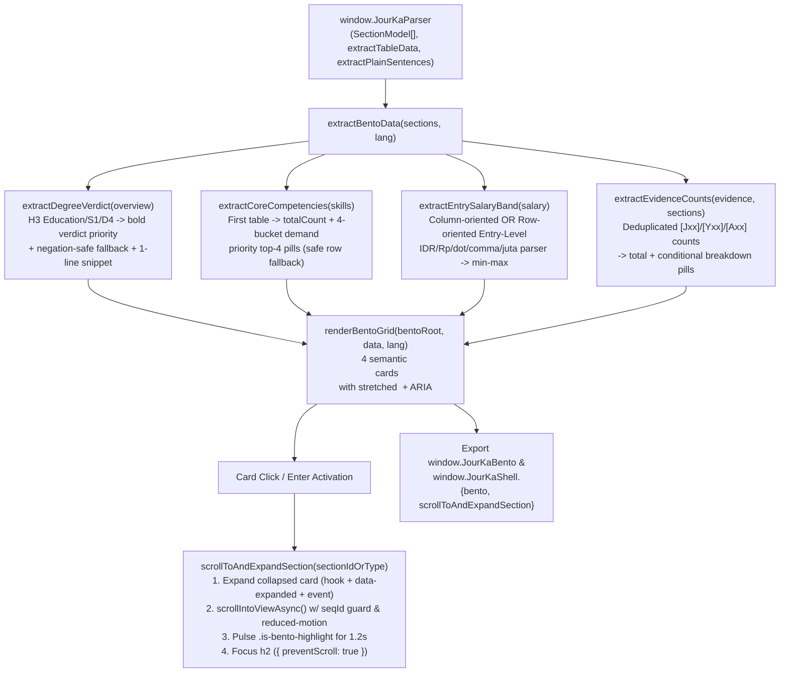

# [JK-FE-005] Tier 0: Dynamic Executive At-a-Glance Bento KPI Summary Grid — Implementation Plan

> **Issue / Source:** https://github.com/prayogizan/JourKa/issues/7 (`#7`, retrieved via `github_personal` MCP)
> **Git Branch:** `feat/jk-fe-005-tier0-executive-bento-grid` *(checked out; up to date with `origin/pre-master` at `22297f9`, including merged PR #15 `JK-FE-004`)*
> **Epic:** `EPIC-JK-UX` — 3-Tier Progressive Disclosure ("Compact First → Expand") · **Priority / Points:** `P1 (High) / 3 pts`
> **Project Root:** `/Users/ottencoffee/ProjectLabs/Hackathon/JourKa/JourKa` (`D:\UiPathProject\JourKa\JourKa` on Windows Studio host, [project.json](file:///Users/ottencoffee/ProjectLabs/Hackathon/JourKa/JourKa/project.json))
> **Project Type:** `Modern Windows XAML Process` (`targetFramework: Windows`, `dotNetVersion: net10.0`, frontend template asset: 100% self-contained single-file HTML5/CSS/JS)
> **Expression Language:** `VisualBasic` *(no `.xaml` edits in this ticket; 8-token VB.NET `.Replace()` contract preserved verbatim)*
> **Approach:** `explore-first`
> **Execution Autonomy:** `interactive` *(pauses for user approval of this plan before writing the canonical plan file or editing [DossierInteractiveTemplate.html](file:///Users/ottencoffee/ProjectLabs/Hackathon/JourKa/JourKa/Templates/DossierInteractiveTemplate.html))*
> **Delivery Model:** `standalone` *(local Studio / Robot execution; offline `file://` HTML artifact delivery)*
> **Packaging:** `standalone`
> **App Type / App State / UI Targeting:** `N/A (static HTML5/CSS/JS template authoring; no UiPath UIA selectors or desktop capture)`
> **Canonical Plan Path:** `JourKa/docs/plans/2026-11-20-jk-fe-005-tier0-executive-bento-grid.md`

---

## Understanding (`uipath-planner` Header Prelude)

Following the completion of `JK-RPA-001` (#3 / PR #12), `JK-RPA-002` (#4 / PR #13), `JK-FE-003` (#5 / PR #14), and `JK-FE-004` (#6 / PR #15), [DossierInteractiveTemplate.html](file:///Users/ottencoffee/ProjectLabs/Hackathon/JourKa/JourKa/Templates/DossierInteractiveTemplate.html) provides the Light/Dark WCAG AA master app shell, a reserved `<div id="bento-root" class="bento-slot" hidden></div>` slot directly beneath the Hero Banner ([DossierInteractiveTemplate.html#L943](file:///Users/ottencoffee/ProjectLabs/Hackathon/JourKa/JourKa/Templates/DossierInteractiveTemplate.html#L943)), and a dual-engine online/offline Markdown parser exposing normalized bilingual `SectionModel[]`, `extractTableData()`, `extractPlainText()`, and `extractPlainSentences()` on `window.JourKaParser` / `window.JourKaShell`. However, `#bento-root` remains hidden and empty, forcing readers to scroll through 8–9 full sections to answer the four highest-signal career questions.

This plan implements the **Tier 0 Executive At-a-Glance Bento KPI Summary Grid** (`.bento-summary`) inside [DossierInteractiveTemplate.html](file:///Users/ottencoffee/ProjectLabs/Hackathon/JourKa/JourKa/Templates/DossierInteractiveTemplate.html): four responsive, role-agnostic, bilingual (`EN` / `ID`) KPI cards dynamically extracted from the parsed DOM of any current or future dossier—(1) S1/D4 Degree Verdict, (2) Core Competency Snapshot, (3) Entry-Level (0–1 yr) IDR Salary Band, and (4) Verified Market Evidence (`[J]`, `[Y]`, `[A]`)—wired to a forward-compatible `scrollToAndExpandSection(sectionIdOrType)` controller that expands collapsed Tier 1 sections (`JK-FE-006`), scrolls smoothly with reduced-motion and post-scroll completion support, pulses a `1.2s` highlight border, and hands keyboard focus cleanly to the destination heading—with `0` changes to `.xaml`, `.md`, `.pdf`, or `project.json`.

## Decisions & Trade-offs (`uipath-planner` Header Prelude)

- **Why single-file HTML5 template scope only (`0` `.xaml` edits):** All 8 VB.NET tokens (`{{LANG_CODE}}`..`{{MARKDOWN_ENCODED}}`) and `data-jourka-ui="v2"` detection in [Main.xaml](file:///Users/ottencoffee/ProjectLabs/Hackathon/JourKa/JourKa/Main.xaml) and [PublishDossier.xaml](file:///Users/ottencoffee/ProjectLabs/Hackathon/JourKa/JourKa/Workflows/PublishDossier.xaml) already deliver raw Markdown cleanly to `#m`. Restricting `JK-FE-005` strictly to [DossierInteractiveTemplate.html](file:///Users/ottencoffee/ProjectLabs/Hackathon/JourKa/JourKa/Templates/DossierInteractiveTemplate.html) eliminates RPA regression risk and preserves `.md` / `.pdf` format isolation.
- **Why skill loading order is `jourka-uipath-rpa` → `jourka-interactive-html` → `modern-web-guidance` → `uipath-review`:** `jourka-uipath-rpa` enforces JourKa hard invariants and artifact isolation; `jourka-interactive-html` governs the 8-token contract and `JK-FE-005`/`006`/`009` integration hooks; `modern-web-guidance` governs current card semantics, container queries, post-scroll completion effects, motion, accessibility, and WCAG/forced-colors contrast; `uipath-review` audits invariants prior to PR.
- **Why salary extraction detects BOTH row-oriented and transposed column-oriented tables:** Live auditing of all 14 dossiers uncovered that 4 of 14 files (`Mobile Developer` EN/ID and `Mobile Engineer` EN/ID) transpose Section 5's table (company scales as rows, experience tiers as columns). Detecting entry-level headers *before* falling back to Row 1 prevents mixing Junior/Mid-Level figures (`IDR 20,000,000`) into Entry-Level ranges and achieves `14/14` exact accuracy.
- **Why Degree Verdict prioritizes `<strong>` verdict phrases in Paragraph 1 before full-sentence scanning:** Auditing `Video Editor - EN.md` revealed the casual trailing word `"required"` (`"muscle memory required for..."`) inside a `**Strongly Preferred**` paragraph, and auditing Indonesian dossiers surfaced four distinct translations (`Sangat Direkomendasikan`, `Sangat Disarankan`, `Sangat Diutamakan`, `Sangat Disukai`). Evaluating bold verdict tokens first with strict priority (`required` > `preferred` > `optional`) plus negation-guarded fallback achieves `14/14` exact accuracy.
- **Why Bento cards use the stretched-link `<article>` + `<a class="bento-card-link" href="#section-N">` pattern:** Wrapping an entire KPI card's pills and prose inside a single `<a>` produces an unwieldy screen-reader accessible name. Placing a native `<a class="bento-card-link" href="#section-N">` inside each card's `<h3>` and stretching its hit target via `::after` preserves concise accessible link names, native link semantics, full-card pointer targeting, and graceful `#section-N` anchor behavior.
- **Why `DossierInteractiveTemplate.html`'s duplicate `id="section-N"` on `<section>` and child `<h2>` is fixed in scope:** `JK-FE-004` stamped `id="section-N"` on both `<section>` and its child `<h2>` ([DossierInteractiveTemplate.html#L1922](file:///Users/ottencoffee/ProjectLabs/Hackathon/JourKa/JourKa/Templates/DossierInteractiveTemplate.html#L1922), [DossierInteractiveTemplate.html#L2162](file:///Users/ottencoffee/ProjectLabs/Hackathon/JourKa/JourKa/Templates/DossierInteractiveTemplate.html#L2162)), while placing `scroll-margin-top` only on `h2`. Moving `h2`'s ID to `section-N-heading` (`tabindex="-1"`), keeping `id="section-N"` solely on `<section>` with `scroll-margin-top: calc(var(--toolbar-h) + 20px)`, and updating `populateBasicToc()` to resolve the enclosing section ID guarantees valid HTML5, clean sticky-toolbar clearance, and accurate post-scroll focus handoff.

---

## 1. Skill Auto-Discovery, Routing & Auto-Creation Gate *(mandatory — execute first)*

Before editing any file during execution, audit `.agents/skills/` against the task's domains:

```powershell
# On Windows Studio host (or verify .agents/skills/ directory on macOS):
powershell -NoProfile -ExecutionPolicy Bypass -File "D:\UiPathProject\JourKa\.agents\skills\jourka-uipath-rpa\scripts\Ensure-UiPathSkills.ps1" -EnsureCore -Audit
```

### 1.1 Active & Required Skills Matrix
| Skill Name | Scope (`.agents/skills/<name>` / Plugin) | Trigger / Role in This Plan | Status (`Loaded` / `Auto-Extract` / `Auto-Create`) |
|---|---|---|---|
| `jourka-uipath-rpa` | [.agents/skills/jourka-uipath-rpa/SKILL.md](file:///Users/ottencoffee/ProjectLabs/Hackathon/JourKa/.agents/skills/jourka-uipath-rpa/SKILL.md) | Master JourKa invariants, format isolation, plan template, `Invoke-JourKaGate.ps1` | `Loaded` |
| `jourka-interactive-html` | [.agents/skills/jourka-interactive-html/SKILL.md](file:///Users/ottencoffee/ProjectLabs/Hackathon/JourKa/.agents/skills/jourka-interactive-html/SKILL.md) | Primary domain skill for `DossierInteractiveTemplate.html`, 8-token contract, `JK-FE-003..009` boundaries | `Loaded` |
| `modern-web-guidance` | [modern-web-guidance/SKILL.md](file:///Users/ottencoffee/.gemini/config/plugins/modern-web-guidance-plugin/skills/modern-web-guidance/SKILL.md) | Mandatory web platform guidance (`scroll-completion-effects`, `card`, `css-layout`, `motion`, `accessibility`, `color`) | `Loaded` |
| `uipath-planner` | [.agents/skills/uipath-planner/SKILL.md](file:///Users/ottencoffee/ProjectLabs/Hackathon/JourKa/.agents/skills/uipath-planner/SKILL.md) | Plan & task schema (`Identity` tuples, anti-hallucination prompts, mandatory testing task) | `Loaded` |
| `uipath-rpa` | [.agents/skills/uipath-rpa/SKILL.md](file:///Users/ottencoffee/ProjectLabs/Hackathon/JourKa/.agents/skills/uipath-rpa/SKILL.md) | Reference only — confirms `0` `.xaml` edits and VB.NET `.Replace()` token contract safety | `Loaded` |
| `uipath-review` | [.agents/skills/uipath-review/SKILL.md](file:///Users/ottencoffee/ProjectLabs/Hackathon/JourKa/.agents/skills/uipath-review/SKILL.md) | Read-only quality & invariant verification before PR | `Loaded` |
| `jourka-github-pr` | [.agents/skills/jourka-github-pr/SKILL.md](file:///Users/ottencoffee/ProjectLabs/Hackathon/JourKa/.agents/skills/jourka-github-pr/SKILL.md) | Standardized PR template & `Closes #7` linkage when user requests PR creation | `Loaded` |

### 1.2 Skill Gap Auto-Creation Decision
- **Does this ticket introduce a repeatable workflow, external API, NuGet package, or UI subsystem not covered above?** `No` — all 6 project-local skills verified in `.agents/skills/` plus `modern-web-guidance` cover every extraction, layout, deep-linking, accessibility, and verification requirement of `JK-FE-005`.

---

## 2. Goal, Epic Boundary & Artifact Isolation *(mandatory)*

- **Outcome in one sentence:** Implement the Tier 0 dynamic 4-card Executive At-a-Glance Bento KPI Summary Grid (`.bento-summary`) inside [DossierInteractiveTemplate.html](file:///Users/ottencoffee/ProjectLabs/Hackathon/JourKa/JourKa/Templates/DossierInteractiveTemplate.html) with bilingual role-agnostic DOM extractors (S1/D4 Degree Verdict, Core Competencies, Entry-Level IDR Salary Band, Verified Evidence Counts) and interactive click-to-expand, smooth-scroll, highlight-pulse navigation to Tier 1 section containers.
- **In scope (strictly owned by `JK-FE-005` / Issue #7):**
  - Responsive 4-card `.bento-summary` grid rendered inside `#bento-root` immediately below `#dossier-hero` (always visible above the fold as Tier 0): 4 columns on Desktop (`>= 1024px`), `2×2` grid on Tablet (`640px–1023px`), and 1-column stack on Mobile (`< 640px`), styled for both Light Editorial and Dark Slate themes, Forced Colors Mode, `prefers-reduced-motion`, and clean `@media print`.
  - Four bilingual (`EN` / `ID`), role-agnostic KPI extractors consuming `window.JourKaParser`'s normalized `SectionModel[]`, `extractTableData()`, and `extractPlainSentences()`:
    1. **Card 1 — Degree / Qualification Verdict (`S1/D4`):** Locates the Education/Qualification subsection in `overview`, classifies `required` (`Required` / `Wajib`), `preferred` (`Strongly Preferred` / `Sangat Direkomendasikan`), `optional` (`Optional` / `Opsional`), or safe `neutral` fallback, renders a WCAG-compliant semantic badge with non-color icon + 1-line extracted context snippet + `"Jump to Overview →"` / `"Lihat Ringkasan →"`.
    2. **Card 2 — Core Competency Snapshot:** Parses the first `<table>` in `skills`, displays total mapped competencies count (`N Core Skills Mapped` / `N Kompetensi Inti`), and renders up to `4` skill pill badges prioritized by demand tier (`Mission-Critical`/`Critical`/`Must-Have`/`Mandatory`/`Sangat Kritis`/`Kritis`/`Wajib` → `Very High`/`High Growth`/`Sangat Tinggi`/`Pertumbuhan Tinggi` → `High`/`Essential`/`Tinggi`/`Esensial` → first 4 rows fallback).
    3. **Card 3 — Entry-Level Salary Band (IDR):** Parses the salary `<table>` in `salary` across **both** row-oriented (10/14 dossiers) and transposed column-oriented (4/14 dossiers) layouts, normalizes `,`/`.` thousand separators and `IDR`/`Rp` prefixes (plus `juta`/`jt`/`M` shorthand fallback), and displays the consolidated min–max range (`IDR X – Y`) with localized caption `Gross Monthly · Entry-Level (0–1 yr)` / `Gaji Kotor Bulanan · Entry-Level (0–1 thn)`.
    4. **Card 4 — Verified Market Evidence:** Counts deduplicated `[Jxx]` Job Postings, `[Yxx]` YouTube Routines, and `[Axx]` Abroad Visa Postings from the `evidence` register table (with full-document fallback), displaying total verified sources count + breakdown pills (`X LinkedIn`, `Y YouTube` when `Y > 0`, and `Z Abroad` / `Z Luar Negeri` strictly when `A > 0`).
  - Interactive deep-linking controller `scrollToAndExpandSection(sectionIdOrType)` exposed on `window.JourKaBento` and `window.JourKaShell`: expands collapsed target Tier 1 section cards (`window.JourKaShell.expandSection` hook + `[data-expanded="false"]` attribute / `[aria-expanded]` sync + `jourka:section-expand` event), awaits programmatic smooth scrolling (`scrollIntoView` Promise + `scrollend`/idle fallback with rapid-click sequence guard and `prefers-reduced-motion` support), pulses a `1.2s` highlight border (`.is-bento-highlight`) on the destination section, and moves focus (`preventScroll: true`) to its `<h2>` heading.
  - Fix the duplicate `id="section-N"` collision between `<section>` and `<h2>` introduced in `JK-FE-004` and add `scroll-margin-top: calc(var(--toolbar-h) + 20px)` to `.dossier-section` so deep-linking clears the sticky toolbar reliably.
- **Out of scope (owned by sibling tickets — do NOT creep into these):**
  - `JK-RPA-001` (#3, merged), `JK-RPA-002` (#4, merged), `JK-FE-003` (#5, merged), `JK-FE-004` (#6, merged): Already delivered and merged into `pre-master`.
  - `JK-FE-006` (#8): Wrapping Tier 1 sections in collapsed-by-default `.dossier-card` accordions, auto-generated TL;DR preview strips, `grid-template-rows: 0fr -> 1fr` animations, and `sessionStorage` open-state persistence. *(In `JK-FE-005`, only interoperate cleanly with `[data-expanded="false"]` / `window.JourKaShell.expandSection` so `JK-FE-006` plugs in seamlessly without modifying Bento code.)*
  - `JK-FE-007` (#9): Tier 2 Portfolio Blueprint sub-cards, 30/60/90 onboarding phase tabs + `localStorage` checklist, Mentor Deep-Dive expanders, and S1/AI Sentiment callout boxes inside Section 1/6.
  - `JK-FE-008` (#10): ASCII-to-Stepper `.flow-stepper` converter, inline `[Jxx]`/`[Yxx]`/`[Axx]` citation popovers, and Skills/Evidence table filter bars.
  - `JK-FE-009` (#11): `IntersectionObserver` scrollspy TOC, `Compact Summary ↔ Expand All` toolbar button activation, `Ctrl+K` live search + `<mark class="search-hit">`, and full cross-widget `I18N` consolidation.
- **Immutable Artifacts & Contracts (MUST NOT change):**
  - All 8 VB.NET template tokens in [DossierInteractiveTemplate.html](file:///Users/ottencoffee/ProjectLabs/Hackathon/JourKa/JourKa/Templates/DossierInteractiveTemplate.html): `{{LANG_CODE}}`, `{{DOC_TITLE}}`, `{{ROLE_NAME}}`, `{{BANNER_SUFFIX}}`, `{{META_PILLS_HTML}}`, `{{COUNTERPART_HREF}}`, `{{COUNTERPART_LABEL}}`, `{{MARKDOWN_ENCODED}}`.
  - Exact `<html lang="{{LANG_CODE}}" data-jourka-ui="v2" data-theme="light">` stamp (`Main.xaml` `If_3` Regex contract).
  - Existing `window.JourKaParser` and `window.JourKaShell` APIs and DOM IDs (`#m`, `#c`, `#bento-root`, `#hero-vitals`, `#toc-list`, `#toc-drawer-list`).
  - [JourKa/Main.xaml](file:///Users/ottencoffee/ProjectLabs/Hackathon/JourKa/JourKa/Main.xaml), [JourKa/Workflows/PublishDossier.xaml](file:///Users/ottencoffee/ProjectLabs/Hackathon/JourKa/JourKa/Workflows/PublishDossier.xaml), and [JourKa/project.json](file:///Users/ottencoffee/ProjectLabs/Hackathon/JourKa/JourKa/project.json) — **0 byte changes**.
  - All 14 `.md` files and all 14 `.pdf` files in `JourKa/Output/` plus all 14 `.pdf` files in `PDF_Results/` — **0 byte changes**.

---

## 3. Codebase, Workflow & Activity Discovery *(mandatory — Rule 17 & Rule 21)*

Verified directly against live [DossierInteractiveTemplate.html](file:///Users/ottencoffee/ProjectLabs/Hackathon/JourKa/JourKa/Templates/DossierInteractiveTemplate.html), [project.json](file:///Users/ottencoffee/ProjectLabs/Hackathon/JourKa/JourKa/project.json), sibling Issues `#8` & `#11`, and an automated audit of all 14 live EN/ID Markdown dossiers across all 7 role directories in `JourKa/Output/`.

### 3.1 Live Codebase Findings
| # | Finding | Verified Location (`file#Lx-Ly`) | Impact on Plan |
|---|---|---|---|
| **F1** | `#bento-root` slot already exists directly below `#dossier-hero` (`<div id="bento-root" class="bento-slot" hidden></div>`) with `.bento-slot[hidden] { display: none; }` CSS hook. | [DossierInteractiveTemplate.html#L510-L513](file:///Users/ottencoffee/ProjectLabs/Hackathon/JourKa/JourKa/Templates/DossierInteractiveTemplate.html#L510-L513), [DossierInteractiveTemplate.html#L943](file:///Users/ottencoffee/ProjectLabs/Hackathon/JourKa/JourKa/Templates/DossierInteractiveTemplate.html#L943) | Un-hide `#bento-root` (`hidden = false`) once KPI cards mount cleanly, keeping it hidden if `sections.length === 0`. |
| **F2** | **Duplicate `id="section-N"` & missing `scroll-margin-top` on `.dossier-section`:** `normalizeSections()` sets `rs.headingEl.id = id` (`#L1922`) AND the mount loop sets `secEl.id = sec.id` (`#L2162`), producing duplicate IDs in HTML5. Meanwhile, `scroll-margin-top` is only defined on `.dossier-content h2` (`#L539`), not `.dossier-section`. | [DossierInteractiveTemplate.html#L539](file:///Users/ottencoffee/ProjectLabs/Hackathon/JourKa/JourKa/Templates/DossierInteractiveTemplate.html#L539), [#L1176-L1188](file:///Users/ottencoffee/ProjectLabs/Hackathon/JourKa/JourKa/Templates/DossierInteractiveTemplate.html#L1176-L1188), [#L1922](file:///Users/ottencoffee/ProjectLabs/Hackathon/JourKa/JourKa/Templates/DossierInteractiveTemplate.html#L1922), [#L2162](file:///Users/ottencoffee/ProjectLabs/Hackathon/JourKa/JourKa/Templates/DossierInteractiveTemplate.html#L2162) | Keep `id="section-N"` exclusively on `<section class="dossier-section">` with `scroll-margin-top: calc(var(--toolbar-h) + 20px)`, set `headingEl.id = id + '-heading'` + `tabindex="-1"`, and update `populateBasicToc()` to link to the parent section's ID (`#section-N`). |
| **F3** | **4 of 14 dossiers transpose Section 5's Salary table:** `Mobile Developer` (EN/ID) and `Mobile Engineer` (EN/ID) put Experience Tiers in **columns** (`col 1 = Entry-Level (0–1 yr)`) and Company Scales (`[a]`, `[b]`, `[c]`) in **rows**, whereas the other 10 dossiers put Experience Tiers in **rows** (`row 1 = Fresh Graduate / Entry-Level`) and Company Scales in **columns**. | [Mobile Developer - EN.md](file:///Users/ottencoffee/ProjectLabs/Hackathon/JourKa/JourKa/Output/Mobile%20Developer/Mobile%20Developer%20-%20EN.md), [Mobile Developer - ID.md](file:///Users/ottencoffee/ProjectLabs/Hackathon/JourKa/JourKa/Output/Mobile%20Developer/Mobile%20Developer%20-%20ID.md), [Mobile Engineer - EN.md](file:///Users/ottencoffee/ProjectLabs/Hackathon/JourKa/JourKa/Output/Mobile%20Engineer/Mobile%20Engineer%20-%20EN.md), [Mobile Engineer - ID.md](file:///Users/ottencoffee/ProjectLabs/Hackathon/JourKa/JourKa/Output/Mobile%20Engineer/Mobile%20Engineer%20-%20ID.md) | `extractEntrySalaryBand()` MUST check headers (`colIdx >= 1`) for an Entry-Level column first (scanning that column across all rows) before scanning Row 1 across columns—preventing `Mobile Dev/Eng` from leaking Junior/Mid-Level numbers (`20M`) into the Entry-Level band (`5M–18M` / `6M–18M`). |
| **F4** | **Salary currency formats vary across dossiers:** EN files use commas (`IDR 5,000,000 – 8,000,000`), ID files mix dots (`IDR 4.500.000 – 6.500.000`) and commas (`IDR 6,000,000`), `Video Editor` uses repeated `Rp` (`Rp 4,500,000 – Rp 6,500,000`), and ranges mix `-` and `–`. | `JourKa/Output/*/*.md` (14/14 files audited) | `parseIdrAmounts()` extracts `\d{1,3}(?:[.,]\d{3})+` bounded to `[500_000, 500_000_000]` (with `juta`/`jt`/`M` shorthand fallback), ignoring `(0–1 yr)` and calendar years, and formats cleanly via deterministic `formatIdrNumber(num, lang)`. |
| **F5** | **`Video Editor - EN.md` contains the casual word `"required"` inside a `**Strongly Preferred**` paragraph, and Indonesian dossiers use 4 distinct translations for `Strongly Preferred`:** `Sangat Direkomendasikan` (`Android Dev`, `Android Eng`, `Video Editor`), `Sangat Disarankan` (`Kotlin Multiplatform`), `Sangat Diutamakan` (`Mobile Developer`), and `Sangat Disukai` (`Mobile Engineer`). Both `Kotlin Multiplatform` and `Video Editor` contain BOTH `**Strongly Preferred**` and `**Optional**`. | [Video Editor - EN.md](file:///Users/ottencoffee/ProjectLabs/Hackathon/JourKa/JourKa/Output/Video%20Editor/Video%20Editor%20-%20EN.md), [Kotlin Multiplatform - ID.md](file:///Users/ottencoffee/ProjectLabs/Hackathon/JourKa/JourKa/Output/Kotlin%20Multiplatform/Kotlin%20Multiplatform%20-%20ID.md), [Mobile Developer - ID.md](file:///Users/ottencoffee/ProjectLabs/Hackathon/JourKa/JourKa/Output/Mobile%20Developer/Mobile%20Developer%20-%20ID.md), [Mobile Engineer - ID.md](file:///Users/ottencoffee/ProjectLabs/Hackathon/JourKa/JourKa/Output/Mobile%20Engineer/Mobile%20Engineer%20-%20ID.md) | `extractDegreeVerdict()` evaluates `<strong>`/`<b>` elements in the Education subsection's opening paragraph first (`required` > `preferred` > `optional`) covering all 4 Indonesian synonyms, with a negation-guarded first-sentence plain-text fallback—preventing `Video Editor - EN` false-positive `Required` classification. |
| **F6** | **Skills demand labels include qualified compounds (`Moderate to High`, `Medium-High`, `Niche / High-Value`, `Sedang hingga Tinggi`, `Menengah-Tinggi`, `Niche / Bernilai Tinggi`):** Naive `/High|Tinggi/i` matching would promote `Moderate to High` (`Java`) or `Medium-High` (`After Effects`) above `Critical` or `Essential` (`Sound Design`, `Short-Form Storytelling`). | [Android Engineer - EN.md](file:///Users/ottencoffee/ProjectLabs/Hackathon/JourKa/JourKa/Output/Android%20Engineer/Android%20Engineer%20-%20EN.md), [Video Editor - EN.md](file:///Users/ottencoffee/ProjectLabs/Hackathon/JourKa/JourKa/Output/Video%20Editor/Video%20Editor%20-%20EN.md) | Use 4-bucket stable priority ranking: B1 (`Critical`/`Mandatory`/`Must-Have`/`Wajib`/`Kritis`), B2 (`Very High`/`High Growth`/`Sangat Tinggi`/`Pertumbuhan Tinggi`), B3 (`High`/`Essential`/`Tinggi`/`Esensial` excluding `Moderate`/`Medium`/`Niche`/`High-Value`), B4 (document-order fallback). |
| **F7** | **Evidence register counts vary including `Y = 0` (`Kotlin Multiplatform`: 8J, 0Y, 0A), `Y = 6` (`Apoteker`: 8J, 6Y, 0A), and `A = 1` (`Video Editor`: 8J, 8Y, 1A), with bolded IDs (`**[J01]**`).** | [Kotlin Multiplatform - EN.md](file:///Users/ottencoffee/ProjectLabs/Hackathon/JourKa/JourKa/Output/Kotlin%20Multiplatform/Kotlin%20Multiplatform%20-%20EN.md), [Apoteker - EN.md](file:///Users/ottencoffee/ProjectLabs/Hackathon/JourKa/JourKa/Output/Apoteker/Apoteker%20-%20EN.md), [Video Editor - EN.md](file:///Users/ottencoffee/ProjectLabs/Hackathon/JourKa/JourKa/Output/Video%20Editor/Video%20Editor%20-%20EN.md) | Render breakdown pills cleanly for non-zero counts (`LinkedIn`, `YouTube` when `> 0`, `Abroad` / `Luar Negeri` strictly when `A > 0`) and deduplicate uppercase `[JYA]\d+` keys. |
| **F8** | **Desktop `.main-canvas` width is `688px` at `1024px` viewport (`163px` per card in 4-col grid) up to `880px` at `>= 1280px` (`211px` per card).** | [DossierInteractiveTemplate.html#L364-L373](file:///Users/ottencoffee/ProjectLabs/Hackathon/JourKa/JourKa/Templates/DossierInteractiveTemplate.html#L364-L373) | Use `grid-template-columns: repeat(4, minmax(0, 1fr))` on `>= 1024px`, `container-type: inline-size` on `.bento-card` with `@container` typography/padding tightening below `190px`, `tabular-nums`, and `.bento-nowrap` spans around min/max IDR figures so numbers never break mid-digit and horizontal overflow stays `0px`. |

### 3.2 Target `InvokeCode` & Workflow Inventory
| Workflow / Template File | Activity `IdRef` / Section | Scope in `JK-FE-005` | In / Out Arguments or Tokens |
|---|---|---|---|
| [JourKa/Templates/DossierInteractiveTemplate.html](file:///Users/ottencoffee/ProjectLabs/Hackathon/JourKa/JourKa/Templates/DossierInteractiveTemplate.html) | `<style>` (Bento grid, card container queries, semantic badges, pulse highlight, forced-colors, print CSS), `<main>` (`#bento-root`), and `<script>` runtime (`#L1168-L1205`, `#L1922`, `#L2150-L2206`) | **Primary edit target** | Preserves all 8 immutable VB.NET tokens (`{{LANG_CODE}}`..`{{MARKDOWN_ENCODED}}`), `window.JourKaParser`, and `window.JourKaShell` |
| [JourKa/Main.xaml](file:///Users/ottencoffee/ProjectLabs/Hackathon/JourKa/JourKa/Main.xaml) & [JourKa/Workflows/PublishDossier.xaml](file:///Users/ottencoffee/ProjectLabs/Hackathon/JourKa/JourKa/Workflows/PublishDossier.xaml) | `N/A` | **Read-only reference** (`0` edits) | Verified 8-token `.Replace()` chain & `If_3` `data-jourka-ui="v2"` regex |

### 3.3 NuGet Package & Activity Resolution Gate (`Rule 21`)
- **Dependencies in [JourKa/project.json](file:///Users/ottencoffee/ProjectLabs/Hackathon/JourKa/JourKa/project.json) sufficient?** `Yes` — zero `.xaml` or `.cs` modifications; zero NuGet packages added or updated.
- **New XAML Activities Added:** `None` (`N/A` — pure frontend single-file HTML template deliverable).

---

## 4. UiPath Common Pitfalls, Template Hygiene & Modern Web Vetting Gate *(mandatory — Rule 22)*

Vetted against [.agents/skills/jourka-uipath-rpa/references/invokecode-rules.md](file:///Users/ottencoffee/ProjectLabs/Hackathon/JourKa/.agents/skills/jourka-uipath-rpa/references/invokecode-rules.md), [.agents/skills/jourka-interactive-html/SKILL.md](file:///Users/ottencoffee/ProjectLabs/Hackathon/JourKa/.agents/skills/jourka-interactive-html/SKILL.md), and retrieved `modern-web-guidance` guides (`scroll-completion-effects`, `card`, `css-layout`, `motion`, `accessibility`, `color`):

- [ ] **Exact `v2` Stamp & 8-Token Contract:** `<html lang="{{LANG_CODE}}" data-jourka-ui="v2" data-theme="light">` and all 8 `{{TOKEN}}` placeholders remain intact; zero literal `{{...}}` strings appear in newly added JS/CSS/comments.
- [ ] **Single-File `file://` Offline Portability:** Zero new external CDN/CSS/JS/font imports; all Bento icons are lightweight inline `<svg aria-hidden="true" focusable="false">`.
- [ ] **Zero Unsafe DOM Sinks:** Construct every Bento card, badge, pill, and snippet strictly via `document.createElement()` and `.textContent` (plus static hardcoded SVG icon strings parsed cleanly via `<template>` or SVG helper—never interpolating extracted dossier text into `innerHTML`).
- [ ] **Semantic Stretched-Link Card Markup (`card`, `accessibility`):** Root each KPI card in `<article class="bento-card">`, keep one native `<a class="bento-card-link" href="#section-N">` inside `<h3>` stretched across the card via `::after` (`position: relative` on `.bento-card`), style hover/focus on `.bento-card:has(a.bento-card-link:focus-visible)` (with `:focus-within` fallback), and avoid nesting interactive controls inside the card.
- [ ] **Heading Outline & Landmark Discipline (`accessibility`):** Place a visually hidden `<h2 id="bento-heading" class="visually-hidden">` before `.bento-summary` so card `<h3>` elements preserve sequential `h1 → h2 → h3` order; do NOT add `aria-labelledby` to `#bento-root` if using `<section>` (or keep `<div>`) so we avoid unnecessary `region` landmark clutter.
- [ ] **Post-Scroll Completion & Focus Handoff (`scroll-completion-effects`, `motion`):** In `scrollToAndExpandSection()`, await the `Promise` returned by `scrollIntoView()` when `result instanceof Promise` (with `scrollend` + `100ms` idle fallback otherwise), guard against rapid overlapping clicks via an incrementing `scrollSeqId` token, respect `prefers-reduced-motion: reduce` (`behavior: 'auto'`, static non-pulsing `1.2s` border highlight), and move keyboard focus to the destination `<h2>` via `.focus({ preventScroll: true })`.
- [ ] **Non-Color State Indicators, Contrast & Forced Colors (`color`):** Never communicate degree verdict severity by color alone—pair each badge with a distinct inline SVG icon and explicit localized text label; maintain `>= 4.5:1` text contrast and `>= 3:1` border/focus contrast in both Light and Dark themes using existing calibrated tokens (`--rose-text`/`--rose-soft`, `--accent-hover`/`--accent-soft`, `--emerald-text`/`--emerald-soft`, `--amber-text`/`--amber-soft`), and include `@media (forced-colors: active)` `CanvasText` / `Highlight` border & outline rules for `.bento-card`, `.bento-badge`, `.bento-pill`, and `.is-bento-highlight`.
- [ ] **Compositor-Friendly Hover & Highlight Transitions (`motion`, `card`):** Never change layout-affecting properties (`border-width`, `padding`, `font-weight`) on hover, focus, or highlight; animate only `transform`, `box-shadow`, `border-color`, and `opacity` (and gate hover elevation `translateY(-2px)` inside `@media (prefers-reduced-motion: no-preference)`).

---

## 5. Issue Gaps, Ambiguities, Decisions & Stop Conditions *(mandatory)*

### 5.1 Gaps & Decisions
| # | Gap / Ambiguity / Contradiction | Decision Taken & Rationale | Needs User Input? |
|---|---|---|---|
| **D1** | **Template-only edit vs. re-backfilling the 14 existing `JourKa/Output/*/*.html` files:** Issue #7 lists `JourKa/Templates/DossierInteractiveTemplate.html` as the sole Target File; `JK-FE-003` and `JK-FE-004` kept `JourKa/Output/` untouched and verified rendered previews in git-ignored `JourKa/.local/preview/`. | **Default:** Edit **only** [DossierInteractiveTemplate.html](file:///Users/ottencoffee/ProjectLabs/Hackathon/JourKa/JourKa/Templates/DossierInteractiveTemplate.html) in `JK-FE-005` and verify across all 14 rendered fixtures in git-ignored `JourKa/.local/preview/` so `JourKa/Output/` stays clean until the frontend epic (`JK-FE-003..009`) finishes (unless user explicitly requests backfilling all 14 `.html` outputs now). | `Optional (default: Template only)` |
| **D2** | **Transposed Section 5 Salary Tables in 4 of 14 dossiers (`Mobile Developer` & `Mobile Engineer` EN/ID):** Issue #7 says *"targeting Row 1 (`Fresh Graduate` / `Entry-Level` / `0-1` / `0–1`)"*, which fails on transposed tables where Row 1 is `[a] Local Startups` across Fresh Grad + Junior + Mid-Level. | Inspect table headers (`colIdx >= 1`) for an Entry-Level column first; when matched, aggregate all currency figures down column `colIdx` across all company-tier rows. Otherwise scan the matching Entry-Level row (defaulting to Row 1) across columns `1..N`. Verified `14/14` exact match. | `No` |
| **D3** | **Degree Verdict badge label in Indonesian (`ID`) dossiers:** Four different Indonesian phrases appear across real dossiers (`Sangat Direkomendasikan`, `Sangat Disarankan`, `Sangat Diutamakan`, `Sangat Disukai`), while `Apoteker - ID` uses `Wajib`. | Normalize badge labels cleanly by language and tier (`required`: `Required` / `Wajib`; `strongly_preferred`: `Strongly Preferred` / `Sangat Direkomendasikan`; `preferred`: `Preferred` / `Direkomendasikan`; `optional`: `Optional` / `Opsional`; `neutral`: `See Overview` / `Lihat Ringkasan`) while showing the exact role-specific context sentence directly below the badge. | `No` |
| **D4** | **Salary number separator formatting in `EN` vs `ID`:** EN dossiers consistently use commas (`IDR 5,000,000 – 18,000,000`) while ID dossiers mix dots (`IDR 4.500.000`) and commas (`IDR 6,000,000`), and `Video Editor` uses `Rp`. | Normalize displayed currency prefix to `IDR` across all roles (`IDR 4,500,000 – 12,000,000` in EN; `IDR 4.500.000 – 12.000.000` in ID) via deterministic digit grouping (`formatIdrNumber`) that never depends on OS locale and never outputs `NaN`. Expose raw numeric `min` / `max` on `window.JourKaBento.getData()`. | `No` |
| **D5** | **Evidence breakdown display when `youtube === 0` (`Kotlin Multiplatform`: 8J, 0Y, 0A):** Issue #7 states `8 LinkedIn · 8 YouTube` + `1 Abroad` when `A > 0`. | Display `LinkedIn` pill when `jobs > 0`, `YouTube` pill when `youtube > 0`, and `Abroad` (`Luar Negeri` in ID) pill strictly when `abroad > 0` (if all are `0`, show localized `No sources listed` / `Belum ada sumber`). Avoids awkward `0 YouTube` on `Kotlin Multiplatform` while keeping `8 LinkedIn · 8 YouTube · 1 Abroad` on `Video Editor`. | `No` |
| **D6** | **Testing `scrollToAndExpandSection()` collapse→expand behavior before `JK-FE-006` (#8) lands:** Tier 1 `.dossier-card` accordions aren't built until `JK-FE-006`, yet Issue #7's Gherkin AC #2 explicitly tests expanding a collapsed Section 5. | Build full forward-compatible expansion inside `scrollToAndExpandSection()`: calls `window.JourKaShell.expandSection(id)` if registered by `JK-FE-006`, else flips `[data-expanded="false"]` → `"true"`, syncs `.section-toggle[aria-expanded]`, and dispatches `jourka:section-expand`. In L4/L5 verification, simulate a collapsed `data-expanded="false"` Section 5 in live Chrome and assert click → `data-expanded="true"` + scroll into viewport + `.is-bento-highlight` pulse! | `No` |
| **D7** | **Duplicate `id="section-N"` on `<section>` and `<h2>` in current template:** Left by `JK-FE-004` (`#L1922` and `#L2162`). | Deduplicate cleanly: keep `id="section-N"` on `<section class="dossier-section">` (with `scroll-margin-top: calc(var(--toolbar-h) + 20px)`), set `headingEl.id = id + '-heading'` (`tabindex="-1"`), and update `populateBasicToc()` to resolve parent section ID. Preserves `#section-N` TOC anchors and `window.JourKaParser.getSections()[i].id === 'section-' + (i+1)`. | `No` |

### 5.2 Stop Conditions / Re-plan Triggers
Execution pauses and hands back to the planner/user if any of these hard blockers occur:
- Any change would require mutating `.xaml`, `.md`, `.pdf`, or `project.json` (violating `JK-FE-005` format isolation).
- Any of the 14 live EN/ID dossiers extracts an inaccurate verdict, skill count, entry-level min–max salary, or `[J]`/`[Y]`/`[A]` count, or renders `"undefined"`, `"NaN"`, or `"null"` in any Bento card (online or offline).
- Responsive viewport verification (`1280×800`, `1024×768`, `768×1024`, `375×812`) exhibits horizontal overflow (`scrollWidth > clientWidth`) or clipped salary/badge text inside narrow `1024px` 4-column cards.
- `git diff --stat` contains any file outside §7 Change Manifest.

---

## 6. Technical Design, Data Contracts & Failure Modes *(mandatory)*

### 6.1 Architecture & Data-Flow Diagram


### 6.2 Module, Schema & API Contracts

#### A. `BentoKpiModel` Data Contract (Returned by `extractBentoData` & `window.JourKaBento.getData()`)
| Key | Properties | Target Section Fallback |
|---|---|---|
| `degree` | `{ tier: 'required' \| 'preferred' \| 'optional' \| 'neutral', label: string, snippet: string, targetId: string \| null, targetType: 'overview' }` | Matches `sectionType === 'overview'` (fallback `sections[0]`) |
| `skills` | `{ totalCount: number, pills: string[], targetId: string \| null, targetType: 'skills' }` | Matches `sectionType === 'skills'` (fallback `sections[1]`) |
| `salary` | `{ min: number \| null, max: number \| null, formattedRange: string, caption: string, orientation: 'column' \| 'row' \| 'text' \| 'none', targetId: string \| null, targetType: 'salary' }` | Matches `sectionType === 'salary'` |
| `evidence` | `{ total: number, jobs: number, youtube: number, abroad: number, other: number, targetId: string \| null, targetType: 'evidence' }` | Matches `sectionType === 'evidence'` (fallback `sections[sections.length - 1]`) |

#### B. Empirically Verified 14-Dossier Extraction Ground-Truth Baseline
Every live dossier in `JourKa/Output/` was dry-run audited against the exact extraction rules in this plan (`14/14` = `100%` match):

| Dossier File | Card 1: Degree Verdict | Card 2: Total & Top 4 Pills | Card 3: Entry-Level Salary (`0–1 yr`) | Card 4: Evidence (`Total` / Breakdown) |
|---|---|---|---|---|
| `Android Developer - EN` | `Strongly Preferred` (`preferred`) | `8` · Kotlin (Native), Android SDK & Lifecycle, RESTful APIs & Networking, Jetpack Compose | `[row]` `IDR 5,000,000 – 18,000,000` | `16` (`8 LinkedIn · 8 YouTube`) |
| `Android Developer - ID` | `Sangat Direkomendasikan` (`preferred`) | `8` · Kotlin (Native), Android SDK & Lifecycle, RESTful APIs & Networking, Jetpack Compose | `[row]` `IDR 5.000.000 – 18.000.000` | `16` (`8 LinkedIn · 8 YouTube`) |
| `Android Engineer - EN` | `Strongly Preferred` (`preferred`) | `8` · Kotlin, MVVM / Clean Architecture, Jetpack Compose, Coroutines & Flow | `[row]` `IDR 6,000,000 – 20,000,000` | `16` (`8 LinkedIn · 8 YouTube`) |
| `Android Engineer - ID` | `Sangat Direkomendasikan` (`preferred`) | `8` · Kotlin, MVVM / Clean Architecture, Jetpack Compose, Coroutines & Flow | `[row]` `IDR 6.000.000 – 20.000.000` | `16` (`8 LinkedIn · 8 YouTube`) |
| `Apoteker - EN` | `Required` (`required`) | `6` · Pengkajian Resep & Farmasi Klinis, STRA & SIPARIS/SIP Management, CDOB (…), CPOB / GMP Compliance | `[row]` `IDR 4,500,000 – 13,000,000` | `14` (`8 LinkedIn · 6 YouTube`) |
| `Apoteker - ID` | `Wajib` (`required`) | `6` · Pengkajian Resep & Farmasi Klinis, Manajemen STRA & SIPARIS/SIP, CDOB (…), Kepatuhan CPOB / GMP | `[row]` `IDR 4.500.000 – 13.000.000` | `14` (`8 LinkedIn · 6 YouTube`) |
| `Kotlin Multiplatform - EN` | `Strongly Preferred` (`preferred`) | `6` · Kotlin Language (Coroutines, Flow), Kotlin Multiplatform (KMP/KMM), Ktor Client, Git & CI/CD Pipelines | `[row]` `IDR 6,000,000 – 20,000,000` | `8` (`8 LinkedIn`) |
| `Kotlin Multiplatform - ID` | `Sangat Direkomendasikan` (`preferred`) | `6` · Kotlin Language (Coroutines, Flow), Kotlin Multiplatform (KMP/KMM), Ktor Client, Git & CI/CD Pipelines | `[row]` `IDR 6.000.000 – 20.000.000` | `8` (`8 LinkedIn`) |
| `Mobile Developer - EN` | `Strongly Preferred` (`preferred`) | `7` · Flutter / Dart, Kotlin / Jetpack Compose, Swift / SwiftUI / UIKit, RESTful APIs & Networking | `[col1]` `IDR 5,000,000 – 18,000,000` | `16` (`8 LinkedIn · 8 YouTube`) |
| `Mobile Developer - ID` | `Sangat Direkomendasikan` (`preferred`) | `7` · Flutter / Dart, Kotlin / Jetpack Compose, Swift / SwiftUI / UIKit, RESTful APIs & Networking | `[col1]` `IDR 5.000.000 – 18.000.000` | `16` (`8 LinkedIn · 8 YouTube`) |
| `Mobile Engineer - EN` | `Strongly Preferred` (`preferred`) | `8` · Kotlin, Jetpack Compose, Swift / iOS SDK, Flutter | `[col1]` `IDR 6,000,000 – 18,000,000` | `16` (`8 LinkedIn · 8 YouTube`) |
| `Mobile Engineer - ID` | `Sangat Direkomendasikan` (`preferred`) | `8` · Kotlin, Jetpack Compose, Swift / iOS SDK, Flutter | `[col1]` `IDR 6.000.000 – 18.000.000` | `16` (`8 LinkedIn · 8 YouTube`) |
| `Video Editor - EN` | `Strongly Preferred` (`preferred`) | `6` · Sound Design & Audio Mixing, Adobe Premiere Pro, CapCut (Desktop & Mobile), Short-Form Storytelling & Pacing | `[row]` `IDR 4,500,000 – 12,000,000` | `17` (`8 LinkedIn · 8 YouTube · 1 Abroad`) |
| `Video Editor - ID` | `Sangat Direkomendasikan` (`preferred`) | `6` · Sound Design & Audio Mixing, Adobe Premiere Pro, CapCut (Desktop & Mobile), Short-Form Storytelling & Pacing | `[row]` `IDR 4.500.000 – 12.000.000` | `17` (`8 LinkedIn · 8 YouTube · 1 Luar Negeri`) |

#### C. Responsive Bento CSS & Visual Token Contract
- **Responsive Breakpoints (Exact Issue #7 Spec):**
  - Desktop (`>= 1024px`): `.bento-summary { display: grid; grid-template-columns: repeat(4, minmax(0, 1fr)); gap: 12px; }`
  - Tablet (`640px–1023px`): `grid-template-columns: repeat(2, minmax(0, 1fr)); gap: 14px;`
  - Mobile (`< 640px`): `grid-template-columns: 1fr; gap: 12px;`
- **Container-Aware Card Internals (`card` & `css-layout` guides):**
  - `.bento-card`: `position: relative; container: bento-card / inline-size; display: flex; flex-direction: column; gap: 10px; min-width: 0; padding: 14px 15px; background: var(--bg-surface); border: 1px solid var(--border); border-radius: var(--radius-md); box-shadow: var(--shadow-sm);`
  - `@container bento-card (inline-size < 190px)` tightens `.bento-card` inner typography (`font-size` for `.bento-salary-range` and `.bento-pill`) and badge padding so 4-column desktop at `1024px` (`~163px` card width) stays balanced with zero overflow.
  - `.bento-footer { margin-block-start: auto; padding-top: 6px; border-top: 1px solid var(--border); }` aligns `"Jump to ... →"` action cues cleanly at the bottom edge of every card.
- **Verdict Badge Semantic Palette (WCAG 2.1 AA >= 4.5:1 + Non-Color Icon):**
  - `required`: `background: var(--rose-soft); color: var(--rose-text); border-color: var(--rose);` + shield/alert inline SVG (`6.45:1` Light / `9.7:1` Dark)
  - `preferred`: `background: var(--accent-soft); color: var(--accent-hover); border-color: var(--accent);` + award/star inline SVG (`6.14:1` Light / `10.1:1` Dark)
  - `optional`: `background: var(--emerald-soft); color: var(--emerald-text); border-color: var(--emerald);` + check/flex inline SVG (`5.21:1` Light / `8.9:1` Dark)
  - `neutral`: `background: var(--bg-subtle); color: var(--ink-muted-subtle); border-color: var(--border-control);` + info inline SVG
- **Highlight Pulse (`.is-bento-highlight`, `1.2s`):**
  - Applied to the target `<section class="dossier-section">` after programmatic scroll settles.
  - Under `@media (prefers-reduced-motion: no-preference)`: smooth single-cycle `1.2s` accent border + soft ring glow fade-out (`box-shadow` + `border-color` + `outline`; never exceeds WCAG 2.3.1 flash limit).
  - Under `@media (prefers-reduced-motion: reduce)`: static `2px solid var(--accent)` ring held cleanly for `1.2s` without animation.
  - Under `@media (forced-colors: active)`: `outline: 3px solid Highlight; outline-offset: 2px;`.

#### D. Bilingual UI Dictionary (`BENTO_I18N`)
| Key | English (`en`) | Bahasa Indonesia (`id`) |
|---|---|---|
| `gridHeading` | `Executive At-a-Glance Summary` | `Ringkasan Eksekutif Sekilas` |
| `card1Title` | `Degree Verdict (S1/D4)` | `Status Gelar (S1/D4)` |
| `card1Cta` | `Jump to Overview` | `Lihat Ringkasan` |
| `card2Title` | `Core Competencies` | `Kompetensi Inti` |
| `card2Count` | `(n) => n + ' Core Skills Mapped'` | `(n) => n + ' Kompetensi Inti Dipetakan'` |
| `card2Cta` | `Jump to Skills` | `Lihat Kompetensi` |
| `card3Title` | `Entry-Level Salary` | `Gaji Awal (Entry-Level)` |
| `card3Caption` | `Gross Monthly · Entry-Level (0–1 yr)` | `Gaji Kotor Bulanan · Entry-Level (0–1 thn)` |
| `card3Cta` | `Jump to Salary` | `Lihat Estimasi Gaji` |
| `card4Title` | `Verified Market Evidence` | `Bukti Pasar Terverifikasi` |
| `card4Count` | `(n) => n + ' Verified Sources'` | `(n) => n + ' Sumber Terverifikasi'` |
| `card4Cta` | `Jump to Sources` | `Lihat Daftar Bukti` |
| `pillJobs` | `(n) => n + ' LinkedIn'` | `(n) => n + ' LinkedIn'` |
| `pillYoutube` | `(n) => n + ' YouTube'` | `(n) => n + ' YouTube'` |
| `pillAbroad` | `(n) => n + ' Abroad'` | `(n) => n + ' Luar Negeri'` |
| `fallbackNA` | `See full section` | `Lihat bagian lengkap` |

#### E. Global API Exports (`window.JourKaBento` & `window.JourKaShell`)
- `window.JourKaBento`: `{ extractBentoData, extractDegreeVerdict, extractCoreCompetencies, extractEntrySalaryBand, extractEvidenceCounts, parseIdrAmounts, formatIdrNumber, renderBentoGrid, scrollToAndExpandSection, getData: () => bentoData }`
- `window.JourKaShell`: adds `bento: window.JourKaBento` and `scrollToAndExpandSection: scrollToAndExpandSection` while preserving every existing property (`lang`, `getTheme`, `setTheme`, `updateVitals`, `wrapTables`, `populateBasicToc`, `closeTocDrawer`, `parser`, `sections`).

### 6.3 Failure Modes & Degraded-Mode Fallbacks
| Failure Scenario | Detection | Recovery / Fallback Behavior | Observable Signal |
|---|---|---|---|
| Unseen future role omits S1/D4 subsection or uses novel verdict phrasing | No matching `<h3>` or no regex hit in Pass 1/2 | Falls back to `overview` opening sentence via `extractPlainSentences(overview, { maxSentences: 1, maxChars: 110 })` + neutral `'See Overview'` / `'Lihat Ringkasan'` badge | Zero `undefined`; clickable card still jumps to `section-1` |
| Future skills table uses custom demand labels (e.g., `"Core"`, `"Tier A"`) or has `< 4` rows | Bucket 1–3 return `< 4` items | Bucket 4 fills remaining slots from rows in document order (capped at `Math.min(4, rowCount)`); if `0` rows, shows `fallbackNA` | Valid count + clean pills; zero `undefined` |
| Future salary table omits Entry-Level label, uses `Rp 5–8 juta` shorthand, or contains only one figure | `amounts.length === 1` or `0` | Single value renders `IDR X` (no `X – X` duplication); shorthand parser handles `juta`/`jt`/`M`; zero-amount fallback scans section prose, else shows `fallbackNA` | Zero `NaN`; accurate formatted range |
| Future dossier has `0` YouTube (`Y=0`) or `0` Abroad (`A=0`) or empty evidence table | `youtube === 0`, `abroad === 0`, or `table.rowCount === 0` | Omits `YouTube`/`Abroad` pills when `0`; falls back to scanning unique `[JYA]\d+` tokens across all sections if evidence table is absent | Clean breakdown pills; zero `NaN` or empty pills |
| Browsers without `scrollIntoView()` Promise support (Firefox/Safari/older Chrome) | `!(result instanceof Promise)` | Falls back to `scrollend` + `100ms` idle scroll debounce timer in `scrollIntoViewAsync()` | Post-scroll `.is-bento-highlight` and focus handoff execute cleanly across all browsers |
| Rapid clicking of multiple Bento cards mid-scroll | `seq !== currentScrollSeqId` after `await` | Aborts superseded scroll's highlight/focus; only the latest target section highlights and receives focus | Zero competing highlights or stale focus jumps |
| Empty Markdown (`sections.length === 0`) | `!sections || sections.length === 0` | Leaves `#bento-root` with `hidden = true` | Zero runtime errors; no broken empty grid |

---

## 7. Strict Change Manifest *(mandatory)*

Every file to be created or edited. `git diff --stat` at completion must be a strict subset of this table (`0` `.xaml`, `0` `.md`, `0` `.pdf`, `0` `project.json` files modified).

| File Path | Action (`new` / `edit` / `delete`) | Node / Section | Summary of Change |
|---|---|---|---|
| `JourKa/docs/plans/2026-11-20-jk-fe-005-tier0-executive-bento-grid.md` | `new` | Full plan artifact | Canonical `uipath-planner` Non-PDD plan & tasks file saved in `JourKa/docs/plans/` |
| [JourKa/Templates/DossierInteractiveTemplate.html](file:///Users/ottencoffee/ProjectLabs/Hackathon/JourKa/JourKa/Templates/DossierInteractiveTemplate.html) | `edit` | `<style>` (Bento grid, container queries, semantic badges, pulse highlight, forced-colors, print CSS), `<main>` (`#bento-root` wrapper), `<script>` (section ID deduplication, 4 bilingual KPI extractors, DOM renderer, `scrollToAndExpandSection`, `window.JourKaBento` & `window.JourKaShell` exports) | Implement complete Tier 0 4-card Executive Bento KPI Grid with auto-extraction and interactive deep-linking |

*(Temporary verification fixtures and Node/browser test scripts MUST be written strictly to git-ignored `JourKa/.local/preview/` and never committed.)*

---

## 8. Turn-Budgeted Implementation Tasks (`uipath-planner` Schema) *(mandatory)*

### Task T0 — `jourka-uipath-rpa` — Persist Canonical Plan, Audit Skills & Snapshot Template Baseline
**Identity:** `jourka-uipath-rpa:JourKa:jk-fe-005-skills-and-baseline`
**Status:** `[ ] pending`
**Blocked by:** `none`
**Skill prompt:**
> Load `jourka-uipath-rpa` and `jourka-interactive-html`. Save this canonical plan to `JourKa/docs/plans/2026-11-20-jk-fe-005-tier0-executive-bento-grid.md`, confirm all 6 project-local skills exist in `.agents/skills/`, confirm clean git status on branch `feat/jk-fe-005-tier0-executive-bento-grid`, and snapshot the current `JourKa/Templates/DossierInteractiveTemplate.html` baseline into git-ignored `JourKa/.local/preview/DossierInteractiveTemplate__before_fe005.html`. Use values, mappings, and structure exactly as documented in the plan at `JourKa/docs/plans/2026-11-20-jk-fe-005-tier0-executive-bento-grid.md`. Do not infer or guess.

- [ ] Write canonical plan file `JourKa/docs/plans/2026-11-20-jk-fe-005-tier0-executive-bento-grid.md`.
- [ ] Verify all 6 project-local skills exist in `.agents/skills/` (`jourka-uipath-rpa`, `jourka-interactive-html`, `uipath-planner`, `uipath-rpa`, `uipath-review`, `jourka-github-pr`) and confirm current branch is `feat/jk-fe-005-tier0-executive-bento-grid`.
- [ ] Snapshot baseline [JourKa/Templates/DossierInteractiveTemplate.html](file:///Users/ottencoffee/ProjectLabs/Hackathon/JourKa/JourKa/Templates/DossierInteractiveTemplate.html) to git-ignored `JourKa/.local/preview/DossierInteractiveTemplate__before_fe005.html`.
- [ ] **Validate:** Plan file exists at `JourKa/docs/plans/2026-11-20-jk-fe-005-tier0-executive-bento-grid.md` and `git status --short` shows only the new plan file (confirming `JourKa/.local/preview/` is git-ignored).

### Task T1 — `jourka-interactive-html` — Add Bento KPI CSS System, Section Scroll Clearance & Deduplicate Section Heading IDs
**Identity:** `jourka-interactive-html:JourKa:Templates/DossierInteractiveTemplate.html:bento-styles-and-ids`
**Status:** `[ ] pending`
**Blocked by:** `T0`
**Skill prompt:**
> Load `jourka-interactive-html` and follow `modern-web-guidance` (`card`, `css-layout`, `motion`, `accessibility`, `color`). Inside `JourKa/Templates/DossierInteractiveTemplate.html`, add the complete Light/Dark responsive CSS for `.bento-summary` (4-col `>= 1024px`, 2×2 `640px–1023px`, 1-col `< 640px`), container-aware `.bento-card` internals (`container: bento-card / inline-size`), stretched-link hover/focus styling, WCAG AA semantic verdict badges, competency/evidence pills, `.is-bento-highlight` `1.2s` highlight animation (with `prefers-reduced-motion` and `forced-colors` rules), and `@media print` styling. Also add `scroll-margin-top: calc(var(--toolbar-h) + 20px)` to `.dossier-section`, deduplicate `section-N` vs `section-N-heading` IDs (`tabindex="-1"` on `<h2>`), and update `populateBasicToc()` to anchor cleanly to `#section-N`. Preserve all 8 immutable VB.NET tokens (`{{LANG_CODE}}`..`{{MARKDOWN_ENCODED}}`). Use values, mappings, and structure exactly as documented in the plan at `JourKa/docs/plans/2026-11-20-jk-fe-005-tier0-executive-bento-grid.md`. Do not infer or guess.

- [ ] Add `.bento-slot`, `.bento-summary`, `.bento-card` (with `container: bento-card / inline-size` and `@container bento-card (inline-size < 190px)` compact rules), `.bento-card-header`, `.bento-icon`, `.bento-title`, `.bento-card-link` (stretched `::after` overlay + `:has(a.bento-card-link:focus-visible)` / `:focus-within` ring), `.bento-body`, `.bento-badge` (`--required`, `--preferred`, `--optional`, `--neutral`), `.bento-snippet`, `.bento-metric`, `.bento-salary-range` (`tabular-nums`, `.bento-nowrap`), `.bento-caption`, `.bento-pills` (`flex-wrap: wrap; flex-wrap: balance`), `.bento-pill`, and `.bento-footer` CSS rules inside `<style>`.
- [ ] Add `.dossier-section { scroll-margin-top: calc(var(--toolbar-h) + 20px); border-radius: var(--radius-md); }` and `.is-bento-highlight` (`1.2s` border/ring highlight gated cleanly for `@media (prefers-reduced-motion: no-preference)`, `reduce`, and `@media (forced-colors: active)`).
- [ ] Add responsive breakpoints (`@media (max-width: 1023px)` → 2-column Bento grid; `@media (max-width: 639px)` → 1-column Bento grid), `@media (forced-colors: active)` card/badge/pill border rules, and `@media print` 2×2 clean Bento print rules hiding `.bento-footer` navigation hints.
- [ ] Deduplicate section IDs in `normalizeSections()` / mount loop (`secEl.id = sec.id`, `sec.headingEl.id = sec.id + '-heading'`, `sec.headingEl.setAttribute('tabindex', '-1')`) and update `populateBasicToc()` so TOC links resolve `(h.closest('.dossier-section, .dossier-card') || h).id`.
- [ ] **Validate:** Run a syntax & token check via `/opt/homebrew/bin/node` / Python confirming all 8 `{{TOKEN}}` placeholders and `data-jourka-ui="v2"` remain intact, zero duplicate `id` attributes exist in rendered DOM, and zero CSS/JS syntax errors occur.

### Task T2 — `jourka-interactive-html` — Implement Bilingual Role-Agnostic KPI Extractors (Cards 1–4)
**Identity:** `jourka-interactive-html:JourKa:Templates/DossierInteractiveTemplate.html:bento-extractors`
**Status:** `[ ] pending`
**Blocked by:** `T1`
**Skill prompt:**
> Load `jourka-interactive-html`. Inside `JourKa/Templates/DossierInteractiveTemplate.html`, implement `BENTO_I18N`, `extractDegreeVerdict()`, `extractCoreCompetencies()`, `parseIdrAmounts()`, `formatIdrNumber()`, `extractEntrySalaryBand()`, `extractEvidenceCounts()`, and `extractBentoData(sections, lang)` consuming `window.JourKaParser` (`SectionModel[]`, `extractTableData()`, `extractPlainSentences()`). Handle both row-oriented and transposed column-oriented salary tables, dot/comma/`Rp`/`IDR`/`juta` salary formats, all 4 Indonesian `Strongly Preferred` synonyms, negation-safe verdict detection, 4-bucket demand priority skill ranking, and deduplicated `[J]`/`[Y]`/`[A]` counts with zero `undefined` or `NaN` outputs. Use values, mappings, and structure exactly as documented in the plan at `JourKa/docs/plans/2026-11-20-jk-fe-005-tier0-executive-bento-grid.md`. Do not infer or guess.

- [ ] Add `BENTO_I18N` (`en` and `id`) matching §6.2.D verbatim.
- [ ] Implement `extractDegreeVerdict(overviewSection, lang)`: locate the Education/Qualification (`S1/D4` / `Pendidikan` / `Gelar` / `Kualifikasi`) subsection nodes inside `overviewSection.nodes`; inspect `<strong>`/`<b>` elements in Paragraph 1 first (`required` > `preferred` > `optional`, covering all 4 ID synonyms `Sangat Direkomendasikan` / `Sangat Disarankan` / `Sangat Diutamakan` / `Sangat Disukai`), fall back to negation-guarded first-sentence scan, then `neutral` safe fallback; extract clean 1-line context snippet via `extractPlainSentences(..., { maxSentences: 1, maxChars: 115, stripCitations: true })`.
- [ ] Implement `extractCoreCompetencies(skillsSection, lang)`: parse first table via `extractTableData(skillsSection)`, locate skill and demand columns dynamically, stably partition rows into 4 demand buckets (B1 Critical/Mandatory → B2 Very High/High Growth → B3 High/Essential excluding Moderate/Medium/Niche/High-Value → B4 document-order fallback), and return `{ totalCount, pills: top4, targetId }`.
- [ ] Implement `parseIdrAmounts(text)`, `formatIdrNumber(num, lang)`, and `extractEntrySalaryBand(salarySection, lang)`: inspect `tableData.headers` (`colIdx >= 1`) first for transposed Entry-Level columns (`Mobile Developer`, `Mobile Engineer`), else target the Entry-Level row (defaulting to Row 1) across company-tier columns; extract all valid IDR amounts (`500_000`–`500_000_000`, supporting `,`/`.` separators, `IDR`/`Rp`, and `juta`/`jt`/`M` shorthand) and format `IDR <min> – <max>` cleanly without `NaN`.
- [ ] Implement `extractEvidenceCounts(evidenceSection, allSections, lang)`: parse evidence table via `extractTableData(evidenceSection)` (falling back to full-section citation scan if no table exists), count deduplicated uppercase `[Jxx]`, `[Yxx]`, `[Axx]` entries, and compute `{ total, jobs, youtube, abroad, other, targetId }`.
- [ ] Implement `extractBentoData(sections, lang)` assembling the complete `BentoKpiModel` with safe target section resolution.
- [ ] **Validate:** Run an automated extraction test via `/opt/homebrew/bin/node` against all 14 live `.md` dossiers (under both `marked` and `forceFallback: true`) asserting `14/14` exact match against the §6.2.B ground-truth matrix plus synthetic edge-case fixtures (custom demand labels, `Optional` verdict, `Rp 5–8 juta`, `0` evidence rows, empty Markdown) with `0` `undefined` / `NaN` strings.

### Task T3 — `jourka-interactive-html` — Implement Bento DOM Renderer, `scrollToAndExpandSection()` & Shell Wiring
**Identity:** `jourka-interactive-html:JourKa:Templates/DossierInteractiveTemplate.html:bento-render-and-deeplink`
**Status:** `[ ] pending`
**Blocked by:** `T2`
**Skill prompt:**
> Load `jourka-interactive-html` and follow `modern-web-guidance` (`scroll-completion-effects`, `card`, `accessibility`, `motion`). Inside `JourKa/Templates/DossierInteractiveTemplate.html`, implement `renderBentoGrid(bentoRoot, data, lang)` using safe DOM creation (`createElement` / `textContent`, zero user-data `innerHTML`), `scrollIntoViewAsync()`, and `scrollToAndExpandSection(sectionIdOrType)` with forward-compatible Tier 1 accordion expansion (`window.JourKaShell.expandSection`, `[data-expanded="false"]`, `[aria-expanded]`, `jourka:section-expand` event), rapid-click sequence guard, `1.2s` `.is-bento-highlight` pulse, and `{ preventScroll: true }` heading focus handoff. Mount the Bento grid immediately after section normalization and export `window.JourKaBento` + `window.JourKaShell.{bento, scrollToAndExpandSection}`. Do not build `JK-FE-006..009` widgets. Use values, mappings, and structure exactly as documented in the plan at `JourKa/docs/plans/2026-11-20-jk-fe-005-tier0-executive-bento-grid.md`. Do not infer or guess.

- [ ] Implement `renderBentoGrid(bentoRoot, data, lang)`: create visually hidden `<h2 id="bento-heading" class="visually-hidden">` + `<div class="bento-summary">` containing 4 semantic `<article class="bento-card" data-kpi="..." data-target-section="...">` cards, each with header icon (`aria-hidden="true"`), `<h3><a class="bento-card-link" href="#section-N">...</a></h3>`, KPI body (badge with non-color SVG icon + snippet for Card 1; mapped skill count + top-4 pills for Card 2; non-breaking formatted IDR min–max range + localized caption for Card 3; total count + conditional `LinkedIn` / `YouTube` / `Abroad` breakdown pills for Card 4), and footer action cue (`Jump to ... →`), mounting via `bentoRoot.replaceChildren(...)` and setting `bentoRoot.hidden = false`.
- [ ] Implement `scrollIntoViewAsync(element, options)` per `scroll-completion-effects` guide: return native `Promise` when `element.scrollIntoView(options) instanceof Promise`, else resolve via `scrollend` listener + `100ms` scroll-idle fallback timer.
- [ ] Implement `scrollToAndExpandSection(sectionIdOrType)`:
  1. Resolve target `<section>` by ID or `[data-section-type]`.
  2. Expand if collapsed: invoke `window.JourKaShell.expandSection(id)` if defined; if `target.getAttribute('data-expanded') === 'false'`, set `data-expanded="true"`, update any `.section-toggle[aria-expanded]` to `"true"`, and dispatch bubbling `CustomEvent('jourka:section-expand', { detail: { id, sectionType } })`.
  3. Increment `currentScrollSeqId`, clear active highlight timers/classes, await `scrollIntoViewAsync(target, { behavior: prefersReducedMotion ? 'auto' : 'smooth', block: 'start' })`, and abort early if `seq !== currentScrollSeqId`.
  4. Apply `.is-bento-highlight` to `target` for `1200ms` (removing cleanly on timer completion) and move focus to the section's `<h2>` via `heading.focus({ preventScroll: true })`.
- [ ] Wire click handler on `.bento-card-link` anchors (`ev.preventDefault(); scrollToAndExpandSection(targetId)`), initialize Bento inside the main IIFE directly after `#c` mounts, and expose `window.JourKaBento` + `window.JourKaShell.{bento, scrollToAndExpandSection}`.
- [ ] **Validate:** Render all 14 EN/ID preview fixtures into git-ignored `JourKa/.local/preview/` using `Main.xaml`'s exact 8-token `.Replace()` chain; verify `0` unreplaced `{{...}}` tokens, `data-jourka-ui="v2"` regex match, and clean `#bento-root` mounting.

### Task T4 — `jourka-interactive-html` — Testing & Multi-Layer Verification (MANDATORY)
**Identity:** `jourka-interactive-html:JourKa:jk-fe-005-testing`
**Status:** `[ ] pending`
**Blocked by:** `T1, T2, T3`
**Skill prompt:**
> Load `jourka-interactive-html`, `jourka-uipath-rpa`, and `uipath-review` and run the full verification workflow end-to-end across Layers L1–L7 in §9 of the plan: 8-token contract & HTML5 ID uniqueness, 14-dossier online + offline KPI extraction accuracy against §6.2.B, synthetic edge cases (Optional verdict, custom demand labels, `Rp juta` shorthand, transposed/missing tables, empty MD), live browser rendering & visual layout across Desktop (`1280×800`, `1024×768`), Tablet (`768×1024`), and Mobile (`375×812`) in both Light and Dark modes, live Gherkin AC-1 & AC-2 proofs (including simulated collapsed `data-expanded="false"` Section 5 expansion + smooth scroll + `1.2s` highlight + focus handoff), `JK-FE-003`/`004` non-regression, and strict repo format-isolation invariants. Use values, mappings, and structure exactly as documented in the plan at `JourKa/docs/plans/2026-11-20-jk-fe-005-tier0-executive-bento-grid.md`. Do not infer or guess.

- [ ] Run **L1 & L2** automated contract + 14-dossier extraction suite (`/opt/homebrew/bin/node` + Python) verifying all 8 tokens, `data-jourka-ui="v2"` regex, `0` duplicate DOM IDs, `14/14` exact KPI output match against §6.2.B (both `marked` and `forceFallback: true`), and synthetic edge-case fixtures (`0` `"undefined"` / `"NaN"` strings).
- [ ] Run **L3 & L4** live browser verification (headless Chrome / browser subagent) on `file://` fixtures in `JourKa/.local/preview/`:
  - **AC-1 (Cross-domain EN/ID accuracy):** Verify `Android Developer - EN.html`, `Apoteker - ID.html`, `Video Editor - EN.html` (plus `Mobile Developer - EN.html` transposed salary & `Kotlin Multiplatform - EN.html` zero-YouTube edge case) in both online and offline modes; assert Card 1 verdict (`Strongly Preferred` vs `Wajib`/`Required`), Card 2 top-4 skills + total count, Card 3 exact Entry-Level IDR min–max band, and Card 4 accurate `[J]`/`[Y]`/`[A]` counts with `0` console errors.
  - **AC-2 (Click-to-expand, smooth scroll, pulse highlight & focus):** Simulate Section 5 collapsed (`data-expanded="false"` + `<button class="section-toggle" aria-expanded="false">`), click Bento Card 3 (and test keyboard `Enter`), assert `data-expanded` flips to `"true"`, `aria-expanded` flips to `"true"`, `jourka:section-expand` fires, Section 5 scrolls into the viewport below the sticky toolbar, `.is-bento-highlight` applies and clears after `~1.2s`, and focus lands on `#section-5-heading`.
- [ ] Run **L5** responsive, theme & accessibility verification: test Light & Dark themes at `1280×800` (4-col), `1024×768` (4-col compact), `768×1024` (2×2), and `375×812` (1-col) confirming `0px` horizontal overflow (`document.documentElement.scrollWidth <= window.innerWidth`), clean `h1 → h2 → h3` heading order, and zero regressions to `JK-FE-003` shell or `JK-FE-004` parser.
- [ ] Run **L6 & L7** UiPath pipeline & repo invariant checks (`git diff -- JourKa/Main.xaml JourKa/Workflows/PublishDossier.xaml JourKa/project.json`, `git status --short -- JourKa/Output PDF_Results`, `git diff --stat` ⊆ §7 Change Manifest).
- [ ] **Validate:** All L1–L7 checks pass with `0` console errors, `14/14` KPI extraction accuracy, `0px` mobile/desktop overflow, `0` unintended repo diffs, and clean `git diff --stat`.

---

## 9. Multi-Layer Verification Matrix (`Gate != Runtime Proof`) *(mandatory)*

| Layer | Check | Command / Method | Pass Criterion |
|---|---|---|---|
| **L1 — Token & HTML5 Contract** | All 8 VB.NET tokens intact, `data-jourka-ui="v2"` exact, `0` duplicate IDs | Python script running `Main.xaml`'s exact 8-token `.Replace()` chain on [DossierInteractiveTemplate.html](file:///Users/ottencoffee/ProjectLabs/Hackathon/JourKa/JourKa/Templates/DossierInteractiveTemplate.html) across all 14 `.md` files into `JourKa/.local/preview/` | `0` unreplaced `{{...}}` tokens; `Regex.IsMatch(..., 'data-jourka-ui\s*=\s*["\']v2["\']')` is `True`; `0` duplicate `id` attributes in rendered DOM |
| **L2 — 14-Dossier Online/Offline Extraction Parity** | Exact Card 1–4 accuracy across all 14 dossiers + edge cases | Automated DOM/Node test comparing `window.JourKaBento.getData()` under `marked` and `forceFallback: true` across all 14 files + synthetic edge fixtures (`Optional`, `Rp 5–8 juta`, custom skill labels, missing sections, empty MD) | `14/14` (`100%`) match against §6.2.B baseline; `0` `"undefined"`, `"NaN"`, or `"null"` strings anywhere in `#bento-root` |
| **L3 — Live Browser Cross-Domain Proof (`AC-1`)** | Tech (`Android Dev`, `Mobile Dev`, `KMP`), Healthcare (`Apoteker` ID), Creative (`Video Editor` EN) via `file://` | Headless Chrome / browser subagent inspection of rendered preview HTMLs (online + offline) | Card 1 displays `Strongly Preferred` (`Android Dev` / `Video Editor`) & `Wajib` (`Apoteker - ID`); Card 2 shows total + top-4 skills; Card 3 shows exact Entry-Level IDR min–max; Card 4 shows exact `[J]`/`[Y]`/`[A]` pills; `0` console errors |
| **L4 — Live Browser Click-to-Expand & Scroll Proof (`AC-2`)** | Collapsed Section 5 expansion + smooth scroll + `1.2s` highlight + focus handoff | Live browser interaction: set `#section-5` `data-expanded="false"`, click Bento Card 3 (and test keyboard `Enter`) | `#section-5` flips to `data-expanded="true"`, fires `jourka:section-expand`, scrolls into viewport below sticky `.app-toolbar`, pulses `.is-bento-highlight` for `~1.2s`, and focuses `#section-5-heading` |
| **L5 — Responsive Grid, Theme & A11y Non-Regression** | Breakpoints (`1280px`, `1024px`, `768px`, `375px`), Light/Dark toggle, `prefers-reduced-motion`, shell/parser parity | Live browser viewport sweeps + computed `grid-template-columns` & overflow checks in Light & Dark modes | `4-col` at `>= 1024px`, `2-col` at `768px`, `1-col` at `375px`; `scrollWidth <= innerWidth` (`0px` overflow) across all viewports; `JK-FE-003` & `JK-FE-004` features 100% intact |
| **L6 — UiPath Pipeline Compatibility** | Zero `.xaml` / `project.json` changes | `git diff -- JourKa/Main.xaml JourKa/Workflows/PublishDossier.xaml JourKa/project.json` (optional `Invoke-JourKaGate.ps1` on Windows Studio host) | `0` diff lines across all `.xaml` and `project.json` files |
| **L7 — Repo Format-Isolation Invariants** | Zero collateral `.md` / `.pdf` / `Output` diffs | `git status --short -- JourKa/Output PDF_Results` & `git diff --stat` | `0` modified `.md` or `.pdf` files; changed files are a strict subset of §7 Change Manifest |

---

## 10. Risks, Rollback & Follow-Up Tech Debt

### 10.1 Risks & Mitigations
| Risk | Likelihood | Impact | Mitigation |
|---|---|---|---|
| **R1:** Narrow `1024px` 4-column desktop cards (`~163px` wide) wrap mid-number or clip long salary strings / skill pills. | `Med` | `Med` | Apply `minmax(0, 1fr)`, `container: bento-card / inline-size` with `@container (inline-size < 190px)` typography scaling, `tabular-nums`, and `.bento-nowrap` spans around min and max amounts; verify visually at `1024×768`. |
| **R2:** Future Gemini dossiers use a new Indonesian synonym for degree verdict or non-standard salary format (`Rp 5–8 juta/bulan`). | `Med` | `Med` | Support both bold-first and negation-safe plain-text verdict detection with neutral fallback, plus both thousand-separated (`5,000,000` / `5.000.000`) and shorthand (`juta`/`jt`/`M`) IDR parsing. |
| **R3:** Tight coupling between `JK-FE-005` click-to-expand and future `JK-FE-006` Tier 1 accordions breaks when `#8` lands. | `Low` | `High` | Decouple via `window.JourKaShell.expandSection(id)` hook + standard `[data-expanded="false"]` / `[aria-expanded]` contract + `jourka:section-expand` CustomEvent matching Issue #8's exact attribute spec. |
| **R4:** Fixing duplicate `id="section-N"` inadvertently breaks `JK-FE-004` TOC links or downstream selectors. | `Low` | `High` | Keep `id="section-N"` on `<section class="dossier-section">`, move `<h2>` to `section-N-heading`, update `populateBasicToc()` to target parent section ID, and keep `SectionModel.id === 'section-N'` unchanged. |
| **R5:** Accidental `{{...}}` token syntax in new JS/CSS gets mangled by VB.NET `.Replace()`. | `Low` | `High` | Never write double-brace placeholder literals in JS/CSS; validate all 14 rendered fixtures via L1 8-token injection script. |

### 10.2 Rollback Procedure
- Before commit: `git checkout -- JourKa/Templates/DossierInteractiveTemplate.html` and delete `JourKa/docs/plans/2026-11-20-jk-fe-005-tier0-executive-bento-grid.md` + `JourKa/.local/preview/`.
- After commit: `git revert <commit-sha>` restores the `JK-FE-004` template cleanly with zero impact on `.xaml`, `.md`, or `.pdf` artifacts.

### 10.3 Follow-Ups / Tech Debt (Out of Scope Here)
- **F1 (`JK-FE-006`, #8):** Register `window.JourKaShell.expandSection(id)` (or listen for `jourka:section-expand`) when wrapping `.dossier-section` into collapsed-by-default `.dossier-card` accordions so Bento clicks persist open state to `sessionStorage` seamlessly.
- **F2 (`JK-FE-007` & `JK-FE-008`, #9–#10):** Reuse `extractDegreeVerdict()` / `window.JourKaBento.getData()` where helpful for Section 1 S1/D4 callout styling and Section 8/9 Evidence Register filtering.
- **F3 (`JK-FE-009`, #11):** Wire `BENTO_I18N` cleanly alongside toolbar search, view-mode switcher, and `IntersectionObserver` scrollspy TOC.
- **F4 (Post-Epic Backfill):** Re-run the HTML-only backfill across all 14 `.html` files in `JourKa/Output/` once `JK-FE-003..009` finish (unless requested earlier per `D1`).

---

## 11. Definition of Done (DoD) Gate

- [ ] All required skills verified in `.agents/skills/` (`jourka-uipath-rpa`, `jourka-interactive-html`, `uipath-planner`, `uipath-rpa`, `uipath-review`, `jourka-github-pr`).
- [ ] Responsive 4-card `.bento-summary` grid styled for both Light and Dark themes (`4-col` desktop, `2×2` tablet, `1-col` mobile, Forced Colors Mode, `@media print`).
- [ ] Bilingual (`EN` & `ID`) extractors with safe fallbacks for unseen future roles verified `14/14` across live dossiers (online and offline) with `0` `"undefined"` or `"NaN"` strings.
- [ ] Click-to-expand and smooth scroll navigation (`scrollToAndExpandSection`) with `1.2s` highlight pulse and focus handoff wired to Tier 1 section containers.
- [ ] All Gherkin Acceptance Criteria (`AC-1` cross-domain EN/ID accuracy & `AC-2` click-to-expand + smooth scroll) verified via live browser over `file://`.
- [ ] Format-isolation invariant check clean (`0` `.xaml`, `0` `.md`, `0` `.pdf`, `0` `project.json` changes; `git diff --stat` ⊆ §7 Change Manifest).
- [ ] Atomic Conventional Commit (`feat(jk-fe-005-tier0-executive-bento-grid): implement Tier 0 dynamic executive Bento KPI summary grid (#7)` with `Closes #7`).
