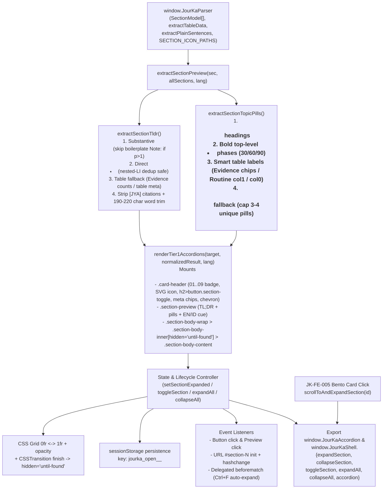

# [JK-FE-006] Tier 1: Compact-First Section Accordions with Auto-Generated Executive Preview Strips — Implementation Plan

> **Issue / Source:** https://github.com/prayogizan/JourKa/issues/8 (`#8`, retrieved via `github_personal` MCP)
> **Git Branch:** `feat/jk-fe-006-tier1-compact-section-accordions` *(checked out; up to date with `origin/pre-master` at `7675596`, including merged PR #16 `JK-FE-005`)*
> **Epic:** `EPIC-JK-UX` — 3-Tier Progressive Disclosure ("Compact First → Expand") · **Priority / Points:** `P0 (Blocker / Core UX Requirement) / 5 pts`
> **Project Root:** `/Users/ottencoffee/ProjectLabs/Hackathon/JourKa/JourKa` (`D:\UiPathProject\JourKa\JourKa` on Windows Studio host, [project.json](file:///Users/ottencoffee/ProjectLabs/Hackathon/JourKa/JourKa/project.json))
> **Project Type:** `Modern Windows XAML Process` (`targetFramework: Windows`, `dotNetVersion: net10.0`, frontend template asset: 100% self-contained single-file HTML5/CSS/JS)
> **Expression Language:** `VisualBasic` *(no `.xaml` edits in this ticket; 8-token VB.NET `.Replace()` contract preserved verbatim)*
> **Approach:** `explore-first`
> **Execution Autonomy:** `interactive` *(pauses for user approval of this plan before writing the canonical plan file or editing [DossierInteractiveTemplate.html](file:///Users/ottencoffee/ProjectLabs/Hackathon/JourKa/JourKa/Templates/DossierInteractiveTemplate.html))*
> **Delivery Model:** `standalone` *(local Studio / Robot execution; offline `file://` HTML artifact delivery)*
> **Packaging:** `standalone`
> **App Type / App State / UI Targeting:** `N/A (static HTML5/CSS/JS template authoring; no UiPath UIA selectors or desktop capture)`
> **Canonical Plan Path:** `JourKa/docs/plans/2026-11-20-jk-fe-006-tier1-compact-section-accordions.md`

---

## Understanding (`uipath-planner` Header Prelude)

Following the completion of `JK-RPA-001` (#3 / PR #12), `JK-RPA-002` (#4 / PR #13), `JK-FE-003` (#5 / PR #14), `JK-FE-004` (#6 / PR #15), and `JK-FE-005` (#7 / PR #16), [DossierInteractiveTemplate.html](file:///Users/ottencoffee/ProjectLabs/Hackathon/JourKa/JourKa/Templates/DossierInteractiveTemplate.html) already provides the Light/Dark WCAG AA app shell, dual-engine online/offline Markdown parser (`SectionModel[]`, `SECTION_ICON_PATHS`, `computeSectionStats`, `extractTableData`, `extractPlainSentences`), and the Tier 0 Bento KPI grid (`scrollToAndExpandSection`). However, lines [3169–3190](file:///Users/ottencoffee/ProjectLabs/Hackathon/JourKa/JourKa/Templates/DossierInteractiveTemplate.html#L3169-L3190) still mount all 8 or 9 `<h2>` sections as flat, fully expanded `<section class="dossier-section">` blocks inside a single `#c.dossier-content` surface—dumping 3,500–5,000 words onto the initial viewport.

This plan implements **Tier 1 Compact-First Section Accordions** (`.dossier-card`) inside [DossierInteractiveTemplate.html](file:///Users/ottencoffee/ProjectLabs/Hackathon/JourKa/JourKa/Templates/DossierInteractiveTemplate.html): every `SectionModel` renders by default as an elevated, collapsed card (`data-expanded="false"`, `aria-expanded="false"`) featuring a clickable header bar (index badge `01`..`09`, semantic SVG icon, localized `<h2>` heading wrapping a native `<button type="button" class="section-toggle">`, read-time/table/subsection metadata chips, and rotating chevron), an auto-generated executive `.section-preview` strip (1–2 sentence TL;DR, up to 3–4 topic pills, and bilingual expand cue) visible only while collapsed, smooth CSS Grid row expansion (`grid-template-rows: 0fr -> 1fr`) paired with `hidden="until-found"` + `beforematch` find-in-page synchronization, `#section-N` URL hash auto-expansion, `sessionStorage` state persistence (`jourka_open_<role>_<lang>`), and clean integration hooks for `JK-FE-005` Bento jumps and downstream `JK-FE-007`..`009`—with `0` changes to `.xaml`, `.md`, `.pdf`, or `project.json`.

## Decisions & Trade-offs (`uipath-planner` Header Prelude)

- **Why single-file HTML5 template scope only (`0` `.xaml` edits):** All 8 VB.NET template tokens and `data-jourka-ui="v2"` detection in [Main.xaml](file:///Users/ottencoffee/ProjectLabs/Hackathon/JourKa/JourKa/Main.xaml) and [PublishDossier.xaml](file:///Users/ottencoffee/ProjectLabs/Hackathon/JourKa/JourKa/Workflows/PublishDossier.xaml) already deliver raw Markdown cleanly to `#m`. Restricting `JK-FE-006` strictly to [DossierInteractiveTemplate.html](file:///Users/ottencoffee/ProjectLabs/Hackathon/JourKa/JourKa/Templates/DossierInteractiveTemplate.html) eliminates RPA regression risk and preserves `.md` / `.pdf` format isolation.
- **Why skill loading order is `jourka-uipath-rpa` → `jourka-interactive-html` → `modern-web-guidance` → `uipath-review`:** `jourka-uipath-rpa` enforces JourKa hard invariants and artifact isolation; `jourka-interactive-html` governs the 8-token contract and `JK-FE-005`/`006`/`007`/`008`/`009` integration hooks; `modern-web-guidance` governs custom heading-preserving accordion semantics, `hidden="until-found"` + `beforematch` find-in-page sync, `prefers-reduced-motion`, and keyboard/focus accessibility; `uipath-review` audits invariants prior to PR.
- **Why Custom ARIA Accordion (`<h2 id="section-N-heading"><button class="section-toggle" aria-expanded aria-controls>`) instead of `<details>/<summary>`:** Per `modern-web-guidance` (`accordion`, `accessibility`, `html`), placing `<h2>` inside `<summary>` drops heading semantics in JAWS and TalkBack; because each dossier section is a primary document landmark navigated by heading, wrapping a native `<button type="button" class="section-toggle">` inside `<h2>` and stretching its pointer hit area across `.card-header` via `::after` preserves both screen-reader heading navigation and full-bar click ergonomics, while matching Issue #8's exact attribute contract (`data-expanded`, `aria-expanded`, `aria-controls="sec-body-N"`).
- **Why `.section-body-wrap` combines Issue #8's `grid-template-rows: 0fr -> 1fr` transition with `hidden="until-found"` on `.section-body-inner` + `beforematch` sync:** Relying purely on `0fr` + `overflow: hidden` leaves collapsed links and focusable `.table-wrapper` regions in the keyboard Tab order and screen-reader tree (WCAG 2.4.3 / 2.4.7 failure). Applying `hidden="until-found"` to `.section-body-inner` when settled collapsed (removed immediately on expand, re-applied after `CSSTransition` settles via `getAnimations()` or immediately under `prefers-reduced-motion: reduce`) removes collapsed descendants from Tab order/AT, enables native browser `Ctrl+F` find-in-page auto-expand via `beforematch` in Chromium/Firefox, and keeps all nodes live in the DOM for `JK-FE-009` `Ctrl+K` scanning.
- **Why TL;DR and Topic Pill generators use multi-tier empirical fallbacks across all 14 live dossiers:** Auditing all `114` sections across all 14 EN/ID dossiers uncovered three real-world LLM patterns: (1) all `14` Evidence Register sections (`section-8`/`9`) contain **zero** `<p>` and **zero** `<li>` elements (table-only), (2) `24` sections lack `<h3>` headings (relying on bold top-level `<li>` phases or tables), and (3) `8` sections open with an italic `*Note:...*` disclaimer (`Video Editor` Section 8 has a second substantive paragraph right after it). Building table-aware TL;DR synthesis, nested-`<li>`-safe sentence extraction, disclaimer skipping (when a subsequent paragraph exists), and 4-tier topic pill extraction guarantees `114/114` (`100%`) high-signal preview strips with zero blanks.
- **Why `#c.dossier-content.dossier-content--cards` drops its outer box chrome when Tier 1 cards mount:** Removing the outer border/background/padding on `#c` when `.dossier-card` accordions mount prevents double-boxed card-in-card nesting and reclaims `56px` of reading width while keeping every existing `.dossier-content` typography/table/code rule intact for inner card bodies.

---

## 1. Skill Auto-Discovery, Routing & Auto-Creation Gate *(mandatory — execute first)*

Before editing any file during execution, audit `.agents/skills/` against the task's domains:

```powershell
# On Windows Studio host (or verify .agents/skills/ directory on macOS):
powershell -NoProfile -ExecutionPolicy Bypass -File "D:\UiPathProject\JourKa\.agents\skills\jourka-uipath-rpa\scripts\Ensure-UiPathSkills.ps1" -EnsureCore -Audit
```

### 1.1 Active & Required Skills Matrix
| Skill Name | Scope (`.agents/skills/<name>` / Plugin) | Trigger / Role in This Plan | Status (`Loaded` / `Auto-Extract` / `Auto-Create`) |
|---|---|---|---|
| `jourka-uipath-rpa` | [.agents/skills/jourka-uipath-rpa/SKILL.md](file:///Users/ottencoffee/ProjectLabs/Hackathon/JourKa/.agents/skills/jourka-uipath-rpa/SKILL.md) | Master JourKa invariants, format isolation, plan template, `Invoke-JourKaGate.ps1` | `Loaded` |
| `jourka-interactive-html` | [.agents/skills/jourka-interactive-html/SKILL.md](file:///Users/ottencoffee/ProjectLabs/Hackathon/JourKa/.agents/skills/jourka-interactive-html/SKILL.md) | Primary domain skill for `DossierInteractiveTemplate.html`, 8-token contract, `JK-FE-003..009` boundaries | `Loaded` |
| `modern-web-guidance` | [modern-web-guidance/SKILL.md](file:///Users/ottencoffee/.gemini/config/plugins/modern-web-guidance-plugin/skills/modern-web-guidance/SKILL.md) | Mandatory web platform guidance (`accordion`, `search-hidden-content`, `animate-to-intrinsic-sizes`, `accessibility`, `motion`, `html`) | `Loaded` |
| `uipath-planner` | [.agents/skills/uipath-planner/SKILL.md](file:///Users/ottencoffee/ProjectLabs/Hackathon/JourKa/.agents/skills/uipath-planner/SKILL.md) | Plan & task schema (`Identity` tuples, anti-hallucination prompts, mandatory testing task) | `Loaded` |
| `uipath-rpa` | [.agents/skills/uipath-rpa/SKILL.md](file:///Users/ottencoffee/ProjectLabs/Hackathon/JourKa/.agents/skills/uipath-rpa/SKILL.md) | Reference only — confirms `0` `.xaml` edits and VB.NET `.Replace()` token contract safety | `Loaded` |
| `uipath-review` | [.agents/skills/uipath-review/SKILL.md](file:///Users/ottencoffee/ProjectLabs/Hackathon/JourKa/.agents/skills/uipath-review/SKILL.md) | Read-only quality & invariant verification before PR | `Loaded` |
| `jourka-github-pr` | [.agents/skills/jourka-github-pr/SKILL.md](file:///Users/ottencoffee/ProjectLabs/Hackathon/JourKa/.agents/skills/jourka-github-pr/SKILL.md) | Standardized PR template & `Closes #8` linkage when user requests PR creation | `Loaded` |

### 1.2 Skill Gap Auto-Creation Decision
- **Does this ticket introduce a repeatable workflow, external API, NuGet package, or UI subsystem not covered above?** `No` — all 6 project-local skills verified in `.agents/skills/` plus `modern-web-guidance` cover every DOM extraction, accordion animation, accessibility, state-persistence, and verification requirement of `JK-FE-006`.

---

## 2. Goal, Epic Boundary & Artifact Isolation *(mandatory)*

- **Outcome in one sentence:** Transform every Tier 1 `<h2>` section in [DossierInteractiveTemplate.html](file:///Users/ottencoffee/ProjectLabs/Hackathon/JourKa/JourKa/Templates/DossierInteractiveTemplate.html) into an elevated, accessible, collapsed-by-default `.dossier-card` accordion with an auto-generated bilingual executive preview strip (1–2 sentence TL;DR, 3–4 topic pills, expand cue), smooth `grid-template-rows: 0fr -> 1fr` expansion, `#section-N` hash auto-expand, and `sessionStorage` state persistence.
- **In scope (strictly owned by `JK-FE-006` / Issue #8):**
  - Wrap every normalized `SectionModel` (`01`..`08` or `09`) in `<section class="dossier-card" id="section-N" data-section-type="..." data-section-index="N" data-expanded="false">`.
  - Default every Tier 1 card to **collapsed** (`data-expanded="false"`, `aria-expanded="false"`) on fresh page load without a URL `#section-N` hash.
  - Auto-expand and scroll into view when the URL contains a `#section-N` hash (on initial load and on `hashchange`).
  - Render the **Clickable Header Bar (`.card-header`)**:
    - Left: Rounded index badge (`01`..`09`), semantic SVG icon matching `sectionType` (reusing `SECTION_ICON_PATHS`), and localized `<h2 id="section-N-heading" class="card-title" tabindex="-1">` wrapping `<button type="button" class="section-toggle" aria-expanded="false" aria-controls="sec-body-N">`.
    - Right: Localized metadata chips (`~X min read` / `~X mnt baca`, `N Table(s)` / `N Tabel` when `tableCount > 0`, `N Subsection(s)` / `N Subbagian` when `subsectionCount > 0`) + animated chevron indicator (`aria-hidden="true"`).
  - Render the **Auto-Generated Executive Preview Strip (`.section-preview`)**:
    - Visible **only when collapsed** (`[data-expanded="false"]`); cleanly hidden when expanded (`[data-expanded="true"]`) so text is never duplicated.
    - **TL;DR Summary Line (`.preview-tldr`):** 1–2 substantive sentences extracted from opening `<p>` / `<li>` (skipping redundant boilerplate `*Note:...*` disclaimers when substantive prose follows, handling nested `<li>` cleanly without text duplication, stripping `[Jxx]`/`[Yxx]`/`[Axx]` citation noise, truncating on word boundaries at `~190–220` chars) with smart localized table-summary fallback for table-only sections (e.g., all 14 Evidence Registers).
    - **Topic / Subsection Highlight Pills (`.preview-pills`):** Up to `3–4` concise pills extracted from `<h3>` headings → bold top-level `<li>` phase headings → key table row labels (evidence breakdown pills for Evidence Registers; Activity column for Routine time-blocks) → `<h4>` fallback.
    - **Action Cue (`.preview-cue`):** Localized `"Click to expand full analysis ↓"` (`EN`) / `"Klik untuk buka analisis lengkap ↓"` (`ID`).
  - **Smooth CSS Grid Expansion, A11y Isolation & Native Find-in-Page Sync:**
    - `grid-template-rows: 0fr -> 1fr` (`250ms cubic-bezier(0.22, 1, 0.36, 1)`) and `opacity: 0 -> 1` (`200ms ease`) gated cleanly inside `@media (prefers-reduced-motion: no-preference)`.
    - Synchronize `hidden="until-found"` on `.section-body-inner` (removed before expand; applied after collapse `CSSTransition` settles via `getAnimations()` or immediately under reduced motion) + delegated `beforematch` listener on `#c` so collapsed sections are excluded from keyboard Tab order/AT yet auto-expand cleanly on native `Ctrl+F` matches.
  - **Session Persistence:** Persist expanded section IDs in `sessionStorage` keyed by role slug + language (`jourka_open_<role>_<lang>`), wrapped in `try/catch` for restricted environments.
  - **Controller & Integration API (`window.JourKaAccordion` & `window.JourKaShell`):** Register `expandSection`, `collapseSection`, `toggleSection`, `setSectionExpanded`, `expandAll`, `collapseAll`, and `getExpandedSectionIds` so `JK-FE-005` Bento jumps and future `JK-FE-007`..`009` interoperate cleanly without touching accordion internals; include defensive `@media print` and `@media (forced-colors: active)` styles for `.dossier-card`.
- **Out of scope (owned by sibling tickets — do NOT creep into these):**
  - `JK-RPA-001` (#3), `JK-RPA-002` (#4), `JK-FE-003` (#5), `JK-FE-004` (#6), `JK-FE-005` (#7): Already merged into `pre-master`.
  - `JK-FE-007` (#9): Tier 2 Portfolio Blueprint sub-cards (`.blueprint-card`), 30/60/90 onboarding phase tabs + `localStorage` checklist, Mentor Deep-Dive paragraph expanders, and S1/AI Sentiment callout boxes inside Section 1/6.
  - `JK-FE-008` (#10): ASCII-to-Stepper `.flow-stepper` converter, inline `[Jxx]`/`[Yxx]`/`[Axx]` citation popovers, and Skills/Evidence table filter bars.
  - `JK-FE-009` (#11): Activating the `#view-mode-group` (`Compact Summary` ↔ `Expand All`) toolbar buttons (keep `aria-disabled="true"` untouched here; only expose `expandAll()`/`collapseAll()` hooks), `IntersectionObserver` scrollspy TOC active-state highlighting, `Ctrl+K` / `/` live search with `<mark class="search-hit">`, and full cross-widget `I18N` consolidation.
- **Immutable Artifacts & Contracts (MUST NOT change):**
  - All 8 VB.NET template tokens in [DossierInteractiveTemplate.html](file:///Users/ottencoffee/ProjectLabs/Hackathon/JourKa/JourKa/Templates/DossierInteractiveTemplate.html): `{{LANG_CODE}}`, `{{DOC_TITLE}}`, `{{ROLE_NAME}}`, `{{BANNER_SUFFIX}}`, `{{META_PILLS_HTML}}`, `{{COUNTERPART_HREF}}`, `{{COUNTERPART_LABEL}}`, `{{MARKDOWN_ENCODED}}`.
  - Exact `<html lang="{{LANG_CODE}}" data-jourka-ui="v2" data-theme="light">` stamp (`Main.xaml` `If_3` Regex contract).
  - Existing `window.JourKaParser`, `window.JourKaBento`, and `window.JourKaShell` APIs and DOM IDs (`#m`, `#c`, `#bento-root`, `#hero-vitals`, `#toc-list`, `#toc-drawer-list`, `#section-N`, `#section-N-heading`).
  - [JourKa/Main.xaml](file:///Users/ottencoffee/ProjectLabs/Hackathon/JourKa/JourKa/Main.xaml), [JourKa/Workflows/PublishDossier.xaml](file:///Users/ottencoffee/ProjectLabs/Hackathon/JourKa/JourKa/Workflows/PublishDossier.xaml), and [JourKa/project.json](file:///Users/ottencoffee/ProjectLabs/Hackathon/JourKa/JourKa/project.json) — **0 byte changes**.
  - All 14 `.md` files and all 14 `.pdf` files in `JourKa/Output/` plus all 14 `.pdf` files in `PDF_Results/` — **0 byte changes**.

---

## 3. Codebase, Workflow & Activity Discovery *(mandatory — Rule 17 & Rule 21)*

Verified directly against live [DossierInteractiveTemplate.html](file:///Users/ottencoffee/ProjectLabs/Hackathon/JourKa/JourKa/Templates/DossierInteractiveTemplate.html), [project.json](file:///Users/ottencoffee/ProjectLabs/Hackathon/JourKa/JourKa/project.json), sibling Issues `#7` & `#9`–`#11`, and an automated audit of all `114` sections across all `14` live EN/ID Markdown dossiers in `JourKa/Output/`.

### 3.1 Live Codebase Findings
| # | Finding | Verified Location (`file#Lx-Ly`) | Impact on Plan |
|---|---|---|---|
| **F1** | Current section mount loop emits flat, always-expanded `<section class="dossier-section">` nodes inside boxed `#c.dossier-content`. | [DossierInteractiveTemplate.html#L767-L774](file:///Users/ottencoffee/ProjectLabs/Hackathon/JourKa/JourKa/Templates/DossierInteractiveTemplate.html#L767-L774), [#L3169-L3190](file:///Users/ottencoffee/ProjectLabs/Hackathon/JourKa/JourKa/Templates/DossierInteractiveTemplate.html#L3169-L3190) | Replace flat mount with `renderTier1Accordions()` emitting `<section class="dossier-card" data-expanded="false">` cards, and add `.dossier-content--cards` on `#c` so cards stack cleanly with `14px` gap without double-box borders. |
| **F2** | `JK-FE-005` already anticipates `.dossier-card` in CSS (`.dossier-card.is-bento-highlight`), `populateBasicToc()` (`h.closest('.dossier-section, .dossier-card')`), and `scrollToAndExpandSection()` (`shellApi.expandSection(targetId)` + `[data-expanded="false"]` + `.section-toggle[aria-expanded]`). | [DossierInteractiveTemplate.html#L963-L974](file:///Users/ottencoffee/ProjectLabs/Hackathon/JourKa/JourKa/Templates/DossierInteractiveTemplate.html#L963-L974), [#L1495](file:///Users/ottencoffee/ProjectLabs/Hackathon/JourKa/JourKa/Templates/DossierInteractiveTemplate.html#L1495), [#L2914-L2938](file:///Users/ottencoffee/ProjectLabs/Hackathon/JourKa/JourKa/Templates/DossierInteractiveTemplate.html#L2914-L2938) | Register `window.JourKaShell.expandSection(targetId)` so Bento clicks expand cards through the single canonical accordion controller, persist open state to `sessionStorage`, and avoid duplicate `jourka:section-expand` events. |
| **F3** | `SECTION_ICON_PATHS`, `createSvgIcon()`, and `SectionModel.stats` (`readMins`, `tableCount`, `subsectionCount`, `codeBlockCount`) are already implemented in `JK-FE-004`/`005`. | [DossierInteractiveTemplate.html#L2115-L2172](file:///Users/ottencoffee/ProjectLabs/Hackathon/JourKa/JourKa/Templates/DossierInteractiveTemplate.html#L2115-L2172), [#L2519-L2523](file:///Users/ottencoffee/ProjectLabs/Hackathon/JourKa/JourKa/Templates/DossierInteractiveTemplate.html#L2519-L2523) | Reuse `SECTION_ICON_PATHS[sec.sectionType]` via `createSvgIcon()` and read `sec.stats` directly—zero duplicate SVG maps or stat recomputation. |
| **F4** | **All `14` Evidence Register sections (`section-8`/`9`) contain ZERO `<p>` and ZERO `<li>` elements** (table-only), so existing `extractPlainSentences(sec)` returns `""`. | All 14 `JourKa/Output/*/*.md` files audited (`14/14` table-only Evidence sections) | Add table-aware TL;DR synthesis in `extractSectionTldr()`: for `evidence` sections, summarize source counts (`Jobs`/`YouTube`/`Abroad`); for generic table-only sections, summarize row count & key column headers. |
| **F5** | **`24/114` sections contain ZERO `<h3>` headings:** Section 4 Daily Routine (`Android Dev`, `Mobile Dev` EN/ID), Section 7 30/60/90 Onboarding (`Android Dev`, `Android Eng`, `Mobile Dev` EN/ID — bold top-level `<li>` items), and all 14 Evidence Registers. | `Android Developer`, `Android Engineer`, `Mobile Developer` EN/ID + all 14 Evidence Registers | Build 4-tier topic pill extraction (`<h3>` → bold top-level `<li>` phases → smart table row labels [evidence breakdown for `evidence`, col 1 Activity for `routine` time-blocks, col 0 for others] → `<h4>`), topping up to `3–4` pills when a section has only 1 `<h3>` + a table. |
| **F6** | **Nested `<ul><li>` text duplication in `extractPlainText()`:** Line 2406 runs `n.querySelectorAll('li')`, matching both parent `<li>` (whose `.textContent` includes children) and every nested child `<li>`, duplicating text on Pattern B Section 7 onboarding lists (`Android Dev`, `Android Eng`, `Mobile Dev`). | [DossierInteractiveTemplate.html#L2405-L2410](file:///Users/ottencoffee/ProjectLabs/Hackathon/JourKa/JourKa/Templates/DossierInteractiveTemplate.html#L2405-L2410) | In `extractSectionTldr()` (preserving `extractPlainText` API compatibility), extract direct top-level `<li>` summaries cleanly with sentence separators instead of concatenating overlapping parent+child `<li>` text. |
| **F7** | **`8/114` sections open with an italic `*Note:...*` / `*All figures...*` disclaimer `<p>`:** In `Video Editor` (EN & ID) Section 8 (`Abroad`), `p[0]` is a generic legal disclaimer while `p[1]` holds the substantive UK visa summary; in Section 5 (`Salary`), `p[0]` is the only `<p>`. | [Video Editor - EN.md](file:///Users/ottencoffee/ProjectLabs/Hackathon/JourKa/JourKa/Output/Video%20Editor/Video%20Editor%20-%20EN.md), [Video Editor - ID.md](file:///Users/ottencoffee/ProjectLabs/Hackathon/JourKa/JourKa/Output/Video%20Editor/Video%20Editor%20-%20ID.md) | Skip opening boilerplate `/^\s*(?:note|disclaimer|catatan|penafian)\s*:/i` paragraphs **only when** another substantive `<p>` exists in the section, keeping single-paragraph salary explanations intact. |
| **F8** | `.dossier-content h2` sets `border-bottom`, `padding-bottom`, and `margin: 28px 0 12px 0`; `normalizeSections()` sets `headingEl.textContent` with leading `"1. "` intact (`rawTitle`), while `sec.cleanTitle` strips the prefix. | [DossierInteractiveTemplate.html#L784-L795](file:///Users/ottencoffee/ProjectLabs/Hackathon/JourKa/JourKa/Templates/DossierInteractiveTemplate.html#L784-L795), [#L2239-L2247](file:///Users/ottencoffee/ProjectLabs/Hackathon/JourKa/JourKa/Templates/DossierInteractiveTemplate.html#L2239-L2247) | Render `sec.cleanTitle` inside `<h2 class="card-title"><button class="section-toggle">...` so the `01`..`09` badge never causes `"01 1. Role Description"` double-numbering, and reset `margin`/`padding`/`border` on `.dossier-card .card-title`. |
| **F9** | Toolbar `#view-mode-group` buttons (`Compact` / `Expand All`) have `aria-disabled="true"` placeholders owned by `JK-FE-009` (#11). | [DossierInteractiveTemplate.html#L1201-L1204](file:///Users/ottencoffee/ProjectLabs/Hackathon/JourKa/JourKa/Templates/DossierInteractiveTemplate.html#L1201-L1204) | Leave `#view-mode-group` attributes untouched in `JK-FE-006` to prevent scope creep into `#11`, while exporting `expandAll()` / `collapseAll()` on `window.JourKaShell` ready for `JK-FE-009` to wire. |

### 3.2 Target `InvokeCode` & Workflow Inventory
| Workflow / Template File | Activity `IdRef` / Section | Scope in `JK-FE-006` | In / Out Arguments or Tokens |
|---|---|---|---|
| [JourKa/Templates/DossierInteractiveTemplate.html](file:///Users/ottencoffee/ProjectLabs/Hackathon/JourKa/JourKa/Templates/DossierInteractiveTemplate.html) | `<style>` (`.dossier-content--cards`, `.dossier-card`, `.card-header`, `.section-toggle`, `.card-meta`, `.section-preview`, `.section-body-wrap` / `.section-body-inner` / `.section-body-content`, responsive/coarse-pointer/forced-colors/print CSS) and `<script>` runtime (`ACCORDION_I18N`, preview extractors, `renderTier1Accordions`, state & `sessionStorage` controller, hash + `beforematch` handlers, global exports) | **Primary edit target** | Preserves all 8 immutable VB.NET tokens (`{{LANG_CODE}}`..`{{MARKDOWN_ENCODED}}`), `window.JourKaParser`, `window.JourKaBento`, and `window.JourKaShell` |
| [JourKa/Main.xaml](file:///Users/ottencoffee/ProjectLabs/Hackathon/JourKa/JourKa/Main.xaml) & [JourKa/Workflows/PublishDossier.xaml](file:///Users/ottencoffee/ProjectLabs/Hackathon/JourKa/JourKa/Workflows/PublishDossier.xaml) | `N/A` | **Read-only reference** (`0` edits) | Verified 8-token `.Replace()` chain & `If_3` `data-jourka-ui="v2"` regex |

### 3.3 NuGet Package & Activity Resolution Gate (`Rule 21`)
- **Dependencies in [JourKa/project.json](file:///Users/ottencoffee/ProjectLabs/Hackathon/JourKa/JourKa/project.json) sufficient?** `Yes` — zero `.xaml` or `.cs` modifications; zero NuGet packages added or updated.
- **New XAML Activities Added:** `None` (`N/A` — pure frontend single-file HTML template deliverable).

---

## 4. UiPath Common Pitfalls, Template Hygiene & Modern Web Vetting Gate *(mandatory — Rule 22)*

Vetted against [.agents/skills/jourka-uipath-rpa/references/invokecode-rules.md](file:///Users/ottencoffee/ProjectLabs/Hackathon/JourKa/.agents/skills/jourka-uipath-rpa/references/invokecode-rules.md), [.agents/skills/jourka-interactive-html/SKILL.md](file:///Users/ottencoffee/ProjectLabs/Hackathon/JourKa/.agents/skills/jourka-interactive-html/SKILL.md), and retrieved `modern-web-guidance` guides (`accordion`, `search-hidden-content`, `animate-to-intrinsic-sizes`, `accessibility`, `motion`, `html`):

- [ ] **Exact `v2` Stamp & 8-Token Contract:** `<html lang="{{LANG_CODE}}" data-jourka-ui="v2" data-theme="light">` and all 8 `{{TOKEN}}` placeholders remain intact; zero literal `{{...}}` strings appear in newly added JS/CSS/comments.
- [ ] **Single-File `file://` Offline Portability:** Zero new external CDN/CSS/JS/font imports; all section icons and chevrons are inline `<svg aria-hidden="true" focusable="false">`.
- [ ] **Zero Unsafe DOM Sinks:** Construct every `.dossier-card`, `.card-header`, `.section-toggle`, metadata chip, `.section-preview`, TL;DR `<p>`, and topic pill strictly via `document.createElement()` and `.textContent` (plus static hardcoded SVG path templates via `createSvgIcon()`—never interpolating extracted dossier text into `innerHTML`).
- [ ] **Heading-Preserving Custom Accordion (`accordion`, `accessibility`, `html`):** Never use `<details><summary><h2>` (JAWS/TalkBack strip heading roles inside `<summary>`). Use `<h2 id="section-N-heading" tabindex="-1"><button type="button" class="section-toggle" aria-expanded="false" aria-controls="sec-body-N">Title</button></h2>` so screen readers preserve `h1 → h2 → h3` heading navigation AND expose native button toggle semantics (`Enter` & `Space` free natively—no redundant `keydown` handlers on `<button>`!). Do NOT add arrow-key roving `tabindex` or `Home`/`End` overrides (arrow keys scroll long expanded sections), and do NOT add `aria-labelledby` to `<section class="dossier-card">` (avoids 8–9 noisy `region` landmarks).
- [ ] **Concise Accessible Button Name & Target Size (`accessibility`):** Keep ONLY the clean section title inside `<button class="section-toggle">` (do NOT pack metadata chips, TL;DR sentences, or "collapsed" state text into the label); stretch its clickable surface across `.card-header` via `::after` (`min-block-size: 48px`, `>= 44px` coarse pointer) and render `:focus-visible` cleanly on `.card-header:has(.section-toggle:focus-visible)` (`outline: 3px solid var(--accent); outline-offset: 2px`).
- [ ] **Collapsed Content Tab-Order Isolation & `hidden="until-found"` + `beforematch` (`search-hidden-content`, `animate-to-intrinsic-sizes`):** Keep borders, padding, and backgrounds on `.section-body-content` (inside `.section-body-inner`), NEVER directly on `.section-body-inner[hidden="until-found"]`; NEVER apply `display: none` or `visibility: hidden` to `[hidden="until-found"]`; remove `hidden` before expanding and re-apply `hidden="until-found"` after collapse transitions finish via `bodyWrap.getAnimations()` (or immediately when `transitions.length === 0`); listen to `beforematch` on `#c` to synchronize `data-expanded="true"`, `aria-expanded="true"`, preview visibility, and `sessionStorage` when native `Ctrl+F` reveals a collapsed section.
- [ ] **Reduced-Motion & Compositor Safety (`motion`, `animate-to-intrinsic-sizes`):** Declare `.section-body-wrap` transitions (`grid-template-rows 250ms cubic-bezier(0.22, 1, 0.36, 1), opacity 200ms ease`) and `.card-chevron` rotation transitions strictly inside `@media (prefers-reduced-motion: no-preference)` so `prefers-reduced-motion: reduce` toggles cleanly with instant final state (`opacity: 1`, `grid-template-rows: 1fr` / `0fr`) and zero orphaned transitions.
- [ ] **WCAG AA Contrast & Forced Colors Mode (`accessibility`):** Maintain `>= 4.5:1` text contrast for card titles, TL;DR previews, metadata chips, topic pills, and expand cues in both Light and Dark themes using existing calibrated tokens (`--ink-primary`, `--ink-body`, `--ink-muted-subtle`, `--accent`, `--bg-subtle`, `--border`), and add `@media (forced-colors: active)` `CanvasText` / `Highlight` border & focus rules for `.dossier-card`, `.meta-chip`, and `.preview-pill`.

---

## 5. Issue Gaps, Ambiguities, Decisions & Stop Conditions *(mandatory)*

### 5.1 Gaps & Decisions
| # | Gap / Ambiguity / Contradiction | Decision Taken & Rationale | Needs User Input? |
|---|---|---|---|
| **D1** | **Template-only edit vs. re-backfilling the 14 existing `JourKa/Output/*/*.html` files:** Issue #8 lists `JourKa/Templates/DossierInteractiveTemplate.html` as the sole Target File; `JK-FE-003`, `JK-FE-004`, and `JK-FE-005` kept `JourKa/Output/` untouched and verified rendered fixtures in git-ignored `JourKa/.local/preview/`. | **Default:** Edit **only** [DossierInteractiveTemplate.html](file:///Users/ottencoffee/ProjectLabs/Hackathon/JourKa/JourKa/Templates/DossierInteractiveTemplate.html) in `JK-FE-006` and verify across all 14 rendered fixtures in `JourKa/.local/preview/` so `JourKa/Output/` stays clean until the frontend epic (`JK-FE-003..009`) finishes (unless user explicitly asks to backfill all 14 `.html` outputs now). | `Optional (default: Template only)` |
| **D2** | **Table-only sections (all `14/14` Evidence Register sections) have zero `<p>` and zero `<li>` elements:** A literal `<p>`/`<li>`-only TL;DR extractor would render an empty preview line on Section 8/9 of every dossier. | Add a bilingual table-aware fallback in `extractSectionTldr()`: synthesize a factual count summary (`"Catalogs 16 verified primary sources (8 LinkedIn, 8 YouTube)..."` / `"Memuat 16 sumber primer terverifikasi..."`) for `evidence` sections and a row/column summary for any generic table-only section. | `No` |
| **D3** | **24 sections lack `<h3>` headings (Section 4 Routine on `Android Dev`/`Mobile Dev`, Section 7 Onboarding Pattern B, and all 14 Evidence Registers):** A `<h3>`-only pill generator would leave ~21% of cards with zero topic pills. | Implement 4-tier pill extraction: `<h3>` headings → bold top-level `<li>` phase headings (`Days 1–30`..`Days 61–90`) → smart table row labels (breakdown counts for `evidence`, Activity column for `routine` time-blocks, col 0 labels for `skills`/`salary`/`generic`, topping up to 4 when a section has only 1 `<h3>` + table) → `<h4>` fallback. | `No` |
| **D4** | **Clicking `.section-preview` while collapsed:** Issue #8 specifies a clickable `.card-header` and shows `"Click to expand full analysis ↓"` inside `.section-preview`. Users naturally click either the header OR the preview cue/strip to open a collapsed card. | Clicking `.card-header` triggers the stretched `<button class="section-toggle">`; clicking `.section-preview` (when `window.getSelection().toString()` is empty so text copying still works!) also expands the card cleanly without nesting interactive elements inside `.section-preview`. | `No` |
| **D5** | **`sessionStorage` persistence vs. fresh-load Compact Default & URL `#section-N` hash precedence:** Issue #8 requires (a) all cards collapsed on initial load without hash, (b) `#section-N` hash auto-expands & scrolls into view, and (c) `sessionStorage` (`jourka_open_<role>_<lang>`) preserves open state across refresh. | On load: start all cards collapsed → restore valid saved IDs from `sessionStorage` (empty on fresh tab → all collapsed!) → if `location.hash` targets `#section-N` (or a descendant inside a card), force-expand that card, sync `sessionStorage`, and scroll into view. Also listen to `hashchange` so basic TOC anchor clicks auto-expand their target section immediately. | `No` |
| **D6** | **Header double-numbering (`01` badge + `"1. Role Description..."`):** `SectionModel.rawTitle` includes `"1. "` while `SectionModel.cleanTitle` strips it. | Display `sec.numBadge` (`01`..`09`) in `.card-index` and `sec.cleanTitle` inside `<h2 class="card-title"><button class="section-toggle">`, preventing `"01 1. Role Description"` visual clutter while preserving `sec.rawTitle` on `SectionModel`. | `No` |
| **D7** | **Toolbar `#view-mode-group` (`Compact` / `Expand All`) buttons currently carry `aria-disabled="true"`:** Owned by `JK-FE-009` (#11). | Keep `#view-mode-group` untouched in `JK-FE-006` (strict epic boundary), while exporting `window.JourKaShell.expandAll(opts)` and `window.JourKaShell.collapseAll(opts)` so `JK-FE-009` wires them in one line. | `No` |

### 5.2 Stop Conditions / Re-plan Triggers
Execution pauses and hands back to the planner/user if any of these hard blockers occur:
- Any change would require mutating `.xaml`, `.md`, `.pdf`, or `project.json` (violating `JK-FE-006` format isolation).
- Any of the `114` sections across the `14` live EN/ID dossiers renders an empty TL;DR preview, zero topic pills, `"undefined"`, `"NaN"`, or `"null"`, or leaks collapsed links/tables into keyboard Tab navigation when `data-expanded="false"`.
- Responsive viewport verification (`1280×800`, `1024×768`, `768×1024`, `375×812`) exhibits horizontal overflow (`scrollWidth > clientWidth`) or header chip overlap/clipping on mobile.
- `JK-FE-005` Bento click-to-expand (`scrollToAndExpandSection`) fails to expand a collapsed `.dossier-card`, persist to `sessionStorage`, scroll below the sticky toolbar, pulse `.is-bento-highlight`, and focus `#section-N-heading`.
- `git diff --stat` contains any file outside §7 Change Manifest.

---

## 6. Technical Design, Data Contracts & Failure Modes *(mandatory)*

### 6.1 Architecture & Data-Flow Diagram


### 6.2 Module, DOM, CSS, Storage, I18N & API Contracts

#### A. Tier 1 `.dossier-card` DOM Contract
Every normalized section mounts inside `#c.dossier-content.dossier-content--cards`:
```html
<section class="dossier-card" id="section-2" data-section-type="skills" data-section-index="2" data-expanded="false">
  <div class="card-header">
    <div class="card-header-main">
      <span class="card-index" aria-hidden="true">02</span>
      <span class="card-icon" aria-hidden="true"><!-- inline SVG from SECTION_ICON_PATHS --></span>
      <h2 id="section-2-heading" class="card-title" tabindex="-1" data-section-type="skills">
        <button type="button" class="section-toggle" aria-expanded="false" aria-controls="sec-body-2">
          Entry-Level Skillset &amp; Core Competency Demand
        </button>
      </h2>
    </div>
    <div class="card-meta" aria-hidden="true">
      <span class="meta-chip">~4 min read</span>
      <span class="meta-chip">1 Table</span>
      <span class="meta-chip">1 Subsection</span>
      <span class="card-chevron"><!-- rotating chevron-down SVG --></span>
    </div>
  </div>

  <div class="section-preview" id="sec-preview-2">
    <p class="preview-tldr">When evaluating entry-level Android candidates in Indonesia, ...</p>
    <div class="preview-pills">
      <span class="preview-pill">Hiring Manager's Perspective</span>
      <span class="preview-pill">Kotlin (Native)</span>
      <span class="preview-pill">Android SDK &amp; Lifecycle</span>
      <span class="preview-pill">Jetpack Compose</span>
    </div>
    <span class="preview-cue" aria-hidden="true">Click to expand full analysis ↓</span>
  </div>

  <div class="section-body-wrap" id="sec-body-2">
    <div class="section-body-inner" hidden="until-found">
      <div class="section-body-content">
        <!-- Original sec.nodes moved intact (tables wrapped in .table-wrapper) -->
      </div>
    </div>
  </div>
</section>
```
- **Note on `id` uniqueness:** `#section-N` (card), `#section-N-heading` (`<h2>`), `#sec-preview-N` (preview), and `#sec-body-N` (body wrap referenced by `aria-controls`) are strictly unique across the entire document.
- **Note on `preambleNodes`:** If `normalizedResult.preambleNodes.length > 0`, wrap them in `<div class="dossier-preamble">` above the first `.dossier-card`.

#### B. Smooth CSS Grid Expansion, Preview Visibility & Responsive Styling Contract
- **Outer container:** `.dossier-content.dossier-content--cards { background: transparent; border: 0; border-radius: 0; padding: 0; box-shadow: none; display: flex; flex-direction: column; gap: 14px; }`
- **Card shell:** `.dossier-card { background: var(--bg-surface); border: 1px solid var(--border); border-radius: var(--radius-lg); box-shadow: var(--shadow-sm); scroll-margin-top: calc(var(--toolbar-h) + 20px); overflow: visible; }`
  - Hover while collapsed: `.dossier-card[data-expanded="false"]:hover { border-color: var(--accent); box-shadow: var(--shadow-md); }`
  - Focus ring: `.card-header:has(.section-toggle:focus-visible)` (and fallback `.section-toggle:focus-visible`) applies `outline: 3px solid var(--accent); outline-offset: -3px; border-radius: var(--radius-lg);`.
- **Header bar & stretched toggle:**
  - `.card-header { position: relative; display: flex; align-items: center; justify-content: space-between; gap: 12px; padding: 16px 20px; min-block-size: 60px; cursor: pointer; }`
  - `.dossier-card[data-expanded="true"] .card-header { border-bottom: 1px solid var(--border); }`
  - `.section-toggle { appearance: none; border: 0; background: transparent; color: inherit; font: inherit; text-align: left; padding: 0; margin: 0; cursor: pointer; }`
  - `.section-toggle::after { content: ""; position: absolute; inset: 0; border-radius: inherit; }`
  - `.section-toggle:focus-visible { outline: none; }` when supported by `:has()` (keep fallback outline on `.section-toggle:focus-visible` inside `@supports not selector(:has(*))`).
  - `.card-chevron svg { inline-size: 18px; block-size: 18px; transform: rotate(0deg); }` and `.dossier-card[data-expanded="true"] .card-chevron svg { transform: rotate(180deg); }` (transition gated inside `@media (prefers-reduced-motion: no-preference)`).
- **Preview strip visibility (strictly collapsed-only, zero text duplication):**
  - `.section-preview { padding: 0 20px 16px 20px; display: flex; flex-direction: column; gap: 10px; cursor: pointer; }`
  - `.dossier-card[data-expanded="true"] .section-preview { display: none; }`
  - `.preview-tldr { margin: 0; font-size: 0.875rem; line-height: 1.55; color: var(--ink-body); }`
  - `.preview-pills { display: flex; flex-wrap: wrap; gap: 6px; }`
  - `.preview-pill { display: inline-flex; align-items: center; padding: 2px 9px; border-radius: var(--radius-pill); background: var(--bg-subtle); border: 1px solid var(--border); color: var(--ink-primary); font-size: 0.71875rem; font-weight: 600; max-width: 100%; overflow: hidden; text-overflow: ellipsis; white-space: nowrap; }`
  - `.preview-cue { font-size: 0.78125rem; font-weight: 600; color: var(--accent); align-self: flex-start; }`
- **CSS Grid Row Expansion (exact Issue #8 timing + reduced-motion safety):**
  ```css
  .section-body-wrap {
    display: grid;
    grid-template-rows: 0fr;
    opacity: 0;
  }
  .dossier-card[data-expanded="true"] .section-body-wrap {
    grid-template-rows: 1fr;
    opacity: 1;
  }
  @media (prefers-reduced-motion: no-preference) {
    .section-body-wrap {
      transition: grid-template-rows 250ms cubic-bezier(0.22, 1, 0.36, 1), opacity 200ms ease;
    }
    .card-chevron svg {
      transition: transform 220ms cubic-bezier(0.22, 1, 0.36, 1);
    }
  }
  .section-body-inner {
    overflow: hidden;
    min-block-size: 0;
  }
  .section-body-content {
    padding: 18px 22px 22px 22px;
    min-width: 0;
  }
  ```
- **Mobile (`<= 639px`):** `.card-header` wraps cleanly (`flex-wrap: wrap; padding: 14px 16px;`), `.card-meta` aligns cleanly below/beside title without horizontal overflow, `.section-preview` uses `padding: 0 16px 14px 16px;`, `.section-body-content` uses `padding: 14px 16px 18px 16px;`.
- **Coarse pointer (`@media (pointer: coarse)`):** `.card-header` maintains generous `>= 60px` touch target; `.card-chevron` button area remains `>= 44px`.
- **Forced Colors (`@media (forced-colors: active)`):** Add `border: 1px solid CanvasText;` for `.dossier-card`, `.meta-chip`, `.preview-pill`, `.card-index`, `.card-icon` and `outline: 3px solid Highlight;` on focused `.card-header`.
- **Print (`@media print`):** Force `.section-body-wrap { grid-template-rows: 1fr !important; opacity: 1 !important; }`, `.section-body-inner[hidden] { display: block !important; content-visibility: visible !important; }`, hide `.section-preview` and `.card-chevron`, and remove card box-shadows.

#### C. Bilingual UI Dictionary (`ACCORDION_I18N`)
| Key | English (`en`) | Bahasa Indonesia (`id`) |
|---|---|---|
| `readMins` | `(m) => '~' + m + ' min read'` | `(m) => '~' + m + ' mnt baca'` |
| `tables` | `(n) => n + (n === 1 ? ' Table' : ' Tables')` | `(n) => n + ' Tabel'` |
| `subsections` | `(n) => n + (n === 1 ? ' Subsection' : ' Subsections')` | `(n) => n + ' Subbagian'` |
| `expandCue` | `'Click to expand full analysis \u2193'` | `'Klik untuk buka analisis lengkap \u2193'` |
| `evidenceTldr` | `(total, parts) => 'Catalogs ' + total + ' verified primary sources (' + parts + ') with direct links for verification.'` | `(total, parts) => 'Memuat ' + total + ' sumber primer terverifikasi (' + parts + ') beserta tautan langsung untuk verifikasi.'` |
| `tableTldr` | `(rows, cols) => 'Structured reference table with ' + rows + ' entries covering ' + cols + '.'` | `(rows, cols) => 'Tabel referensi terstruktur berisi ' + rows + ' entri mencakup ' + cols + '.'` |
| `diagramTldr` | `(n) => 'Visual roadmap and reference guide with ' + n + (n === 1 ? ' structured diagram.' : ' structured diagrams.')` | `(n) => 'Peta jalan visual dan panduan referensi berisi ' + n + ' diagram terstruktur.'` |
| `genericTldr` | `(title) => 'Expand to explore the complete analysis for ' + title + '.'` | `(title) => 'Buka untuk membaca analisis lengkap mengenai ' + title + '.'` |

#### D. Empirically Audited Archetype Preview Matrix (14 Dossiers / 114 Sections)
| Section Archetype | Example Live Dossiers | TL;DR Source Tier | Topic Pills Source Tier (3–4 Pills) |
|---|---|---|---|
| **Sec 1 — Overview** | All 14 dossiers | Opening `<p>` (1–2 sentences, `<= 215` chars, citations stripped) | `<h3>` (`Education & Degree [S1/D4] Verdict`) + top bold `<li>` topics when present (`Apoteker`) |
| **Sec 2 — Skills** | All 14 dossiers | Opening `<p>` (`Hiring Manager's Perspective` or intro `<p>`) | `<h3>` + top 3 competencies from Skills table col 0 (e.g., `Kotlin (Native)`, `Android SDK`, `Jetpack Compose`) |
| **Sec 3 — Roadmap** | `Android Dev` (`<p>`+`<h3>`+`<h4>`), `Video Editor` (`<li>`+`<h3>`+`<h4>`), `KMP` (nested `<li>`) | Opening `<p>` or direct `<li>` items | All 4 `<h3>` titles (`Phase 1`, `Phase 2`, `Phase 3`, `Concrete Portfolio Project Blueprints`) |
| **Sec 4 — Daily Routine** | `Android Dev`/`Mobile Dev` (`0` `<h3>`), `Video Editor`/`Apoteker` (`1` `<h3>`) | Opening `<p>` narrative | `<h3>` (if present) + Activity names from Routine table **col 1** (skipping raw timestamps in col 0!) |
| **Sec 5 — Salary** | Row-oriented (10/14) & transposed col-oriented (4/14) | Opening `<p>` (or progression `<li>` if absent) | 2 `<h3>` titles (`Indonesian Gross Monthly Salary Benchmarks`, `Career Progression Roadmap`) + top 2 table tiers |
| **Sec 6 — Career Guidance** | All 14 dossiers | Opening `<p>` (AI sentiment / realities narrative) | 2–3 `<h3>` titles (`Pros & Cons`, `AI Sentiment & Future Outlook`, `Honest Industry Realities`) |
| **Sec 7 — 30/60/90 Onboarding** | Pattern A (`<h3>` in `Video Editor`/`Apoteker`/`KMP`), Pattern B (nested `<ul><li><strong>` in `Android Dev`/`Android Eng`/`Mobile Dev`) | Direct top-level/first-leaf `<li>` sentences (deduplicated, never doubled!) | Pattern A: 3 `<h3>` titles; Pattern B: 3 bold top-level `<li>` phase labels (`Days 1–30`, `Days 31–60`, `Days 61–90` / `Hari 1–30`..`Hari 61–90`) |
| **Sec 8 — Abroad (`9`-sec)** | `Video Editor` EN & ID | Skips boilerplate `*Note: The following guidance is for informational purposes...*` → leads with substantive `p[1]`! | All 4 `<h3>` titles (`Verified International Postings`, `Work Visa Guide`, `Hiring Bars`, `Relocation Checklist`) |
| **Sec 8/9 — Evidence Register** | All 14 dossiers (`0` `<p>`, `0` `<li>`, `0` `<h3>`) | Synthesized localized count summary (`Catalogs 17 verified primary sources (8 LinkedIn, 8 YouTube, 1 Abroad)...`) | Localized breakdown chips (`8 LinkedIn`, `8 YouTube`, `1 Abroad` / `1 Luar Negeri`) — never raw `[J01]` IDs |

#### E. `sessionStorage` & Global API Contracts
- **Storage Key:** `'jourka_open_' + slugifyRole(roleName) + '_' + lang`
  - Value: JSON array of open section IDs (e.g., `["section-2","section-5"]`). When empty (`[]`), removes the key (or stores `[]`) cleanly inside `try/catch`.
- **Custom Events:**
  - `jourka:section-toggle` (bubbles: `true`, `detail: { id, sectionType, expanded, source }`)
  - `jourka:section-expand` (bubbles: `true`, `detail: { id, sectionType }`) when transitioning `false` → `true`
- **Exports:**
  - `window.JourKaAccordion`: `{ storageKey, extractSectionTldr, extractSectionTopicPills, extractSectionPreview, renderTier1Accordions, setSectionExpanded, expandSection, collapseSection, toggleSection, expandAll, collapseAll, getExpandedSectionIds, getCard, applyHashExpansion }`
  - `window.JourKaShell`: adds `accordion`, `expandSection`, `collapseSection`, `toggleSection`, `expandAll`, `collapseAll`, `getExpandedSectionIds` while preserving every existing property (`lang`, `getTheme`, `setTheme`, `updateVitals`, `wrapTables`, `populateBasicToc`, `closeTocDrawer`, `scrollToAndExpandSection`, `parser`, `bento`, `sections`).

### 6.3 Failure Modes & Degraded-Mode Fallbacks
| Failure Scenario | Detection | Recovery / Fallback Behavior | Observable Signal |
|---|---|---|---|
| `sessionStorage` blocked (incognito/sandboxed `file://` security exception) or contains corrupted JSON | `try/catch` around `getItem`/`setItem`/`JSON.parse` | Silently ignores storage error; accordions still expand/collapse in-memory with zero uncaught errors | `0` console errors; full interactive toggling |
| URL hash targets a nested element (`#section-5-heading` or future `#blueprint-1`) or non-existent `#unknown` | `document.getElementById(hashId)` + `.closest('.dossier-card')` | Nested target resolves and expands its enclosing `.dossier-card`; non-existent hash is safely ignored | No errors; valid nested targets still reveal and scroll |
| Browser lacks `hidden="until-found"` / `beforematch` (Safari) | Native UA fallback (`[hidden="until-found"]` behaves as `hidden`) | Accordion expand/collapse still works identically via JS removing/restoring `hidden`; `JK-FE-009` `Ctrl+K` handles cross-browser collapsed search | Zero regressions in Safari; zero focusable hidden leaks |
| Browser lacks `Element.prototype.getAnimations()` or `prefers-reduced-motion: reduce` disables transitions | `typeof bodyWrap.getAnimations !== 'function'` or `transitions.length === 0` | Immediately applies `hidden="until-found"` on collapse without waiting for a non-firing `transitionend` | Collapsed content never gets stuck focusable under reduced motion |
| User clicks expand again mid-collapse animation (rapid double-click) | Transition finish callback re-checks `card.getAttribute('data-expanded') === 'false'` before setting `hidden="until-found"` | Stale collapse callback aborts cleanly; expanded card never snaps shut after `250ms` | Smooth reversal on rapid toggling |
| Empty Markdown (`sections.length === 0`) or malformed single-section doc | `sections.length === 0` | Leaves `#c` clean without `.dossier-content--cards` breakage; `expandSection()` safely returns `false` | `0` runtime errors |

---

## 7. Strict Change Manifest *(mandatory)*

Every file to be created or edited. `git diff --stat` at completion must be a strict subset of this table (`0` `.xaml`, `0` `.md`, `0` `.pdf`, `0` `project.json` files modified).

| File Path | Action (`new` / `edit` / `delete`) | Node / Section | Summary of Change |
|---|---|---|---|
| `JourKa/docs/plans/2026-11-20-jk-fe-006-tier1-compact-section-accordions.md` | `new` | Full plan artifact | Canonical `uipath-planner` Non-PDD plan & tasks file saved in `JourKa/docs/plans/` |
| [JourKa/Templates/DossierInteractiveTemplate.html](file:///Users/ottencoffee/ProjectLabs/Hackathon/JourKa/JourKa/Templates/DossierInteractiveTemplate.html) | `edit` | `<style>` (Tier 1 `.dossier-card`, `.card-header`, `.section-toggle`, `.card-meta`, `.section-preview`, `.section-body-wrap` CSS Grid `0fr -> 1fr` + reduced motion, responsive, forced-colors, print rules) & `<script>` (`ACCORDION_I18N`, TL;DR + topic pill extractors, `renderTier1Accordions`, state/`sessionStorage`/hash/`beforematch` controller, `window.JourKaAccordion` & `window.JourKaShell` exports) | Implement complete Tier 1 compact-first section accordions with auto-generated executive preview strips |

*(Temporary verification fixtures and Node/browser test scripts MUST be written strictly to git-ignored `JourKa/.local/preview/` and never committed.)*

---

## 8. Turn-Budgeted Implementation Tasks (`uipath-planner` Schema) *(mandatory)*

### Task T0 — `jourka-uipath-rpa` — Persist Canonical Plan, Audit Skills & Snapshot Template Baseline
**Identity:** `jourka-uipath-rpa:JourKa:jk-fe-006-skills-and-baseline`
**Status:** `[ ] pending`
**Blocked by:** `none`
**Skill prompt:**
> Load `jourka-uipath-rpa` and `jourka-interactive-html`. Save this canonical plan to `JourKa/docs/plans/2026-11-20-jk-fe-006-tier1-compact-section-accordions.md`, confirm all 6 project-local skills exist in `.agents/skills/`, confirm clean git status on branch `feat/jk-fe-006-tier1-compact-section-accordions`, and snapshot the current `JourKa/Templates/DossierInteractiveTemplate.html` baseline into git-ignored `JourKa/.local/preview/DossierInteractiveTemplate__before_fe006.html`. Use values, mappings, and structure exactly as documented in the plan at `JourKa/docs/plans/2026-11-20-jk-fe-006-tier1-compact-section-accordions.md`. Do not infer or guess.

- [ ] Write canonical plan file `JourKa/docs/plans/2026-11-20-jk-fe-006-tier1-compact-section-accordions.md`.
- [ ] Verify all 6 project-local skills exist in `.agents/skills/` (`jourka-uipath-rpa`, `jourka-interactive-html`, `uipath-planner`, `uipath-rpa`, `uipath-review`, `jourka-github-pr`) and confirm current branch is `feat/jk-fe-006-tier1-compact-section-accordions`.
- [ ] Snapshot baseline [JourKa/Templates/DossierInteractiveTemplate.html](file:///Users/ottencoffee/ProjectLabs/Hackathon/JourKa/JourKa/Templates/DossierInteractiveTemplate.html) to git-ignored `JourKa/.local/preview/DossierInteractiveTemplate__before_fe006.html`.
- [ ] **Validate:** Plan file exists at `JourKa/docs/plans/2026-11-20-jk-fe-006-tier1-compact-section-accordions.md` and `git status --short` shows only the new plan file (confirming `JourKa/.local/preview/` is git-ignored).

### Task T1 — `jourka-interactive-html` — Add Tier 1 Accordion Card, Preview Strip & CSS Grid Animation Styles
**Identity:** `jourka-interactive-html:JourKa:Templates/DossierInteractiveTemplate.html:tier1-accordion-styles`
**Status:** `[ ] pending`
**Blocked by:** `T0`
**Skill prompt:**
> Load `jourka-interactive-html` and follow `modern-web-guidance` (`accordion`, `search-hidden-content`, `animate-to-intrinsic-sizes`, `accessibility`, `motion`). Inside `JourKa/Templates/DossierInteractiveTemplate.html`, add the Light/Dark CSS for `.dossier-content--cards`, `.dossier-preamble`, `.dossier-card`, `.card-header`, `.card-index`, `.card-icon`, `.card-title`, stretched `.section-toggle` (with `:has(.section-toggle:focus-visible)` and fallback focus ring), `.card-meta`, `.meta-chip`, `.card-chevron`, `.section-preview` (hidden cleanly when `[data-expanded="true"]`), `.preview-tldr`, `.preview-pills`, `.preview-pill`, `.preview-cue`, and `.section-body-wrap` (`grid-template-rows: 0fr -> 1fr`, `opacity: 0 -> 1` gated inside `@media (prefers-reduced-motion: no-preference)`) with `.section-body-inner` (`overflow: hidden; min-block-size: 0;`, no padding/borders directly on the `[hidden="until-found"]` node) and `.section-body-content`. Include mobile (`<= 639px`), coarse-pointer, `@media (forced-colors: active)`, and `@media print` overrides. Preserve all 8 immutable VB.NET tokens (`{{LANG_CODE}}`..`{{MARKDOWN_ENCODED}}`) and all existing shell/Bento styles. Use values, mappings, and structure exactly as documented in the plan at `JourKa/docs/plans/2026-11-20-jk-fe-006-tier1-compact-section-accordions.md`. Do not infer or guess.

- [ ] Add `.dossier-content--cards`, `.dossier-preamble`, `.dossier-card`, `.card-header`, `.card-header-main`, `.card-index`, `.card-icon`, `.card-title` (resetting `.dossier-content h2` margin/border/padding), `.section-toggle` (`::after` stretched click surface + focus ring), `.card-meta`, `.meta-chip`, and `.card-chevron` rules in `<style>`.
- [ ] Add `.section-preview`, `[data-expanded="true"] .section-preview { display: none; }`, `.preview-tldr`, `.preview-pills`, `.preview-pill`, and `.preview-cue` rules in `<style>`.
- [ ] Add `.section-body-wrap`, `.dossier-card[data-expanded="true"] .section-body-wrap`, `@media (prefers-reduced-motion: no-preference)` transitions (`grid-template-rows 250ms cubic-bezier(0.22, 1, 0.36, 1), opacity 200ms ease`, chevron `transform 220ms`), `.section-body-inner`, and `.section-body-content` rules.
- [ ] Add responsive (`<= 1023px`, `<= 639px`), `@media (pointer: coarse)`, `@media (forced-colors: active)`, and `@media print` overrides for `.dossier-card` and collapsed `.section-body-inner[hidden]`.
- [ ] **Validate:** Run a syntax & token check confirming all 8 `{{TOKEN}}` placeholders and `data-jourka-ui="v2"` remain intact and `<style>` parses cleanly with balanced braces.

### Task T2 — `jourka-interactive-html` — Implement Bilingual Executive Preview Strip Extractors (TL;DR & Topic Pills)
**Identity:** `jourka-interactive-html:JourKa:Templates/DossierInteractiveTemplate.html:tier1-preview-extractors`
**Status:** `[ ] pending`
**Blocked by:** `T1`
**Skill prompt:**
> Load `jourka-interactive-html`. Inside `JourKa/Templates/DossierInteractiveTemplate.html`, implement `ACCORDION_I18N`, `extractSectionTldr(sec, allSections, lang)`, `extractSectionTopicPills(sec, allSections, lang)`, and `extractSectionPreview(sec, allSections, lang)` consuming `window.JourKaParser` (`SectionModel`, `extractTableData`, `extractPlainSentences`) and `extractEvidenceCounts`. Handle opening boilerplate disclaimer skipping (only when another `<p>` exists), nested-`<li>`-safe sentence extraction (zero duplicated text on Pattern B 30/60/90 lists), `[JYA]` citation stripping with `190–220` char word-boundary truncation, table-only Evidence Register & generic table TL;DR synthesis, and 4-tier topic pill extraction (`<h3>` → bold top-level `<li>` → smart table row labels [evidence breakdown / routine col 1 Activity / col 0] → `<h4>`, capped at 4 unique concise pills). Use values, mappings, and structure exactly as documented in the plan at `JourKa/docs/plans/2026-11-20-jk-fe-006-tier1-compact-section-accordions.md`. Do not infer or guess.

- [ ] Add `ACCORDION_I18N` (`en` and `id`) matching §6.2.C verbatim.
- [ ] Implement `extractSectionTldr(sec, allSections, lang)`:
  1. Scan `sec.nodes` for substantive `<p>` / `<blockquote>` blocks, skipping a leading boilerplate `/^\s*(?:note|disclaimer|catatan|penafian)\s*:/i` paragraph when `candidates.length > 1`.
  2. If no `<p>`, extract clean non-duplicated top-level/leaf `<li>` text from `<ul>`/`<ol>` nodes (avoiding `querySelectorAll('li')` parent+child text doubling).
  3. Pass extracted text through `extractPlainSentences(text, { maxSentences: 2, maxChars: 215, stripCitations: true })`.
  4. If still empty (e.g., all 14 Evidence Registers), synthesize localized summary via `extractEvidenceCounts` (for `evidence`) or `extractTableData` row/column metadata (for generic table-only sections), falling back to diagram/generic localized summary.
- [ ] Implement `extractSectionTopicPills(sec, allSections, lang)` returning `1–4` deduplicated, word-boundary-trimmed (`<= 40` chars) chips:
  1. Extract cleaned `<h3>` titles from `sec.nodes`.
  2. If `< 3` pills and top-level `<li> > strong` headings exist (e.g., Pattern B `Days 1–30`..`Days 61–90`), extract bold labels.
  3. If `< 3` pills and a `<table>` exists: for `evidence` sections emit localized `LinkedIn` / `YouTube` / `Abroad` (`Luar Negeri`) chips; for `routine` tables whose col 0 matches time blocks (`/\d{1,2}[:.]\d{2}/`), pull col 1 Activity labels; otherwise pull cleaned col 0 labels (skipping bare `[J01]` IDs).
  4. Fallback to `<h4>` titles if still empty.
- [ ] Implement `extractSectionPreview(sec, allSections, lang)` returning `{ tldr, pills, cue, metaChips }`.
- [ ] **Validate:** Run an automated Node test (`/opt/homebrew/bin/node`) across all `14` live EN/ID `.md` dossiers (`114` sections total, under both `marked` and `forceFallback: true`) asserting `114/114` non-empty TL;DRs (`<= 225` chars, zero `[J01]`/`[Y01]`/`[A01]` noise), `114/114` sections have `>= 1` and `<= 4` clean pills, and `0` `"undefined"` / `"NaN"` / `"null"` strings.

### Task T3 — `jourka-interactive-html` — Build Tier 1 Accordion DOM Renderer, `sessionStorage` Persistence, Hash & `beforematch` Controller
**Identity:** `jourka-interactive-html:JourKa:Templates/DossierInteractiveTemplate.html:tier1-accordion-controller`
**Status:** `[ ] pending`
**Blocked by:** `T2`
**Skill prompt:**
> Load `jourka-interactive-html` and follow `modern-web-guidance` (`accordion`, `search-hidden-content`, `animate-to-intrinsic-sizes`, `accessibility`, `motion`, `html`). Inside `JourKa/Templates/DossierInteractiveTemplate.html`, implement `slugifyRole()`, `renderTier1Accordions()`, `setSectionExpanded(id, expanded, opts)`, `expandSection()`, `collapseSection()`, `toggleSection()`, `expandAll()`, `collapseAll()`, `sessionStorage` state load/save (`jourka_open_<role>_<lang>`), URL `#section-N` initial + `hashchange` auto-expansion, and delegated `beforematch` synchronization. Replace the flat `<section class="dossier-section">` mount loop cleanly, preserve `wrapTables()` and `populateBasicToc()`, preserve `JK-FE-005` Bento `scrollToAndExpandSection()` integration, and export `window.JourKaAccordion` + `window.JourKaShell.{accordion, expandSection, collapseSection, toggleSection, expandAll, collapseAll, getExpandedSectionIds}`. Keep `#view-mode-group` buttons (`JK-FE-009`) untouched. Use values, mappings, and structure exactly as documented in the plan at `JourKa/docs/plans/2026-11-20-jk-fe-006-tier1-compact-section-accordions.md`. Do not infer or guess.

- [ ] Implement safe `slugifyRole(name)` and `readOpenState(storageKey)` / `writeOpenState(storageKey, ids)` wrapped in `try/catch` for `jourka_open_<role>_<lang>`.
- [ ] Implement `renderTier1Accordions(target, normalizedResult, lang)`:
  - Add `.dossier-content--cards` to `#c` when `sections.length > 0`; wrap any `preambleNodes` in `.dossier-preamble`.
  - For each `SectionModel`, build `<section class="dossier-card" id="section-N" data-section-type="..." data-section-index="N" data-expanded="false">` matching §6.2.A verbatim via `createElement` / `textContent` + `createSvgIcon(SECTION_ICON_PATHS[sec.sectionType])`, moving `sec.nodes` intact into `.section-body-content` inside `.section-body-inner[hidden="until-found"]` inside `#sec-body-N.section-body-wrap`.
  - Attach `sec.cardEl`, `sec.bodyEl`, `sec.toggleBtn`, `sec.previewEl` references cleanly for downstream `JK-FE-007`..`009`.
- [ ] Implement `setSectionExpanded(id, expanded, opts)`:
  - **Expand:** Remove `hidden` on `.section-body-inner`; if `animate !== false` and `!prefersReducedMotion`, force single reflow (`void bodyWrap.offsetHeight`) before flipping `data-expanded="true"`; set `aria-expanded="true"`.
  - **Collapse:** Flip `data-expanded="false"` and `aria-expanded="false"`; if `animate !== false` and `!prefersReducedMotion` and `typeof bodyWrap.getAnimations === 'function'`, await `Promise.allSettled(cssTransitions.map(t => t.finished))` and apply `bodyInner.setAttribute('hidden', 'until-found')` ONLY if still collapsed (`data-expanded="false"`); otherwise apply `hidden="until-found"` immediately.
  - Persist open IDs to `sessionStorage` when `opts.persist !== false` and dispatch `jourka:section-toggle` (plus `jourka:section-expand` on `false -> true`).
- [ ] Wire interaction handlers:
  - `<button class="section-toggle">` `click` → `toggleSection(id)` (handles mouse + keyboard `Enter`/`Space` natively!).
  - `.section-preview` `click` → if `!(window.getSelection && window.getSelection().toString())`, call `expandSection(id)`.
  - Delegated `beforematch` on `#c` → resolve enclosing `.dossier-card` and call `setSectionExpanded(card.id, true, { animate: false, persist: true, source: 'beforematch' })`.
  - Initial load sequence: mount cards collapsed → restore `sessionStorage` IDs (`animate: false`) → check `window.location.hash` via `applyHashExpansion({ scroll: true })`; register `window.addEventListener('hashchange', ...)` for subsequent hash clicks.
- [ ] Export `window.JourKaAccordion` and add `accordion`, `expandSection`, `collapseSection`, `toggleSection`, `expandAll`, `collapseAll`, `getExpandedSectionIds` onto `window.JourKaShell`.
- [ ] **Validate:** Render all 14 EN/ID preview fixtures into git-ignored `JourKa/.local/preview/` using `Main.xaml`'s exact 8-token `.Replace()` chain; verify `0` unreplaced `{{...}}` tokens, `data-jourka-ui="v2"` regex match, and clean card mounting.

### Task T4 — `jourka-interactive-html` — Testing & Multi-Layer Verification (MANDATORY)
**Identity:** `jourka-interactive-html:JourKa:jk-fe-006-testing`
**Status:** `[ ] pending`
**Blocked by:** `T1, T2, T3`
**Skill prompt:**
> Load `jourka-interactive-html`, `jourka-uipath-rpa`, and `uipath-review` and run the full verification workflow end-to-end across Layers L1–L7 in §9 of the plan: 8-token contract & HTML5 ID uniqueness, 114-section online + offline TL;DR & topic pill extraction quality across all 14 dossiers + synthetic edge cases, live browser Gherkin AC-1 (default Compact Summary State) & AC-2 (mouse + keyboard Enter/Space expand/collapse), URL `#section-N` hash auto-expand, `sessionStorage` persistence across browser reload, `JK-FE-005` Bento card click-to-expand integration, `hidden="until-found"` collapsed keyboard focus isolation + `beforematch` sync, responsive Light/Dark viewports (`1280×800`, `1024×768`, `768×1024`, `375×812`) with `prefers-reduced-motion` check, and strict repo format-isolation invariants. Use values, mappings, and structure exactly as documented in the plan at `JourKa/docs/plans/2026-11-20-jk-fe-006-tier1-compact-section-accordions.md`. Do not infer or guess.

- [ ] Run **L1 & L2** automated contract + 114-section extraction suite (`/opt/homebrew/bin/node` + Python) verifying all 8 tokens, `data-jourka-ui="v2"` regex, `0` duplicate DOM IDs, `114/114` non-empty citation-free TL;DRs & `1–4` topic pills (online `marked` & offline `forceFallback: true`), and synthetic edge cases (table-only section, disclaimer-only section, empty MD, `0` tables/subsections).
- [ ] Run **L3 & L4** live browser verification (headless Chrome / browser subagent) on `file://` fixtures (`Android Developer - EN.html`, `Android Developer - ID.html`, `Apoteker - ID.html`, `Kotlin Multiplatform - EN.html`, `Video Editor - EN.html`, `Video Editor - ID.html`):
  - **AC-1 (Default Compact Summary State):** Open without URL hash in a fresh session; assert all `8` (or `9` for `Video Editor`) `.dossier-card` elements have `data-expanded="false"`, `aria-expanded="false"`, `.section-body-inner[hidden="until-found"]`, visible index badge `01`..`08/09`, SVG icon, title, read-time chip, non-empty TL;DR preview, topic pills, and localized expand cue (`EN` vs `ID`).
  - **AC-2 (Mouse & Keyboard Expand/Collapse):** Click Section 2 header (and test keyboard `Enter` and `Space` on `.section-toggle`); assert `data-expanded="true"`, `aria-expanded="true"`, `.section-preview` computed `display === 'none'`, `.section-body-inner` has no `hidden` attribute, and skills table is visible; click again and assert smooth collapse back to `data-expanded="false"`, `aria-expanded="false"`, `.section-preview` visible, and `.section-body-inner` restored to `hidden="until-found"` after transition.
  - **Hash & `sessionStorage` Proof:** Expand Section 2 & Section 5 → reload page → assert `sessionStorage.getItem('jourka_open_<role>_<lang>')` restores ONLY Sections 2 & 5 expanded. Open fresh tab with `#section-6` hash → assert `#section-6` auto-expands and scrolls into viewport.
  - **Bento Interop (`JK-FE-005`) & `beforematch` Proof:** From Compact Summary state, click Bento Card 3 (`Entry-Level Salary`) → assert `#section-5` expands (`data-expanded="true"`, `aria-expanded="true"`), persists to `sessionStorage`, scrolls below sticky `.app-toolbar`, pulses `.is-bento-highlight`, and focuses `#section-5-heading`. Dispatch `beforematch` on a collapsed `.section-body-inner` → assert enclosing card expands and syncs `aria-expanded="true"`.
- [ ] Run **L5** responsive, theme & accessibility checks: sweep `1280×800`, `1024×768`, `768×1024`, and `375×812` in Light and Dark themes plus `prefers-reduced-motion: reduce`; assert `0px` horizontal overflow (`scrollWidth <= innerWidth`), zero focusable descendants reachable inside collapsed cards, clean `h1 → h2 → h3` heading tree, and `0` console errors.
- [ ] Run **L6 & L7** UiPath pipeline & repo invariant checks (`git diff -- JourKa/Main.xaml JourKa/Workflows/PublishDossier.xaml JourKa/project.json`, `git status --short -- JourKa/Output PDF_Results`, `git diff --stat` ⊆ §7 Change Manifest).
- [ ] **Validate:** All L1–L7 checks pass with `0` console errors, `114/114` preview coverage, `0px` overflow across viewports, `0` unintended repo diffs, and clean `git diff --stat`.

---

## 9. Multi-Layer Verification Matrix (`Gate != Runtime Proof`) *(mandatory)*

| Layer | Check | Command / Method | Pass Criterion |
|---|---|---|---|
| **L1 — Token & HTML5 Contract** | All 8 VB.NET tokens intact, `data-jourka-ui="v2"` exact, `0` duplicate IDs | Python script running `Main.xaml`'s exact 8-token `.Replace()` chain on [DossierInteractiveTemplate.html](file:///Users/ottencoffee/ProjectLabs/Hackathon/JourKa/JourKa/Templates/DossierInteractiveTemplate.html) across all 14 `.md` files into `JourKa/.local/preview/` | `0` unreplaced `{{...}}` tokens; `Regex.IsMatch(..., 'data-jourka-ui\s*=\s*["\']v2["\']')` is `True`; `0` duplicate `id` attributes in rendered DOM |
| **L2 — 14-Dossier / 114-Section Preview Parity** | Online + offline TL;DR & topic pill extraction quality across all archetypes | Automated DOM/Node test over all 14 dossiers (`marked` & `forceFallback: true`) + synthetic edge fixtures | `114/114` non-empty TL;DRs (`<= 225` chars, zero citation noise, zero doubled nested-`<li>` text); `114/114` cards have `1–4` valid topic pills; `0` `"undefined"`/`"NaN"`/`"null"` |
| **L3 — Live Browser Gherkin `AC-1` & `AC-2`** | Initial Compact state + mouse/keyboard (`Enter`/`Space`) toggle over `file://` | Live browser inspection on `Android Developer` (EN/ID), `Apoteker` (ID), `Kotlin Multiplatform` (EN), `Video Editor` (EN/ID) (online + offline) | All `8`/`9` cards default `data-expanded="false"` & `aria-expanded="false"` with badges/icons/chips/TL;DR/pills/EN-ID cues; clicking header or pressing `Enter`/`Space` toggles cleanly and hides `.section-preview` when open; `0` console errors |
| **L4 — Persistence, Hash, Bento Interop & `beforematch`** | `sessionStorage` reload memory, `#section-N` deep-link, Bento Card 3 jump, `beforematch` auto-expand | Live browser script + reload & hash navigation assertions | Open state persists under `jourka_open_<role>_<lang>` across reload; `#section-6` auto-expands on load; Bento Card 3 expands `#section-5` + persists + scrolls + highlights + focuses; `beforematch` syncs collapsed card to expanded |
| **L5 — Responsive, Theme, Motion & A11y Audit** | Breakpoints (`1280px`, `1024px`, `768px`, `375px`), Light/Dark, `prefers-reduced-motion: reduce`, Tab isolation, print CSS | Live browser viewport sweeps, computed styles & Tab-order inspection | `0px` horizontal overflow across all viewports; collapsed card bodies excluded from keyboard Tab order (`hidden="until-found"`); `h1 → h2 → h3` outline intact; instant toggle under reduced motion; `JK-FE-003..005` non-regression |
| **L6 — UiPath Pipeline Compatibility** | Zero `.xaml` / `project.json` changes | `git diff -- JourKa/Main.xaml JourKa/Workflows/PublishDossier.xaml JourKa/project.json` (optional `Invoke-JourKaGate.ps1` on Windows Studio host) | `0` diff lines across all `.xaml` and `project.json` files |
| **L7 — Repo Format-Isolation Invariants** | Zero collateral `.md` / `.pdf` / `Output` diffs | `git status --short -- JourKa/Output PDF_Results` & `git diff --stat` | `0` modified `.md` or `.pdf` files; changed files are a strict subset of §7 Change Manifest |

---

## 10. Risks, Rollback & Follow-Up Tech Debt

### 10.1 Risks & Mitigations
| Risk | Likelihood | Impact | Mitigation |
|---|---|---|---|
| **R1:** Rapid double-click during `250ms` collapse causes the settled `getAnimations()` callback to re-hide a freshly re-expanded card. | `Med` | `High` | Re-check `card.getAttribute('data-expanded') === 'false'` inside the `Promise.allSettled` callback before applying `hidden="until-found"`; remove `hidden` synchronously at the start of every expand call. |
| **R2:** Removing `hidden="until-found"` and flipping `data-expanded="true"` in the same layout frame skips the CSS Grid `0fr -> 1fr` opening animation. | `Med` | `Med` | Force a single synchronous style flush (`void bodyWrap.offsetHeight`) after removing `hidden` and before setting `data-expanded="true"` when motion is enabled. |
| **R3:** Table-only sections (all 14 Evidence Registers) or nested-list sections (`Android Dev` Sec 7) produce blank or duplicated TL;DR previews. | `High` (if naive) | `Med` | Use dedicated `extractSectionTldr()` with nested-`<li>` deduplication, disclaimer skipping, and localized table-summary fallback; assert `114/114` coverage in L2. |
| **R4:** Long Indonesian section titles + 3 metadata chips crowd `.card-header` at `375px` mobile width, causing overflow or cramped touch targets. | `Med` | `Med` | Allow `.card-header` to wrap cleanly below `640px` (`min-width: 0` on flex children, `.card-title` wraps naturally, `.card-meta` aligns cleanly with `flex-wrap: wrap`). |
| **R5:** Accidental `{{...}}` token syntax in new JS/CSS breaks VB.NET `.Replace()` injection. | `Low` | `High` | Never write double-brace placeholders in JS/CSS/comments; validate all 14 rendered fixtures via L1 injection check. |

### 10.2 Rollback Procedure
- Before commit: `git checkout -- JourKa/Templates/DossierInteractiveTemplate.html` and delete `JourKa/docs/plans/2026-11-20-jk-fe-006-tier1-compact-section-accordions.md` + `JourKa/.local/preview/`.
- After commit: `git revert <commit-sha>` restores the `JK-FE-005` template cleanly with zero impact on `.xaml`, `.md`, or `.pdf` artifacts.

### 10.3 Follow-Ups / Tech Debt (Out of Scope Here)
- **F1 (`JK-FE-007`, #9):** Mount Tier 2 `.blueprint-card`, 30/60/90 onboarding phase tabs + `localStorage` checklist, Mentor Deep-Dive expanders, and S1/AI Sentiment callouts inside each section's `.section-body-content` (`sec.bodyEl`).
- **F2 (`JK-FE-008`, #10):** Enhance `<pre>` ASCII diagrams, inline `[Jxx]`/`[Yxx]`/`[Axx]` citation popovers, and Skills/Evidence table filters inside `.section-body-content`.
- **F3 (`JK-FE-009`, #11):** Wire toolbar `#view-mode-group` (`Compact` ↔ `Expand All`) directly to `window.JourKaShell.collapseAll()` / `expandAll()`, connect `Ctrl+K` live search auto-expand/restore, and add `IntersectionObserver` scrollspy to `#toc-list`.
- **F4 (Post-Epic Backfill):** Re-run the HTML-only backfill across all 14 `.html` files in `JourKa/Output/` once `JK-FE-003..009` finish (unless requested earlier per `D1`).

---

## 11. Definition of Done (DoD) Gate

- [ ] All required skills verified in `.agents/skills/` (`jourka-uipath-rpa`, `jourka-interactive-html`, `uipath-planner`, `uipath-rpa`, `uipath-review`, `jourka-github-pr`).
- [ ] All Tier 1 `<h2>` sections wrapped in accessible `.dossier-card` accordions defaulting to collapsed (`Compact Summary` mode).
- [ ] Dynamic TL;DR sentence + topic chip generator works for any current or future role in both `EN` and `ID` (`114/114` live sections verified online & offline).
- [ ] Smooth `grid-template-rows: 0fr -> 1fr` animation and `sessionStorage` state memory (`jourka_open_<role>_<lang>`) implemented.
- [ ] All Gherkin Acceptance Criteria (`AC-1` default Compact Summary State & `AC-2` mouse/keyboard expand & collapse), URL `#section-N` hash auto-expand, and `JK-FE-005` Bento interop verified via live browser over `file://`.
- [ ] Format-isolation invariant check clean (`0` `.xaml`, `0` `.md`, `0` `.pdf`, `0` `project.json` changes; `git diff --stat` ⊆ §7 Change Manifest).
- [ ] Atomic Conventional Commit (`feat(jk-fe-006-tier1-compact-section-accordions): implement Tier 1 compact-first section accordions with executive preview strips (#8)` with `Closes #8`).
