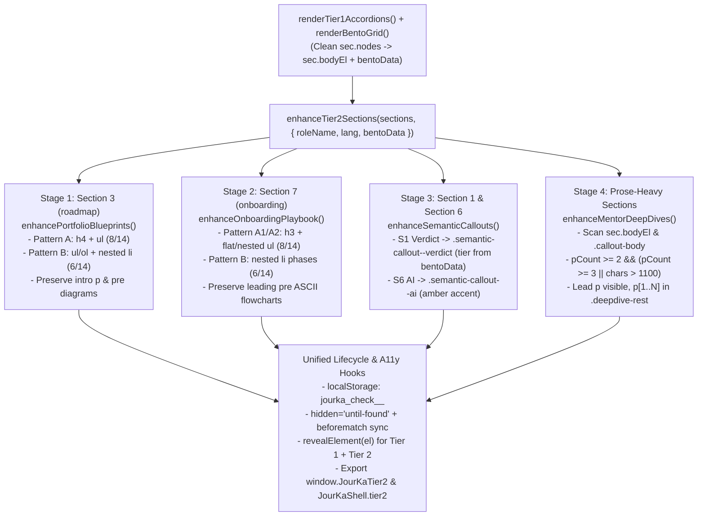

# [JK-FE-007] Tier 2: Intra-Section Expandables (Portfolio Blueprints, 30/60/90 Playbook & Mentor Deep-Dives) — Implementation Plan

> **Issue / Source:** `https://github.com/prayogizan/JourKa/issues/9` (`#9`, retrieved via GitHub MCP `get_issue`)
> **Git Branch:** `feat/jk-fe-007-tier2-nested-expandables-playbook` *(checked out on `a181f03`, including merged PRs `#12`–`#17`: `JK-RPA-001`, `JK-RPA-002`, `JK-FE-003`–`JK-FE-006`)*
> **Epic:** `EPIC-JK-UX` — 3-Tier Progressive Disclosure ("Compact First → Expand") · **Priority / Points:** `P1 (High) / 5 pts`
> **Project Root:** `D:\UiPathProject\JourKa\JourKa` (`project.json`)
> **Project Type:** `Modern Windows XAML Process` (`targetFramework: Windows`, `dotNetVersion: net10.0`, frontend template asset: 100% self-contained single-file HTML5/CSS/JS)
> **Expression Language:** `VisualBasic` *(`0` `.xaml` edits in this ticket; 8-token VB.NET `.Replace()` contract preserved verbatim)*
> **Execution Autonomy:** `interactive` *(pauses for user approval before persisting the canonical plan to `JourKa/docs/plans/` and editing [DossierInteractiveTemplate.html](file:///D:/UiPathProject/JourKa/JourKa/Templates/DossierInteractiveTemplate.html))*
> **UI Targeting:** `N/A (static HTML5/CSS/JS template authoring; no UiPath UIA selectors or desktop capture)`
> **Canonical Plan Path (to persist in `T0`):** `JourKa/docs/plans/2026-11-20-jk-fe-007-tier2-nested-expandables-playbook.md`

---

## 1. Skill Auto-Discovery, Routing & Auto-Creation Gate *(mandatory — execute first)*

Audited via `Ensure-UiPathSkills.ps1 -Audit` — all 6 project-local skills are present in `.agents/skills/`:

```powershell
powershell -NoProfile -ExecutionPolicy Bypass -File "D:\UiPathProject\JourKa\.agents\skills\jourka-uipath-rpa\scripts\Ensure-UiPathSkills.ps1" -Audit
```

### 1.1 Active & Required Skills Matrix
| Skill Name | Scope (`D:\UiPathProject\JourKa\.agents\skills\<name>`) | Trigger / Role in This Plan | Status (`Loaded` / `Auto-Extract` / `Auto-Create`) |
|---|---|---|---|
| `jourka-uipath-rpa` | [.agents/skills/jourka-uipath-rpa/SKILL.md](file:///D:/UiPathProject/JourKa/.agents/skills/jourka-uipath-rpa/SKILL.md) | Master JourKa runbook, hard invariants, format isolation, plan template, `Invoke-JourKaGate.ps1` | `Loaded` |
| `jourka-interactive-html` | [.agents/skills/jourka-interactive-html/SKILL.md](file:///D:/UiPathProject/JourKa/.agents/skills/jourka-interactive-html/SKILL.md) | `DossierInteractiveTemplate.html` (`v2`) 8-token contract, offline GFM parity, `JK-FE-003..009` boundaries | `Loaded` |
| `uipath-planner` | [.agents/skills/uipath-planner/SKILL.md](file:///D:/UiPathProject/JourKa/.agents/skills/uipath-planner/SKILL.md) | Task derivation (`Identity` tuples), stop conditions, mandatory testing task | `Loaded` |
| `uipath-rpa` | [.agents/skills/uipath-rpa/SKILL.md](file:///D:/UiPathProject/JourKa/.agents/skills/uipath-rpa/SKILL.md) | Reference only — confirms `0` `.xaml` edits and VB.NET `.Replace()` token contract safety | `Loaded` |
| `uipath-review` | [.agents/skills/uipath-review/SKILL.md](file:///D:/UiPathProject/JourKa/.agents/skills/uipath-review/SKILL.md) | Read-only quality & invariant verification before PR | `Loaded` |
| `jourka-github-pr` | [.agents/skills/jourka-github-pr/SKILL.md](file:///D:/UiPathProject/JourKa/.agents/skills/jourka-github-pr/SKILL.md) | Conventional Commit & PR checklist (`Closes #9`) when PR is requested | `Loaded` |

### 1.2 Skill Gap Auto-Creation Decision
- **Does this ticket introduce a repeatable workflow, external API, NuGet package, or UI subsystem not covered above?** `No` — all 6 project-local skills in `.agents/skills/` cover every frontend template, accessibility, verification, and RPA invariance requirement of `JK-FE-007`.

---

## 2. Goal, Epic Boundary & Artifact Isolation *(mandatory)*

- **Outcome in one sentence:** Add four role-agnostic, bilingual (`EN`/`ID`), WCAG 2.2 AA Tier 2 progressive-disclosure components inside expanded Tier 1 section bodies in [DossierInteractiveTemplate.html](file:///D:/UiPathProject/JourKa/JourKa/Templates/DossierInteractiveTemplate.html): collapsible Portfolio Project Blueprint sub-cards, an interactive 30/60/90-day onboarding tab/checklist playbook (`localStorage`-persisted), Mentor Deep-Dive narrative expanders, and semantic S1/D4 Verdict & AI Sentiment callout boxes.
- **In scope (strictly owned by `JK-FE-007` / Issue `#9`):**
  - **Collapsible Portfolio Project Blueprint Sub-Cards (`.blueprint-card`, Section 3 `roadmap`):** Dual-pattern (`<h4>`/`<h3>` + `<ul>`/`<ol>` nested `<li>`) detector covering numeric (`1..3`), lettered (`A..C`), and unprefixed titles across `EN`/`ID`; collapsed by default showing `P1`–`P3` badge, cleaned title, 1-line Problem preview, and up to 4 Tech Stack / Tools pills; expanding reveals Problem Statement, complete Tech Stack, Workflow & Architecture, and a highlighted **Hiring Manager Evaluation Criteria** box (`.blueprint-eval-box`).
  - **Interactive 30/60/90-Day Onboarding Playbook (`.onboarding-playbook`, Section 7 `onboarding`):** Triple-variant (`<h3>` flat, `<h3>` + `Operational Focus` / nested `Action Items:`, and Pattern B top-level `<li>` phases) detector; WAI-ARIA 4-tab bar (`Phase 1: Days 1–30` | `Phase 2: Days 31–60` | `Phase 3: Days 61–90` | `All Phases`, localized for `ID`) with `ArrowLeft`/`ArrowRight`/`Home`/`End` keyboard navigation; live completion progress bar (`X / Y Milestones Completed`) + per-phase counters; interactive `<label class="check-item"><input type="checkbox"> <span>...</span></label>` rows persisted in `localStorage` under `jourka_check_<role>_<lang>`.
  - **Mentor Deep-Dive Narrative Expander (`.deepdive-block`):** Detects contiguous `<p>` sequences with `>= 2` paragraphs where `count >= 3 || totalChars > 1100` in prose-heavy subsections; keeps Paragraph 1 visible and collapses Paragraphs `2..N` inside `.deepdive-rest` with localized pill button (`"Read full mentor commentary (+N paragraphs) ↓"` / `"Baca ulasan lengkap mentor (+N paragraf) ↓"`).
  - **Semantic Callout Cards (`.semantic-callout`):** Automatically wraps Section 1's `Education & Degree / Qualification [S1/D4] Verdict` subsection (`.semantic-callout--verdict`, dynamically accented by verdict tier `required|preferred|optional|neutral`) and Section 6's `AI Sentiment & Future Outlook` subsection (`.semantic-callout--ai`, distinct amber editorial accent) with SVG icons and Light/Dark WCAG AA tokens.
  - **Controller & Downstream Integration API (`window.JourKaTier2` & `window.JourKaShell.tier2`):** Exposes `expandBlueprint`, `collapseBlueprint`, `toggleBlueprint`, `selectOnboardingPhase`, `resetOnboardingChecks`, `toggleDeepDive`, `expandAllTier2`, `collapseAllTier2`, and `revealElement(el)` (opens enclosing Tier 1 + Tier 2 containers for `#hash`, `beforematch`, and future `JK-FE-009` search).
- **Out of scope (owned by sibling tickets — zero scope creep):**
  - `JK-FE-008` (`#10`): ASCII `<pre>` → `.flow-stepper` converter, inline `[Jxx]`/`[Yxx]`/`[Axx]` `.cite-chip` popovers, and Section 2 / Section 8–9 table filter bars. *(Strictly preserve `<pre>` blocks and inline citation text nodes so `#10` plugs in cleanly.)*
  - `JK-FE-009` (`#11`): Activating `#view-mode-group` (`Compact` ↔ `Expand All`, keep `aria-disabled="true"` untouched), `Ctrl+K` / `/` live search (`#dossier-search`), `IntersectionObserver` scrollspy active-TOC tracking, and cross-widget `I18N` consolidation.
  - `JK-RPA-001` (`#3`), `JK-RPA-002` (`#4`), `JK-FE-003`–`006` (`#5`–`#8`): Already merged.
- **Immutable Artifacts & Contracts (MUST NOT change):**
  - All 8 VB.NET template tokens (`{{LANG_CODE}}`, `{{DOC_TITLE}}`, `{{ROLE_NAME}}`, `{{BANNER_SUFFIX}}`, `{{META_PILLS_HTML}}`, `{{COUNTERPART_HREF}}`, `{{COUNTERPART_LABEL}}`, `{{MARKDOWN_ENCODED}}`) and exact `<html lang="{{LANG_CODE}}" data-jourka-ui="v2" data-theme="light">` stamp.
  - Existing APIs & IDs: `window.JourKaParser`, `window.JourKaBento`, `window.JourKaAccordion`, `window.JourKaShell`, `#m`, `#c`, `#bento-root`, `#section-N`, `#section-N-heading`, `#sec-body-N`.
  - [Main.xaml](file:///D:/UiPathProject/JourKa/JourKa/Main.xaml), [PublishDossier.xaml](file:///D:/UiPathProject/JourKa/JourKa/Workflows/PublishDossier.xaml), [project.json](file:///D:/UiPathProject/JourKa/JourKa/project.json), all 14 `.md` files, and all 28 `.pdf` files (`JourKa/Output/` & `PDF_Results/`): **0 byte changes**.

---

## 3. Codebase, Workflow & Activity Discovery *(mandatory — Rule 17 & Rule 21)*

Verified directly against live [DossierInteractiveTemplate.html](file:///D:/UiPathProject/JourKa/JourKa/Templates/DossierInteractiveTemplate.html) (`4,183` lines) and all `14` committed EN/ID Markdown dossiers in `JourKa/Output/` (`42` Portfolio Projects, `42` Onboarding Phases, `114` sections).

### 3.1 Live Codebase & 14-Dossier Empirical Findings
| # | Finding | Verified Location / Evidence | Impact on Plan |
|---|---|---|---|
| **F1** | Initialization order runs `renderTier1Accordions()` → `extractBentoData()` → `renderBentoGrid()` at lines `4100–4107`. | [DossierInteractiveTemplate.html#L4100-L4107](file:///D:/UiPathProject/JourKa/JourKa/Templates/DossierInteractiveTemplate.html#L4100-L4107) | Run `enhanceTier2Sections()` **immediately after** `renderBentoGrid()` so Tier 0 (`extractBentoData`) and Tier 1 (`extractSectionPreview`) stay 100% regression-free and Tier 2 reuses `bentoData.degree.tier` directly. |
| **F2** | Every `SectionModel` already exposes `sec.bodyEl` (`.section-body-content`), `sec.cardEl`, `sec.sectionType`, and `slugifyRole()` is already defined. | [DossierInteractiveTemplate.html#L3517-L3522](file:///D:/UiPathProject/JourKa/JourKa/Templates/DossierInteractiveTemplate.html#L3517-L3522), [#L4067-L4071](file:///D:/UiPathProject/JourKa/JourKa/Templates/DossierInteractiveTemplate.html#L4067-L4071) | Mount all Tier 2 upgrades directly inside `sec.bodyEl` and reuse `slugifyRole(roleName)` for `jourka_check_<role>_<lang>`. |
| **F3** | **Section 3 Portfolio Blueprints span 3 DOM patterns across 14/14 dossiers (42/42 projects):** (A) `<h4>` (`Project 1..3`, `Proyek 1..3`, `Project Blueprint 1..3/A..C`, `Cetak Biru Proyek 1..3`, `Blueprint A..C`, `Cetak Biru A..C`, `Blueprint Proyek A..C` — 8/14); (B1) `<ul>` with `<em>` sub-field labels (`Kotlin Multiplatform` — 2/14); (B2) `<ol>` with optional intro `<p>` (`Android Engineer` — 2/14) or unprefixed titles (`Mobile Developer` — 2/14). | Audited all 14 `JourKa/Output/*/*.md` files (`42/42` projects verified) | Locate the Portfolio `<h3>` container (`/portfolio\|portofolio\|blueprint\|cetak\s+biru/i`), preserve any leading intro `<p>`, detect both Pattern A (`<h4>`/`<h3>`) and Pattern B (`<ul>`/`<ol>` whose `<li>`s contain structured sub-lists), and match sub-field labels across **both** `<strong>` and `<em>`. |
| **F4** | **Section 7 Onboarding spans 3 DOM patterns across 14/14 dossiers (42/42 phases):** (A1) `<h3>` + flat `<ul>` (`KMP`, `Mobile Eng`, `Video Editor` — 6/14); (A2) `<h3>` + `Operational Focus:` + nested `Action Items:` `<ul>` (`Apoteker` — 2/14); (B) single `<ul>` with 3 bold top-level `<li>` phases (`Android Dev`, `Android Eng`, `Mobile Dev` — 6/14). | Audited all 14 `JourKa/Output/*/*.md` files (`42/42` phases verified) | Handle all 3 variants cleanly: extract `Operational Focus:` / `Fokus Operasional:` into a `.phase-focus` callout strip and unwrap container `<li>` items like `Action Items:` / `Butir Tindakan:` so every leaf action becomes an individual `.check-item`. |
| **F5** | **`marked.parse` wraps loose `<li>` headings in `<p><strong>...</strong></p>`, whereas `fallbackMarkdownToHtml` emits `<li><strong>...</strong></li>` directly.** | Verified via Node harness running template's `fallbackMarkdownToHtml` on all 7 roles | Use unified helper `getLeadElement(li)` checking `:scope > strong, :scope > em, :scope > p > strong, :scope > p > em` so online and offline rendering produce identical Tier 2 trees. |
| **F6** | **6/14 dossiers have a `<pre><code>` ASCII flowchart at the top of Section 7** (`Android Dev`, `KMP`, `Video Editor` EN/ID) and **14/14 have one at the top of Section 3**. | Audited all 14 `JourKa/Output/*/*.md` files | Leave all `<pre>` blocks untouched in `.section-body-content` above `.onboarding-playbook` / `.blueprint-grid` so `JK-FE-008` converts them seamlessly. |
| **F7** | **14/14 dossiers have exact S1 Verdict `<h3>` and S6 AI Sentiment `<h3>` headings** (with 5 ID title variations on S1: `Penilaian`, `Verifikasi`, `Putusan`, `Verdict`, `Keputusan`). | Audited all 14 `JourKa/Output/*/*.md` files | Match S1 Verdict with `/s1\s*\/\s*d4\|education\s*(?:&\|and)?\s*degree\|pendidikan\s*(?:&\|dan)?\s*gelar/i` and S6 AI Sentiment with `/ai\s+sentiment\|sentimen\s+ai\|future\s+outlook\|prospek\s+masa\s+depan/i`. |
| **F8** | **Contiguous `<p>` runs triggering `>= 3` paras OR `> 1,100` chars:** S1 top (`14/14`, 2 paras, `1507–2421` chars), S1 Verdict (`8/14`, 2 paras, `1191–1651` chars), S2 Hiring Manager (`7/14`, 2–4 paras, `1092–1660` chars), S4 Routine (`14/14`, 3 paras, `1180–2439` chars), S6 AI Sentiment (`4/14`, 2 paras, `1172–1366` chars), S6 Honest Realities (`4/14`, 3 paras, `1188–1594` chars). | Full 114-section Node audit across all 14 dossiers | Require `run.length >= 2 && (run.length >= 3 || totalChars > 1100)` so single-paragraph blocks never collapse; run after callout wrapping so long prose inside S1/S6 callouts also gains a clean deep-dive toggle. |
| **F9** | Existing `beforematch` listener at lines `4082–4087` and `applyHashExpansion()` at lines `3905–3925` only expand outer `.dossier-card` accordions. | [DossierInteractiveTemplate.html#L3905-L3925](file:///D:/UiPathProject/JourKa/JourKa/Templates/DossierInteractiveTemplate.html#L3905-L3925), [#L4082-L4087](file:///D:/UiPathProject/JourKa/JourKa/Templates/DossierInteractiveTemplate.html#L4082-L4087) | Extend `beforematch` and hash resolution via `revealElement(el)` so `Ctrl+F` matches or deep-links inside a collapsed `.blueprint-card`, `.deepdive-rest`, or inactive `.onboarding-panel` expand **both** Tier 2 and Tier 1 cleanly. |

### 3.2 Target `InvokeCode` & Workflow Inventory
| Workflow / Template File | Activity `IdRef` / Section | In / Out Arguments or Tokens | Scope in `JK-FE-007` |
|---|---|---|---|
| [JourKa/Templates/DossierInteractiveTemplate.html](file:///D:/UiPathProject/JourKa/JourKa/Templates/DossierInteractiveTemplate.html) | `<style>` (Tier 2 `.blueprint-*`, `.onboarding-*`, `.check-item`, `.deepdive-*`, `.semantic-callout*` + Light/Dark, mobile, coarse-pointer, `forced-colors`, `@media print`) & `<script>` (`TIER2_I18N`, 4 Tier 2 enhancers, `localStorage` persistence, `revealElement`, `window.JourKaTier2` & `window.JourKaShell.tier2`) | Preserves all 8 immutable VB.NET tokens (`{{LANG_CODE}}`..`{{MARKDOWN_ENCODED}}`), `JourKaParser`, `JourKaBento`, `JourKaAccordion` | **Primary edit target** |
| [JourKa/Main.xaml](file:///D:/UiPathProject/JourKa/JourKa/Main.xaml) & [JourKa/Workflows/PublishDossier.xaml](file:///D:/UiPathProject/JourKa/JourKa/Workflows/PublishDossier.xaml) | `N/A` | Verified 8-token `.Replace()` chain & `data-jourka-ui="v2"` regex | **Read-only (`0` edits)** |

### 3.3 NuGet Package & Activity Resolution Gate (`Rule 21`)
- **Dependencies in `project.json` sufficient?** `Yes` — zero `.xaml` / `.cs` edits, zero NuGet changes.
- **New XAML Activities Added:** `None` (`N/A` — pure single-file HTML5/CSS/JS template deliverable).

---

## 4. UiPath Common Pitfalls & Analyzer Vetting Gate *(mandatory — Rule 22)*

Vetted against [invokecode-rules.md](file:///D:/UiPathProject/JourKa/.agents/skills/jourka-uipath-rpa/references/invokecode-rules.md), [jourka-interactive-html/SKILL.md](file:///D:/UiPathProject/JourKa/.agents/skills/jourka-interactive-html/SKILL.md), and WCAG 2.2 AA / WAI-ARIA APG best practices:

- [ ] **8-Token & `v2` Stamp Hygiene:** Keep `<html lang="{{LANG_CODE}}" data-jourka-ui="v2" data-theme="light">` and all 8 `{{TOKEN}}` placeholders exact; never write literal `{{...}}` sequences in new CSS/JS/comments.
- [ ] **Single-File `file://` Offline Portability:** Zero external scripts/CSS/fonts added; all icons are inline `<svg aria-hidden="true" focusable="false">` using existing `createSvgIcon()`.
- [ ] **Zero Unsafe DOM Sinks:** Build every Tier 2 wrapper via `document.createElement()` / `.textContent` and **move existing sanitized DOM child nodes** (`appendChild` of parsed children) — never concatenate extracted text into `innerHTML`.
- [ ] **Heading-Preserving Blueprint Accordions (WCAG 2.2 AA / APG):** Wrap `<button type="button" class="blueprint-toggle" aria-expanded="false" aria-controls="blueprint-body-N">` inside `<h4>` (never `<details><summary><h4>`), keeping ONLY the concise project title inside the button's accessible name, with a stretched `::after` click target across `.blueprint-header` and `:focus-visible` ring on `.blueprint-header:has(.blueprint-toggle:focus-visible)` + `@supports not` fallback.
- [ ] **WAI-ARIA Tabs Pattern for 30/60/90 Onboarding:** Use `role="tablist"`, `role="tab"` (`aria-selected`, `aria-controls`, roving `tabindex`), and `role="tabpanel"` (`aria-labelledby`), with `ArrowLeft`/`ArrowRight`/`Home`/`End` keyboard navigation and native `<input type="checkbox">` (preserving natural `Space` toggle, screen-reader announcement, and Windows High Contrast visibility).
- [ ] **Single-Source-of-Truth `All Phases` View:** Render 3 `.onboarding-panel` containers (`p1`, `p2`, `p3`); selecting `All Phases` simply unhides all 3 panels simultaneously — **zero duplicated checkboxes**, zero state desync, and `0` duplicate DOM IDs.
- [ ] **Collapsed Tab-Order Isolation & `hidden="until-found"` + `beforematch`:** Apply `hidden="until-found"` to settled-collapsed `.blueprint-body-inner`, `.deepdive-rest-inner`, and inactive `.onboarding-panel` nodes (never put padding/borders on `[hidden="until-found"]`; sync collapse transitions via `getAnimations()` re-checking `data-expanded === 'false'`; gate CSS transitions strictly inside `@media (prefers-reduced-motion: no-preference)`).
- [ ] **WCAG AA Contrast, Forced Colors & Print Completeness:** Use calibrated existing `:root` / `[data-theme="dark"]` semantic tokens (`--accent`, `--emerald`, `--amber`, `--rose` + `-soft` / `-text` variants) for `>= 4.5:1` contrast; add `@media (forced-colors: active)` borders/outlines; force all `.blueprint-body-wrap`, `.deepdive-rest-wrap`, and all 3 `.onboarding-panel` elements expanded/visible in `@media print` while hiding `.deepdive-toggle`, `.onboarding-tabs`, and `.blueprint-chevron`.
- [ ] **Storage Fault Tolerance:** Wrap every `localStorage.getItem`/`setItem`/`removeItem` and `JSON.parse` call for `jourka_check_<role>_<lang>` in `try/catch` (handles private browsing / strict `file://` origins gracefully) and listen to `window.storage` events for multi-tab sync.

---

## 5. Issue Gaps, Ambiguities, Decisions & Stop Conditions *(mandatory)*

### 5.1 Gaps & Decisions
| # | Gap / Ambiguity / Contradiction | Decision Taken & Rationale | Needs User Input? |
|---|---|---|---|
| **D1** | **Template-only edit vs. backfilling 14 committed `JourKa/Output/*/*.html` files:** Issue `#9` names `JourKa/Templates/DossierInteractiveTemplate.html` as the sole Target File; `JK-FE-003..006` all tested via git-ignored `JourKa/.local/preview/` and left `JourKa/Output/` clean until the epic completes. | **Default:** Edit **only** [DossierInteractiveTemplate.html](file:///D:/UiPathProject/JourKa/JourKa/Templates/DossierInteractiveTemplate.html) (plus canonical plan doc) and verify all 14 live rendered fixtures in `JourKa/.local/preview/`. | `Optional (default: Template only)` |
| **D2** | **Unprefixed `<ol>` projects (`Mobile Developer`) & lettered `Blueprint A/B/C` (`Mobile Engineer`, `Video Editor`):** Issue `#9` only mentions `Project 1..3` / `Proyek 1..3` / `Cetak Biru Proyek 1..3`. | Detect projects contextually inside the Section 3 Portfolio `<h3>` block (matching any `<h4>` siblings OR any `<ul>`/`<ol>` with `>= 2` structured sub-list items) and normalize badges to `P1`, `P2`, `P3` while stripping redundant prefixes (`Project 1:`, `Blueprint A:`, `Cetak Biru Proyek 1:`). Achieves `42/42` (`100%`) project coverage across all 14 dossiers. | `No` |
| **D3** | **`Apoteker` Section 7 has `Operational Focus:` + nested `Action Items:` sub-list:** Converting every top-level `<li>` naively would create broken parent checkboxes wrapping nested bullets. | Promote `Operational Focus:` / `Fokus Operasional:` to a styled `.phase-focus` subtitle banner above the checklist, and unwrap container `<li>`s (`Action Items:` / `Butir Tindakan:`) so each nested leaf bullet becomes an individual checkable `.check-item`. | `No` |
| **D4** | **Single-paragraph blocks exceeding `1,100` chars vs. multi-paragraph Deep-Dive rule:** Issue `#9` says *"keep Paragraph 1 visible... wrap Paragraphs 2..N"*. A 1-paragraph block has no `2..N`. | Enforce `run.length >= 2 && (run.length >= 3 || totalChars > 1100)` so every `.deepdive-block` genuinely keeps Paragraph 1 visible and reveals `+1` or more paragraphs on click. | `No` |
| **D5** | **Deep-Dive scope (`Section 2 Hiring Manager's Perspective` & inside S1/S6 Callouts):** `7/14` dossiers have 2–4 paragraph (`1,092–1,660` char) Hiring Manager essays in Section 2, and `8/14` S1 Verdict + `4/14` S6 AI Sentiment callouts have 2 long paragraphs (`1,172–1,651` chars). | **Default:** Apply `.deepdive-block` to prose-heavy sections `['overview', 'skills', 'routine', 'guidance', 'abroad', 'generic']` (including inside `.callout-body`) while excluding `roadmap`, `onboarding`, `salary`, and `evidence`. | `Optional (default: include S2 + callout bodies)` |
| **D6** | **Tech Stack pill parsing on verbose non-tech tools (`Apoteker`, `Video Editor`):** Strings include commas inside parentheses like `Clinical Pharmacology Databases (Micromedex, Medscape)` and duplicate entries (`Room Database, Room` in `Mobile Engineer - ID`). | Split on top-level commas (outside `(...)`), strip `[JYA]` citations & verbose explanatory parentheticals `(for ...)` / `(untuk ...)` for pills only (preserving full text in the expanded body), deduplicate case-insensitively, cap at `4` pills + optional `+N` overflow indicator. | `No` |

### 5.2 Stop Conditions
Execution pauses and hands back to the user/planner if any of these hard blockers occur:
- Any edit would touch `.xaml`, `.md`, `.pdf`, or `project.json` (violating format isolation).
- Fewer than `42/42` Portfolio Projects (across all 14 dossiers) or fewer than `42/42` Onboarding Phases parse cleanly under **both** online (`marked`) and offline (`forceFallback: true`) engines.
- Any Tier 0 (`JK-FE-005`) Bento KPI value or Tier 1 (`JK-FE-006`) 114-section preview strip regresses or changes unexpectedly.
- Any responsive viewport (`1280×800`, `1024×768`, `768×1024`, `375×812`) exhibits horizontal overflow (`scrollWidth > innerWidth`) or keyboard Tab traps inside collapsed Tier 2 containers.
- `git diff --stat` contains any file outside §7 Change Manifest.

---

## 6. Technical Design, Data Contracts & Failure Modes *(mandatory)*

### 6.1 Architecture & Data-Flow Diagram


### 6.2 Argument, Variable, DOM, Storage & API Contracts

#### A. Portfolio Project Blueprint Sub-Card (`.blueprint-grid` / `.blueprint-card`)
- **Container:** `<div class="blueprint-grid">` inserted immediately after the Portfolio `<h3>` (and any intro `<p>`), replacing the parsed project headings/lists.
- **Card markup:**
  - `<article class="blueprint-card" id="blueprint-N" data-blueprint-index="N" data-expanded="false">`
  - `.blueprint-header` (clickable via stretched `button.blueprint-toggle::after`):
    - Top row: `<span class="blueprint-badge" aria-hidden="true">P1</span>`, `<h4 class="blueprint-title" id="blueprint-N-heading"><button type="button" class="blueprint-toggle" aria-expanded="false" aria-controls="blueprint-body-N">Cleaned Title</button></h4>`, `<span class="blueprint-chevron" aria-hidden="true">...</span>`
    - Collapsed-only preview: `<p class="blueprint-preview-problem">` (`-webkit-line-clamp: 2`, hidden when `[data-expanded="true"]`)
    - Stack chips: `<div class="blueprint-stack-pills">` (up to `4` `.blueprint-pill` items + `+N` badge if extra tools exist)
  - `.blueprint-body-wrap#blueprint-body-N` → `.blueprint-body-inner[hidden="until-found"]` → `.blueprint-body-content`:
    - Structured `.blueprint-field` blocks (Problem Statement, Tech Stack, Workflow & Architecture — preserving rich inline DOM nodes like `<code>`, `<em>`, `[J01]`)
    - Highlighted `.blueprint-eval-box` for **Hiring Manager Evaluation Criteria** (emerald/accent left border + subtle tinted surface + clipboard-check SVG icon)

#### B. 30/60/90-Day Onboarding Playbook (`.onboarding-playbook`)
- **Markup:**
  - `<div class="onboarding-playbook" id="onboarding-playbook" data-active-phase="p1">`
  - `.onboarding-header`:
    - Completion summary: `<span class="onboarding-progress-label" id="onboarding-progress-label" aria-live="polite">0 / 9 Milestones Completed</span>` + `<button type="button" class="onboarding-reset-btn" hidden>Reset</button>`
    - Progress bar: `<div class="onboarding-progress-track" role="progressbar" aria-valuemin="0" aria-valuemax="9" aria-valuenow="0" aria-labelledby="onboarding-progress-label"><div class="onboarding-progress-fill"></div></div>`
  - `.onboarding-tabs` (`role="tablist"`, localized `aria-label`):
    - 4 `<button type="button" role="tab" class="onboarding-tab" id="onboarding-tab-p1" data-phase="p1" aria-selected="true" aria-controls="onboarding-panel-p1" tabindex="0">`:
      - `p1` (`Phase 1: Days 1–30` / `Fase 1: Hari 1–30`) + mini count badge `0/3`
      - `p2` (`Phase 2: Days 31–60` / `Fase 2: Hari 31–60`) + mini count badge `0/3`
      - `p3` (`Phase 3: Days 61–90` / `Fase 3: Hari 61–90`) + mini count badge `0/3`
      - `all` (`All Phases` / `Semua Fase`) controlling `onboarding-panel-p1 onboarding-panel-p2 onboarding-panel-p3`
  - `.onboarding-panels`:
    - 3 `<div class="onboarding-panel" id="onboarding-panel-pN" role="tabpanel" aria-labelledby="onboarding-tab-pN" data-phase="pN">` (`p2` and `p3` initialized with `hidden="until-found"`):
      - `<h3 class="onboarding-phase-title">` (preserves exact phase subtitle)
      - Optional `<p class="phase-focus">` (when `Operational Focus:` / `Fokus Operasional:` exists, e.g., `Apoteker`)
      - `<div class="onboarding-checklist">` containing `<label class="check-item" data-check-id="p1-0"><input type="checkbox" class="check-input" data-check-id="p1-0"><span class="check-text">...</span></label>`
- **`localStorage` Contract:**
  - Key: `'jourka_check_' + slugifyRole(roleName) + '_' + lang`
  - Payload: JSON object mapping checked item IDs to `true` (e.g., `{"p1-0":true,"p1-1":true}`); removes key cleanly when count returns to `0`. Syncs across tabs via `window.addEventListener('storage', ...)`.

#### C. Mentor Deep-Dive Expander (`.deepdive-block`)
- **Markup:**
  - `<div class="deepdive-block" id="deepdive-N" data-expanded="false">`
  - Lead paragraph (`.deepdive-lead`, always visible)
  - `<div class="deepdive-rest-wrap" id="deepdive-rest-N"><div class="deepdive-rest-inner" hidden="until-found"><div class="deepdive-rest">...p[1..N]...</div></div></div>`
  - `<button type="button" class="deepdive-toggle" aria-expanded="false" aria-controls="deepdive-rest-N">` with localized expand/collapse label.

#### D. Semantic Callout Cards (`.semantic-callout`)
- **Verdict Callout:** `<aside class="semantic-callout semantic-callout--verdict" data-callout="verdict" data-verdict-tier="required|preferred|optional|neutral">` with graduation-cap icon, original `<h3>`, localized tier pill (`Required` / `Strongly Preferred` / `Optional` / `Wajib` / `Sangat Direkomendasikan` / `Opsional`), and `.callout-body`.
- **AI Sentiment Callout:** `<aside class="semantic-callout semantic-callout--ai" data-callout="ai-sentiment">` with sparkles icon, original `<h3>`, localized badge (`AI Impact & Outlook` / `Dampak & Prospek AI`), and `.callout-body` styled with `--amber` / `--amber-soft` / `--amber-text`.

#### E. Bilingual Dictionary (`TIER2_I18N`)
| Key | English (`en`) | Bahasa Indonesia (`id`) |
|---|---|---|
| `blueprintStackLabel` | `'Tech stack & tools'` | `'Tech stack & alat'` |
| `blueprintEvalLabel` | `'Hiring Manager Evaluation Criteria'` | `'Kriteria Evaluasi Manajer Perekrutan'` |
| `onboardingTabsLabel` | `'30/60/90-day onboarding phases'` | `'Fase onboarding 30/60/90 hari'` |
| `phase1Tab` / `phase2Tab` / `phase3Tab` | `'Phase 1: Days 1\u201330'` / `'Phase 2: Days 31\u201360'` / `'Phase 3: Days 61\u201390'` | `'Fase 1: Hari 1\u201330'` / `'Fase 2: Hari 31\u201360'` / `'Fase 3: Hari 61\u201390'` |
| `allPhasesTab` | `'All Phases'` | `'Semua Fase'` |
| `progressLabel` | `(done, total) => done + ' / ' + total + ' Milestones Completed'` | `(done, total) => done + ' / ' + total + ' Pencapaian Selesai'` |
| `resetChecks` | `'Reset'` | `'Reset'` |
| `deepdiveMore` | `(n) => 'Read full mentor commentary (+' + n + (n === 1 ? ' paragraph' : ' paragraphs') + ') \u2193'` | `(n) => 'Baca ulasan lengkap mentor (+' + n + ' paragraf) \u2193'` |
| `deepdiveLess` | `'Show less mentor commentary \u2191'` | `'Ringkas ulasan mentor \u2191'` |
| `aiCalloutBadge` | `'AI Impact & Outlook'` | `'Dampak & Prospek AI'` |

#### F. Global Controller Exports
- `window.JourKaTier2`: `{ checkStorageKey, enhanceTier2Sections, enhancePortfolioBlueprints, enhanceOnboardingPlaybook, enhanceSemanticCallouts, enhanceMentorDeepDives, setBlueprintExpanded, toggleBlueprint, selectOnboardingPhase, getOnboardingProgress, resetOnboardingChecks, setDeepDiveExpanded, toggleDeepDive, expandAllTier2, collapseAllTier2, revealElement, getStats }`
- `window.JourKaShell`: adds `tier2: tier2Api`, `revealElement`, `expandAllTier2`, `collapseAllTier2` without altering any existing property.

### 6.3 Failure Modes & Degraded-Mode Fallbacks
| Failure Scenario | Detection | Recovery / Fallback Behavior | Observable Signal |
|---|---|---|---|
| `localStorage` blocked (sandboxed `file://` / incognito) or corrupted JSON | `try/catch` on `getItem`/`setItem`/`JSON.parse` | Checkboxes and progress bar still work in-memory; `0` uncaught exceptions | `0` console errors; live `X / Y` updates work |
| Future role uses unusual Section 3 / Section 7 headings (no match for blueprints or `< 2` phases) | Parser returns `items.length === 0` or `phases.length < 2` | Leaves original sanitized Markdown DOM completely untouched (graceful degradation) | Original lists/headings remain readable; `0` blank UI shells |
| Rapid double-click on `.blueprint-card` or `.deepdive-block` mid-collapse | `getAnimations()` settle callback re-checks `data-expanded === 'false'` before applying `hidden="until-found"` | Stale collapse callback aborts cleanly; card stays open | Smooth reversal, never snaps shut |
| Browser lacks `hidden="until-found"` (Safari) or `prefers-reduced-motion: reduce` is active | Feature/media checks (`transitions.length === 0`) | Removes/sets `hidden` synchronously; instant toggle with zero orphaned transitions | Full interactive behavior across all engines |
| Native `Ctrl+F` (`beforematch`) matches text inside a collapsed Tier 2 element inside a collapsed Tier 1 card | Delegated `beforematch` on `#c` calls `revealElement(ev.target)` | Reveals inner `.blueprint-card` / `.deepdive-block` / `.onboarding-panel` **and** enclosing `.dossier-card` simultaneously | Matched text immediately visible & synced |

---

## 7. Strict Change Manifest *(mandatory)*

`git diff --stat` at completion must be a strict subset of this table (`0` `.xaml`, `0` `.md`, `0` `.pdf`, `0` `project.json` edits):

| File Path | Action (`new` / `edit` / `delete`) | XAML Node / `IdRef` / Section | Summary of Change |
|---|---|---|---|
| `JourKa/docs/plans/2026-11-20-jk-fe-007-tier2-nested-expandables-playbook.md` | `new` | Canonical plan document | Persist approved `uipath-planner` plan & task tracker |
| [JourKa/Templates/DossierInteractiveTemplate.html](file:///D:/UiPathProject/JourKa/JourKa/Templates/DossierInteractiveTemplate.html) | `edit` | `<style>` & `<script>` runtime | Implement Tier 2 Portfolio Blueprint sub-cards, 30/60/90 onboarding tabs + persistent checklist, Mentor Deep-Dive expanders, Verdict & AI Sentiment callouts, and `window.JourKaTier2` API |

*(Temporary verification fixtures and scripts live strictly inside git-ignored `JourKa/.local/preview/`.)*

---

## 8. Turn-Budgeted Implementation Tasks (`uipath-planner` Schema) *(mandatory)*

### Task T0 — `jourka-uipath-rpa` — Persist Canonical Plan, Audit Skills & Snapshot Baseline
**Identity:** `jourka-uipath-rpa:JourKa:jk-fe-007-skills-and-baseline`
**Status:** `[ ] pending`
**Blocked by:** `none`
**Skill prompt:**
> Load `jourka-uipath-rpa` and `jourka-interactive-html`. Save this canonical plan to `JourKa/docs/plans/2026-11-20-jk-fe-007-tier2-nested-expandables-playbook.md`, verify all 6 project-local skills in `.agents/skills/`, confirm branch `feat/jk-fe-007-tier2-nested-expandables-playbook`, and snapshot `JourKa/Templates/DossierInteractiveTemplate.html` into git-ignored `JourKa/.local/preview/DossierInteractiveTemplate__before_fe007.html`.

- [ ] Save canonical plan to `JourKa/docs/plans/2026-11-20-jk-fe-007-tier2-nested-expandables-playbook.md`.
- [ ] Run `Ensure-UiPathSkills.ps1 -Audit` and confirm branch `feat/jk-fe-007-tier2-nested-expandables-playbook`.
- [ ] Snapshot baseline [DossierInteractiveTemplate.html](file:///D:/UiPathProject/JourKa/JourKa/Templates/DossierInteractiveTemplate.html) to git-ignored `JourKa/.local/preview/DossierInteractiveTemplate__before_fe007.html`.
- [ ] **Validate:** `git status --short` shows only the new plan file.

### Task T1 — `jourka-interactive-html` — Add Tier 2 CSS System (Blueprints, 30/60/90 Playbook, Deep-Dive, Semantic Callouts)
**Identity:** `jourka-interactive-html:JourKa:Templates/DossierInteractiveTemplate.html:tier2-styles`
**Status:** `[ ] pending`
**Blocked by:** `T0`
**Skill prompt:**
> Load `jourka-interactive-html`. Inside `JourKa/Templates/DossierInteractiveTemplate.html`, add Light/Dark CSS for `.blueprint-*`, `.onboarding-*`, `.check-item`, `.deepdive-*`, and `.semantic-callout*` including responsive (`<= 639px`), `@media (pointer: coarse)`, `@media (forced-colors: active)`, and `@media print` overrides. Preserve all 8 VB.NET `{{TOKEN}}` placeholders and `data-jourka-ui="v2"`.

- [ ] Add CSS for `.blueprint-grid`, `.blueprint-card`, `.blueprint-header`, `.blueprint-badge`, `.blueprint-title`, stretched `.blueprint-toggle` (`:has(.blueprint-toggle:focus-visible)` + fallback), `.blueprint-preview-problem`, `.blueprint-stack-pills`, `.blueprint-body-wrap` (`grid-template-rows: 0fr -> 1fr` gated under `prefers-reduced-motion: no-preference`), and `.blueprint-eval-box`.
- [ ] Add CSS for `.onboarding-playbook`, `.onboarding-header`, `.onboarding-progress-track`/`-fill`, `.onboarding-tabs`, `.onboarding-tab[aria-selected="true"]`, `.phase-focus`, and `.check-item`.
- [ ] Add CSS for `.deepdive-block`, `.deepdive-rest-wrap` (`0fr -> 1fr`), `.deepdive-toggle`, and `.semantic-callout` (`--verdict` with `[data-verdict-tier]` and `--ai` amber accent).
- [ ] Add responsive (`<= 639px`), `@media (pointer: coarse)`, `@media (forced-colors: active)`, and `@media print` overrides.
- [ ] **Validate:** Balanced CSS braces, zero literal `{{...}}` collisions, all 8 VB.NET tokens intact.

### Task T2 — `jourka-interactive-html` — Implement Portfolio Blueprint Sub-Cards (Dual-Pattern `<h4>` + `<ul>`/`<ol>`)
**Identity:** `jourka-interactive-html:JourKa:Templates/DossierInteractiveTemplate.html:tier2-blueprints`
**Status:** `[ ] pending`
**Blocked by:** `T1`
**Skill prompt:**
> Load `jourka-interactive-html`. Inside `JourKa/Templates/DossierInteractiveTemplate.html`, implement `TIER2_I18N`, `TIER2_ICONS`, `getLeadElement(li)`, `animateGridCollapse()`, `extractTechStackPills()`, and `enhancePortfolioBlueprints(sec, lang)` handling Pattern A (`<h4>`/`<h3>`) and Pattern B (`<ul>`/`<ol>`) across numeric, lettered, and unprefixed project titles while preserving intro `<p>` and `<pre>` diagrams.

- [ ] Add `TIER2_I18N`, `TIER2_ICONS`, `getLeadElement(li)`, and `animateGridCollapse(wrap, inner, isCollapsedFn)`.
- [ ] Implement `extractTechStackPills(text)` (parenthesis-aware comma splitter, citation stripping, deduplication, cap `4` + `+N` overflow).
- [ ] Implement `enhancePortfolioBlueprints(sec, lang)` classifying the 4 sub-fields across `<strong>` and `<em>` in EN/ID and rendering collapsed `.blueprint-card` sub-accordions with `.blueprint-eval-box`.
- [ ] **Validate:** Node DOM check across all `14` dossiers (online & offline) confirms `42/42` Portfolio Blueprints render with `P1`–`P3`, non-empty Problem previews, `1–4` Tech Stack chips, and `.blueprint-eval-box`.

### Task T3 — `jourka-interactive-html` — Implement Interactive 30/60/90-Day Onboarding Playbook & `localStorage` Checklist
**Identity:** `jourka-interactive-html:JourKa:Templates/DossierInteractiveTemplate.html:tier2-onboarding`
**Status:** `[ ] pending`
**Blocked by:** `T2`
**Skill prompt:**
> Load `jourka-interactive-html`. Inside `JourKa/Templates/DossierInteractiveTemplate.html`, implement `enhanceOnboardingPlaybook(sec, roleSlug, lang)` supporting Pattern A1 (`<h3>` + flat `<ul>`), Pattern A2 (`<h3>` + `Operational Focus` + nested `Action Items:`), and Pattern B (top-level `<li>` phases), preserving leading `<pre>` diagrams, WAI-ARIA 4-tab bar with keyboard nav, live progress bar, and `localStorage` persistence under `jourka_check_<role>_<lang>`.

- [ ] Implement `enhanceOnboardingPlaybook(sec, roleSlug, lang)` handling all 3 phase variants and unwrapping `Action Items:` / `Butir Tindakan:` containers.
- [ ] Wire 4-tab WAI-ARIA tablist (`p1`, `p2`, `p3`, `all`) with click + `ArrowLeft`/`ArrowRight`/`Home`/`End` keyboard nav, live `role="progressbar"` + `X / Y` label + per-phase mini counters, and `Reset` button.
- [ ] Wire `localStorage` persistence (`jourka_check_<role>_<lang>`) wrapped in `try/catch` + `window.storage` cross-tab sync.
- [ ] **Validate:** Node DOM check across all `14` dossiers (online & offline) confirms `42/42` phases detected, `0` container-only checkboxes, and `0` swallowed `<pre>` diagrams.

### Task T4 — `jourka-interactive-html` — Implement Semantic Callouts, Mentor Deep-Dives, `beforematch` / Hash Sync & Global APIs
**Identity:** `jourka-interactive-html:JourKa:Templates/DossierInteractiveTemplate.html:tier2-callouts-deepdive-api`
**Status:** `[ ] pending`
**Blocked by:** `T3`
**Skill prompt:**
> Load `jourka-interactive-html`. Inside `JourKa/Templates/DossierInteractiveTemplate.html`, implement `enhanceSemanticCallouts()`, `enhanceMentorDeepDives()`, `revealElement()`, `beforematch`/hash upgrades, and `window.JourKaTier2` + `window.JourKaShell.tier2` exports.

- [ ] Implement `enhanceSemanticCallouts(sec, lang, bentoData)` for Section 1 S1/D4 Verdict and Section 6 AI Sentiment.
- [ ] Implement `enhanceMentorDeepDives(sec, lang)` (`run.length >= 2 && (run.length >= 3 || totalChars > 1100)`) across prose-heavy sections and `.callout-body`.
- [ ] Wire `enhanceTier2Sections()` after `renderBentoGrid()`, upgrade `beforematch` & `applyHashExpansion()` via `revealElement(el)`, and export `window.JourKaTier2` + `window.JourKaShell.{tier2, revealElement, expandAllTier2, collapseAllTier2}`.
- [ ] **Validate:** Render all `14` EN/ID fixtures into `JourKa/.local/preview/` using `Main.xaml`'s 8-token `.Replace()` chain; verify `0` unreplaced `{{...}}` tokens, `0` duplicate DOM IDs, and `14/14` Verdict + `14/14` AI Sentiment callouts.

### Task T5 — `jourka-interactive-html` — Multi-Layer Verification & Invariant Gate (MANDATORY)
**Identity:** `jourka-interactive-html:JourKa:jk-fe-007-testing`
**Status:** `[ ] pending`
**Blocked by:** `T1, T2, T3, T4`
**Skill prompt:**
> Load `jourka-interactive-html`, `jourka-uipath-rpa`, and `uipath-review`. Execute all verification layers L1–L7 in §9 across all 14 live dossiers (online + offline), live browser Gherkin AC-1 & AC-2 over `file://`, responsive Light/Dark viewports, keyboard/A11y isolation, `prefers-reduced-motion`, and repo format-isolation invariants.

- [ ] Run **L1 & L2** automated token + 14-dossier online/offline extraction parity checks (`42/42` Blueprints, `42/42` Phases, `28/28` Callouts, `0` `<pre>` regressions).
- [ ] Run **L3 & L4** live browser verification over `file://` for both Gherkin Acceptance Criteria (`AC-1` Portfolio Blueprints & `AC-2` 30/60/90 Onboarding Tabs + `localStorage` reload persistence).
- [ ] Run **L5** responsive (`1280×800`, `768×1024`, `375×812`), Light/Dark, `prefers-reduced-motion`, `beforematch`, and keyboard Tab-isolation checks.
- [ ] Run **L6 & L7** UiPath & repo format-isolation invariant checks (`git diff --stat` ⊆ §7 Change Manifest, `0` `.xaml`/`.md`/`.pdf` diffs).

---

## 9. Multi-Layer Verification Matrix (`Gate != Runtime Proof`) *(mandatory)*

| Layer | Check | Command / Method | Pass Criterion |
|---|---|---|---|
| **L1 — Token & HTML5 Contract** | 8 VB.NET tokens intact, `data-jourka-ui="v2"` exact, `0` duplicate IDs | Node/PowerShell script applying `Main.xaml`'s exact 8-token `.Replace()` chain to all 14 `.md` files into `JourKa/.local/preview/` | `0` unreplaced `{{...}}` tokens; `v2` regex `True`; `0` duplicate DOM `id`s |
| **L2 — 14-Dossier Online + Offline Parity** | All 42 Portfolio Projects, 42 Onboarding Phases, 28 Callouts, and Deep-Dive triggers across `marked` & `forceFallback: true` | Automated Node harness over all 14 fixtures (online + offline) + synthetic edge fixtures | `42/42` Blueprints (`P1`–`P3`, preview, 1–4 pills, `.blueprint-eval-box`); `42/42` Onboarding phases with leaf `.check-item`s; `14/14` Verdict + `14/14` AI Sentiment callouts; `114/114` Tier 1 previews & Tier 0 Bento KPIs unchanged; `0` `<pre>` diagrams swallowed |
| **L3 — Live Browser Gherkin `AC-1` (Portfolio Blueprints)** | `Android Developer - EN.html` (`<h4>`), `Apoteker - ID.html` (`<h4>`), `Kotlin Multiplatform - EN.html` (`<ul>`), `Mobile Developer - EN.html` (`<ol>`), `Video Editor - ID.html` (`Blueprint Proyek A..C`) over `file://` | Browser subagent interactive check | Expanding Section 3 shows all 3 collapsed `.blueprint-card` sub-cards with Title, Problem preview, Tech Stack chips; clicking (and `Enter`/`Space`) expands full Architecture & highlighted Hiring Manager Evaluation Criteria; `0` console errors |
| **L4 — Live Browser Gherkin `AC-2` (30/60/90 Playbook + Reload)** | Check 2 items under `Days 1–30`, switch to `Days 31–60`, test `All Phases`, reload page (`Android Developer - EN`, `Apoteker - ID`, `Video Editor - EN`) | Live browser interactive check + reload assertion | `localStorage['jourka_check_<role>_<lang>']` persists checked IDs across reload; progress badge & `aria-valuenow` reflect `2 / N completed`; checked items remain checked; `ArrowRight`/`ArrowLeft`/`Home`/`End` keyboard tab switching works |
| **L5 — Deep-Dive, Callouts, `beforematch`, Responsive & A11y** | S1/S4/S6 Deep-Dive expand/collapse, S1 Verdict tier accents (`Apoteker` rose vs `Video Editor` emerald vs `Android` blue), S6 AI amber callout, `beforematch` sync, `1280×800`/`768×1024`/`375×812` Light & Dark, `prefers-reduced-motion: reduce` | Live browser viewport sweep & computed-style audit | `0px` horizontal overflow (`scrollWidth <= innerWidth`); collapsed Tier 2 content excluded from Tab order (`hidden="until-found"`); `h1 → h2 → h3 → h4` outline intact; `beforematch` opens nested Tier 2 + outer Tier 1 card; `0` console errors |
| **L6 — UiPath Pipeline Compatibility** | Zero `.xaml` / `project.json` changes | `git diff -- JourKa/Main.xaml JourKa/Workflows/PublishDossier.xaml JourKa/project.json` | `0` diff lines |
| **L7 — Repo Format-Isolation Invariants** | Zero unintended `.md` / `.pdf` / `Output` diffs | `git status --short -- JourKa/Output PDF_Results` & `git diff --stat` | `0` modified `.md` or `.pdf` files; changed files ⊆ §7 Change Manifest |

---

## 10. Risks, Rollback & Follow-Up Tech Debt

### 10.1 Risks & Mitigations
| Risk | Likelihood | Impact | Mitigation |
|---|---|---|---|
| **R1 (`marked` vs `fallback` loose-list DOM mismatch)** | `High` | `High` | Use unified `getLeadElement()` (`strong`/`em` direct or inside `<p>`) and verify under both engines in L2. |
| **R2 (Swallowing Section 3/7 `<pre>` ASCII diagrams needed by `JK-FE-008`)** | `Med` | `High` | Only consume nodes belonging to the Portfolio project sequence / Onboarding phase sequence; assert `<pre>` count preservation in L2. |
| **R3 (Duplicate checkboxes if `All Phases` clones DOM)** | `Med` | `High` | Unhide the 3 single-source-of-truth `.onboarding-panel` elements simultaneously when `All Phases` is active. |
| **R4 (Double-boxing visual noise inside expanded `.dossier-card`)** | `Med` | `Med` | Use subtle `--bg-canvas` / `--bg-subtle` contrast layering (`1px solid var(--border)`, `12px` radius) calibrated for both Light and Dark themes. |

### 10.2 Rollback Procedure
- Before commit: `git checkout -- JourKa/Templates/DossierInteractiveTemplate.html` and delete `JourKa/docs/plans/2026-11-20-jk-fe-007-tier2-nested-expandables-playbook.md` + `JourKa/.local/preview/`.
- After commit: `git revert <commit-sha>`.

### 10.3 Follow-Ups / Tech Debt (Out of Scope Here)
- **F1 (`JK-FE-008`, `#10`):** Upgrade preserved `<pre>` ASCII blocks to `.flow-stepper`, tokenize inline `[Jxx]`/`[Yxx]`/`[Axx]` inside Tier 2 blocks into `.cite-chip` popovers, and add table filter bars.
- **F2 (`JK-FE-009`, `#11`):** Wire toolbar `Compact` / `Expand All` to `JourKaShell.expandAll()`/`collapseAll()` (+ `expandAllTier2()`/`collapseAllTier2()`), and wire `Ctrl+K` live search to `JourKaShell.revealElement(el)`.

---

## 11. Definition of Done (DoD) Gate

- [ ] All 6 required project skills verified in `.agents/skills/` via `Ensure-UiPathSkills.ps1`.
- [ ] Dual-pattern Portfolio Blueprint parser (`<h4>`/`<h3>` + nested `<ul>`/`<ol>`) and compact `.blueprint-card` sub-accordions implemented (`42/42` projects verified online & offline).
- [ ] Interactive 30/60/90-day onboarding tabs (`Phase 1` | `Phase 2` | `Phase 3` | `All Phases`), live progress bar, and `localStorage`-persisted checkboxes (`jourka_check_<role>_<lang>`) implemented (`42/42` phases verified).
- [ ] Long narrative `"Read full mentor commentary"` expander (`.deepdive-block`) and S1 Verdict + S6 AI Sentiment semantic callout boxes styled for Light/Dark, mobile, `forced-colors`, and `@media print`.
- [ ] Both Gherkin Acceptance Criteria verified live over `file://` with `0` console errors and `0px` horizontal overflow.
- [ ] Format-isolation invariant check clean (`0` `.xaml`, `0` `.md`, `0` `.pdf`, `0` `project.json` changes; `git diff --stat` ⊆ §7 Change Manifest).
- [ ] Atomic Conventional Commit (`feat(jk-fe-007-tier2-nested-expandables-playbook): ... (#9)` with `Closes #9`).
