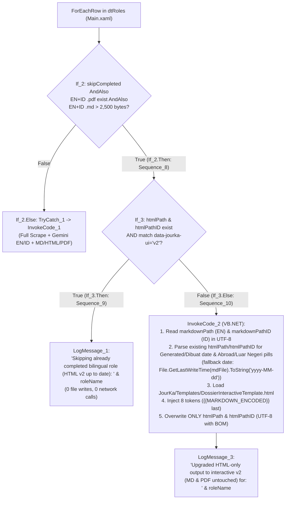

# [JK-RPA-002] In-Workflow Auto-Upgrade for Existing Completed Roles (`Main.xaml` `If_2`) & HTML-Only Backfill — Implementation Plan

> **Issue / Source:** https://github.com/prayogizan/JourKa/issues/4
> **Git Branch:** `feat/jk-rpa-002-in-workflow-html-upgrade` *(alternative: `rpa/jk-002-html-only-backfill`)*
> **Epic:** `EPIC-JK-RPA` — UiPath Workflow Pre-Output HTML Engine & Format Isolation · **Priority / Points:** `P1 (High) / 3 pts`
> **Project Root:** `D:\UiPathProject\JourKa\JourKa` (`project.json`)
> **Project Type:** `Modern Windows XAML Process` (`targetFramework: Windows`, `dotNetVersion: net10.0`)
> **Expression Language:** `VisualBasic` (`Option Strict On`, `Option Explicit On`)
> **Approach:** `explore-first`
> **Execution Autonomy:** `interactive` *(pauses for user approval before XAML mutation and before `uip rpa run` per `JourKa/AGENTS.md`)*
> **Delivery Model:** `standalone` *(local Studio / Robot execution)*
> **Packaging:** `standalone`
> **App Type / App State / UI Targeting:** `N/A (headless/API/InvokeCode — file-system & template transformation only)`
> **Canonical Plan Path:** `JourKa/docs/plans/2026-11-20-jk-rpa-002-in-workflow-html-upgrade.md`

---

## Understanding (`uipath-planner` Header Prelude)

When [Main.xaml](file:///Users/ottencoffee/ProjectLabs/Hackathon/JourKa/JourKa/Main.xaml#L275-L278) runs with `skipCompleted = True` and encounters a role in [Desire Role List.xlsx](file:///Users/ottencoffee/ProjectLabs/Hackathon/JourKa/JourKa/Input/Desire%20Role%20List.xlsx) whose EN and ID `.pdf` files and `.md` files (`> 2,500` bytes) already exist (`If_2`), it currently logs `"Skipping already completed bilingual role: " & roleName` and immediately moves to the next row. Consequently, all 7 previously completed roles (14 `.html` files in `JourKa/Output/<Role>/`) remain on legacy static `v1` HTML and cannot be upgraded in-workflow without deleting their `.pdf`/`.md` files and re-triggering expensive LinkedIn/YouTube/Arbeitnow scraping and Gemini API calls.

This plan upgrades `If_2.Then` in [Main.xaml](file:///Users/ottencoffee/ProjectLabs/Hackathon/JourKa/JourKa/Main.xaml#L275-L278) to inspect `<Role> - EN.html` and `<Role> - ID.html` for the `data-jourka-ui="v2"` marker (`data-jourka-ui="v2"` or `data-jourka-ui='v2'`). If both files already contain the `v2` marker, the workflow logs `"Skipping already completed bilingual role (HTML v2 up to date): " & roleName` with `0` file writes; if either file is missing or lacks `data-jourka-ui="v2"`, an isolated `ui:InvokeCode` (`InvokeCode_2`) reads the existing UTF-8 `.md` files from disk, extracts and preserves the original `Generated: YYYY-MM-DD` / `Dibuat: YYYY-MM-DD` date pill and any `Abroad (...): N verified` / `Luar Negeri (...): N terverifikasi` pill from the existing `.html` file, injects the 8 tokens into [DossierInteractiveTemplate.html](file:///Users/ottencoffee/ProjectLabs/Hackathon/JourKa/JourKa/Templates/DossierInteractiveTemplate.html), and overwrites **only** `htmlPath` and `htmlPathID`—making `0` network calls and leaving all `.md` and `.pdf` files byte-identical.

## Decisions & Trade-offs (`uipath-planner` Header Prelude)

- **Why `Project type: XAML` + `ui:InvokeCode` (`InvokeCode_2`) inside `If_2.Then`:** Matches JourKa's brownfield architecture where file I/O, Regex extraction, and chained 8-token `.Replace()` template injection live in compiled VB.NET `ui:InvokeCode` blocks rather than sprawling nested XAML `Assign` chains.
- **Why skill loading order is `jourka-uipath-rpa` → `uipath-rpa` → `jourka-interactive-html` → `uipath-review`:** `jourka-uipath-rpa` governs `InvokeCodeTool.ps1` and `Invoke-JourKaGate.ps1`; `uipath-rpa` enforces XAML Rules 16–25 (`<Sequence>` container wrapping in `If_2.Then` and `If_3`, permanent `IdRef` numbering); `jourka-interactive-html` enforces the 8-token contract and `data-jourka-ui="v2"` stamp across the 14 backfilled role HTMLs; `uipath-review` performs the final read-only quality and invariant audit.
- **Why Regex check `data-jourka-ui\s*=\s*["']v2["']` is used instead of `.Contains("v2")`:** Prevents a false positive on `data-jourka-ui='v2-fallback'` (the degraded inline template emitted when `DossierInteractiveTemplate.html` is temporarily missing), ensuring fallback files are automatically upgraded to full `v2` once the template is present.

---

## 1. Skill Auto-Discovery, Routing & Auto-Creation Gate *(mandatory — execute first)*

Before touching any file during execution, audit `.agents/skills/` against the task's domains and run [Ensure-UiPathSkills.ps1](file:///Users/ottencoffee/ProjectLabs/Hackathon/JourKa/.agents/skills/jourka-uipath-rpa/scripts/Ensure-UiPathSkills.ps1) so every required skill is present and loaded in this project workspace.

```powershell
powershell -NoProfile -ExecutionPolicy Bypass -File "D:\UiPathProject\JourKa\.agents\skills\jourka-uipath-rpa\scripts\Ensure-UiPathSkills.ps1" -EnsureCore -Audit
```

### 1.1 Active & Required Skills Matrix
| Skill Name | Scope (`D:\UiPathProject\JourKa\.agents\skills\<name>`) | Trigger / Role in This Plan | Status (`Loaded` / `Auto-Extract` / `Auto-Create`) |
|---|---|---|---|
| `jourka-uipath-rpa` | [.agents/skills/jourka-uipath-rpa/SKILL.md](file:///Users/ottencoffee/ProjectLabs/Hackathon/JourKa/.agents/skills/jourka-uipath-rpa/SKILL.md) | Master JourKa runbook, `InvokeCodeTool.ps1`, `Invoke-JourKaGate.ps1`, hard invariants | `Loaded` |
| `uipath-rpa` | [.agents/skills/uipath-rpa/SKILL.md](file:///Users/ottencoffee/ProjectLabs/Hackathon/JourKa/.agents/skills/uipath-rpa/SKILL.md) | Core UiPath XAML/InvokeCode rules (Rules 1–25), activity cards, common pitfalls, CLI reference | `Loaded` |
| `uipath-planner` | [.agents/skills/uipath-planner/SKILL.md](file:///Users/ottencoffee/ProjectLabs/Hackathon/JourKa/.agents/skills/uipath-planner/SKILL.md) | Task derivation (`Identity` tuples), turn-budgeted execution maps, stop conditions | `Loaded` |
| `uipath-review` | [.agents/skills/uipath-review/SKILL.md](file:///Users/ottencoffee/ProjectLabs/Hackathon/JourKa/.agents/skills/uipath-review/SKILL.md) | Read-only quality & Workflow Analyzer audit (`ST-USG-*`, `ST-MRD-*`, `ST-NMG-*`) | `Loaded` |
| `jourka-interactive-html` | [.agents/skills/jourka-interactive-html/SKILL.md](file:///Users/ottencoffee/ProjectLabs/Hackathon/JourKa/.agents/skills/jourka-interactive-html/SKILL.md) | `DossierInteractiveTemplate.html` (`v2`) 8-token contract, pill preservation, bilingual EN/ID backfill (`JK-RPA-002`) | `Loaded` |
| `jourka-github-pr` | [.agents/skills/jourka-github-pr/SKILL.md](file:///Users/ottencoffee/ProjectLabs/Hackathon/JourKa/.agents/skills/jourka-github-pr/SKILL.md) | PR formatting, issue linkage (`Closes #4`), format isolation proof | `Loaded` |

### 1.2 Skill Gap Auto-Creation Decision
- **Does this ticket introduce a repeatable workflow, external API, NuGet package, or UI subsystem not covered above?** `No` — all 6 required official and project-local skills (`jourka-uipath-rpa`, `uipath-rpa`, `uipath-planner`, `uipath-review`, `jourka-interactive-html`, `jourka-github-pr`) are already installed and verified in `.agents/skills/`.

---

## 2. Goal, Epic Boundary & Artifact Isolation *(mandatory)*

- **Outcome in one sentence:** Upgrade `If_2.Then` in [Main.xaml](file:///Users/ottencoffee/ProjectLabs/Hackathon/JourKa/JourKa/Main.xaml#L275-L278) so completed roles with missing or legacy `.html` files are automatically upgraded in-workflow to `data-jourka-ui="v2"` from existing on-disk `.md` files (with original `Generated`/`Dibuat` dates and `Abroad`/`Luar Negeri` pills preserved and `0` API/scraping calls), and backfill all 14 existing role `.html` files in `JourKa/Output/`.
- **In scope (strictly owned by `JK-RPA-002` / Issue #4):**
  - Modifying `If_2.Then` in [JourKa/Main.xaml](file:///Users/ottencoffee/ProjectLabs/Hackathon/JourKa/JourKa/Main.xaml#L275-L278) to check whether `htmlPath` and `htmlPathID` exist and contain `data-jourka-ui="v2"` (or `data-jourka-ui='v2'`).
  - Fast idempotent skip when both EN and ID `.html` files are already `v2`: log `"Skipping already completed bilingual role (HTML v2 up to date): " & roleName` with `0` file writes.
  - HTML-only upgrade via `InvokeCode_2` when either `.html` file is missing or legacy `v1`/`v2-fallback`: read `markdownPath` (`EN`) and `markdownPathID` (`ID`) in UTF-8, extract and preserve existing `Generated: YYYY-MM-DD` / `Dibuat: YYYY-MM-DD` and `Abroad (...): N verified` / `Luar Negeri (...): N terverifikasi` pills (with fallback to `File.GetLastWriteTime(mdFile).ToString("yyyy-MM-dd")`), inject the 8 tokens into [JourKa/Templates/DossierInteractiveTemplate.html](file:///Users/ottencoffee/ProjectLabs/Hackathon/JourKa/JourKa/Templates/DossierInteractiveTemplate.html), overwrite **only** `htmlPath` and `htmlPathID`, and log `"Upgraded HTML-only output to interactive v2 (MD & PDF untouched) for: " & roleName`.
  - Backfilling all 14 existing `.html` files across the 7 completed roles in `JourKa/Output/<Role>/<Role> - {EN,ID}.html`.
- **Out of scope (owned by sibling tickets — do NOT creep into these):**
  - `JK-RPA-001` (#3, merged): Decoupled `publishDossier` inside `Main.xaml` `InvokeCode_1` and `Workflows/PublishDossier.xaml` `InvokeCode_1`, plus initial creation of `JourKa/Templates/DossierInteractiveTemplate.html`.
  - `JK-FE-003` (#5): Full interactive app shell, Light/Dark CSS custom properties, zero-FOUC theme init, sticky toolbar, and 2-column responsive layout inside `DossierInteractiveTemplate.html`.
  - `JK-FE-004` (#6): Offline GFM fallback parser (`fallbackMarkdownToHtml`) and bilingual `classifySection` normalizer inside `DossierInteractiveTemplate.html`.
  - `JK-FE-005` (#7): Tier 0 executive Bento KPI summary grid inside `DossierInteractiveTemplate.html`.
  - `JK-FE-006` (#8): Tier 1 compact-first section accordions inside `DossierInteractiveTemplate.html`.
  - `JK-FE-007` (#9): Tier 2 nested expandables (Portfolio Blueprints, 30/60/90 checklist, Mentor Deep-Dives) inside `DossierInteractiveTemplate.html`.
  - `JK-FE-008` (#10): ASCII-to-Stepper converter, citation popovers, and filterable tables inside `DossierInteractiveTemplate.html`.
  - `JK-FE-009` (#11): Sticky TOC, `Ctrl+K` search with auto-expand, view mode switcher, EN/ID switcher UI polish, and `@media print` rules inside `DossierInteractiveTemplate.html`.
- **Immutable Artifacts & Contracts (MUST NOT change):**
  - All 14 committed Markdown files (`JourKa/Output/<Role>/<Role> - {EN,ID}.md`) — **0 byte changes allowed**.
  - All 14 role-folder PDFs (`JourKa/Output/<Role>/<Role> - {EN,ID}.pdf`) and all 14 consolidated PDFs (`PDF_Results/<Role> - {EN,ID}.pdf`) — **0 byte changes allowed**.
  - `If_2` outer condition expression in [Main.xaml#L275](file:///Users/ottencoffee/ProjectLabs/Hackathon/JourKa/JourKa/Main.xaml#L275) (`skipCompleted AndAlso ... Length > 2500`).
  - `If_2.Else` (`TryCatch_1` / `InvokeCode_1`) scraping, Gemini prompt generation, and `legacyPdfHtml` Chrome headless PDF pipeline in [Main.xaml#L279-L466](file:///Users/ottencoffee/ProjectLabs/Hackathon/JourKa/JourKa/Main.xaml#L279-L466).
  - [Workflows/PublishDossier.xaml](file:///Users/ottencoffee/ProjectLabs/Hackathon/JourKa/JourKa/Workflows/PublishDossier.xaml) and [JourKa/Templates/DossierInteractiveTemplate.html](file:///Users/ottencoffee/ProjectLabs/Hackathon/JourKa/JourKa/Templates/DossierInteractiveTemplate.html).
  - [JourKa/project.json](file:///Users/ottencoffee/ProjectLabs/Hackathon/JourKa/JourKa/project.json) (`targetFramework: "Windows"`, `dotNetVersion: "net10.0"`, `expressionLanguage: "VisualBasic"`).

---

## 3. Codebase, Workflow & Activity Discovery *(mandatory — Rule 17 & Rule 21)*

Verified directly against live [Main.xaml](file:///Users/ottencoffee/ProjectLabs/Hackathon/JourKa/JourKa/Main.xaml), [PublishDossier.xaml](file:///Users/ottencoffee/ProjectLabs/Hackathon/JourKa/JourKa/Workflows/PublishDossier.xaml), [DossierInteractiveTemplate.html](file:///Users/ottencoffee/ProjectLabs/Hackathon/JourKa/JourKa/Templates/DossierInteractiveTemplate.html), [Desire Role List.xlsx](file:///Users/ottencoffee/ProjectLabs/Hackathon/JourKa/JourKa/Input/Desire%20Role%20List.xlsx), and all 14 `JourKa/Output/*/*.html` files.

### 3.1 Live Codebase Findings
| # | Finding | Verified Location (`file#Lx-Ly`) | Impact on Plan |
|---|---|---|---|
| **F1** | `If_2` (`"If Both EN + ID PDFs Already Exist"`) checks `skipCompleted`, `currentStatus`, `File.Exists(pdfPath)`, `File.Exists(pdfPathID)`, and `FileInfo(markdownPath).Length > 2500` for both EN & ID. Its `<If.Then>` currently holds a bare `<ui:LogMessage IdRef="LogMessage_1">` without a `<Sequence>` wrapper. | [Main.xaml#L275-L278](file:///Users/ottencoffee/ProjectLabs/Hackathon/JourKa/JourKa/Main.xaml#L275-L278) | Keep `If_2.Condition` untouched. Wrap `If_2.Then` in `<Sequence IdRef="Sequence_8">` per Rule 24 and insert inner `<If IdRef="If_3">` checking the `v2` marker on `htmlPath` and `htmlPathID`. |
| **F2** | Highest existing numeric `IdRef`s in `Main.xaml` are `Sequence_7`, `If_2`, `InvokeCode_1`, `LogMessage_2`, and `Assign_11`. | [Main.xaml#L98-L475](file:///Users/ottencoffee/ProjectLabs/Hackathon/JourKa/JourKa/Main.xaml#L98-L475) | Rule 25 requires new activities to use next free numbers: `Sequence_8`, `Sequence_9`, `Sequence_10`, `If_3`, `InvokeCode_2`, and `LogMessage_3` (preserving `LogMessage_1` in the `v2`-already-up-to-date branch). |
| **F3** | `InvokeCode_1` in `Main.xaml` (updated in `JK-RPA-001`) resolves `DossierInteractiveTemplate.html` via a 2-path candidate array (`Environment.CurrentDirectory\Templates\...` and `in_RoleFolder\..\..\Templates\...`) with an inline `data-jourka-ui='v2-fallback'` fallback, and injects the 8 tokens via chained `.Replace()` with `{{MARKDOWN_ENCODED}}` last. | [Main.xaml#L417](file:///Users/ottencoffee/ProjectLabs/Hackathon/JourKa/JourKa/Main.xaml#L417) | Reuse the exact same template candidate resolution and 8-token `.Replace()` chain inside `InvokeCode_2` (`If_2.Then` → `If_3.Else`) so new and upgraded HTMLs are 100% structurally identical. |
| **F4** | All 14 existing `.html` files in `JourKa/Output/*/` are UTF-8 with BOM (`EF BB BF`), start with `<!DOCTYPE html><html lang='en'>` or `<html lang='id'>` (no `data-jourka-ui="v2"`), and carry `<span class='pill'>Generated: 2026-11-16</span>` (`EN`) or `<span class='pill'>Dibuat: 2026-11-16</span>` (`ID`). | [Video Editor - EN.html#L1](file:///Users/ottencoffee/ProjectLabs/Hackathon/JourKa/JourKa/Output/Video%20Editor/Video%20Editor%20-%20EN.html#L1), [Video Editor - ID.html#L1](file:///Users/ottencoffee/ProjectLabs/Hackathon/JourKa/JourKa/Output/Video%20Editor/Video%20Editor%20-%20ID.html#L1) | Regex extraction on existing `htmlFile` must capture `2026-11-16` from `(?:Generated\|Dibuat):\s*(\d{4}-\d{2}-\d{2})` and write output with `System.Text.Encoding.UTF8` (UTF-8 with BOM). |
| **F5** | Only `Video Editor` has an Abroad pill in its existing HTML (`<span class='pill'>Abroad (Singapore, Malaysia, United Kingdom): 1 verified</span>` in EN and `<span class='pill'>Luar Negeri (Singapore, Malaysia, United Kingdom): 1 terverifikasi</span>` in ID). All other 6 roles have 4 pills (`Level`, `Market`/`Pasar`, `Language`/`Bahasa`, `Generated`/`Dibuat`). Note that during `If_2.Then`, `ResearchAbroadJobs.xaml` is **not** run, so `abroadCount` is `0` in workflow memory. | [Video Editor - EN.html#L1](file:///Users/ottencoffee/ProjectLabs/Hackathon/JourKa/JourKa/Output/Video%20Editor/Video%20Editor%20-%20EN.html#L1), [Main.xaml#L275-L357](file:///Users/ottencoffee/ProjectLabs/Hackathon/JourKa/JourKa/Main.xaml#L275-L357) | `InvokeCode_2` **cannot** rely on `abroadCount` (which is uninitialized/`0` in `If_2.Then`); it MUST extract any existing `Abroad (...)` / `Luar Negeri (...)` `<span class='pill'>...</span>` directly from the legacy `.html` file on disk. |
| **F6** | `Workflows/PublishDossier.xaml` is a single-role publishing workflow that does not contain `If_2` or loop over `dtRoles`. | [PublishDossier.xaml#L1-L67](file:///Users/ottencoffee/ProjectLabs/Hackathon/JourKa/JourKa/Workflows/PublishDossier.xaml#L1-L67) | Documented per Hard Invariant #3: `If_2` exists only in `Main.xaml`, so `PublishDossier.xaml` requires no change in `JK-RPA-002`. |

### 3.2 Target `InvokeCode` & Workflow Inventory
| Workflow File | Activity `IdRef` | `DisplayName` | In / Out / InOut Arguments | Missing Namespace Imports to Fully-Qualify |
|---|---|---|---|---|
| [JourKa/Main.xaml](file:///Users/ottencoffee/ProjectLabs/Hackathon/JourKa/JourKa/Main.xaml) | `InvokeCode_2` *(new inside `If_2.Then` → `If_3.Else`)* | `Upgrade EN & ID HTML to Interactive v2 From Existing Markdown` | `in_RoleName` (`In String`), `in_RoleLevel` (`In String`), `in_RoleLocation` (`In String`), `in_ExtraKeywords` (`In String`), `in_RoleFolder` (`In String`), `in_MarkdownPath` (`In String`), `in_HtmlPath` (`In String`), `in_MarkdownPathID` (`In String`), `in_HtmlPathID` (`In String`) | All namespaces are imported in `Main.xaml`, but fully qualify `System.IO.File`, `System.IO.Path`, `System.Net.WebUtility`, `System.Uri`, `System.Text.Encoding`, `System.Text.RegularExpressions.Regex`, `System.Text.RegularExpressions.Match`, `System.Text.RegularExpressions.RegexOptions` per `invokecode-rules.md`. |

### 3.3 NuGet Package & Activity Resolution Gate (`Rule 21`)
- **Dependencies in `project.json` sufficient?** `Yes` (`UiPath.System.Activities [26.10.0]`, `UiPath.Excel.Activities [3.6.1]`). No new NuGet packages required.
- **New XAML Activities Added:**
  | Activity Class | Source (`Card` / `Memory` / `Rule 21 Triple: find -> <Activity>.md -> get-default-xaml`) | Required Properties Checklist | Container `<Sequence>` Slot Needed? |
  |---|---|---|---|
  | `System.Activities.Statements.Sequence` (`Sequence_8`, `Sequence_9`, `Sequence_10`) | `Card` (`common-activity-card.md § Sequence`) | `DisplayName`, `sap2010:WorkflowViewState.IdRef` | Is itself the Rule 24 container wrapper for `If_2.Then`, `If_3.Then`, `If_3.Else` |
  | `System.Activities.Statements.If` (`If_3`) | `Card` (`common-activity-card.md § If`) | `Condition`, `DisplayName`, `sap2010:WorkflowViewState.IdRef`, `<If.Then>`, `<If.Else>` | `Yes` (`Sequence_9` in `If.Then`, `Sequence_10` in `If.Else`) |
  | `UiPath.Core.Activities.InvokeCode` (`InvokeCode_2`) | `Card` (`common-pattern-card.md § Invoke Code`) | `Code` (attribute form only), `Language="VBNet"`, `DisplayName`, `ContinueOnError="{x:Null}"`, `sap2010:WorkflowViewState.IdRef`, `<ui:InvokeCode.Arguments>` | Placed inside `Sequence_10` (`If_3.Else`) |
  | `UiPath.Core.Activities.LogMessage` (`LogMessage_1` updated, `LogMessage_3` new) | `Card` (`common-activity-card.md § Log Message`) | `Level="Info"`, `Message`, `DisplayName`, `sap2010:WorkflowViewState.IdRef` | `LogMessage_1` inside `Sequence_9`; `LogMessage_3` inside `Sequence_10` |

---

## 4. UiPath Common Pitfalls & Analyzer Vetting Gate *(mandatory — Rule 22)*

Vetted against [.agents/skills/uipath-rpa/references/xaml/common-pitfalls.md](file:///Users/ottencoffee/ProjectLabs/Hackathon/JourKa/.agents/skills/uipath-rpa/references/xaml/common-pitfalls.md) and [.agents/skills/jourka-uipath-rpa/references/invokecode-rules.md](file:///Users/ottencoffee/ProjectLabs/Hackathon/JourKa/.agents/skills/jourka-uipath-rpa/references/invokecode-rules.md):

- [x] **`Option Strict On` & `Option Explicit On` (VB.NET):** Every variable (`Dim mdContent As String`, `Dim existingHtml As String`, `Dim genDate As String`, `Dim abroadPill As String`) and lambda (`Dim upgradeSingleHtml As Action(Of String, String, String)`) in `InvokeCode_2` has explicit types; no implicit `Object` conversions.
- [x] **Fully-Qualified CLR Types:** `System.IO.File`, `System.IO.Path`, `System.Net.WebUtility`, `System.Uri`, `System.Text.Encoding`, `System.Text.RegularExpressions.Regex`, `System.Text.RegularExpressions.Match`, and `System.Text.RegularExpressions.RegexOptions` are fully qualified.
- [x] **`InvokeCode` Method-Body Rule:** Top-level code in `InvokeCode_2` is a `Sub Run(...)` body with no top-level `Return <value>`; early exit inside `upgradeSingleHtml` uses bare `Return`.
- [x] **Safe XML Attribute Editing (`InvokeCodeTool.ps1`):** `InvokeCode_2` will be inserted as a minimal 1-line placeholder attribute in `Main.xaml`, and its multi-line VB.NET body will be injected via `InvokeCodeTool.ps1 inject -Xaml ... -IdRef InvokeCode_2` so XML attribute encoding (`&#xA;`, `&quot;`, `&amp;`, `&lt;`, `&gt;`) and well-formedness are guaranteed.
- [x] **Studio ViewState & Container Wrappers (Rules 20, 24, 25):** Leave `sap:WorkflowViewStateService.ViewState` and `HintSize` untouched on all unchanged nodes; wrap `If_2.Then` (`Sequence_8`), `If_3.Then` (`Sequence_9`), and `If_3.Else` (`Sequence_10`) in `<Sequence>`; keep `LogMessage_1` on the existing skip log activity and assign `Sequence_8..10`, `If_3`, `InvokeCode_2`, `LogMessage_3` without renumbering existing activities.
- [x] **Exception Taxonomy & Stack Preservation:** Template read checks `File.Exists` inside `Try...Catch` with graceful fallback to inline `v2-fallback` template; `InvokeCode_1` and outer `TryCatch_1` remain untouched.
- [x] **Process & Temp-File Lifecycle:** `InvokeCode_2` does **not** spawn `chrome.exe` and creates **zero** `%TEMP%\jourka_pdf_*.html` files (100% HTML-only regeneration).
- [x] **Template & String Escaping:** Uses chained `.Replace("{{TOKEN}}", val)` (never `String.Format`), and replaces `{{MARKDOWN_ENCODED}}` **last** so Markdown containing literal `{{...}}` is never re-substituted.
- [x] **Secret Redaction & Hygiene:** `InvokeCode_2` does not take `in_GeminiApiKey` as an argument and makes `0` network calls.

---

## 5. Issue Gaps, Ambiguities, Decisions & Stop Conditions *(mandatory)*

### 5.1 Gaps & Decisions
| # | Gap / Ambiguity / Contradiction | Decision Taken & Rationale | Needs User Input? |
|---|---|---|---|
| **D1** | **Distinguishing `data-jourka-ui="v2"` from `data-jourka-ui="v2-fallback"`:** Simple substring matching `.Contains("data-jourka-ui=""v2")` could match `v2-fallback` if quotes aren't closed. | Use `System.Text.RegularExpressions.Regex.IsMatch(htmlText, "data-jourka-ui\s*=\s*[""']v2[""']", System.Text.RegularExpressions.RegexOptions.IgnoreCase)` in `If_3.Condition`. This matches both `data-jourka-ui="v2"` and `data-jourka-ui='v2'`, while treating `data-jourka-ui='v2-fallback'` as needing an upgrade once `DossierInteractiveTemplate.html` is available. | `No` |
| **D2** | **Preserving `Abroad` / `Luar Negeri` pill when `If_2.Then` bypasses `ResearchAbroadJobs.xaml`:** Inside `If_2.Then`, `abroadCount` is `0` because scraping is skipped. | Extract the full `<span class='pill'>Abroad (...): N verified</span>` / `<span class='pill'>Luar Negeri (...): N terverifikasi</span>` tag directly from the existing `.html` file via Regex `(?is)<span\s+class=['""]pill['""]>\s*((?:Abroad\|Luar\s+Negeri)\s*\([^<]+?\):\s*\d+\s+(?:verified\|terverifikasi))\s*</span>`. | `No` |
| **D3** | **Preserving `Focus` / `Fokus` pill if present in legacy HTML or `extraKeywords`:** Issue #4 mentions preserving existing metadata pills (specifically `Generated`/`Dibuat` and `Abroad`/`Luar Negeri`). | If `in_ExtraKeywords` is non-empty, build `focusPill` just like `InvokeCode_1`; otherwise, if the existing `.html` contains `<span class='pill'>(?:Focus\|Fokus): ...</span>`, preserve that pill from the existing `.html`. | `No` |
| **D4** | **How to backfill the 14 existing `.html` files in `JourKa/Output/`:** On Windows with Studio (`uip`), running `Main.xaml` (or a backfill script calling the exact same template + pill preservation logic) updates all 14 files. | Provide **both** the in-workflow `Main.xaml` `If_2.Then` implementation (`InvokeCode_2`) **and** a deterministic execution step that applies the exact same 8-token + pill-preservation upgrade across all 14 existing `.html` files in `JourKa/Output/`. | `No` |

### 5.2 Stop Conditions
Execution continues through the approved tasks unless one of these hard blockers occurs:
- `uip rpa validate` or `uip rpa build` fails after 5 structured repair attempts (Package → Structure → Type → Properties → Logic).
- Live runtime execution (`uip rpa run`) is reached without explicit user consent (`JourKa/AGENTS.md`).
- The `uip` CLI / PowerShell runtime is unavailable on the current host when executing the Windows Studio CLI gate (`Invoke-JourKaGate.ps1`), in which case the agent reports the environment blocker per `JourKa/AGENTS.md`.
- An invariant check fails (any modification to `.md` or `.pdf` files in `JourKa/Output/` or `PDF_Results/`, or any diff outside §7 Change Manifest).

---

## 6. Technical Design, Data Contracts & Failure Modes *(mandatory)*

### 6.1 Architecture & Data-Flow Diagram


### 6.2 Argument, Variable & Token Contracts

#### A. `InvokeCode_2` Arguments Contract (`Main.xaml` `If_2.Then` → `If_3.Else`)
| Name | Kind | Type | Producer | Consumer | Encoding / Validation Rule |
|---|---|---|---|---|---|
| `in_RoleName` | `InArg` | `x:String` | `Main.xaml` (`[roleName]`) | `InvokeCode_2` | `HtmlEncode` in `{{ROLE_NAME}}` and `{{DOC_TITLE}}` |
| `in_RoleLevel` | `InArg` | `x:String` | `Main.xaml` (`[roleLevel]`) | `InvokeCode_2` | `HtmlEncode` in `Level: <val>` pill |
| `in_RoleLocation` | `InArg` | `x:String` | `Main.xaml` (`[roleLocation]`) | `InvokeCode_2` | `HtmlEncode` in `Market: <val>` / `Pasar: <val>` pill |
| `in_ExtraKeywords` | `InArg` | `x:String` | `Main.xaml` (`[extraKeywords]`) | `InvokeCode_2` | `HtmlEncode` in optional `Focus` / `Fokus` pill |
| `in_RoleFolder` | `InArg` | `x:String` | `Main.xaml` (`[roleFolder]`) | `InvokeCode_2` | Relative template resolution (`in_RoleFolder\..\..\Templates\DossierInteractiveTemplate.html`) |
| `in_MarkdownPath` | `InArg` | `x:String` | `Main.xaml` (`[markdownPath]`) | `InvokeCode_2` | Read-only (`File.ReadAllText(..., Encoding.UTF8)`); **never written** |
| `in_HtmlPath` | `InArg` | `x:String` | `Main.xaml` (`[htmlPath]`) | `InvokeCode_2` | Read existing pills if present; overwrite with `v2` HTML (`Encoding.UTF8`) |
| `in_MarkdownPathID` | `InArg` | `x:String` | `Main.xaml` (`[markdownPathID]`) | `InvokeCode_2` | Read-only (`File.ReadAllText(..., Encoding.UTF8)`); **never written** |
| `in_HtmlPathID` | `InArg` | `x:String` | `Main.xaml` (`[htmlPathID]`) | `InvokeCode_2` | Read existing pills if present; overwrite with `v2` HTML (`Encoding.UTF8`) |

#### B. 8-Token Template Injection Contract (`DossierInteractiveTemplate.html`)
| Order | Token | EN Value | ID Value | Encoding / Rule |
|---|---|---|---|---|
| 1 | `{{LANG_CODE}}` | `"en"` | `"id"` | Raw lowercase ISO code |
| 2 | `{{DOC_TITLE}}` | `HtmlEncode(in_RoleName & " - Career Dossier (EN)")` | `HtmlEncode(in_RoleName & " - Dosier Karier (ID)")` | `WebUtility.HtmlEncode` |
| 3 | `{{ROLE_NAME}}` | `HtmlEncode(in_RoleName)` | `HtmlEncode(in_RoleName)` | `WebUtility.HtmlEncode` |
| 4 | `{{BANNER_SUFFIX}}` | `HtmlEncode("Career Intelligence Dossier")` | `HtmlEncode("Dosier Intelijen Karier")` | `WebUtility.HtmlEncode` |
| 5 | `{{META_PILLS_HTML}}` | `<span class='pill'>Level: ...</span><span class='pill'>Market: ...</span>[focusPill]<span class='pill'>Language: English</span>[abroadPill]<span class='pill'>Generated: YYYY-MM-DD</span>` | `<span class='pill'>Level: ...</span><span class='pill'>Pasar: ...</span>[focusPill]<span class='pill'>Bahasa: Indonesia</span>[abroadPill]<span class='pill'>Dibuat: YYYY-MM-DD</span>` | Pre-built `<span class='pill'>` HTML with encoded inner text & preserved pills |
| 6 | `{{COUNTERPART_HREF}}` | `HtmlEncode(Uri.EscapeDataString("<Role> - ID.html"))` | `HtmlEncode(Uri.EscapeDataString("<Role> - EN.html"))` | `Uri.EscapeDataString` then `WebUtility.HtmlEncode` |
| 7 | `{{COUNTERPART_LABEL}}` | `"ID"` | `"EN"` | Literal label |
| 8 *(Last)* | `{{MARKDOWN_ENCODED}}` | `HtmlEncode(mdContentEN)` | `HtmlEncode(mdContentID)` | Replaced **last** via `WebUtility.HtmlEncode` |

#### C. Complete VB.NET Body for `InvokeCode_2` (`Main__InvokeCode_2.vb`)
```vbnet
Dim emDash As String = ChrW(&H2014)
Dim tplContent As String = ""
Dim tplCandidates As String() = New String() { _
    System.IO.Path.Combine(Environment.CurrentDirectory, "Templates", "DossierInteractiveTemplate.html"), _
    System.IO.Path.GetFullPath(System.IO.Path.Combine(in_RoleFolder, "..", "..", "Templates", "DossierInteractiveTemplate.html")) _
}
For Each tplCandidate As String In tplCandidates
    If System.IO.File.Exists(tplCandidate) Then
        Try
            tplContent = System.IO.File.ReadAllText(tplCandidate, System.Text.Encoding.UTF8)
            If Not String.IsNullOrWhiteSpace(tplContent) Then Exit For
        Catch
            tplContent = ""
        End Try
    End If
Next
If String.IsNullOrWhiteSpace(tplContent) Then
    tplContent = "<!DOCTYPE html><html lang='{{LANG_CODE}}' data-jourka-ui='v2-fallback' data-jourka-template='inline-fallback'><head><meta charset='utf-8'><title>{{DOC_TITLE}}</title><style>body{font-family:'Segoe UI',Arial,sans-serif;line-height:1.68;color:#1e293b;max-width:860px;margin:24px auto;padding:0 16px;}.banner{background:linear-gradient(135deg,#0f172a 0%,#1e3a8a 100%);color:#fff;padding:20px 24px;border-radius:10px;margin-bottom:20px;}.banner h1{margin:0 0 8px 0;font-size:22px;color:#fff;}.meta{display:flex;flex-wrap:wrap;gap:10px;font-size:12px;}.pill{background:rgba(255,255,255,0.16);padding:3px 10px;border-radius:999px;}</style><script src='https://cdn.jsdelivr.net/npm/marked/marked.min.js'></script></head><body><div class='banner'><h1>{{ROLE_NAME}} " & emDash & " {{BANNER_SUFFIX}}</h1><div class='meta'>{{META_PILLS_HTML}} <a class='pill' style='color:#fff;' href='{{COUNTERPART_HREF}}'>{{COUNTERPART_LABEL}}</a></div></div><div id='c'></div><textarea id='m' style='display:none;'>{{MARKDOWN_ENCODED}}</textarea><script>if(window.marked){document.getElementById('c').innerHTML=marked.parse(document.getElementById('m').value);}</script></body></html>"
End If

Dim upgradeSingleHtml As Action(Of String, String, String) = Sub(mdFile As String, htmlFile As String, langCode As String)
    If Not System.IO.File.Exists(mdFile) Then Return
    Dim mdContent As String = System.IO.File.ReadAllText(mdFile, System.Text.Encoding.UTF8)
    If String.IsNullOrWhiteSpace(mdContent) Then Return

    Dim isId As Boolean = String.Equals(langCode, "id", StringComparison.OrdinalIgnoreCase)
    Dim docTitleSuffix As String = If(isId, " - Dosier Karier (ID)", " - Career Dossier (EN)")
    Dim bannerSuffix As String = If(isId, "Dosier Intelijen Karier", "Career Intelligence Dossier")
    Dim lblMarket As String = If(isId, "Pasar: ", "Market: ")
    Dim lblFocus As String = If(isId, "Fokus: ", "Focus: ")
    Dim lblGen As String = If(isId, "Dibuat: ", "Generated: ")
    Dim lblLang As String = If(isId, "Bahasa: Indonesia", "Language: English")

    Dim existingHtml As String = ""
    If System.IO.File.Exists(htmlFile) Then
        Try
            existingHtml = System.IO.File.ReadAllText(htmlFile, System.Text.Encoding.UTF8)
        Catch
            existingHtml = ""
        End Try
    End If

    Dim genDate As String = ""
    If Not String.IsNullOrWhiteSpace(existingHtml) Then
        Dim mGen As System.Text.RegularExpressions.Match = System.Text.RegularExpressions.Regex.Match(existingHtml, "(?is)<span\s+class=['""]pill['""]>\s*(?:Generated|Dibuat):\s*(\d{4}-\d{2}-\d{2})\s*</span>")
        If mGen.Success Then
            genDate = mGen.Groups(1).Value.Trim()
        End If
    End If
    If String.IsNullOrWhiteSpace(genDate) Then
        genDate = System.IO.File.GetLastWriteTime(mdFile).ToString("yyyy-MM-dd")
    End If

    Dim focusPill As String = ""
    If Not String.IsNullOrWhiteSpace(in_ExtraKeywords) Then
        focusPill = "<span class='pill'>" & System.Net.WebUtility.HtmlEncode(lblFocus & in_ExtraKeywords) & "</span>"
    ElseIf Not String.IsNullOrWhiteSpace(existingHtml) Then
        Dim mFocus As System.Text.RegularExpressions.Match = System.Text.RegularExpressions.Regex.Match(existingHtml, "(?is)<span\s+class=['""]pill['""]>\s*(?:Focus|Fokus):\s*([^<]+?)\s*</span>")
        If mFocus.Success Then
            focusPill = "<span class='pill'>" & System.Net.WebUtility.HtmlEncode(lblFocus & System.Net.WebUtility.HtmlDecode(mFocus.Groups(1).Value.Trim())) & "</span>"
        End If
    End If

    Dim abroadPill As String = ""
    If Not String.IsNullOrWhiteSpace(existingHtml) Then
        Dim mAbroad As System.Text.RegularExpressions.Match = System.Text.RegularExpressions.Regex.Match(existingHtml, "(?is)<span\s+class=['""]pill['""]>\s*((?:Abroad|Luar\s+Negeri)\s*\([^<]+?\):\s*\d+\s+(?:verified|terverifikasi))\s*</span>")
        If mAbroad.Success Then
            Dim rawAbroadText As String = System.Net.WebUtility.HtmlDecode(mAbroad.Groups(1).Value.Trim())
            abroadPill = "<span class='pill'>" & System.Net.WebUtility.HtmlEncode(rawAbroadText) & "</span>"
        End If
    End If

    Dim metaPillsHtml As String = "<span class='pill'>Level: " & System.Net.WebUtility.HtmlEncode(in_RoleLevel) & "</span>" & _
        "<span class='pill'>" & System.Net.WebUtility.HtmlEncode(lblMarket & in_RoleLocation) & "</span>" & _
        focusPill & _
        "<span class='pill'>" & System.Net.WebUtility.HtmlEncode(lblLang) & "</span>" & _
        abroadPill & _
        "<span class='pill'>" & System.Net.WebUtility.HtmlEncode(lblGen & genDate) & "</span>"

    Dim htmlFileName As String = System.IO.Path.GetFileName(htmlFile)
    Dim counterpartFile As String = If(isId, htmlFileName.Replace(" - ID.html", " - EN.html"), htmlFileName.Replace(" - EN.html", " - ID.html"))
    If String.Equals(counterpartFile, htmlFileName, StringComparison.OrdinalIgnoreCase) Then
        counterpartFile = System.IO.Path.GetFileNameWithoutExtension(htmlFileName) & If(isId, " - EN.html", " - ID.html")
    End If
    Dim counterpartHref As String = System.Net.WebUtility.HtmlEncode(System.Uri.EscapeDataString(counterpartFile))
    Dim counterpartLabel As String = If(isId, "EN", "ID")

    Dim interactiveHtml As String = tplContent _
        .Replace("{{LANG_CODE}}", langCode) _
        .Replace("{{DOC_TITLE}}", System.Net.WebUtility.HtmlEncode(in_RoleName & docTitleSuffix)) _
        .Replace("{{ROLE_NAME}}", System.Net.WebUtility.HtmlEncode(in_RoleName)) _
        .Replace("{{BANNER_SUFFIX}}", System.Net.WebUtility.HtmlEncode(bannerSuffix)) _
        .Replace("{{META_PILLS_HTML}}", metaPillsHtml) _
        .Replace("{{COUNTERPART_HREF}}", counterpartHref) _
        .Replace("{{COUNTERPART_LABEL}}", counterpartLabel) _
        .Replace("{{MARKDOWN_ENCODED}}", System.Net.WebUtility.HtmlEncode(mdContent))
    System.IO.File.WriteAllText(htmlFile, interactiveHtml, System.Text.Encoding.UTF8)
End Sub

upgradeSingleHtml(in_MarkdownPath, in_HtmlPath, "en")
upgradeSingleHtml(in_MarkdownPathID, in_HtmlPathID, "id")
```

### 6.3 Failure Modes & Degraded-Mode Fallbacks
| Failure Scenario | Detection | Recovery / Fallback Behavior | Observable Signal |
|---|---|---|---|
| Legacy `.html` file was deleted on disk (only `.md` and `.pdf` exist) | `Not System.IO.File.Exists(htmlPath)` in `If_3.Condition` and `InvokeCode_2` | `If_3` routes to `Else` (`Sequence_10`); `genDate` falls back to `System.IO.File.GetLastWriteTime(mdFile).ToString("yyyy-MM-dd")`; `htmlFile` is created fresh in `v2` format. | `<Role> - {EN,ID}.html` created with `data-jourka-ui="v2"` and `.md` last-write date pill. |
| `DossierInteractiveTemplate.html` missing or unreadable at runtime | `tplCandidates` loop finds no non-empty template file | Falls back to inline `data-jourka-ui='v2-fallback'` HTML string (same degraded fallback as `InvokeCode_1`); subsequent run when template is restored auto-upgrades `v2-fallback` → `v2`. | `data-jourka-ui='v2-fallback'` in output `.html` until template is restored. |
| One language `.html` is already `v2` but its counterpart `.html` is `v1` or missing | `If_3.Condition` uses `AndAlso` across both `htmlPath` and `htmlPathID` | `If_3` evaluates to `False` and refreshes both `htmlPath` and `htmlPathID` deterministically from `markdownPath` and `markdownPathID` with preserved dates/pills. | Both `EN.html` and `ID.html` guaranteed at `data-jourka-ui="v2"`. |

---

## 7. Strict Change Manifest *(mandatory)*

Every file to be created or edited. `git diff --stat` at completion must be a strict subset of this table (0 `.md` and 0 `.pdf` files touched).

| File Path | Action (`new` / `edit` / `delete`) | XAML Node / `IdRef` / Section | Summary of Change |
|---|---|---|---|
| `JourKa/docs/plans/2026-11-20-jk-rpa-002-in-workflow-html-upgrade.md` | `new` | Full plan artifact | Canonical `uipath-planner` Non-PDD plan & tasks file saved in project `docs/plans/` |
| [JourKa/Main.xaml](file:///Users/ottencoffee/ProjectLabs/Hackathon/JourKa/JourKa/Main.xaml#L275-L278) | `edit` | `If_2.Then` (`Sequence_8`, `If_3`, `Sequence_9`, `LogMessage_1`, `Sequence_10`, `InvokeCode_2`, `LogMessage_3`) | Wrap `If_2.Then` in `Sequence_8`, add `If_3` checking `data-jourka-ui="v2"` on `htmlPath` & `htmlPathID`, update `LogMessage_1` message, and add `InvokeCode_2` + `LogMessage_3` in `If_3.Else` |
| [JourKa/Output/Android Developer/Android Developer - EN.html](file:///Users/ottencoffee/ProjectLabs/Hackathon/JourKa/JourKa/Output/Android%20Developer/Android%20Developer%20-%20EN.html) | `edit` | Full HTML (`v1` → `v2`) | Backfill to `data-jourka-ui="v2"` from `Android Developer - EN.md`, preserving `Generated: 2026-11-16` pill |
| [JourKa/Output/Android Developer/Android Developer - ID.html](file:///Users/ottencoffee/ProjectLabs/Hackathon/JourKa/JourKa/Output/Android%20Developer/Android%20Developer%20-%20ID.html) | `edit` | Full HTML (`v1` → `v2`) | Backfill to `data-jourka-ui="v2"` from `Android Developer - ID.md`, preserving `Dibuat: 2026-11-16` pill |
| [JourKa/Output/Android Engineer/Android Engineer - EN.html](file:///Users/ottencoffee/ProjectLabs/Hackathon/JourKa/JourKa/Output/Android%20Engineer/Android%20Engineer%20-%20EN.html) | `edit` | Full HTML (`v1` → `v2`) | Backfill to `data-jourka-ui="v2"` from `Android Engineer - EN.md`, preserving `Generated: 2026-11-16` pill |
| [JourKa/Output/Android Engineer/Android Engineer - ID.html](file:///Users/ottencoffee/ProjectLabs/Hackathon/JourKa/JourKa/Output/Android%20Engineer/Android%20Engineer%20-%20ID.html) | `edit` | Full HTML (`v1` → `v2`) | Backfill to `data-jourka-ui="v2"` from `Android Engineer - ID.md`, preserving `Dibuat: 2026-11-16` pill |
| [JourKa/Output/Apoteker/Apoteker - EN.html](file:///Users/ottencoffee/ProjectLabs/Hackathon/JourKa/JourKa/Output/Apoteker/Apoteker%20-%20EN.html) | `edit` | Full HTML (`v1` → `v2`) | Backfill to `data-jourka-ui="v2"` from `Apoteker - EN.md`, preserving `Generated: 2026-11-16` pill |
| [JourKa/Output/Apoteker/Apoteker - ID.html](file:///Users/ottencoffee/ProjectLabs/Hackathon/JourKa/JourKa/Output/Apoteker/Apoteker%20-%20ID.html) | `edit` | Full HTML (`v1` → `v2`) | Backfill to `data-jourka-ui="v2"` from `Apoteker - ID.md`, preserving `Dibuat: 2026-11-16` pill |
| [JourKa/Output/Kotlin Multiplatform/Kotlin Multiplatform - EN.html](file:///Users/ottencoffee/ProjectLabs/Hackathon/JourKa/JourKa/Output/Kotlin%20Multiplatform/Kotlin%20Multiplatform%20-%20EN.html) | `edit` | Full HTML (`v1` → `v2`) | Backfill to `data-jourka-ui="v2"` from `Kotlin Multiplatform - EN.md`, preserving `Generated: 2026-11-16` pill |
| [JourKa/Output/Kotlin Multiplatform/Kotlin Multiplatform - ID.html](file:///Users/ottencoffee/ProjectLabs/Hackathon/JourKa/JourKa/Output/Kotlin%20Multiplatform/Kotlin%20Multiplatform%20-%20ID.html) | `edit` | Full HTML (`v1` → `v2`) | Backfill to `data-jourka-ui="v2"` from `Kotlin Multiplatform - ID.md`, preserving `Dibuat: 2026-11-16` pill |
| [JourKa/Output/Mobile Developer/Mobile Developer - EN.html](file:///Users/ottencoffee/ProjectLabs/Hackathon/JourKa/JourKa/Output/Mobile%20Developer/Mobile%20Developer%20-%20EN.html) | `edit` | Full HTML (`v1` → `v2`) | Backfill to `data-jourka-ui="v2"` from `Mobile Developer - EN.md`, preserving `Generated: 2026-11-16` pill |
| [JourKa/Output/Mobile Developer/Mobile Developer - ID.html](file:///Users/ottencoffee/ProjectLabs/Hackathon/JourKa/JourKa/Output/Mobile%20Developer/Mobile%20Developer%20-%20ID.html) | `edit` | Full HTML (`v1` → `v2`) | Backfill to `data-jourka-ui="v2"` from `Mobile Developer - ID.md`, preserving `Dibuat: 2026-11-16` pill |
| [JourKa/Output/Mobile Engineer/Mobile Engineer - EN.html](file:///Users/ottencoffee/ProjectLabs/Hackathon/JourKa/JourKa/Output/Mobile%20Engineer/Mobile%20Engineer%20-%20EN.html) | `edit` | Full HTML (`v1` → `v2`) | Backfill to `data-jourka-ui="v2"` from `Mobile Engineer - EN.md`, preserving `Generated: 2026-11-16` pill |
| [JourKa/Output/Mobile Engineer/Mobile Engineer - ID.html](file:///Users/ottencoffee/ProjectLabs/Hackathon/JourKa/JourKa/Output/Mobile%20Engineer/Mobile%20Engineer%20-%20ID.html) | `edit` | Full HTML (`v1` → `v2`) | Backfill to `data-jourka-ui="v2"` from `Mobile Engineer - ID.md`, preserving `Dibuat: 2026-11-16` pill |
| [JourKa/Output/Video Editor/Video Editor - EN.html](file:///Users/ottencoffee/ProjectLabs/Hackathon/JourKa/JourKa/Output/Video%20Editor/Video%20Editor%20-%20EN.html) | `edit` | Full HTML (`v1` → `v2`) | Backfill to `data-jourka-ui="v2"` from `Video Editor - EN.md`, preserving `Abroad (Singapore, Malaysia, United Kingdom): 1 verified` & `Generated: 2026-11-16` pills |
| [JourKa/Output/Video Editor/Video Editor - ID.html](file:///Users/ottencoffee/ProjectLabs/Hackathon/JourKa/JourKa/Output/Video%20Editor/Video%20Editor%20-%20ID.html) | `edit` | Full HTML (`v1` → `v2`) | Backfill to `data-jourka-ui="v2"` from `Video Editor - ID.md`, preserving `Luar Negeri (Singapore, Malaysia, United Kingdom): 1 terverifikasi` & `Dibuat: 2026-11-16` pills |

---

## 8. Turn-Budgeted Implementation Tasks (`uipath-planner` Schema) *(mandatory)*

### Task T0 — `jourka-uipath-rpa` — Ensure Project Skills & Snapshot `Main.xaml` Baseline
**Identity:** `jourka-uipath-rpa:JourKa:skills-and-baseline`
**Status:** `[ ] pending`
**Blocked by:** `none`
**Skill prompt:**
> Load `jourka-uipath-rpa`. Audit `.agents/skills/` via `Ensure-UiPathSkills.ps1 -Audit`, save the canonical plan to `JourKa/docs/plans/2026-11-20-jk-rpa-002-in-workflow-html-upgrade.md`, and extract existing `InvokeCode_1` from `JourKa/Main.xaml` into `JourKa/.local/invokecode/Main__InvokeCode_1__before.vb` so we can prove at T3 that `InvokeCode_1` was untouched. Use values, mappings, and structure exactly as documented in the plan at `JourKa/docs/plans/2026-11-20-jk-rpa-002-in-workflow-html-upgrade.md`. Do not infer or guess.

- [ ] Write canonical plan file `JourKa/docs/plans/2026-11-20-jk-rpa-002-in-workflow-html-upgrade.md`.
- [ ] Verify all 6 project skills in `.agents/skills/` (`jourka-uipath-rpa`, `uipath-rpa`, `uipath-planner`, `uipath-review`, `jourka-interactive-html`, `jourka-github-pr`).
- [ ] Snapshot `JourKa/Main.xaml` `InvokeCode_1` into `JourKa/.local/invokecode/Main__InvokeCode_1__before.vb` for L4 invariance proof.
- [ ] **Validate:** `JourKa/.local/invokecode/Main__InvokeCode_1__before.vb` exists and `JourKa/Main.xaml` parses as valid XML.

### Task T1 — `uipath-rpa` — Implement `If_2.Then` HTML v2 Check & `InvokeCode_2` Auto-Upgrade in `JourKa/Main.xaml`
**Identity:** `uipath-rpa:JourKa:Main.xaml`
**Status:** `[ ] pending`
**Blocked by:** `T0`
**Skill prompt:**
> Load `uipath-rpa` and `jourka-uipath-rpa`. Edit `If_2.Then` in `JourKa/Main.xaml` (lines 276–278) to wrap the branch in `<Sequence sap2010:WorkflowViewState.IdRef="Sequence_8">`, add `<If sap2010:WorkflowViewState.IdRef="If_3">` checking `data-jourka-ui="v2"` on `htmlPath` and `htmlPathID`, update `LogMessage_1` in `If_3.Then` (`Sequence_9`), and add `InvokeCode_2` + `LogMessage_3` in `If_3.Else` (`Sequence_10`). Inject the VB.NET body of `InvokeCode_2` from `JourKa/.local/invokecode/Main__InvokeCode_2.vb` via `InvokeCodeTool.ps1` (or equivalent XML-attribute-safe encoder) so view-state, BOM, and `InvokeCode_1` remain 100% untouched. Use values, mappings, and structure exactly as documented in the plan at `JourKa/docs/plans/2026-11-20-jk-rpa-002-in-workflow-html-upgrade.md`. Do not infer or guess.

- [ ] In [JourKa/Main.xaml](file:///Users/ottencoffee/ProjectLabs/Hackathon/JourKa/JourKa/Main.xaml#L276-L278), wrap `<If.Then>` of `If_2` in `<Sequence DisplayName="Check HTML v2 Marker or Auto-Upgrade HTML Only" sap:VirtualizedContainerService.HintSize="420,520" sap2010:WorkflowViewState.IdRef="Sequence_8">` with `<If sap2010:WorkflowViewState.IdRef="If_3" DisplayName="If Both EN and ID HTML Are Already Interactive v2">` checking `File.Exists` and Regex `data-jourka-ui\s*=\s*["']v2["']` on both `htmlPath` and `htmlPathID`.
- [ ] In `If_3.Then`, add `<Sequence DisplayName="Skip Already Upgraded v2 Role" sap:VirtualizedContainerService.HintSize="376,180" sap2010:WorkflowViewState.IdRef="Sequence_9">` wrapping `<ui:LogMessage DisplayName="Log Skip Completed Role" sap:VirtualizedContainerService.HintSize="334,92" sap2010:WorkflowViewState.IdRef="LogMessage_1" Level="Info" Message="[&quot;Skipping already completed bilingual role (HTML v2 up to date): &quot; &amp; roleName]" />`.
- [ ] In `If_3.Else`, add `<Sequence DisplayName="Upgrade Legacy or Missing HTML to Interactive v2" sap:VirtualizedContainerService.HintSize="376,340" sap2010:WorkflowViewState.IdRef="Sequence_10">` containing `<ui:InvokeCode sap2010:WorkflowViewState.IdRef="InvokeCode_2" DisplayName="Upgrade EN &amp; ID HTML to Interactive v2 From Existing Markdown" Language="VBNet" ...>` and `<ui:LogMessage DisplayName="Log Upgraded HTML to Interactive v2" sap:VirtualizedContainerService.HintSize="334,92" sap2010:WorkflowViewState.IdRef="LogMessage_3" Level="Info" Message="[&quot;Upgraded HTML-only output to interactive v2 (MD &amp; PDF untouched) for: &quot; &amp; roleName]" />`.
- [ ] Write the §6.2.C VB.NET code to `JourKa/.local/invokecode/Main__InvokeCode_2.vb` and inject it into `InvokeCode_2` in `JourKa/Main.xaml`.
- [ ] **Validate:** Verify `JourKa/Main.xaml` is well-formed XML, UTF-8 BOM is preserved, `InvokeCode_1` is byte-identical to `Main__InvokeCode_1__before.vb`, and (on Windows Studio host) `powershell -NoProfile -ExecutionPolicy Bypass -File .agents\skills\jourka-uipath-rpa\scripts\Invoke-JourKaGate.ps1 -Files Main.xaml -SkipBuild` returns `No diagnostics found.`

### Task T2 — `jourka-interactive-html` — Backfill All 14 Existing Role `.html` Files in `JourKa/Output/` to Interactive `v2`
**Identity:** `jourka-interactive-html:JourKa:backfill-14-role-htmls`
**Status:** `[ ] pending`
**Blocked by:** `T1`
**Skill prompt:**
> Load `jourka-interactive-html` and `jourka-uipath-rpa`. Execute the exact 8-token template + pill-preservation backfill across all 7 existing role directories (14 `.html` files) in `JourKa/Output/<Role>/<Role> - {EN,ID}.html` using `JourKa/Templates/DossierInteractiveTemplate.html` and the on-disk `.md` files, preserving UTF-8 with BOM (`EF BB BF`), original `Generated: 2026-11-16` / `Dibuat: 2026-11-16` pills, and `Video Editor`'s `Abroad (Singapore, Malaysia, United Kingdom): 1 verified` / `Luar Negeri (Singapore, Malaysia, United Kingdom): 1 terverifikasi` pills. Do not touch any `.md` or `.pdf` file. Use values, mappings, and structure exactly as documented in the plan at `JourKa/docs/plans/2026-11-20-jk-rpa-002-in-workflow-html-upgrade.md`. Do not infer or guess.

- [ ] Upgrade all 14 existing `.html` files in `JourKa/Output/` (`Android Developer`, `Android Engineer`, `Apoteker`, `Kotlin Multiplatform`, `Mobile Developer`, `Mobile Engineer`, `Video Editor` × `{EN,ID}.html`) from their respective `.md` files and `JourKa/Templates/DossierInteractiveTemplate.html`.
- [ ] Verify every upgraded `.html` file starts with UTF-8 BOM (`EF BB BF`), contains `<html lang="en" data-jourka-ui="v2" data-theme="light">` or `<html lang="id" data-jourka-ui="v2" data-theme="light">`, has `0` unreplaced `{{...}}` placeholders from the 8-token list, and preserves its exact original metadata pills.
- [ ] **Validate:** Automated check across all 14 `.html` files confirms `data-jourka-ui="v2"` is present, `<textarea id="m"` decoded text equals the on-disk `.md` file byte-for-byte, and `git status --porcelain -- "JourKa/Output/**/*.md" "JourKa/Output/**/*.pdf" "PDF_Results/*.pdf"` returns empty (`0` modified `.md` or `.pdf` files).

### Task T3 — `uipath-rpa` — Testing & Multi-Layer Verification Gate (MANDATORY)
**Identity:** `uipath-rpa:JourKa:testing`
**Status:** `[ ] pending`
**Blocked by:** `T1, T2`
**Skill prompt:**
> Load `uipath-rpa`, `jourka-uipath-rpa`, and `uipath-review` and run the testing and verification workflow end-to-end across L1–L7 in §9 of the plan: XML & ViewState diff check, `InvokeCode_1` static invariance proof, Gherkin AC-1 (upgrade legacy `v1` HTML with `0` network calls and preserved pills) & AC-2 (idempotent fast skip with `0` file writes when already `v2`), `Invoke-JourKaGate.ps1` (`uip rpa validate` + `uip rpa build`), and repo format-isolation invariants. Use values, mappings, and structure exactly as documented in the plan at `JourKa/docs/plans/2026-11-20-jk-rpa-002-in-workflow-html-upgrade.md`. Do not infer or guess.

- [ ] Run L1–L4 static & XML checks (`Main.xaml` XML parse, `InvokeCode_1` zero-diff check against `Main__InvokeCode_1__before.vb`, `InvokeCode_2` round-trip check).
- [ ] Run L5 Gherkin AC-1 & AC-2 verification across all 14 `.html` files (verifying both the legacy-to-`v2` upgrade path and the idempotent skip predicate when `data-jourka-ui="v2"` is already present).
- [ ] Run L2/L3/L6 `Invoke-JourKaGate.ps1` (`uip rpa validate --file-path Main.xaml` + `uip rpa build`, and consent-gated `uip rpa run` when running on the Windows Studio machine).
- [ ] **Validate:** `git status --porcelain -- "JourKa/Output/**/*.md" "JourKa/Output/**/*.pdf" "PDF_Results/*.pdf"` is empty and `git diff --stat` is a strict subset of §7 Change Manifest.

---

## 9. Multi-Layer Verification Matrix (`Gate != Runtime Proof`) *(mandatory)*

| Layer | Check | Command / Method | Pass Criterion |
|---|---|---|---|
| **L1 — XML & ViewState** | `Main.xaml` well-formed XML, UTF-8 BOM preserved, ViewState intact | XML parser validation + `git diff JourKa/Main.xaml` | Only `If_2.Then` (`Sequence_8`..`Sequence_10`, `If_3`, `InvokeCode_2`, `LogMessage_1`, `LogMessage_3`) changed |
| **L2 — Per-File Validate** | Studio activity & VB expression check on `Main.xaml` | `powershell -NoProfile -ExecutionPolicy Bypass -File .agents\skills\jourka-uipath-rpa\scripts\Invoke-JourKaGate.ps1 -Files Main.xaml -SkipBuild` (`uip rpa validate --min-severity error`) | `"No diagnostics found."` (`0` errors) |
| **L3 — Project Build** | Full project compilation & Workflow Analyzer | `powershell -NoProfile -ExecutionPolicy Bypass -File .agents\skills\jourka-uipath-rpa\scripts\Invoke-JourKaGate.ps1` (`uip rpa build --output json`) | `"Result": "Success"`, `"Success": true` |
| **L4 — Static Proof** | Invariance of untouched `InvokeCode_1` & `If_2.Condition` | `diff -u JourKa/.local/invokecode/Main__InvokeCode_1__before.vb JourKa/.local/invokecode/Main__InvokeCode_1.vb` | `0` diff lines on `InvokeCode_1` (scraping, Gemini prompts, and PDF generation untouched) |
| **L5 — Gherkin AC Map** | **AC-1:** Legacy `v1` HTML upgraded in-workflow with `0` HTTP calls, preserved dates & Abroad pills, `0` `.md`/`.pdf` edits.<br>**AC-2:** Fast idempotent skip (`0` writes) when `data-jourka-ui="v2"` is present. | Automated verification harness testing both `If_3` condition evaluation (`False` on `v1`/`v2-fallback` → upgrades to `v2`; `True` on `v2` → `0` writes, mtime unchanged) across all 14 `JourKa/Output/*/*.html` files | All 14 `.html` files have `data-jourka-ui="v2"`, `Generated: 2026-11-16` / `Dibuat: 2026-11-16`, `Video Editor` has `Abroad`/`Luar Negeri` pills, and 2nd pass performs `0` writes |
| **L6 — Runtime Proof** | Live workflow execution on Windows Studio host (**user consent required**) | `uip rpa run --file-path Main.xaml --project-dir "D:\UiPathProject\JourKa\JourKa" --skip-build --output json` | `Data.hasErrors == false`, `Data.errorMessage == null`, log shows `"Upgraded HTML-only output to interactive v2..."` on 1st run and `"Skipping already completed bilingual role (HTML v2 up to date)..."` on 2nd run |
| **L7 — Repo Invariants** | No collateral `.md`/`.pdf` edits or `%TEMP%` leaks | `git status --short -- JourKa/Output PDF_Results` | Only the 14 `.html` files in `JourKa/Output/` are modified; `0` `.md` and `0` `.pdf` modifications |

---

## 10. Risks, Rollback & Follow-Up Tech Debt

### 10.1 Risks & Mitigations
| Risk | Likelihood | Impact | Mitigation |
|---|---|---|---|
| **R1:** `If_2.Then` cannot access `abroadCount` or `abroadMarkets` from `ResearchAbroadJobs.xaml` because scraping is skipped when `If_2` is `True`, which could drop `Video Editor`'s `Abroad (Singapore, Malaysia, United Kingdom): 1 verified` pill. | `High` *(if naive pill builder used)* | `High` *(violates Issue #4 AC-1)* | `InvokeCode_2` parses the existing `.html` file on disk via Regex `(?is)<span\s+class=['""]pill['""]>\s*((?:Abroad\|Luar\s+Negeri)\s*\([^<]+?\):\s*\d+\s+(?:verified\|terverifikasi))\s*</span>` and preserves the exact pill text in `{{META_PILLS_HTML}}`. |
| **R2:** Re-running `Main.xaml` overwrites the historical `Generated: 2026-11-16` / `Dibuat: 2026-11-16` pill with `DateTime.Now`. | `High` *(if `DateTime.Now` used)* | `Med` *(violates Issue #4 AC-1)* | `InvokeCode_2` extracts `(?:Generated\|Dibuat):\s*(\d{4}-\d{2}-\d{2})` from the existing `.html` file and falls back to `File.GetLastWriteTime(mdFile).ToString("yyyy-MM-dd")` only if the `.html` file was missing. |
| **R3:** `If_3.Condition` throws `FileNotFoundException` if one of the `.html` files (`htmlPath` or `htmlPathID`) was manually deleted while `.md` and `.pdf` still exist. | `Med` | `High` | Short-circuit `If_3.Condition` with `System.IO.File.Exists(htmlPath) AndAlso System.IO.File.Exists(htmlPathID) AndAlso ...` before calling `System.IO.File.ReadAllText(...)`. |

### 10.2 Rollback Procedure
- Before commit: `git checkout -- JourKa/Main.xaml JourKa/Output/` restores `Main.xaml` and all 14 `.html` files cleanly (`0` schema or external state changes).
- After commit: `git revert <commit-sha>` reverts both the `If_2.Then` upgrade block and the 14 backfilled `.html` files in one atomic operation.

### 10.3 Follow-Ups / Tech Debt (Out of Scope Here)
- **F1 (`JK-FE-003`..`JK-FE-009`):** As the frontend tickets (#5–#11) land richer CSS/JS in `JourKa/Templates/DossierInteractiveTemplate.html`, re-running the HTML backfill (or bumping/toggling the template check) will propagate the full interactive UI across all 14 role HTMLs without touching `Main.xaml` token injection.

---

## 11. Definition of Done (DoD) Gate

- [ ] All required skills verified in `.agents/skills/` (`jourka-uipath-rpa`, `uipath-rpa`, `uipath-planner`, `uipath-review`, `jourka-interactive-html`, `jourka-github-pr`).
- [ ] `If_2.Then` in `JourKa/Main.xaml` upgraded with `data-jourka-ui="v2"` check and HTML-only refresh logic.
- [ ] All 14 existing `.html` files in `JourKa/Output/` upgraded to `v2` with original dates and metadata pills intact.
- [ ] `git status` verified to show **zero** modified `.md` or `.pdf` files.
- [ ] `uip rpa validate` returns `0` errors on `JourKa/Main.xaml` and `uip rpa build` succeeds (`"Success": true`) on the Windows Studio host.
- [ ] All Gherkin Acceptance Criteria (`AC-1` upgrade path & `AC-2` fast idempotent skip path) verified.
- [ ] Invariant check clean (`0` unintended `.md`/`.pdf` diffs, `0` leaked `%TEMP%` files, `git diff --stat` ⊆ §7 Change Manifest).
- [ ] Atomic Conventional Commit (`feat(rpa-backfill): add in-workflow HTML-only v2 auto-upgrade in Main.xaml & backfill role HTMLs` with `Closes #4`).
