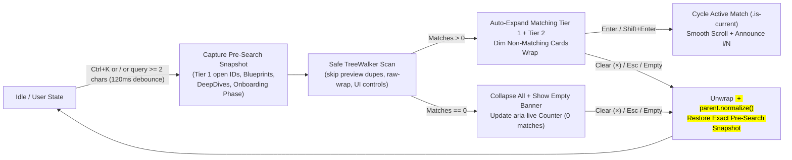
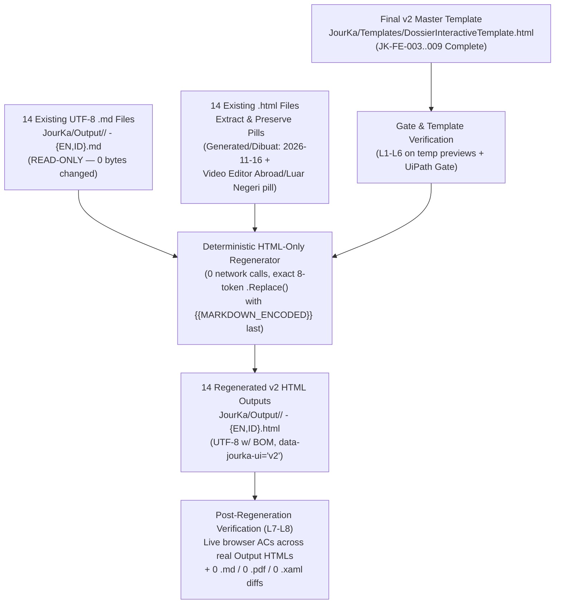

# [JK-FE-009] Sticky Interactive TOC, Instant `Ctrl+K` Search with Auto-Expand, Global View Mode Switcher, `EN ↔ ID` Bilingual Navigation & 14-Dossier HTML Regeneration — Comprehensive Implementation & Preview Plan

> **Issue / Source:** [`prayogizan/JourKa#11`](https://github.com/prayogizan/JourKa/issues/11) (`#11`, retrieved via GitHub MCP `get_issue`)
> **Git Branch:** `feat/jk-fe-009-sticky-toc-search-bilingual-nav` *(checked out on `ab1f7e6`, including merged PRs `#12`–`#18`, `#20`: `JK-RPA-001`, `JK-RPA-002`, `JK-FE-003`–`JK-FE-008`)*
> **Epic:** `EPIC-JK-INT` — Interactive Visualizations, Search, Navigation & `EN ↔ ID` Switcher · **Priority / Points:** `P1 (High) / 5 pts`
> **Project Root:** `D:\UiPathProject\JourKa\JourKa` (`project.json`)
> **Project Type:** `Modern Windows XAML Process` (`targetFramework: Windows`, `dotNetVersion: net10.0`, frontend template asset: 100% self-contained single-file HTML5/CSS/JS + 14 static HTML dossier outputs)
> **Expression Language:** `VisualBasic` *(`0` `.xaml` edits in this ticket; 8-token VB.NET `.Replace()` contract preserved verbatim)*
> **Execution Autonomy:** `interactive` *(pauses for user approval of this preview plan before editing `DossierInteractiveTemplate.html` and regenerating the 14 HTML outputs)*
> **UI Targeting:** `N/A (static HTML5/CSS/JS template authoring & deterministic HTML-only output regeneration; no UiPath UIA selectors or desktop capture)`
> **Canonical Plan Path:** [2026-11-22-jk-fe-009-sticky-toc-search-bilingual-nav.md](file:///D:/UiPathProject/JourKa/JourKa/docs/plans/2026-11-22-jk-fe-009-sticky-toc-search-bilingual-nav.md)

---

## Visual Preview Plan (UI Wireframes & End-to-End Flow)

### 1. Desktop Workspace (`>= 1024px`) — Sticky Toolbar, Active TOC Rail & Live Search
```text
┌──────────────────────────────────────────────────────────────────────────────────────────┐
│ [3px reading progress bar ████████████░░░░░░░░░░░░░░░░░░░░░░░░░░░░░░░░░░░░░░░░░░░░░░░░░] │
├──────────────────────────────────────────────────────────────────────────────────────────┤
│ [JK] Android Developer     [● Compact | Expand All] [🔍 Search (Ctrl+K)  4 in 3  ×]      │
│                                                     [● EN | ID]  [🌙]  [🖨]              │
├───────────────────────────┬──────────────────────────────────────────────────────────────┤
│ CONTENTS                  │ ┌──────────────────────────────────────────────────────────┐ │
│ ┌───────────────────────┐ │ │ HERO BANNER — Android Developer — Career Intelligence    │ │
│ │ 01 [i] Role Descr... ○│ │ └──────────────────────────────────────────────────────────┘ │
│ │▎02 [★] Entry-Level.. ●│ │ ┌──────────┬──────────┬──────────┬─────────────────────────┐ │
│ │    (active + open)    │ │ │ Degree   │ Skills   │ Salary   │ Verified Sources (16)   │ │
│ │ 03 [🗺] What You...  ●│ │ └──────────┴──────────┴──────────┴─────────────────────────┘ │
│ │ 04 [🕒] Daily Rou... ○│ │                                                              │
│ │ 05 [$] Starting S... ○│ │ ┌──────────────────────────────────────────────────────────┐ │
│ │ 06 [🧭] Career Gu... ●│ │ │ [01] Role Description & Overview  (dimmed during search) │ │
│ │ 07 [✓] First 30/60.. ○│ │ └──────────────────────────────────────────────────────────┘ │
│ │ 08 [✓] Verified Ev.. ○│ │ ┌──────────────────────────────────────────────────────────┐ │
│ └───────────────────────┘ │ │ [02] Entry-Level Skillset          [1 match]    [▲ Open] │ │
│  ● = expanded section     │ │   ...backend microservices using <mark>Retrofit</mark>... │ │
│  ○ = collapsed section    │ └──────────────────────────────────────────────────────────┘ │
│  ▎ = active in viewport   │ ┌──────────────────────────────────────────────────────────┐ │
│                           │ │ [03] Roadmap & Blueprints          [2 matches]  [▲ Open] │ │
│                           │ │   ┌─ P1 Offline-First App (auto-expanded) ─────────────┐ │ │
│                           │ │   │ Tech Stack: Kotlin, Compose, <mark>Retrofit</mark> │ │ │
│                           │ │   └────────────────────────────────────────────────────┘ │ │
└───────────────────────────┴──────────────────────────────────────────────────────────────┘
```

### 2. Mobile / Tablet (`< 1024px` & `< 640px`) — 2-Row Responsive Toolbar + Slide-Up TOC Drawer
```text
┌──────────────────────────────────────────┐
│ [JK] Android Developer   [EN|●ID] [🌙][🖨]│  <- Row 1: Brand + Stable EN|ID + Theme + Print
│ [● Ringkas|Buka Semua] [🔍 Cari...   ×]  │  <- Row 2: View Mode + Search (accessible on mobile)
├──────────────────────────────────────────┤
│  ... Bento KPI Grid + Section Cards ...  │
│                                          │
│                       ┌────────────────┐ │
│                       │ [☰] Bagian     │ │  <- Floating bottom-right FAB
│                       └────────────────┘ │
└──────────────────────────────────────────┘
   Tap FAB -> Native <dialog> slide-up drawer with backdrop blur, section icons,
   active-section accent bar, expanded dot, and tap-to-expand + auto-close.
```

### 3. Instant Search & Prior-State Restoration Flow


### 4. End-to-End Template Upgrade & 14-HTML Regeneration Pipeline


---

## 1. Skill Auto-Discovery, Routing & Auto-Creation Gate *(mandatory — execute first)*

Audited live via `Ensure-UiPathSkills.ps1 -Audit` — all `6` project-local skills are present and verified in `.agents/skills/`:

```powershell
powershell -NoProfile -ExecutionPolicy Bypass -File "D:\UiPathProject\JourKa\.agents\skills\jourka-uipath-rpa\scripts\Ensure-UiPathSkills.ps1" -Audit
```

### 1.1 Active & Required Skills Matrix
| Skill Name | Scope (`D:\UiPathProject\JourKa\.agents\skills\<name>`) | Trigger / Role in This Plan | Status |
|---|---|---|---|
| `jourka-uipath-rpa` | [SKILL.md](file:///D:/UiPathProject/JourKa/.agents/skills/jourka-uipath-rpa/SKILL.md) | Master JourKa runbook, hard invariants, format isolation, plan template, `Invoke-JourKaGate.ps1` | `Loaded` |
| `jourka-interactive-html` | [SKILL.md](file:///D:/UiPathProject/JourKa/.agents/skills/jourka-interactive-html/SKILL.md) | `DossierInteractiveTemplate.html` (`v2`) 8-token contract, offline GFM parity, `JK-FE-003..009` & `JK-RPA-002` backfill contract | `Loaded` |
| `uipath-planner` | [SKILL.md](file:///D:/UiPathProject/JourKa/.agents/skills/uipath-planner/SKILL.md) | Task derivation (`Identity` tuples), stop conditions, mandatory testing tasks | `Loaded` |
| `uipath-rpa` | [SKILL.md](file:///D:/UiPathProject/JourKa/.agents/skills/uipath-rpa/SKILL.md) | Reference only — confirms `0` `.xaml` edits and VB.NET `.Replace()` token contract parity | `Loaded` |
| `uipath-review` | [SKILL.md](file:///D:/UiPathProject/JourKa/.agents/skills/uipath-review/SKILL.md) | Read-only quality & invariant verification before PR | `Loaded` |
| `jourka-github-pr` | [SKILL.md](file:///D:/UiPathProject/JourKa/.agents/skills/jourka-github-pr/SKILL.md) | Conventional Commit & PR checklist (`Closes #11`) when PR is requested | `Loaded` |

### 1.2 Skill Gap Auto-Creation Decision
- **Does this ticket introduce a repeatable workflow, external API, NuGet package, or UI subsystem not covered above?** `No` — all 6 project-local skills in `.agents/skills/` cover the single-file template, bilingual UI, HTML-only backfill, accessibility, verification, and RPA invariance requirements.

---

## 2. Goal, Epic Boundary & Artifact Isolation *(mandatory)*

- **Outcome in one sentence:** Complete the final frontend ticket (`JK-FE-009`) in [DossierInteractiveTemplate.html](file:///D:/UiPathProject/JourKa/JourKa/Templates/DossierInteractiveTemplate.html) (sticky icon-enriched TOC with `IntersectionObserver` & mobile drawer, `Compact Summary` ↔ `Expand All` view mode switcher, debounced `Ctrl+K` / `/` instant search with auto-expand & safe `<mark>` highlighting, stable `EN | ID` switcher, unified `I18N` dictionary, and dark-mode-safe `@media print`), and regenerate all `14` committed `JourKa/Output/<Role>/<Role> - {EN,ID}.html` dossiers from their on-disk `.md` files with exact metadata pill preservation and zero `.md`/`.pdf`/`.xaml` edits.
- **In scope (strictly owned by this refined `JK-FE-009` execution):**
  1. **Sticky Interactive Table of Contents (`.toc-sidebar` & Mobile `<dialog id="toc-drawer">`):**
     - Render section number badge (`01`..`08`/`09`), section icon (reusing `SECTION_ICON_PATHS[sec.sectionType]` via `createSvgIcon()`), compact section title (2-line clamp + full `title`), optional per-section match badge during search, and a live expanded-state indicator dot (`.toc-status-dot`, synced via `jourka:section-toggle` events and initial `sessionStorage` restore).
     - Implement `IntersectionObserver` scrollspy (`rootMargin: '-76px 0px -55% 0px'`) with bottom-of-page guard, programmatic-scroll lock (no active-item flicker), and passive `rAF` fallback; apply `.is-active` + `aria-current="location"` across both desktop `#toc-list` and mobile `#toc-drawer-list`.
     - Intercept TOC link clicks (desktop & mobile) to close mobile drawer, call `scrollToAndExpandSection(sec.id)` (`scroll-margin-top: 80px`), update URL hash safely (`try { history.replaceState(...) } catch (e) {}`), and sync active highlight even when re-clicking the already-hashed section.
     - Add reduced-motion-safe slide-up transition on `dialog.toc-drawer`.
  2. **Global View Mode Switcher (`Compact Summary` ↔ `Expand All`):**
     - Activate `#view-mode-group` buttons (remove `aria-disabled="true"`, wire `aria-pressed` + `.is-active`).
     - **`Expand All`:** Expand all Tier 1 `.dossier-card` accordions, all Tier 2 `.blueprint-card` sub-cards, all Mentor Deep-Dives (`.deepdive-block`), and switch the 30/60/90 Onboarding Playbook to `'all'` phases.
     - **`Compact Summary`:** Collapse all Tier 2 blueprints & Mentor Deep-Dives, reset Onboarding Playbook back to Phase 1 (`p1`, preserving `localStorage` checkbox state), and collapse all Tier 1 cards back to their preview strips.
     - Reactive tri-state sync on `jourka:section-toggle` (`Expand All` active when all sections open, `Compact` active when `0` open, both clickable in mixed state); cleanly clears active search first if clicked mid-search.
     - Re-enable both View Mode Switcher and Search on mobile (`<= 639px`) via a clean 2-row compact toolbar (replacing legacy `display: none`).
  3. **Instant Full-Text Search with Auto-Expand (`Ctrl+K` / `/`):**
     - Activate `#dossier-search` (remove `aria-disabled="true"` / `readonly`), add search SVG icon, `<kbd>Ctrl+K</kbd>` hint, live counter badge (`"X matches in Y sections"` / `"X hasil di Y bagian"`), Clear (`×`) button, and `Enter` / `Shift+Enter` match cycling (`.search-hit.is-current`).
     - Global keyboard bindings: `Ctrl+K` / `Cmd+K` and `/` (when not focused inside an input/textarea/select/contenteditable) focus & select `#dossier-search`; `Escape` respects open `.cite-popover` / `<dialog>` priority first before clearing search.
     - `120ms` debounced search engine (`query.trim().length >= 2`):
       - Snapshots pre-search state **once** upon entering search mode (`tier1OpenIds`, `blueprintsOpenIds`, `deepdivesOpenIds`, `onboardingPhase`, `viewMode`).
       - Walks text nodes safely (`document.createTreeWalker`) inside `.dossier-card` headings + bodies, skipping `.section-preview`, `.blueprint-preview-problem`, `.flow-raw-wrap`, `.table-filter-bar`, `.onboarding-tabs`, `.deepdive-toggle`, `.flow-raw-toggle`, `.cite-popover`, `SCRIPT`, `STYLE`, `SVG`, `BUTTON`, `INPUT`.
       - Wraps case-insensitive regex-escaped literal matches in `<mark class="search-hit">` via `DocumentFragment` (**zero** `.innerHTML` mutation — preserves all `.cite-chip`, `.check-input`, and toggle event listeners).
       - Auto-expands matching Tier 1 sections (`persist: false` so `sessionStorage` is never polluted), enclosing `.blueprint-card`, `.deepdive-block`, matching `.onboarding-panel`, and resets hidden Skills/Evidence table filters if a match lives in a filtered-out row.
       - Collapses & dims (`data-search-state="nomatch"`) non-matching sections; displays localized zero-match empty banner with Reset button when `0` hits occur.
       - On clear (`""`, `< 2` chars, `×`, or `Esc`): unwraps all `<mark class="search-hit">`, calls `parent.normalize()`, clears dimmed states & empty banner, and restores exact pre-search snapshot.
  4. **Bilingual Switcher (`EN ↔ ID`), Unified `I18N` Dictionary & Hardened `@media print`:**
     - Stabilize `#lang-switcher` DOM order as `EN | ID` on both `lang="en"` and `lang="id"` pages while preserving `{{COUNTERPART_HREF}}` and `{{COUNTERPART_LABEL}}` verbatim; add localized `aria-label` & `title`.
     - Add `NAV_I18N`, expose unified `window.JourKaI18N` (`en`/`id`) and `window.JourKaNav` / `window.JourKaShell.nav` / `.i18n`, and localize all remaining English attributes/strings (`#app-footer`, `#view-mode-group`, `#lang-switcher`, `#toc-sidebar`, `#theme-toggle-text`, `#print-btn-text`).
     - Harden `@media print` + `beforeprint` hook: override `:root[data-theme="dark"]` variables to Light ink/surfaces so Dark Mode prints crisp black-on-white; switch `.dossier-card` from `break-inside: avoid` to `break-inside: auto` (with `.card-header { break-after: avoid }`); reset dimmed search cards (`opacity: 1 !important`); hide `.search-empty-banner`, `.toc-status-dot`, `.search-count`, `.search-clear-btn`, `.search-kbd`; close open `.cite-popover` / `#toc-drawer` on `beforeprint`.
  5. **HTML-Only Regeneration of All 14 Committed Role Dossiers (`JourKa/Output/<Role>/<Role> - {EN,ID}.html`):**
     - After `DossierInteractiveTemplate.html` passes L1–L6 verification, run a deterministic local PowerShell/VB-equivalent 8-token injection pass (using the exact same `JK-RPA-001` / `JK-RPA-002` token-replacement semantics, `{{MARKDOWN_ENCODED}}` replaced **last**, UTF-8 with BOM) across all `7` roles × `2` languages = `14` HTML outputs.
     - Preserve each file's exact existing `<div class="meta">` pills (`Level`, `Market`/`Pasar`, `Language`/`Bahasa`, `Generated: 2026-11-16` / `Dibuat: 2026-11-16`, plus `Video Editor`'s `Abroad` / `Luar Negeri` verified pill) — `0` network calls, `0` `.md` edits, `0` `.pdf` edits.
- **Out of scope:**
  - Any modification to `Main.xaml`, `Workflows/*.xaml`, `project.json`, `Desire Role List.xlsx`, `.md` files, or `.pdf` files (`JourKa/Output/` & `PDF_Results/`).
  - Running `uip rpa run` (not needed; regeneration is 100% deterministic local HTML-only template injection, preserving `Generated: 2026-11-16` dates without invoking Studio desktop execution or APIs).
- **Immutable Artifacts & Contracts (MUST NOT change):**
  - Exact `<html lang="{{LANG_CODE}}" data-jourka-ui="v2" data-theme="light">` stamp and all 8 VB.NET template tokens (`{{LANG_CODE}}`, `{{DOC_TITLE}}`, `{{ROLE_NAME}}`, `{{BANNER_SUFFIX}}`, `{{META_PILLS_HTML}}`, `{{COUNTERPART_HREF}}`, `{{COUNTERPART_LABEL}}`, `{{MARKDOWN_ENCODED}}`).
  - Existing APIs & IDs: `window.JourKaParser`, `window.JourKaBento`, `window.JourKaAccordion`, `window.JourKaTier2`, `window.JourKaViz`, `window.JourKaShell`, `#m`, `#c`, `#bento-root`, `#section-N`, `#section-N-heading`, `#sec-body-N`.
  - [Main.xaml](file:///D:/UiPathProject/JourKa/JourKa/Main.xaml), [PublishDossier.xaml](file:///D:/UiPathProject/JourKa/JourKa/Workflows/PublishDossier.xaml), [project.json](file:///D:/UiPathProject/JourKa/JourKa/project.json), all `14` `.md` files, and all `28` `.pdf` files (`JourKa/Output/` & `PDF_Results/`): **0 byte changes**.

---

## 3. Codebase, Workflow & 14-Output Discovery *(mandatory — Rule 17 & Rule 21)*

Verified directly against live [DossierInteractiveTemplate.html](file:///D:/UiPathProject/JourKa/JourKa/Templates/DossierInteractiveTemplate.html) (`8,144` lines) and all `14` `.md` + `14` `.html` files in `JourKa/Output/`.

### 3.1 Live Codebase & 14-Dossier Empirical Findings
| # | Finding | Verified Location / Evidence | Impact on Plan |
|---|---|---|---|
| **F1** | `#view-mode-group` buttons (`L2920-2923`) and `#dossier-search` (`L2925-2929`) carry `aria-disabled="true"` / `readonly`, and `@media (max-width: 639px)` (`L2624-2627`) hides both with `display: none`. | [DossierInteractiveTemplate.html#L2622-L2628](file:///D:/UiPathProject/JourKa/JourKa/Templates/DossierInteractiveTemplate.html#L2622-L2628), [#L2920-L2929](file:///D:/UiPathProject/JourKa/JourKa/Templates/DossierInteractiveTemplate.html#L2920-L2929) | Activate controls and replace mobile `display: none` with a responsive 2-row toolbar. |
| **F2** | `populateBasicToc()` (`L3208-3251`) omits section icons, expanded dots, `IntersectionObserver`, and click-to-expand interception (re-clicking an already-hashed collapsed section does not re-expand it). | [DossierInteractiveTemplate.html#L3208-L3251](file:///D:/UiPathProject/JourKa/JourKa/Templates/DossierInteractiveTemplate.html#L3208-L3251), [#L5486](file:///D:/UiPathProject/JourKa/JourKa/Templates/DossierInteractiveTemplate.html#L5486) | Build `renderInteractiveToc()` from `normalizedResult.sections` with icons, `.toc-status-dot`, `IntersectionObserver`, and click interception calling `scrollToAndExpandSection(sec.id)` + drawer close. |
| **F3** | `setSectionExpanded()` already dispatches bubbling `jourka:section-toggle` events (`L5243-5251`), and `.dossier-card` already sets `scroll-margin-top: calc(var(--toolbar-h) + 20px)` (`80px`, `L1039`). | [DossierInteractiveTemplate.html#L1039](file:///D:/UiPathProject/JourKa/JourKa/Templates/DossierInteractiveTemplate.html#L1039), [#L5243-L5251](file:///D:/UiPathProject/JourKa/JourKa/Templates/DossierInteractiveTemplate.html#L5243-L5251) | Listen once on `#c` for `jourka:section-toggle` to live-sync TOC dots and View Mode switcher state. |
| **F4** | `collapseAllTier2()` (`L6720-6731`) does not reset `tier2State.playbook` from `'all'` back to `'p1'`. | [DossierInteractiveTemplate.html#L6706-L6731](file:///D:/UiPathProject/JourKa/JourKa/Templates/DossierInteractiveTemplate.html#L6706-L6731) | Add `if (tier2State.playbook) tier2State.playbook.selectPhase('p1', false);` in `collapseAllTier2()`. |
| **F5** | **Gherkin AC-1 targets verified on real data:** `"Retrofit"` hits `4×` across `3` sections in `Android Developer - EN.md` (S2 Skills table, S3 Roadmap + nested Blueprint P1 Tech Stack, S6 AI Sentiment); `"BPOM"` hits `8×` across `4` sections in `Apoteker - EN.md` (S1 Overview, S2 Skills, S3 Roadmap + nested Blueprint Problem & Tools, S6 Pros/Cons table). | Full scan of all 14 `JourKa/Output/*/*.md` files | Skip `.section-preview`, `.blueprint-preview-problem`, and `.flow-raw-wrap` during search walk to prevent duplicate counting while expanding every matching Tier 1/Tier 2 container. |
| **F6** | `#lang-switcher` (`L2931-2934`) puts `<span data-lang-active>` first, flipping order to `ID \| EN` on Indonesian pages. | [DossierInteractiveTemplate.html#L2931-L2934](file:///D:/UiPathProject/JourKa/JourKa/Templates/DossierInteractiveTemplate.html#L2931-L2934) | Reorder DOM children on init when `lang === 'id'` so pill is always stable `EN \| ID` with `{{COUNTERPART_HREF}}` untouched. |
| **F7** | Five separate `*_I18N` maps exist and 6 DOM labels/ARIA strings (`#app-footer`, `#view-mode-group`, `#lang-switcher`, `#toc-sidebar`, `#theme-toggle-text`, `#print-btn-text`) remain English-only. | [DossierInteractiveTemplate.html#L2920-L2988](file:///D:/UiPathProject/JourKa/JourKa/Templates/DossierInteractiveTemplate.html#L2920-L2988), [#L3018-L3076](file:///D:/UiPathProject/JourKa/JourKa/Templates/DossierInteractiveTemplate.html#L3018-L3076) | Add `NAV_I18N`, expose unified `window.JourKaI18N`, and translate 100% of remaining labels in `applyShellLabels()`. |
| **F8** | **Two `@media print` bugs (`L2818-2903`):** (1) `:root[data-theme="dark"]` tokens aren't reset to Light ink on print; (2) `.dossier-card` has `break-inside: avoid` (`L2868`), breaking multi-page A4 pagination. | [DossierInteractiveTemplate.html#L2818-L2903](file:///D:/UiPathProject/JourKa/JourKa/Templates/DossierInteractiveTemplate.html#L2818-L2903) | Reset `:root[data-theme="dark"]` vars to Light ink in `@media print`; set `.dossier-card { break-inside: auto }` + `.card-header { break-after: avoid }`; reset search dim & close popovers/drawer on `beforeprint`. |
| **F9** | **All `14` committed `JourKa/Output/*/*.html` files** (`24.8–39.3 KB` each) were generated back in `JK-RPA-002` using the early minimal `v2` shell template (prior to `JK-FE-003`..`009`). All `14` carry exact `<div class="meta">` pills with `Generated: 2026-11-16` / `Dibuat: 2026-11-16`, and `Video Editor` (`EN` & `ID`) additionally carries the `Abroad (Singapore, Malaysia, United Kingdom): 1 verified` / `Luar Negeri (...): 1 terverifikasi` pill. | Audited all `14` `JourKa/Output/*/*.html` files | Regenerate all `14` HTML outputs in `T5` using the finished `DossierInteractiveTemplate.html`, reading on-disk UTF-8 `.md` files and extracting & preserving each file's exact `<div class="meta">` inner HTML verbatim. |

### 3.2 NuGet Package & Activity Resolution Gate (`Rule 21`)
- **Dependencies in `project.json` sufficient?** `Yes` — zero `.xaml` / `.cs` edits, zero NuGet changes.
- **New XAML Activities Added:** `None`.

---

## 4. UiPath Common Pitfalls & Modern Frontend / WCAG 2.2 AA Vetting Gate *(mandatory — Rule 22)*

- [x] **8-Token & `v2` Stamp Hygiene:** Keep `<html lang="{{LANG_CODE}}" data-jourka-ui="v2" data-theme="light">` and all 8 `{{TOKEN}}` placeholders exact; never write literal `{{...}}` sequences in new CSS/JS/comments.
- [x] **Single-File `file://` Offline Portability:** Zero external scripts, CSS, or font URLs added; all icons are inline `<svg aria-hidden="true" focusable="false">` via `createSvgIcon()`; `history.replaceState` wrapped in `try/catch`.
- [x] **Zero Unsafe DOM Sinks & Listener Preservation:** Build all TOC items, search badges, empty-state banners, and `<mark class="search-hit">` wrappers via `document.createElement()` / `document.createTextNode()`. Never mutate `.innerHTML` during search highlighting/unwrapping.
- [x] **WCAG 2.2 AA Focus, Contrast & Live Regions:** `<mark class="search-hit">` contrast >= 4.5:1 in Light & Dark; `#search-count` & `#nav-announcer` use `aria-live="polite"`; `/` shortcut ignores focused form fields; `@media (pointer: coarse)` maintains `>= 40px` hit targets; `@media (forced-colors: active)` covers `.toc-link.is-active` and `<mark class="search-hit">`.
- [x] **Session Storage Hygiene:** Transient search auto-expansions pass `{ persist: false }`.
- [x] **Print Fidelity & Dark-Mode Safety:** `@media print` forces Light tokens on `:root[data-theme="dark"]`, fixes `.dossier-card` page breaks, restores dimmed search cards, and hides all interactive search/TOC/filter controls.
- [x] **14-HTML Backfill Isolation & Encoding Parity:** Regeneration script uses `[System.Net.WebUtility]::HtmlEncode`, `[System.Uri]::EscapeDataString`, replaces `{{MARKDOWN_ENCODED}}` **last**, writes UTF-8 with BOM (`[System.Text.UTF8Encoding]::new($true)`), leaves all `14` `.md` and `28` `.pdf` files byte-identical, and asserts `0` unresolved `{{...}}` tokens in every output file.

---

## 5. Issue Gaps, Decisions & Stop Conditions *(mandatory)*

### 5.1 Decisions Recorded
| # | Decision Point | Chosen Design & Rationale |
|---|---|---|
| **D1** | Mobile (`< 640px`) toolbar visibility | Replace legacy `display: none` on `#view-mode-group` and `.toolbar-search-wrap` with a compact 2-row responsive toolbar so mobile users get full View Mode & Search access. |
| **D2** | Duplicate search hit prevention | Exclude `.section-preview`, `.blueprint-preview-problem`, and `.flow-raw-wrap` from search text-node walking so match counts reflect real content occurrences (`0` phantom duplicates). |
| **D3** | Clicking `Compact`/`Expand All` during active search | Clear search cleanly first (discarding pre-search snapshot) and then apply the user's explicit mode. |
| **D4** | Bilingual pill ordering on `lang="id"` | Reorder DOM children inside `#lang-switcher` on init so `EN` is always left and `ID` is always right, preserving `{{COUNTERPART_HREF}}` / `{{COUNTERPART_LABEL}}` tokens untouched. |
| **D5** | Regenerating all 14 `JourKa/Output/*/*.html` files | **Approved by user** — included as Task **T5** right after template verification (`T4`), preserving exact original `Generated: 2026-11-16` / `Dibuat: 2026-11-16` and `Abroad`/`Luar Negeri` meta pills with `0` `.md`/`.pdf`/`.xaml` edits. |

### 5.2 Stop Conditions
- `Invoke-JourKaGate.ps1` (`uip rpa validate` / `uip rpa build`) fails.
- Any verification check detects broken event listeners after search+clear, unresolved `{{TOKEN}}` placeholders, missing meta pills, or console errors (online or offline).
- Any unintended diff appears in `.md`, `.pdf`, `.xaml`, or `project.json`.

---

## 6. Technical Design & Data Contracts *(mandatory)*

### 6.1 Template Runtime Initialization Order (`DossierInteractiveTemplate.html`)
1. `applyShellLabels()` + `initThemeController()` + `initLangSwitcher()` + `initReadingProgressFallback()` + `initDrawerAndPrint()`
2. `parseMarkdown()` → `sanitizeHtmlToFragment()` → `normalizeSections()` → `updateVitals()`
3. `renderTier1Accordions()` + `wrapTables()`
4. `extractBentoData()` → `renderBentoGrid()`
5. `enhanceTier2Sections()` (Blueprints, 30/60/90 Playbook, Semantic Callouts, Mentor Deep-Dives)
6. `enhanceInteractiveVisualizations()` (ASCII Steppers, Citation Popovers, Filterable Tables)
7. `initNavigationSuite()` *(new `JK-FE-009`)*:
   - `renderInteractiveToc()` (icons + `.toc-status-dot` + click-to-expand + drawer close)
   - `initTocScrollSpy()` (`IntersectionObserver` + scroll lock + bottom-of-page & non-IO fallback)
   - `initViewModeSwitcher()` (`Compact` ↔ `Expand All` + reactive `jourka:section-toggle` sync)
   - `initInstantSearch()` (`Ctrl+K`/`/`/`Esc`/`Enter`, `120ms` debounce, snapshot/restore, safe `<mark>` wrap/unwrap, Tier 1/Tier 2/table auto-expand)
   - `initPrintGuards()` (`beforeprint` closes open `.cite-popover` & `#toc-drawer`)
8. Late `applyHashExpansion({ scroll: true })` + export `window.JourKaNav`, `window.JourKaI18N`, and `window.JourKaShell.nav` / `.i18n`.

### 6.2 14-File HTML Regeneration Contract (`T5`)
| Role Folder (`JourKa/Output/<Role>/`) | Files Regenerated (`2` per role = `14` total) | Preserved Metadata Pills | Counterpart Href (`EN` ↔ `ID`) |
|---|---|---|---|
| `Android Developer` | `Android Developer - EN.html`, `Android Developer - ID.html` | `Level`, `Market`/`Pasar`, `Language`/`Bahasa`, `Generated`/`Dibuat: 2026-11-16` | `Android%20Developer%20-%20ID.html` ↔ `Android%20Developer%20-%20EN.html` |
| `Android Engineer` | `Android Engineer - EN.html`, `Android Engineer - ID.html` | `Level`, `Market`/`Pasar`, `Language`/`Bahasa`, `Generated`/`Dibuat: 2026-11-16` | `Android%20Engineer%20-%20ID.html` ↔ `Android%20Engineer%20-%20EN.html` |
| `Apoteker` | `Apoteker - EN.html`, `Apoteker - ID.html` | `Level`, `Market`/`Pasar`, `Language`/`Bahasa`, `Generated`/`Dibuat: 2026-11-16` | `Apoteker%20-%20ID.html` ↔ `Apoteker%20-%20EN.html` |
| `Kotlin Multiplatform` | `Kotlin Multiplatform - EN.html`, `Kotlin Multiplatform - ID.html` | `Level`, `Market`/`Pasar`, `Language`/`Bahasa`, `Generated`/`Dibuat: 2026-11-16` | `Kotlin%20Multiplatform%20-%20ID.html` ↔ `Kotlin%20Multiplatform%20-%20EN.html` |
| `Mobile Developer` | `Mobile Developer - EN.html`, `Mobile Developer - ID.html` | `Level`, `Market`/`Pasar`, `Language`/`Bahasa`, `Generated`/`Dibuat: 2026-11-16` | `Mobile%20Developer%20-%20ID.html` ↔ `Mobile%20Developer%20-%20EN.html` |
| `Mobile Engineer` | `Mobile Engineer - EN.html`, `Mobile Engineer - ID.html` | `Level`, `Market`/`Pasar`, `Language`/`Bahasa`, `Generated`/`Dibuat: 2026-11-16` | `Mobile%20Engineer%20-%20ID.html` ↔ `Mobile%20Engineer%20-%20EN.html` |
| `Video Editor` | `Video Editor - EN.html`, `Video Editor - ID.html` | `Level`, `Market`/`Pasar`, `Language`/`Bahasa`, **`Abroad`/`Luar Negeri (Singapore, Malaysia, United Kingdom): 1 verified/terverifikasi`**, `Generated`/`Dibuat: 2026-11-16` | `Video%20Editor%20-%20ID.html` ↔ `Video%20Editor%20-%20EN.html` |

---

## 7. Strict Change Manifest *(mandatory)*

`git diff --stat` at completion must be a strict subset of this table:

| File Path | Action | Scope / Summary |
|---|---|---|
| `JourKa/docs/plans/2026-11-22-jk-fe-009-sticky-toc-search-bilingual-nav.md` | `new` | Canonical implementation & preview plan |
| [JourKa/Templates/DossierInteractiveTemplate.html](file:///D:/UiPathProject/JourKa/JourKa/Templates/DossierInteractiveTemplate.html) | `edit` | Complete `JK-FE-009` (`<style>`, toolbar/search/empty-banner markup, `<script>` interactive TOC, View Mode switcher, `Ctrl+K` search, `EN \| ID` switcher, unified `I18N`, dark-mode-safe `@media print`, `window.JourKaNav`) |
| `JourKa/Output/Android Developer/Android Developer - {EN,ID}.html` | `edit` | Regenerated full `v2` interactive HTML from existing `.md` (metadata pills preserved) |
| `JourKa/Output/Android Engineer/Android Engineer - {EN,ID}.html` | `edit` | Regenerated full `v2` interactive HTML from existing `.md` (metadata pills preserved) |
| `JourKa/Output/Apoteker/Apoteker - {EN,ID}.html` | `edit` | Regenerated full `v2` interactive HTML from existing `.md` (metadata pills preserved) |
| `JourKa/Output/Kotlin Multiplatform/Kotlin Multiplatform - {EN,ID}.html` | `edit` | Regenerated full `v2` interactive HTML from existing `.md` (metadata pills preserved) |
| `JourKa/Output/Mobile Developer/Mobile Developer - {EN,ID}.html` | `edit` | Regenerated full `v2` interactive HTML from existing `.md` (metadata pills preserved) |
| `JourKa/Output/Mobile Engineer/Mobile Engineer - {EN,ID}.html` | `edit` | Regenerated full `v2` interactive HTML from existing `.md` (metadata pills preserved) |
| `JourKa/Output/Video Editor/Video Editor - {EN,ID}.html` | `edit` | Regenerated full `v2` interactive HTML from existing `.md` (`Abroad` + `Generated`/`Dibuat` pills preserved) |

---

## 8. Turn-Budgeted Implementation Tasks (`uipath-planner` Schema) *(mandatory)*

### Task T0 — `jourka-uipath-rpa` — Plan Preview, Skills Audit & Baseline Snapshot
**Identity:** `jourka-uipath-rpa:JourKa:jk-fe-009-skills-and-baseline`
**Status:** `[ ] pending` · **Blocked by:** `none`
- [ ] Confirm canonical plan exists at `JourKa/docs/plans/2026-11-22-jk-fe-009-sticky-toc-search-bilingual-nav.md`.
- [ ] Re-verify `.agents/skills/` via `Ensure-UiPathSkills.ps1 -Audit` and snapshot baseline template to `JourKa/.local/preview/DossierInteractiveTemplate__before_fe009.html`.

### Task T1 — `jourka-interactive-html` — Toolbar, Search, TOC, Mobile & `@media print` CSS + Markup
**Identity:** `jourka-interactive-html:JourKa:Templates/DossierInteractiveTemplate.html:nav-styles-markup`
**Status:** `[ ] pending` · **Blocked by:** `T0`
- [ ] Activate `#view-mode-group` buttons (`aria-pressed`, remove `aria-disabled`) and `#dossier-search` (remove `aria-disabled`/`readonly`, add search SVG icon, `<kbd>Ctrl+K</kbd>`, `#search-count`, `#search-clear`, `#nav-announcer`, `#search-empty-banner`).
- [ ] Add Light/Dark/mobile/coarse-pointer/`forced-colors` CSS for `.toc-icon`, `.toc-label`, `.toc-status-dot`, `.toc-match-badge`, `.toc-link.is-active`, `dialog.toc-drawer` slide-up, `.toolbar-search-wrap` active states, `<mark class="search-hit">` + `.is-current`, `.dossier-card[data-search-state="nomatch"]`, `.search-empty-banner`, and 2-row `< 640px` mobile toolbar.
- [ ] Harden `@media print` (force Light palette tokens on `:root[data-theme="dark"]`, `.dossier-card { break-inside: auto }`, `.card-header { break-after: avoid }`, reset search dim, hide search/TOC chrome, repeat `thead`).

### Task T2 — `jourka-interactive-html` — Unified `I18N`, Bilingual `EN | ID` Switcher & Sticky Interactive TOC
**Identity:** `jourka-interactive-html:JourKa:Templates/DossierInteractiveTemplate.html:nav-i18n-toc`
**Status:** `[ ] pending` · **Blocked by:** `T1`
- [ ] Add `NAV_I18N`, assemble unified `I18N` (`en`/`id`), and localize all remaining labels/ARIA attributes in `applyShellLabels()`.
- [ ] Implement `initLangSwitcher()` enforcing stable `EN | ID` pill order while preserving `{{COUNTERPART_HREF}}` and `{{COUNTERPART_LABEL}}`.
- [ ] Implement `renderInteractiveToc()` (number badge + SVG icon + compact title + `.toc-status-dot` + click-to-expand via `scrollToAndExpandSection` + mobile drawer close), `syncTocExpandedStates()` (`jourka:section-toggle`), and `initTocScrollSpy()` (`IntersectionObserver` + scroll-lock + bottom-of-page & non-IO fallback).

### Task T3 — `jourka-interactive-html` — Global View Mode Switcher & Instant `Ctrl+K` Search Engine
**Identity:** `jourka-interactive-html:JourKa:Templates/DossierInteractiveTemplate.html:nav-viewmode-search`
**Status:** `[ ] pending` · **Blocked by:** `T2`
- [ ] Update `collapseAllTier2()` to reset 30/60/90 onboarding playbook to Phase 1 (`p1`) while preserving saved checkboxes.
- [ ] Implement `initViewModeSwitcher()` (`Compact Summary` ↔ `Expand All`, reactive sync, search handoff, live-region announcements).
- [ ] Implement `initInstantSearch()` (`Ctrl+K`/`Cmd+K`/`/`/`Esc`/`Enter`/`Shift+Enter`, `120ms` debounce, pre-search snapshot & restore, safe `TreeWalker` literal regex-escaped `<mark class="search-hit">` wrap/unwrap + `parent.normalize()`, Tier 1/Tier 2/onboarding/table-filter auto-expand with `persist: false`, dimming, zero-match banner).
- [ ] Wire `initPrintGuards()` (`beforeprint`), invoke `initNavigationSuite()` right after `enhanceInteractiveVisualizations()`, and export `window.JourKaNav`, `window.JourKaI18N`, and `window.JourKaShell.nav` / `.i18n`.

### Task T4 — `jourka-interactive-html` — Template Verification & UiPath Gate (L1–L6)
**Identity:** `jourka-interactive-html:JourKa:jk-fe-009-template-testing`
**Status:** `[ ] pending` · **Blocked by:** `T3`
- [ ] Verify 8-token contract & `data-jourka-ui="v2"` stamp (L1) and run `Invoke-JourKaGate.ps1` (`uip rpa validate` + `uip rpa build` → `GATE: PASSED`, L3).
- [ ] Verify online & offline rendering, regressions (`JK-FE-003`..`008`), Gherkin `AC-1` & `AC-2`, mobile (`390×844`), and Dark Mode `@media print` emulation on temp previews (L2, L4–L6).

### Task T5 — `jourka-interactive-html` — Regenerate All 14 `JourKa/Output/*/*.html` Files & Final End-to-End Verification (L7–L8)
**Identity:** `jourka-interactive-html:JourKa:Output:regenerate-14-htmls`
**Status:** `[ ] pending` · **Blocked by:** `T4`
- [ ] Run a deterministic PowerShell script (stored only transiently in `JourKa/.local/preview/` so the repo stays clean) that iterates all `7` roles × `2` languages (`14` files):
  1. Reads `JourKa/Templates/DossierInteractiveTemplate.html` and the role's UTF-8 `.md` file (`read-only`).
  2. Extracts the exact `<div class="meta">(.*?)</div>` inner HTML from the existing `.html` file on disk (preserving `Generated: 2026-11-16` / `Dibuat: 2026-11-16` and `Video Editor`'s `Abroad` / `Luar Negeri` verified pills verbatim).
  3. Injects all 8 tokens via chained `.Replace("{{TOKEN}}", val)` using `[System.Net.WebUtility]::HtmlEncode(...)` and `[System.Uri]::EscapeDataString(...)`, replacing `{{MARKDOWN_ENCODED}}` **last**.
  4. Writes the upgraded `JourKa/Output/<Role>/<Role> - {EN,ID}.html` as UTF-8 with BOM (`[System.Text.UTF8Encoding]::new($true)`).
- [ ] Run post-regeneration verification across **all 14 real output HTMLs**:
  - Assert every file has `data-jourka-ui="v2"`, `0` unresolved `{{...}}` tokens, exact preserved meta pills, exact counterpart `href`, and `0` console errors (both online and CDN-blocked offline).
  - Run live browser Gherkin `AC-1` directly on `JourKa/Output/Android Developer/Android Developer - EN.html` (`"Retrofit"`) and `JourKa/Output/Apoteker/Apoteker - EN.html` (`"BPOM"`), and `AC-2` directly clicking `ID` on `JourKa/Output/Video Editor/Video Editor - EN.html` → `Video Editor - ID.html` (`file://` navigation!).
  - Confirm `git status --short` shows **only** §7 Change Manifest files (`0` `.md`, `0` `.pdf`, `0` `.xaml`, `0` `project.json` changes).

---

## 9. Multi-Layer Verification Matrix (`Gate != Runtime Proof`) *(mandatory)*

| Layer | Check | Command / Method | Pass Criterion |
|---|---|---|---|
| **L1 — Token & Stamp Contract** | 8 VB.NET tokens + `data-jourka-ui="v2"` intact; zero stray `{{...}}` | PowerShell regex check on `DossierInteractiveTemplate.html` | Exactly 8 known tokens, `v2` stamp intact |
| **L2 — Online + Offline Render** | Zero JS/CSS errors across all 14 dossiers (CDN enabled & blocked) | Headless Chrome / Playwright check across all 14 dossiers | `0` console errors / uncaught exceptions (online & offline) |
| **L3 — UiPath Gate** | Full UiPath project validation & build | `powershell -NoProfile -ExecutionPolicy Bypass -File .agents\skills\jourka-uipath-rpa\scripts\Invoke-JourKaGate.ps1` | `GATE: PASSED` (`0` diagnostics, `"Success": true`) |
| **L4 — Regression Proof (`JK-FE-003..008`)** | Theme, Bento, Accordions, Blueprints, 30/60/90 checkboxes, Steppers, Citations, Table Filters | Automated DOM assertions across `Android Developer`, `Kotlin Multiplatform`, `Apoteker`, `Video Editor` (`EN` & `ID`) | 100% prior component counts & listeners intact (including after Search + Clear) |
| **L5 — Gherkin AC-1 & AC-2** | Live browser tests directly on regenerated `JourKa/Output/*/*.html` files | `AC-1`: `Ctrl+K` `"Retrofit"` / `"BPOM"` → expand + `<mark>` → `×` restore; `AC-2`: `Video Editor - EN.html` → click `ID` → `Video%20Editor%20-%20ID.html` | Both Gherkin scenarios pass verbatim over `file://` |
| **L6 — Responsive, A11y & Dark-Mode Print** | `1440×900`, `390×844` (2-row toolbar + FAB drawer), Dark Mode `print` emulation | Emulated viewport + `emulateMedia({ media: 'print' })` | `0` horizontal overflow; Dark Mode prints crisp black-on-white; multi-page `.dossier-card` breaks cleanly |
| **L7 — 14-Output Backfill Integrity** | Every regenerated HTML preserves meta pills & has `0` unresolved tokens | PowerShell audit across all 14 `JourKa/Output/*/*.html` files | `14/14` `v2`, `14/14` `2026-11-16` date preserved, `2/2` `Video Editor` Abroad pills preserved, `0` `{{...}}` |
| **L8 — Repo Invariants** | Strict Change Manifest & format isolation | `git status --short` & `git diff --stat -- JourKa/Output PDF_Results JourKa/Main.xaml` | Only §7 files touched (`0` `.md`, `0` `.pdf`, `0` `.xaml`, `0` `project.json` diffs) |

---

## 10. Risks, Rollback & Follow-Ups

### 10.1 Risks & Mitigations
| Risk | Likelihood | Impact | Mitigation |
|---|---|---|---|
| `<mark>` wrapping breaks `.cite-chip` or `.check-input` listeners | Low | High | Strictly use `TreeWalker` on text nodes (`replaceChild` with `DocumentFragment`) and verify chip click + checkbox toggle *after* search + clear in L4/L5. |
| Search auto-expand corrupts `sessionStorage` open state | Med | Med | Pass `{ persist: false, source: 'search' }` during search and restore exact pre-search snapshot on clear. |
| Scrollspy flickers during programmatic TOC smooth scroll | Med | Low | Lock scrollspy updates until `scrollIntoViewAsync` settles (with `700ms` safety release). |
| Dark-mode users get blank/unreadable print pages | High (existing bug) | High | Reset `--bg-*`, `--ink-*`, `--border*` on `:root[data-theme="dark"]` inside `@media print`. |
| 14-HTML regeneration alters `Generated`/`Dibuat` dates or drops `Video Editor` Abroad pill | Low | High | Extract existing `<div class="meta">` inner HTML verbatim per file and assert exact pill parity in L7. |

### 10.2 Rollback Procedure
- Before commit: `git checkout -- JourKa/Templates/DossierInteractiveTemplate.html JourKa/Output/` and remove the plan doc.
- After commit: `git revert <commit-sha>` (self-contained frontend template + HTML outputs; zero workflow/MD/PDF impact).

---

## 11. Definition of Done (DoD) Gate

- [ ] All 6 required skills verified in `.agents/skills/` via `Ensure-UiPathSkills.ps1 -Audit`.
- [ ] Desktop sticky TOC rail (`IntersectionObserver`, section icons, expanded dots, click-to-expand) and mobile slide-up TOC drawer implemented.
- [ ] `Compact Summary` ↔ `Expand All` mode switcher implemented (symmetric Tier 1 + Tier 2 + onboarding phase control, accessible on mobile).
- [ ] `Ctrl+K` / `/` live search with `120ms` debounce, Tier 1/Tier 2 auto-expand, safe `<mark class="search-hit">` highlight/unwrap, and pre-search state restore implemented.
- [ ] Stable `EN | ID` language switcher, unified `I18N` dictionary (`EN`/`ID`), and dark-mode-safe browser `@media print` stylesheet completed.
- [ ] All `14` `JourKa/Output/<Role>/<Role> - {EN,ID}.html` files regenerated with the finished `v2` template, preserving all existing `Generated`/`Dibuat` and `Abroad`/`Luar Negeri` metadata pills (`0` network calls, `0` `.md`/`.pdf` edits).
- [ ] `Invoke-JourKaGate.ps1` passes (`0` diagnostics, `"Success": true`).
- [ ] All Gherkin Acceptance Criteria verified live on the regenerated output HTMLs (online & offline).
- [ ] Invariant check clean (`git diff --stat` ⊆ §7 Change Manifest; `0` `.md`/`.pdf`/`.xaml` diffs).
- [ ] Atomic Conventional Commit (`feat(jk-fe-009): ...` with `Closes #11`) when requested.
