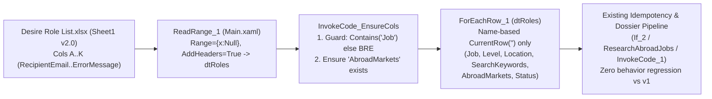

# [JK-RPA-004] Migrate `Desire Role List.xlsx` to v2 Schema with Column A `RecipientEmail` Primary Key — Implementation Plan

> **Goal:** Migrate both `Desire Role List.xlsx` workbooks (`Sheet1`) to the 11-column `v2.0` schema with `RecipientEmail` as Column A Primary Key, prove zero hardcoded column-index or cell-address access across all JourKa `.xaml` workflows, add a fail-fast `dtRoles.Columns.Contains("Job")` guard in `Main.xaml`, and update `README.md` §5.
> **Source:** `https://github.com/prayogizan/JourKa/issues/23` (Parent Epic: `#22` `EPIC-JK-MAIL` / `JK-RPA-003`)
> **Git Branch:** `feat/jk-rpa-004-input-schema-v2-email-pk` *(checked out cleanly at `de3d190`)*
> **Epic:** `EPIC-JK-MAIL` — Column A Primary Key & Automated Student/Parent Email Delivery · **Priority / Points:** `P0 (Blocker / Foundation) / 2 pts`
> **Project Root:** `D:\UiPathProject\JourKa\JourKa` ([project.json](file:///Users/ottencoffee/ProjectLabs/Hackathon/JourKa/JourKa/project.json))
> **Project type:** `XAML` (`Modern Windows XAML Process`, `targetFramework: Windows`, `dotNetVersion: net10.0`)
> **Expression language:** `VB.NET` (`VisualBasic`, `Option Strict On`, `Option Explicit On`)
> **Approach:** `explore-first`
> **Execution autonomy:** `interactive` *(pauses for user approval before XAML/workbook mutation and before `uip rpa run` per [AGENTS.md](file:///Users/ottencoffee/ProjectLabs/Hackathon/JourKa/JourKa/AGENTS.md))*
> **Delivery model:** `standalone` *(local UiPath Studio 26.10 / Robot execution)*
> **App type:** `N/A` *(headless OpenXML Workbook I/O + VB.NET `InvokeCode`)*
> **App state:** `N/A`
> **UI targeting:** `N/A`
> **Canonical Plan Path:** `JourKa/docs/plans/2026-11-23-jk-rpa-004-input-schema-v2-email-pk.md`

---

## Understanding

`Sheet1` of [Desire Role List.xlsx](file:///Users/ottencoffee/ProjectLabs/Hackathon/JourKa/JourKa/Input/Desire%20Role%20List.xlsx) currently uses a 2-column `v1` schema (`Job` in Column A, `AbroadMarkets` in Column B) across 7 role rows, which cannot disambiguate students requesting the same role or route automated emails. Inserting `RecipientEmail` at Column A (Index 0) shifts `Job` to Column B and `AbroadMarkets` to Column C, adding `StudentName` (D), optional scraping overrides `Level`..`Status` (E–H), and downstream email audit columns `EmailStatus`, `EmailTimestamp`, and `ErrorMessage` (I–K).

This foundation ticket (`JK-RPA-004`) migrates the fallback workbook [JourKa/Input/Desire Role List.xlsx](file:///Users/ottencoffee/ProjectLabs/Hackathon/JourKa/JourKa/Input/Desire%20Role%20List.xlsx) and provides the mirrored migration for the external Windows primary path `D:\UiPathProject\Desire Role List.xlsx`, hardens [Main.xaml](file:///Users/ottencoffee/ProjectLabs/Hackathon/JourKa/JourKa/Main.xaml) with a `dtRoles.Columns.Contains("Job")` guard (`InvokeCode_EnsureCols` and `Assign_1`), proves zero `CurrentRow(<int>)` or hardcoded cell-range usage across all 6 `.xaml` workflows, and updates [README.md](file:///Users/ottencoffee/ProjectLabs/Hackathon/JourKa/README.md#L129-L148) §5 with the `v2.0` contract.

## Decisions & Trade-offs

- **Why `Project type: XAML` with minimal `InvokeCode_EnsureCols` + `Assign_1` updates:** Live audit confirms [Main.xaml](file:///Users/ottencoffee/ProjectLabs/Hackathon/JourKa/JourKa/Main.xaml) and [ResearchAbroadJobs.xaml](file:///Users/ottencoffee/ProjectLabs/Hackathon/JourKa/JourKa/Workflows/ResearchAbroadJobs.xaml) already read `Sheet1` dynamically (`Range="{x:Null}"`, `AddHeaders="True"`) and resolve fields by column name, so no new XAML activities or NuGet packages are needed—only adding the missing `Job` column guard.
- **Why skill loading order is `jourka-uipath-rpa` → `uipath-rpa` → `uipath-review` → `jourka-github-pr`:** `jourka-uipath-rpa` enforces `InvokeCodeTool.ps1`, `Invoke-JourKaGate.ps1`, and project invariants; `uipath-rpa` owns XAML editing, `Option Strict On` VB.NET rules, and workflow testing; `uipath-review` performs read-only Workflow Analyzer and quality sign-off; `jourka-github-pr` handles branch/PR formatting once execution is verified.
- **Why `RecipientEmail` header enforcement (`Columns(0) == "RecipientEmail"`), email normalization, and duplicate PK detection stay out of scope:** Parent Epic `#22` assigns pre-flight Column A validation and auto-appending `StudentName`/`EmailStatus`/`EmailTimestamp`/`ErrorMessage` to `#24` (`JK-RPA-005`); keeping `#23` focused on the `v2.0` Excel schema, `Job` column guard, column-name audit, and `README.md` §5 prevents epic scope creep and preserves clean ticket boundaries.
- **Why `D:\UiPathProject\Desire Role List.xlsx` is synced explicitly as a Windows-host step:** That path lives outside the repository root (`JourKa/`) and is not present on macOS; migrating [JourKa/Input/Desire Role List.xlsx](file:///Users/ottencoffee/ProjectLabs/Hackathon/JourKa/JourKa/Input/Desire%20Role%20List.xlsx) in git and copying/syncing it to `D:\UiPathProject\Desire Role List.xlsx` on Windows keeps both runtime paths identical without falsifying local host paths.

---

## 1. Skill Auto-Discovery, Routing & Auto-Creation Gate *(mandatory — execute first)*

Before editing any workflow or workbook during execution, audit `.agents/skills/` using [Ensure-UiPathSkills.ps1](file:///Users/ottencoffee/ProjectLabs/Hackathon/JourKa/.agents/skills/jourka-uipath-rpa/scripts/Ensure-UiPathSkills.ps1) on the Windows host (or verify paths directly on macOS) so all required project skills are loaded.

```powershell
powershell -NoProfile -ExecutionPolicy Bypass -File "D:\UiPathProject\JourKa\.agents\skills\jourka-uipath-rpa\scripts\Ensure-UiPathSkills.ps1" -EnsureCore -Audit
```

### 1.1 Active & Required Skills Matrix
| Skill Name | Scope (`.agents/skills/<name>`) | Trigger / Role in This Plan | Status (`Loaded` / `Auto-Extract` / `Auto-Create` / `N/A`) |
|---|---|---|---|
| `jourka-uipath-rpa` | [SKILL.md](file:///Users/ottencoffee/ProjectLabs/Hackathon/JourKa/.agents/skills/jourka-uipath-rpa/SKILL.md) | Master JourKa runbook, `InvokeCodeTool.ps1`, `Invoke-JourKaGate.ps1`, hard invariants | `Loaded` |
| `uipath-rpa` | [SKILL.md](file:///Users/ottencoffee/ProjectLabs/Hackathon/JourKa/.agents/skills/uipath-rpa/SKILL.md) | Core UiPath XAML/`InvokeCode` rules, `Option Strict On` VB.NET checks, testing workflow | `Loaded` |
| `uipath-planner` | [SKILL.md](file:///Users/ottencoffee/ProjectLabs/Hackathon/JourKa/.agents/skills/uipath-planner/SKILL.md) | Task derivation (`Identity` tuples), dependency edges, mandatory testing task, stop conditions | `Loaded` |
| `uipath-review` | [SKILL.md](file:///Users/ottencoffee/ProjectLabs/Hackathon/JourKa/.agents/skills/uipath-review/SKILL.md) | Read-only quality & Workflow Analyzer audit across touched workflows | `Loaded` |
| `jourka-github-pr` | [SKILL.md](file:///Users/ottencoffee/ProjectLabs/Hackathon/JourKa/.agents/skills/jourka-github-pr/SKILL.md) | Conventional commit & PR checklist (`Closes #23`) after implementation and gate | `Loaded` |
| `jourka-interactive-html` | [SKILL.md](file:///Users/ottencoffee/ProjectLabs/Hackathon/JourKa/.agents/skills/jourka-interactive-html/SKILL.md) | `DossierInteractiveTemplate.html` (`v2`) frontend/token contract | `N/A` *(no HTML template edits in `#23`)* |

### 1.2 Skill Gap Auto-Creation Decision
- **Does this ticket introduce a repeatable workflow, external API, NuGet package, or UI subsystem not covered above?** `No` — OpenXML Workbook I/O (`UiPath.Excel.Activities [3.6.1]`) and `InvokeCode` (`VBNet`) are already covered by `jourka-uipath-rpa` and `uipath-rpa`, and all 5 relevant project skills are already installed in `.agents/skills/`.

---

## 2. Goal, Epic Boundary & Artifact Isolation *(mandatory)*

- **Outcome in one sentence:** Migrate both `Desire Role List.xlsx` workbooks (`Sheet1`) to the `v2.0` 11-column schema with `RecipientEmail` in Column A, enforce a `dtRoles.Columns.Contains("Job")` guard in [Main.xaml](file:///Users/ottencoffee/ProjectLabs/Hackathon/JourKa/JourKa/Main.xaml), verify zero hardcoded index/cell-address access across all `.xaml` workflows, and document the `v2.0` schema in [README.md](file:///Users/ottencoffee/ProjectLabs/Hackathon/JourKa/README.md#L129-L148) §5.
- **In scope (strictly owned by `JK-RPA-004` / Issue `#23`):**
  - Migrate [JourKa/Input/Desire Role List.xlsx](file:///Users/ottencoffee/ProjectLabs/Hackathon/JourKa/JourKa/Input/Desire%20Role%20List.xlsx) `Sheet1` from `v1` (`A: Job`, `B: AbroadMarkets`) to `v2.0` (`A: RecipientEmail`, `B: Job`, `C: AbroadMarkets`, `D: StudentName`, `E: Level`, `F: Location`, `G: SearchKeywords`, `H: Status`, `I: EmailStatus`, `J: EmailTimestamp`, `K: ErrorMessage`), shifting all 7 existing rows right (`Job` → B, `AbroadMarkets` → C).
  - Sync the external Windows host primary workbook `D:\UiPathProject\Desire Role List.xlsx` to the identical `v2.0` schema and migrated rows.
  - Perform and record the Column-Shift Impact Audit across [Main.xaml](file:///Users/ottencoffee/ProjectLabs/Hackathon/JourKa/JourKa/Main.xaml) and all 5 `JourKa/Workflows/*.xaml` files (`ReadRange` has `Range="{x:Null}"` + `AddHeaders="True"`; zero `CurrentRow(<int>)` or hardcoded cell addresses like `"C2"` / `"H2"`).
  - Add the `dtRoles.Columns.Contains("Job")` guard in [Main.xaml](file:///Users/ottencoffee/ProjectLabs/Hackathon/JourKa/JourKa/Main.xaml) (`InvokeCode_EnsureCols` fail-fast `BusinessRuleException` + defensive `Assign_1` expression).
  - Update [README.md](file:///Users/ottencoffee/ProjectLabs/Hackathon/JourKa/README.md#L129-L148) §5 (*Input & Output Data Contracts*) with the `v2.0` 11-column table and multi-recipient `;` / `,` delimiter rules.
- **Out of scope (owned by sibling tickets in `EPIC-JK-MAIL` — do NOT implement here):**
  - `#24` (`JK-RPA-005`): Pre-flight Column A `RecipientEmail` header validation (`dtRoles.Columns(0).ColumnName`), canonical email normalization (`ChrW(160)`/`\u200B` hygiene, `;`/`,` split, regex validation), duplicate PK detection (`out_DuplicateKeys`), component overlap warnings, and auto-appending `StudentName` / `EmailStatus` / `EmailTimestamp` / `ErrorMessage` in-memory.
  - `#25` (`JK-RPA-006`): Row-level PK binding (`strPrimaryKeyEmail`), per-row variable reset, and 1-to-1 dispatch guard.
  - `#26` (`JK-FE-010`): `JourKa/Templates/StudentParentEmailTemplate.html` and HTML-encoded placeholder renderer.
  - `#27` (`JK-RPA-007`): `JourKa/Workflows/SendStudentEmail.xaml` SMTP dispatch with `RetryScope` and `.env` / Asset credentials.
  - `#28` (`JK-RPA-008`): `EmailStatus` / `EmailTimestamp` / `ErrorMessage` Excel audit write-back, `[PK: <email>]` structured logging, and idempotent resend skip.
  - `#29` (`JK-RPA-009`): End-to-end regression suite (`AC-01`..`AC-07`), multi-client email rendering, and UAT sign-off.
- **Immutable Artifacts & Contracts (MUST NOT change):**
  - All 42 committed dossier artifacts in `JourKa/Output/<Role>/<Role> - {EN,ID}.{md,html,pdf}` and all 14 consolidated PDFs in `PDF_Results/` (`0` diffs allowed).
  - [DossierInteractiveTemplate.html](file:///Users/ottencoffee/ProjectLabs/Hackathon/JourKa/JourKa/Templates/DossierInteractiveTemplate.html) (`0` diffs allowed).
  - [project.json](file:///Users/ottencoffee/ProjectLabs/Hackathon/JourKa/JourKa/project.json) (`targetFramework: "Windows"`, `dotNetVersion: "net10.0"`, `expressionLanguage: "VisualBasic"` — `0` diffs allowed).
  - `If_2` idempotency predicate, `If_3` / `InvokeCode_2` HTML `v2` upgrade branch, and `InvokeCode_1` scraping / Gemini / PDF logic in [Main.xaml](file:///Users/ottencoffee/ProjectLabs/Hackathon/JourKa/JourKa/Main.xaml#L275-L479).
  - All `JourKa/Workflows/*.xaml` public `x:Members` argument contracts and workflow bodies (no edits needed; audit-only).

---

## 3. Codebase, Workflow & Activity Discovery *(mandatory — Rule 17 & Rule 21)*

Verified directly against live [Desire Role List.xlsx](file:///Users/ottencoffee/ProjectLabs/Hackathon/JourKa/JourKa/Input/Desire%20Role%20List.xlsx), [Main.xaml](file:///Users/ottencoffee/ProjectLabs/Hackathon/JourKa/JourKa/Main.xaml), all 5 `JourKa/Workflows/*.xaml` files, [project.json](file:///Users/ottencoffee/ProjectLabs/Hackathon/JourKa/JourKa/project.json), and [README.md](file:///Users/ottencoffee/ProjectLabs/Hackathon/JourKa/README.md).

### 3.1 Live Codebase Findings
| # | Finding | Verified Location (`file#Lx-Ly`) | Impact on Plan |
|---|---|---|---|
| **F1** | `Sheet1` of the fallback workbook currently has 8 populated rows under `v1` schema: Row 1 `A1="Job"`, `B1="AbroadMarkets"`; Rows 2–7 `A2..A7` (`Android Developer`, `Mobile Developer`, `Kotlin Multiplatform`, `Android Engineer`, `Mobile Engineer`, `Apoteker`); Row 8 `A8="Video Editor"`, `B8="Singapore, Malaysia, United Kingdom"`. | [Desire Role List.xlsx](file:///Users/ottencoffee/ProjectLabs/Hackathon/JourKa/JourKa/Input/Desire%20Role%20List.xlsx) | Shift `Job` from Column A to Column B (`B2:B8`) and `AbroadMarkets` from Column B to Column C (`C8`), insert `RecipientEmail` at Column A (`A1`), and add Columns `D..K` headers (`StudentName`..`ErrorMessage`). |
| **F2** | `ReadRange_1` in `Main.xaml` already reads `Sheet1` with `Range="{x:Null}"`, `AddHeaders="True"`, `DataTable="[dtRoles]"`, `WorkbookPath="[strExcelPathDesireRole]"`. | [Main.xaml#L134](file:///Users/ottencoffee/ProjectLabs/Hackathon/JourKa/JourKa/Main.xaml#L134) | No change needed to `ReadRange_1`; expanding `Sheet1` from 2 to 11 columns works automatically without hardcoded range limits. |
| **F3** | `InvokeCode_EnsureCols` (`Language="VBNet"`, `io_dtRoles` `InOut DataTable`) immediately follows `ReadRange_1` and only adds `"AbroadMarkets"` if absent; it does **not** check `io_dtRoles.Columns.Contains("Job")`. | [Main.xaml#L135-L139](file:///Users/ottencoffee/ProjectLabs/Hackathon/JourKa/JourKa/Main.xaml#L135-L139) | Update `InvokeCode_EnsureCols` via `InvokeCodeTool.ps1` to validate `io_dtRoles.Columns.Contains("Job")` and fail fast with `UiPath.Core.BusinessRuleException` before `ForEachRow_1` executes. |
| **F4** | Inside `ForEachRow_1`, `Assign_1` reads `Convert.ToString(CurrentRow("Job")).Trim()` directly **without** `dtRoles.Columns.Contains("Job")`, whereas `Assign_2` (`Level`), `Assign_3` (`Location`), `Assign_4` (`SearchKeywords`), `Assign_AbroadMarkets` (`AbroadMarkets`/`AbroadCountry`/`Abroad Country`/`Country`), and `Assign_5` (`Status`) all guard with `dtRoles.Columns.Contains(...)` and use column names only. | [Main.xaml#L152-L199](file:///Users/ottencoffee/ProjectLabs/Hackathon/JourKa/JourKa/Main.xaml#L152-L199) | Add defensive `If(dtRoles.Columns.Contains("Job"), Convert.ToString(CurrentRow("Job")).Trim(), "")` in `Assign_1` (`L157`) alongside the pre-loop check in `InvokeCode_EnsureCols`. |
| **F5** | `ResearchAbroadJobs.xaml` also reads `Desire Role List.xlsx` via `ReadRange_AbroadExcel` (`Range="{x:Null}"`, `AddHeaders="True"`) when invoked standalone (`If_ReadExcelFallback`), and resolves columns strictly by name with `.Columns.Contains(...)` in `InvokeCode_ResolveExcel` and `InvokeCode_1`. | [ResearchAbroadJobs.xaml#L81-L155](file:///Users/ottencoffee/ProjectLabs/Hackathon/JourKa/JourKa/Workflows/ResearchAbroadJobs.xaml#L81-L155) | Audit-confirmed safe across column shift (`Job` → B, `AbroadMarkets` → C); `0` edits required to `ResearchAbroadJobs.xaml`. |
| **F6** | Full regex audit across all 6 `.xaml` files (`Main.xaml`, `GenerateDossier.xaml`, `PublishDossier.xaml`, `ResearchAbroadJobs.xaml`, `ResearchJobBoards.xaml`, `ResearchYouTubeRoutine.xaml`) found **0** occurrences of `CurrentRow(<int>)`, `r(<int>)`, `.Columns(<int>)`, or hardcoded cell ranges (`"A1:B100"`, `"C2"`, `"H2"`). | [Main.xaml](file:///Users/ottencoffee/ProjectLabs/Hackathon/JourKa/JourKa/Main.xaml), [Workflows/](file:///Users/ottencoffee/ProjectLabs/Hackathon/JourKa/JourKa/Workflows) | Confirm zero regressions from column shift and document audit command/output in verification evidence (`L5` / `AC-2`). |
| **F7** | `README.md` §5 (*Input & Output Data Contracts*) currently describes the legacy 2-column schema (`A: Job`, `B: AbroadMarkets`). | [README.md#L129-L148](file:///Users/ottencoffee/ProjectLabs/Hackathon/JourKa/README.md#L129-L148) | Update §5 to document the `v2.0` 11-column schema (`A..K`), Primary Key rules, optional defaults, system-populated audit columns, and `;` / `,` delimiter rules. |

### 3.2 Target `InvokeCode` & Workflow Inventory
| Workflow File | Activity `IdRef` | `DisplayName` | In / Out / InOut Arguments | Missing Namespace Imports to Fully-Qualify |
|---|---|---|---|---|
| [Main.xaml](file:///Users/ottencoffee/ProjectLabs/Hackathon/JourKa/JourKa/Main.xaml#L135-L139) | `InvokeCode_EnsureCols` | `Ensure Minimalist AbroadMarkets Column Exists in dtRoles` *(update `DisplayName` only if desired, or keep stable)* | `io_dtRoles` (`InOut`, `sd:DataTable`) | `UiPath.Core` is imported ([Main.xaml#L25](file:///Users/ottencoffee/ProjectLabs/Hackathon/JourKa/JourKa/Main.xaml#L25)), but fully qualify `UiPath.Core.BusinessRuleException` per [invokecode-rules.md](file:///Users/ottencoffee/ProjectLabs/Hackathon/JourKa/.agents/skills/jourka-uipath-rpa/references/invokecode-rules.md). |
| [Main.xaml](file:///Users/ottencoffee/ProjectLabs/Hackathon/JourKa/JourKa/Main.xaml#L152-L159) | `Assign_1` | `Assign roleName` | Expression assigns `roleName` (`x:String`) from `dtRoles` / `CurrentRow` | Uses `dtRoles.Columns.Contains("Job")` and `Convert.ToString(CurrentRow("Job")).Trim()` (`System` imported). |

### 3.3 NuGet Package & Activity Resolution Gate (`Rule 21`)
- **Dependencies in `project.json` sufficient?** `Yes` — [project.json](file:///Users/ottencoffee/ProjectLabs/Hackathon/JourKa/JourKa/project.json#L6-L12) already includes `UiPath.Excel.Activities [3.6.1]` and `UiPath.System.Activities [26.10.0]`. No new NuGet packages required.
- **New XAML Activities Added:**
  | Activity Class | Source (`Card` / `Memory` / `Rule 21 Triple`) | Required Properties Checklist | Container `<Sequence>` Slot Needed? |
  |---|---|---|---|
  | `None` *(editing existing `InvokeCode_EnsureCols` & `Assign_1` only)* | Existing nodes at [Main.xaml#L135-L159](file:///Users/ottencoffee/ProjectLabs/Hackathon/JourKa/JourKa/Main.xaml#L135-L159) | Preserve `sap2010:WorkflowViewState.IdRef`, `Language="VBNet"`, and `sap:VirtualizedContainerService.HintSize` | `No` — existing nodes already reside inside `Sequence_1` and `Sequence_4`. |

---

## 4. UiPath Common Pitfalls & Analyzer Vetting Gate *(mandatory — Rule 22)*

Vetted against [common-pitfalls.md](file:///Users/ottencoffee/ProjectLabs/Hackathon/JourKa/.agents/skills/uipath-rpa/references/xaml/common-pitfalls.md) and [invokecode-rules.md](file:///Users/ottencoffee/ProjectLabs/Hackathon/JourKa/.agents/skills/jourka-uipath-rpa/references/invokecode-rules.md):

- [x] **`Option Strict On` & `Option Explicit On` (VB.NET):** `InvokeCode_EnsureCols` uses strongly typed `io_dtRoles` (`System.Data.DataTable`) and explicit boolean checks (`io_dtRoles Is Nothing OrElse Not io_dtRoles.Columns.Contains("Job")`), with zero implicit `Object` conversions.
- [x] **Fully-Qualified CLR Types:** `UiPath.Core.BusinessRuleException` is fully qualified inside `InvokeCode_EnsureCols`.
- [x] **`InvokeCode` Method-Body Rule:** Top-level code inside `InvokeCode_EnsureCols` runs as `Sub Run(ByRef io_dtRoles As System.Data.DataTable)` with no top-level `Return <value>`.
- [x] **Safe XML Attribute Editing (`InvokeCodeTool.ps1`):** Extract `InvokeCode_EnsureCols` using `InvokeCodeTool.ps1 extract`, snapshot `*__before.vb`, edit `JourKa/.local/invokecode/Main__InvokeCode_EnsureCols.vb`, and re-inject with `InvokeCodeTool.ps1 inject` (or equivalent XML-attribute-safe encoder when on macOS) preserving UTF-8 BOM and surrounding ViewState.
- [x] **Studio ViewState & Container Wrappers:** Leave all `sap:WorkflowViewStateService.ViewState`, `HintSize`, and `IdRef` attributes untouched across unchanged nodes; `Assign_1` edit changes only the `[...]` expression inside `<InArgument x:TypeArguments="x:String">`.
- [x] **Exception Taxonomy & Stack Preservation:** Missing `"Job"` column raises `UiPath.Core.BusinessRuleException` (not generic `Exception`) before `ForEachRow_1`, so schema errors are clearly categorized as business/input contract violations.
- [x] **Process & Temp-File Lifecycle:** Zero external Chrome/subprocesses or temp files created in this ticket.
- [x] **Template & String Escaping:** `0` HTML templates or `String.Format` calls touched; XML attributes properly entity-encoded (`&quot;`, `&#xA;`).
- [x] **Secret Redaction & Hygiene:** `0` PII or real email addresses committed in `JourKa/Input/Desire Role List.xlsx`; `0` `.env` or secret values read or logged.

---

## 5. Issue Gaps, Ambiguities, Decisions & Stop Conditions *(mandatory)*

### 5.1 Gaps & Decisions
| # | Gap / Ambiguity / Contradiction | Decision Taken & Rationale | Needs User Input? |
|---|---|---|---|
| **D1** | **Where and how to implement the `dtRoles.Columns.Contains("Job")` guard without stepping on `#24` (`JK-RPA-005`):** Issue `#23` requires adding a `dtRoles.Columns.Contains("Job")` guard, while `#24` later adds a full Pre-Flight Validation `InvokeCode` checking `dtRoles.Columns(0).ColumnName == "RecipientEmail"`. | Implement the `Job` guard inside existing `InvokeCode_EnsureCols` (`If io_dtRoles Is Nothing OrElse Not io_dtRoles.Columns.Contains("Job") Then Throw New UiPath.Core.BusinessRuleException(...)`) **and** make `Assign_1` defensive (`If(dtRoles.Columns.Contains("Job"), Convert.ToString(CurrentRow("Job")).Trim(), "")`). This enforces fail-fast safety in `#23` without enforcing Column A `RecipientEmail` before `#24` lands. *(Alternative: only guarding `Assign_1` would silently produce blank rows if `"Job"` is missing instead of failing loudly.)* | `No` *(unless user prefers `Assign_1`-only guard)* |
| **D2** | **Values in Column A (`RecipientEmail`) for the 7 migrated rows in `JourKa/Input/Desire Role List.xlsx`:** Existing `v1` rows have no email values, while `v2.0` marks `RecipientEmail` mandatory for future email dispatch (`#24`/`#27`). | Leave `A2:A8` blank (`""`) in the committed sample workbook [JourKa/Input/Desire Role List.xlsx](file:///Users/ottencoffee/ProjectLabs/Hackathon/JourKa/JourKa/Input/Desire%20Role%20List.xlsx) and keep `v1` role values untouched (`B2:B8` + `C8`). This avoids committing fake/PII email addresses to git and guarantees `AC-1` dossier parity until `#24` activates strict Column A rejection; business operators populate real test/student emails at runtime. | `No` *(unless user wants sample placeholder emails populated now)* |
| **D3** | **External primary workbook `D:\UiPathProject\Desire Role List.xlsx` vs. macOS workspace:** Current planning workspace runs on macOS where Windows path `D:\UiPathProject\Desire Role List.xlsx` does not exist locally. | Update [JourKa/Input/Desire Role List.xlsx](file:///Users/ottencoffee/ProjectLabs/Hackathon/JourKa/JourKa/Input/Desire%20Role%20List.xlsx) cleanly in git (`openpyxl` / OpenXML preserving `Sheet1`), and include an explicit Windows-host verification/sync sub-step (`Copy-Item` / mirror migration onto `D:\UiPathProject\Desire Role List.xlsx` when executed on Windows). | `Yes` *(user confirms sync when running on Windows host)* |
| **D4** | **Cross-platform `uip` CLI gate execution:** `Invoke-JourKaGate.ps1` calls Windows Studio's `uip.cmd` (`C:\Program Files\UiPathPlatform\Studio\26.10.0-cloud.25715\cli\uip.cmd`), which is unavailable on macOS. | Run L1 (XML/BOM/ViewState), OpenXML workbook inspection, and L4/L5 static regex audits locally, and execute `Invoke-JourKaGate.ps1` (L2 `uip rpa validate` + L3 `uip rpa build`) on the Windows Studio 26.10 host before PR merge. | `No` |

### 5.2 Stop Conditions
Execution continues through the approved tasks unless one of these hard blockers occurs:
- `uip rpa validate` or `uip rpa build` fails on the Windows Studio host after 5 structured repair attempts (`Package → Structure → Type → Properties → Logic`).
- Live runtime execution (`uip rpa run`) is reached without explicit user consent ([AGENTS.md](file:///Users/ottencoffee/ProjectLabs/Hackathon/JourKa/JourKa/AGENTS.md)).
- `D:\UiPathProject\Desire Role List.xlsx` or `JourKa/Input/Desire Role List.xlsx` is locked open in Microsoft Excel / another process (`IOException`) and cannot be closed safely.
- `uip.cmd` / Windows Studio host is unavailable when running the mandatory L2/L3 CLI gate (report the environment blocker rather than marking L2/L3 passed).
- An invariant check detects any modification in `JourKa/Output/`, `PDF_Results/`, `Templates/`, `project.json`, or outside §7 Change Manifest.

---

## 6. Technical Design, Data Contracts & Failure Modes *(mandatory)*

### 6.1 Architecture & Data-Flow Diagram


### 6.2 Argument, Variable & Data Contracts

#### A. Target Workbook Schema `v2.0` (`Sheet1`)
| Col | Index | Header | Direction | Required / Default | Consumer Ticket(s) | Format / Delimiter Rule |
|---|---|---|---|---|---|---|
| `A` | `0` | `RecipientEmail` | **In** | **Mandatory — Primary Key** *(empty `""` in committed baseline until `#24`)* | `#24`, `#25`, `#26`, `#27`, `#28` | Single or multiple addresses separated by `;` or `,` (e.g., `student@mail.com; parent@mail.com`) |
| `B` | `1` | `Job` | **In** | **Mandatory** *(row skipped if blank; missing column throws BRE in `#23`)* | `#23` (`Main.xaml`, `ResearchAbroadJobs.xaml`) | Target role title (e.g., `Android Developer`) |
| `C` | `2` | `AbroadMarkets` | **In** | Optional (`""`) | `#23` (`Main.xaml`, `ResearchAbroadJobs.xaml`) | Comma- or semicolon-separated countries (e.g., `"Singapore, Malaysia, United Kingdom"`) |
| `D` | `3` | `StudentName` | **In** | Optional (`"Valued Student"`) | `#25`, `#26`, `#27` | Student display name; encoded via `WebUtility.HtmlEncode` in `#26` |
| `E` | `4` | `Level` | **In** | Optional (`"Entry level"`) | `#23` (`Main.xaml` `Assign_2`) | Seniority level override |
| `F` | `5` | `Location` | **In** | Optional (`"Indonesia"`) | `#23` (`Main.xaml` `Assign_3`) | Local job market override |
| `G` | `6` | `SearchKeywords` | **In** | Optional (`""`) | `#23` (`Main.xaml` `Assign_4`) | Extra priority keywords for scraping & LLM prompt |
| `H` | `7` | `Status` | **In/Out** | Optional (`""` / `"Completed"`) | `#23` (`Main.xaml` `Assign_5`, `If_2`) | Controls `skipCompleted` skip predicate |
| `I` | `8` | `EmailStatus` | **Out** | System-populated (`""` initially) | `#24`, `#28` | Values set by `#24`/`#28`: `"Sent"`, `"Skipped - BRE"`, `"Failed - System"` |
| `J` | `9` | `EmailTimestamp` | **Out** | System-populated (`""` initially) | `#28` | ISO-8601 dispatch timestamp written by `#28` |
| `K` | `10` | `ErrorMessage` | **Out** | System-populated (`""` initially) | `#28` | Redacted error or BRE reason written by `#28` |

#### B. Migrated Row Mapping in `Desire Role List.xlsx` (`Sheet1`)
| Excel Row | `A` (`RecipientEmail`) | `B` (`Job`) | `C` (`AbroadMarkets`) | `D..K` (`StudentName..ErrorMessage`) |
|---|---|---|---|---|
| `1` *(Header)* | `RecipientEmail` | `Job` | `AbroadMarkets` | `StudentName`, `Level`, `Location`, `SearchKeywords`, `Status`, `EmailStatus`, `EmailTimestamp`, `ErrorMessage` |
| `2` | `""` | `Android Developer` | `""` | `""` |
| `3` | `""` | `Mobile Developer` | `""` | `""` |
| `4` | `""` | `Kotlin Multiplatform` | `""` | `""` |
| `5` | `""` | `Android Engineer` | `""` | `""` |
| `6` | `""` | `Mobile Engineer` | `""` | `""` |
| `7` | `""` | `Apoteker` | `""` | `""` |
| `8` | `""` | `Video Editor` | `Singapore, Malaysia, United Kingdom` | `""` |

#### C. Target VB.NET Implementation (`Main.xaml` `InvokeCode_EnsureCols` & `Assign_1`)
```vbnet
' JourKa/.local/invokecode/Main__InvokeCode_EnsureCols.vb (InOut io_dtRoles As System.Data.DataTable)
If io_dtRoles Is Nothing OrElse Not io_dtRoles.Columns.Contains("Job") Then
    Throw New UiPath.Core.BusinessRuleException("Invalid Input Schema: Mandatory column 'Job' was not found in Sheet1 of Desire Role List.xlsx.")
End If
If Not io_dtRoles.Columns.Contains("AbroadMarkets") Then
    io_dtRoles.Columns.Add("AbroadMarkets", GetType(String))
End If
```
And `Assign_1` ([Main.xaml#L157](file:///Users/ottencoffee/ProjectLabs/Hackathon/JourKa/JourKa/Main.xaml#L157)):
```vbnet
[If(dtRoles.Columns.Contains("Job"), Convert.ToString(CurrentRow("Job")).Trim(), "")]
```

### 6.3 Failure Modes & Degraded-Mode Fallbacks
| Failure Scenario | Detection | Recovery / Fallback Behavior | Observable Signal |
|---|---|---|---|
| Workbook missing mandatory `"Job"` header column | `Not io_dtRoles.Columns.Contains("Job")` in `InvokeCode_EnsureCols` | Fails fast before entering `ForEachRow_1` with explicit `UiPath.Core.BusinessRuleException` (never hits `CurrentRow("Job")` `ArgumentException` inside the loop) | Process faults before `ForEachRow_1` with `"Invalid Input Schema: Mandatory column 'Job' was not found..."` |
| Workbook locked open by Excel on Windows | `ReadRange_1` throws `IOException` | Standard UiPath Workbook exception surfaced cleanly (`AGENTS.md` / README prerequisite: close workbook prior to run) | `ReadRange_1` exception with file path context |
| Optional columns (`Level`, `Location`, `SearchKeywords`, `AbroadMarkets`, `Status`, `D..K`) absent in a custom sheet | `dtRoles.Columns.Contains("<ColName>")` returns `False` | `InvokeCode_EnsureCols` adds `AbroadMarkets`; `Assign_2..5` & `Assign_AbroadMarkets` safely fall back to `"Entry level"`, `"Indonesia"`, `""` | Dossier generation succeeds using default parameters |
| Primary path `D:\UiPathProject\Desire Role List.xlsx` missing (e.g., fallback repo test) | `strExcelPathDesireRole` ternary expression ([Main.xaml#L100](file:///Users/ottencoffee/ProjectLabs/Hackathon/JourKa/JourKa/Main.xaml#L100)) | Automatically resolves to `<CurrentDirectory>\Input\Desire Role List.xlsx` (migrated in git) | Reads migrated fallback workbook seamlessly |

---

## 7. Strict Change Manifest *(mandatory)*

Every file to be created or edited. `git diff --stat` at completion must be a strict subset of this table.

| File Path | Action (`new` / `edit` / `delete`) | XAML Node / `IdRef` / Section | Summary of Change |
|---|---|---|---|
| [JourKa/docs/plans/2026-11-23-jk-rpa-004-input-schema-v2-email-pk.md](file:///Users/ottencoffee/ProjectLabs/Hackathon/JourKa/JourKa/docs/plans/2026-11-23-jk-rpa-004-input-schema-v2-email-pk.md) | `new` | Full plan artifact | Canonical `uipath-planner` implementation plan for `JK-RPA-004` (`#23`) |
| [JourKa/Input/Desire Role List.xlsx](file:///Users/ottencoffee/ProjectLabs/Hackathon/JourKa/JourKa/Input/Desire%20Role%20List.xlsx) | `edit` | `Sheet1` (`A1:K8`) | Migrate from 2-col `v1` to 11-col `v2.0` (`RecipientEmail` at Column A, `Job` at B, `AbroadMarkets` at C, `StudentName..ErrorMessage` at D–K); preserve all 7 rows |
| `D:\UiPathProject\Desire Role List.xlsx` *(external Windows host, untracked by git)* | `edit` | `Sheet1` (`A1:K8`) | Mirror identical `v2.0` schema and 7 existing rows on the Windows Studio host |
| [JourKa/Main.xaml](file:///Users/ottencoffee/ProjectLabs/Hackathon/JourKa/JourKa/Main.xaml#L135-L159) | `edit` | `InvokeCode_EnsureCols` (`L135`), `Assign_1` (`L157`) | Add `dtRoles.Columns.Contains("Job")` guard (`BusinessRuleException` in `InvokeCode_EnsureCols` + defensive `If` in `Assign_1`) |
| [README.md](file:///Users/ottencoffee/ProjectLabs/Hackathon/JourKa/README.md#L129-L148) | `edit` | §5 *Input & Output Data Contracts* | Update input table to `v2.0` (`A..K`), document Primary Key role of `RecipientEmail`, and document `;` / `,` multi-recipient rules |

---

## 8. Turn-Budgeted Implementation Tasks (`uipath-planner` Schema) *(mandatory)*

### Task T0 — `jourka-uipath-rpa` — Verify Project Skills & Snapshot `Main.xaml` Baseline
**Identity:** `jourka-uipath-rpa:JourKa:skills-and-baseline`
**Status:** `[ ] pending`
**Blocked by:** `none`
**Skill prompt:**
> Load `jourka-uipath-rpa`. Audit `.agents/skills/` using `Ensure-UiPathSkills.ps1 -EnsureCore -Audit` (or verify paths when on macOS), extract `InvokeCode_EnsureCols` from `JourKa/Main.xaml` into `JourKa/.local/invokecode/Main__InvokeCode_EnsureCols.vb`, and copy it to `JourKa/.local/invokecode/Main__InvokeCode_EnsureCols__before.vb`. Also back up the current `JourKa/Input/Desire Role List.xlsx` rows before migrating. Use values, mappings, and structure exactly as documented in the plan at `JourKa/docs/plans/2026-11-23-jk-rpa-004-input-schema-v2-email-pk.md`. Do not infer or guess.

- [ ] Audit `.agents/skills/` (`jourka-uipath-rpa`, `uipath-rpa`, `uipath-planner`, `uipath-review`, `jourka-github-pr`).
- [ ] Extract `InvokeCode_EnsureCols` from [JourKa/Main.xaml](file:///Users/ottencoffee/ProjectLabs/Hackathon/JourKa/JourKa/Main.xaml#L135) and save baseline snapshot `JourKa/.local/invokecode/Main__InvokeCode_EnsureCols__before.vb`.
- [ ] **Validate:** `JourKa/.local/invokecode/Main__InvokeCode_EnsureCols__before.vb` exists and matches the original 3-line `InvokeCode_EnsureCols` body.

### Task T1 — `uipath-rpa` — Migrate `Desire Role List.xlsx` Workbooks (`Sheet1`) to `v2.0` Schema
**Identity:** `uipath-rpa:JourKa:Input/Desire-Role-List.xlsx`
**Status:** `[ ] pending`
**Blocked by:** `T0`
**Skill prompt:**
> Load `uipath-rpa` and `jourka-uipath-rpa`. Migrate `JourKa/Input/Desire Role List.xlsx` (`Sheet1`) from the 2-column `v1` schema to the 11-column `v2.0` schema (`A: RecipientEmail`, `B: Job`, `C: AbroadMarkets`, `D: StudentName`, `E: Level`, `F: Location`, `G: SearchKeywords`, `H: Status`, `I: EmailStatus`, `J: EmailTimestamp`, `K: ErrorMessage`), shifting all 7 existing role rows one column right (`Job` → B, `AbroadMarkets` → C, `RecipientEmail` left blank `""`). When executing on the Windows Studio host, mirror the exact same migration onto `D:\UiPathProject\Desire Role List.xlsx`. Use values, mappings, and structure exactly as documented in the plan at `JourKa/docs/plans/2026-11-23-jk-rpa-004-input-schema-v2-email-pk.md`. Do not infer or guess.

- [ ] Update `Sheet1` of [JourKa/Input/Desire Role List.xlsx](file:///Users/ottencoffee/ProjectLabs/Hackathon/JourKa/JourKa/Input/Desire%20Role%20List.xlsx) with `v2.0` headers `A1:K1` and shifted row values `B2:C8` (all 7 roles preserved, `Video Editor` `C8 = "Singapore, Malaysia, United Kingdom"`).
- [ ] On Windows Studio host, migrate/sync `D:\UiPathProject\Desire Role List.xlsx` (`Sheet1`) identically after verifying Excel does not hold a lock on the file.
- [ ] **Validate:** OpenXML XML inspection confirms `Sheet1` headers `A1..K1` exactly equal `["RecipientEmail", "Job", "AbroadMarkets", "StudentName", "Level", "Location", "SearchKeywords", "Status", "EmailStatus", "EmailTimestamp", "ErrorMessage"]` and all 7 role values are intact in Columns B and C.

### Task T2 — `uipath-rpa` — Add `dtRoles.Columns.Contains("Job")` Guard & Audit Workflows in `JourKa/Main.xaml`
**Identity:** `uipath-rpa:JourKa:Main.xaml:job-column-guard`
**Status:** `[ ] pending`
**Blocked by:** `T0`
**Skill prompt:**
> Load `uipath-rpa` and `jourka-uipath-rpa`. Update `InvokeCode_EnsureCols` in `JourKa/Main.xaml` (via `InvokeCodeTool.ps1` / XML-attribute-safe injection) to validate `io_dtRoles Is Nothing OrElse Not io_dtRoles.Columns.Contains("Job")` and throw `UiPath.Core.BusinessRuleException` before `ForEachRow_1`, and update `Assign_1` (`L157`) to guard `dtRoles.Columns.Contains("Job")`. Preserve UTF-8 BOM, ViewState, `InvokeCode_1`, `InvokeCode_2`, and all `JourKa/Workflows/*.xaml` files (`audit-only`). Use values, mappings, and structure exactly as documented in the plan at `JourKa/docs/plans/2026-11-23-jk-rpa-004-input-schema-v2-email-pk.md`. Do not infer or guess.

- [ ] Update `JourKa/.local/invokecode/Main__InvokeCode_EnsureCols.vb` per §6.2.C and inject safely into `InvokeCode_EnsureCols` in [JourKa/Main.xaml](file:///Users/ottencoffee/ProjectLabs/Hackathon/JourKa/JourKa/Main.xaml#L135).
- [ ] Update `Assign_1` (`InArgument` value at [Main.xaml#L157](file:///Users/ottencoffee/ProjectLabs/Hackathon/JourKa/JourKa/Main.xaml#L157)) to `[If(dtRoles.Columns.Contains("Job"), Convert.ToString(CurrentRow("Job")).Trim(), "")]`.
- [ ] Confirm `ReadRange_1` (`Main.xaml#L134`) and `ReadRange_AbroadExcel` (`ResearchAbroadJobs.xaml#L81`) keep `Range="{x:Null}"` and `AddHeaders="True"`, and verify zero `CurrentRow(<int>)` or hardcoded cell-address references exist across all `.xaml` files.
- [ ] **Validate:** `JourKa/Main.xaml` parses as well-formed XML with BOM preserved, only `InvokeCode_EnsureCols` and `Assign_1` changed, and (on Windows Studio host) `Invoke-JourKaGate.ps1 -Files Main.xaml -SkipBuild` returns `No diagnostics found.`

### Task T3 — `jourka-uipath-rpa` — Update `README.md` §5 with `v2.0` Schema & Delimiter Rules
**Identity:** `jourka-uipath-rpa:JourKa:README.md:section-5`
**Status:** `[ ] pending`
**Blocked by:** `T1`
**Skill prompt:**
> Load `jourka-uipath-rpa`. Update `README.md` §5 (*Input & Output Data Contracts*, lines 129–148) to replace the legacy 2-column schema table with the `v2.0` 11-column schema (`A` `RecipientEmail` Primary Key through `K` `ErrorMessage`), clearly documenting multi-recipient delimiter rules (`;` or `,`), optional defaults, and system-populated `EmailStatus`/`EmailTimestamp`/`ErrorMessage` columns. Do not alter unrelated README sections. Use values, mappings, and structure exactly as documented in the plan at `JourKa/docs/plans/2026-11-23-jk-rpa-004-input-schema-v2-email-pk.md`. Do not infer or guess.

- [ ] Update [README.md#L129-L148](file:///Users/ottencoffee/ProjectLabs/Hackathon/JourKa/README.md#L129-L148) with the `v2.0` 11-column schema table and multi-recipient (`;` / `,`) rules matching §6.2.A.
- [ ] Verify internal anchor links and markdown table formatting render cleanly.
- [ ] **Validate:** `git diff README.md` modifies only §5 (*Input & Output Data Contracts*) and accurately matches the Column A–K headers in `Desire Role List.xlsx`.

### Task T4 — `uipath-rpa` — Testing (MANDATORY)
**Identity:** `uipath-rpa:JourKa:testing`
**Status:** `[ ] pending`
**Blocked by:** `T1, T2, T3`
**Skill prompt:**
> Load `uipath-rpa` and run its testing workflow end-to-end against this change. Always thorough: verify happy path (`v2.0` workbook shifted right preserves all 7 role lookups including `Video Editor` `AbroadMarkets`), edge cases (missing optional columns `Level`/`Location`/`SearchKeywords`/`Status`/`D..K` fall back safely), error scenarios (missing `Job` column throws `UiPath.Core.BusinessRuleException` before `ForEachRow_1`), and full static column-index/cell-address audit (`AC-2`) across all `.xaml` and `InvokeCode` blocks. See `uipath-rpa`'s testing references for commands and best practices. Do not describe the testing procedure here — the specialist owns it. Use values, mappings, and structure exactly as documented in the plan at `JourKa/docs/plans/2026-11-23-jk-rpa-004-input-schema-v2-email-pk.md`. Do not infer or guess.

- [ ] Run `uipath-rpa` testing workflow covering happy path (`AC-1` rightward column-shift parity), edge cases (optional column defaults), and negative scenario (missing `"Job"` column raises `BusinessRuleException` prior to `ForEachRow_1`).
- [ ] Execute static regex verification (`AC-2`) across all `JourKa/**/*.xaml` confirming zero `CurrentRow(<int>)`, `.Columns(<int>)`, or hardcoded cell addresses (`"A1:B100"`, `"C2"`, `"H2"`).
- [ ] **Validate:** All tests and static checks pass; record observed results per §9 (`L1`–`L6`).

### Task T5 — `uipath-review` — Full Project Gate, Audit & Invariance Proof
**Identity:** `uipath-review:JourKa:verification-gate`
**Status:** `[ ] pending`
**Blocked by:** `T4`
**Skill prompt:**
> Load `uipath-review` and `jourka-uipath-rpa`. Execute the read-only quality/Workflow Analyzer review and run the full `Invoke-JourKaGate.ps1` (`uip rpa validate` + `uip rpa build`) on Windows Studio host, verify zero collateral edits to `JourKa/Output/`, `PDF_Results/`, `Templates/`, or `project.json`, and verify `git diff --stat` is a strict subset of §7 Change Manifest. Use values, mappings, and structure exactly as documented in the plan at `JourKa/docs/plans/2026-11-23-jk-rpa-004-input-schema-v2-email-pk.md`. Do not infer or guess.

- [ ] Run full Windows Studio gate: `powershell -NoProfile -ExecutionPolicy Bypass -File .agents\skills\jourka-uipath-rpa\scripts\Invoke-JourKaGate.ps1 -Files Main.xaml,Workflows/ResearchAbroadJobs.xaml` → must report `GATE: PASSED`.
- [ ] Run read-only `uipath-review` check on modified `Main.xaml` diff.
- [ ] **Validate:** `git status --short -- JourKa/Output PDF_Results JourKa/Templates JourKa/project.json` is completely empty and `git diff --stat` is a strict subset of §7 Change Manifest.

---

## 9. Multi-Layer Verification Matrix (`Gate != Runtime Proof`) *(mandatory)*

| Layer | Check | Command / Method | Pass Criterion |
|---|---|---|---|
| **L1 — XML & ViewState** | `Main.xaml` well-formed XML, UTF-8 BOM preserved, ViewState intact | Python/XML parse + `git diff JourKa/Main.xaml` | Only `InvokeCode_EnsureCols` and `Assign_1` modified; `0` ViewState or `HintSize` drift |
| **L2 — Per-File Validate** | Studio activity & VB expression check on `Main.xaml` | `powershell -NoProfile -ExecutionPolicy Bypass -File .agents\skills\jourka-uipath-rpa\scripts\Invoke-JourKaGate.ps1 -Files Main.xaml -SkipBuild` *(Windows host)* | `"No diagnostics found."` (`0` errors) |
| **L3 — Project Build** | Full project compilation & Workflow Analyzer | `powershell -NoProfile -ExecutionPolicy Bypass -File .agents\skills\jourka-uipath-rpa\scripts\Invoke-JourKaGate.ps1` *(Windows host)* | `"Result": "Success"`, `"Success": true` |
| **L4 — Static Proof** | Invariance of untouched `InvokeCode_1`, `InvokeCode_2`, `ResearchAbroadJobs.xaml`, and OpenXML schema integrity | `git diff` + OpenXML script reading `Sheet1` `A1..K8` | Untouched logic byte-identical; `A1..K1` and all 7 migrated rows verified in Columns B & C |
| **L5 — Gherkin AC Map** | **AC-1:** Existing logic survives rightward column shift (`Job` at B, `AbroadMarkets` at C) with identical dossier parameters.<br>**AC-2:** Zero `CurrentRow(<int>)` or hardcoded cell addresses across all `.xaml` & `InvokeCode` blocks. | Name-based lookup test on `v2.0` `Sheet1` + regex scan across all 6 `JourKa/**/*.xaml` files | `AC-1` resolves `Job`, `AbroadMarkets`, `Level`, `Location`, `SearchKeywords`, `Status` identically; `AC-2` returns `0` forbidden matches |
| **L6 — Runtime Proof** | Live `uip rpa run` on Windows Studio host (**user consent required** per `AGENTS.md`) | `uip rpa run --file-path Main.xaml --project-dir "D:\UiPathProject\JourKa\JourKa" --skip-build --output json` | `Data.hasErrors == false`, `Data.errorMessage == null`, existing 7 completed roles hit `If_2.Then` cleanly using shifted `Job` (Col B) |
| **L7 — Repo Invariants** | No collateral edits to outputs, templates, or `project.json` | `git status --short` & `git diff --stat` | Strictly limited to `JourKa/docs/plans/...`, `JourKa/Input/Desire Role List.xlsx`, `JourKa/Main.xaml`, and `README.md` |

---

## 10. Risks, Rollback & Follow-Up Tech Debt

### 10.1 Risks & Mitigations
| Risk | Likelihood | Impact | Mitigation |
|---|---|---|---|
| **R1:** `D:\UiPathProject\Desire Role List.xlsx` on Windows remains on `v1` while `JourKa/Input/Desire Role List.xlsx` in git is `v2.0` (schema drift because [Main.xaml#L100](file:///Users/ottencoffee/ProjectLabs/Hackathon/JourKa/JourKa/Main.xaml#L100) checks `D:\UiPathProject\...` first). | `Med` | `High` | Task `T1` explicitly includes syncing `D:\UiPathProject\Desire Role List.xlsx` on the Windows Studio host, and `L4` checks both paths before `#24` (`JK-RPA-005`) starts. |
| **R2:** OpenXML rewrite of `Desire Role List.xlsx` corrupts worksheet formatting or drops `Video Editor`'s `AbroadMarkets` cell (`B8` → `C8`). | `Low` | `Med` | Use `openpyxl` cell shift / verified OpenXML script with pre- and post-migration row comparison asserting `7` data rows and `C8 = "Singapore, Malaysia, United Kingdom"`. |
| **R3:** Hand-editing `InvokeCode_EnsureCols` in XML introduces invalid VB quotes or strips BOM. | `Low` | `High` | Always extract/edit `.local/invokecode/Main__InvokeCode_EnsureCols.vb` and encode `&`, `<`, `>`, `"`, `\n` cleanly via `InvokeCodeTool.ps1` (or verified XML serializer), followed by L1 XML parse + L2 `uip rpa validate`. |

### 10.2 Rollback Procedure
- Before commit: `git checkout -- "JourKa/Input/Desire Role List.xlsx" JourKa/Main.xaml README.md` restores the repository cleanly (and restore `D:\UiPathProject\Desire Role List.xlsx` from backup if copied on Windows).
- After commit: `git revert <commit-sha>` cleanly reverts all `v2.0` schema, `Main.xaml`, and `README.md` changes in one commit.

### 10.3 Follow-Ups / Tech Debt (Out of Scope Here)
- **F1 (`#24` / `JK-RPA-005`):** Add Pre-Flight Validation `InvokeCode` between `ReadRange_1` and `ForEachRow_1` enforcing `dtRoles.Columns(0).ColumnName == "RecipientEmail"`, canonical email normalization, duplicate PK detection, and in-memory auto-append of `StudentName` / `EmailStatus` / `EmailTimestamp` / `ErrorMessage`.
- **F2 (`#25`–`#29`):** Implement per-row PK binding/variable reset (`#25`), `StudentParentEmailTemplate.html` (`#26`), `SendStudentEmail.xaml` (`#27`), Excel audit write-back (`#28`), and E2E UAT (`#29`).

---

## 11. Definition of Done (DoD) Gate

- [ ] All required skills verified in `.agents/skills/` (`jourka-uipath-rpa`, `uipath-rpa`, `uipath-planner`, `uipath-review`, `jourka-github-pr`).
- [ ] Both `Desire Role List.xlsx` workbooks migrated to `v2.0` with existing rows preserved (`JourKa/Input/Desire Role List.xlsx` and `D:\UiPathProject\Desire Role List.xlsx`).
- [ ] `Main.xaml` + `Workflows/*.xaml` audited: zero hardcoded data-column indices (`dtRoles.Columns.Contains("Job")` guard added in `Main.xaml`).
- [ ] `README.md` §5 documents the `v2.0` schema and `;` / `,` multi-recipient delimiter rules.
- [ ] `uip rpa validate` passes (`0` errors) and `uip rpa build` succeeds (`"Success": true`) on the Windows Studio host.
- [ ] All Gherkin Acceptance Criteria (`AC-1` rightward column shift parity & `AC-2` zero hardcoded indices/cell addresses) verified.
- [ ] Invariant check clean (`0` unintended edits in `JourKa/Output/`, `PDF_Results/`, `Templates/`, `project.json`; `git diff --stat` ⊆ §7 Change Manifest).
- [ ] Atomic Conventional Commit (`feat(rpa-schema): migrate Desire Role List.xlsx to v2 schema with Column A RecipientEmail PK` with `Closes #23`).
