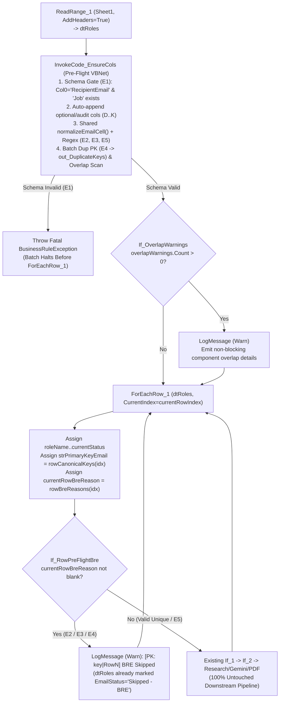

# [JK-RPA-005] Pre-Flight Schema Validation, Column A Email Normalization & Duplicate Primary Key Detection — Implementation Plan

> **Goal:** Upgrade the post-`ReadRange_1` `InvokeCode` in `JourKa/Main.xaml` into a fail-fast Pre-Flight Validation & Email Normalization gate that enforces `RecipientEmail` at Column A (Index 0) and `Job` existence (`E1`), auto-appends missing optional/audit columns (`AbroadMarkets`, `StudentName`, `Status`, `EmailStatus`, `EmailTimestamp`, `ErrorMessage`), normalizes and validates every Column A email cell (`E2`, `E3`, `E5`), detects batch-level duplicate canonical Primary Keys (`E4`, `out_DuplicateKeys`) and non-blocking component email overlaps (`Warn`), and gates rejected rows cleanly inside `ForEachRow_1` without modifying downstream scraping, Gemini, or PDF/HTML pipelines.
> **Source:** `https://github.com/prayogizan/JourKa/issues/24` (Parent Epic: `#22` `EPIC-JK-MAIL` / `JK-RPA-003` §3.2, §4.2, `E1`–`E5`, `AC-03`, `AC-05`, `AC-06`; Dependency: `#23` `JK-RPA-004` merged in `4746768`)
> **Git Branch:** `feat/jk-rpa-005-preflight-email-pk-validation` *(checked out cleanly at `4746768`)*
> **Epic:** `EPIC-JK-MAIL` — Column A Primary Key & Automated Student/Parent Email Delivery · **Priority / Points:** `P0 (Blocker / Foundation) / 3 pts`
> **Project Root:** `D:\UiPathProject\JourKa\JourKa` ([project.json](file:///Users/ottencoffee/ProjectLabs/Hackathon/JourKa/JourKa/project.json))
> **Project type:** `XAML` (`Modern Windows XAML Process`, `targetFramework: Windows`, `dotNetVersion: net10.0`)
> **Expression language:** `VB.NET` (`VisualBasic`, `Option Strict On`, `Option Explicit On`)
> **Approach:** `explore-first`
> **Execution autonomy:** `interactive` *(pauses for user approval before XAML mutation and before `uip rpa run` per [AGENTS.md](file:///Users/ottencoffee/ProjectLabs/Hackathon/JourKa/JourKa/AGENTS.md))*
> **Delivery model:** `standalone` *(local UiPath Studio 26.10 / Robot execution)*
> **Packaging:** `standalone` *(single UiPath RPA process, no `.uipx` solution)*
> **App type:** `N/A` *(headless OpenXML Workbook DataTable + VB.NET `InvokeCode`)*
> **App state:** `N/A`
> **UI targeting:** `N/A`
> **Canonical Plan Path:** `JourKa/docs/plans/2026-11-23-jk-rpa-005-preflight-email-pk-validation.md`

---

## Understanding

`JK-RPA-004` (`#23`, merged at `4746768`) migrated [Desire Role List.xlsx](file:///Users/ottencoffee/ProjectLabs/Hackathon/JourKa/JourKa/Input/Desire%20Role%20List.xlsx) to the 11-column `v2.0` schema (`RecipientEmail` at Column A, `Job` at Column B) and added a `dtRoles.Columns.Contains("Job")` guard in `InvokeCode_EnsureCols` inside [Main.xaml](file:///Users/ottencoffee/ProjectLabs/Hackathon/JourKa/JourKa/Main.xaml#L135-L139). However, [Main.xaml](file:///Users/ottencoffee/ProjectLabs/Hackathon/JourKa/JourKa/Main.xaml) does not yet enforce that Column A (Index `0`) is `"RecipientEmail"`, does not normalize or syntax-validate Column A email tokens, and does not detect duplicate canonical Primary Keys or shared component email overlaps across rows.

This foundation validation ticket (`JK-RPA-005` / `#24`) consolidates and upgrades `InvokeCode_EnsureCols` (between `ReadRange_1` and `ForEachRow_1`) into a single Pre-Flight Validation `InvokeCode` (`VBNet`) that: (1) fails fast with `UiPath.Core.BusinessRuleException` on empty sheets, non-`RecipientEmail` Column A (`E1`), or missing `Job`; (2) auto-appends missing optional/audit columns (`AbroadMarkets`, `StudentName`, `Status`, `EmailStatus`, `EmailTimestamp`, `ErrorMessage`); (3) runs a single shared normalization/validation helper (`ChrW(160)` and `ChrW(&H200B)` hygiene, `;`/`,` split, trim + lowercase, strict regex atomic per-row validation, order-preserving `.Distinct`, `;`-joined `strPrimaryKeyEmail`); (4) outputs `out_DuplicateKeys` (`HashSet(Of String)`), per-row canonical keys (`out_RowCanonicalKeys`), per-row BRE reasons (`out_RowBreReasons`, flagging **only** 2nd+ duplicate occurrences per `#22` Watchout #3), and non-blocking component overlap warnings (`out_OverlapWarnings` logged at `Warn`); and (5) binds `CurrentIndex` + `strPrimaryKeyEmail` in `ForEachRow_1` so `E2`/`E3`/`E4` rows are logged at `Warn` with `EmailStatus = "Skipped - BRE"` and bypassed cleanly while valid unique rows (including `E5` auto-normalized rows) continue.

## Decisions & Trade-offs

- **Why consolidate `InvokeCode_EnsureCols` in-place rather than adding a second `InvokeCode`:** Parent Epic `#22` Watchout #2 explicitly instructs extending/replacing `InvokeCode_EnsureCols` right after `ReadRange_1` rather than keeping a redundant column-creation step. Keeping `IdRef="InvokeCode_EnsureCols"` with an updated `DisplayName` preserves Studio ViewState continuity and `InvokeCodeTool.ps1` extraction compatibility.
- **Why add `xmlns:scgc="clr-namespace:System.Collections.Generic;assembly=System.Collections"` for `out_DuplicateKeys` (`HashSet(Of String)`):** In `.NET 10.0` (`targetFramework: Windows`), `List<T>` and `Dictionary<K,V>` live in `System.Private.CoreLib` (existing `xmlns:scg`), whereas `HashSet<T>` resides in `System.Collections`. Adding `xmlns:scgc` (while `<AssemblyReference>System.Collections</AssemblyReference>` is already present at [Main.xaml#L81](file:///Users/ottencoffee/ProjectLabs/Hackathon/JourKa/JourKa/Main.xaml#L81)) guarantees Studio and CLI compilation of `scgc:HashSet(x:String)` without `Cannot create unknown type` errors.
- **Why compute canonical keys and per-row BRE decisions once in Pre-Flight (`out_RowCanonicalKeys`, `out_RowBreReasons`) instead of re-parsing in `ForEachRow_1`:** A single inline VB.NET helper lambda inside the Pre-Flight `InvokeCode` guarantees 100% identical normalization across duplicate detection and row binding, deterministically flags only 2nd+ duplicate rows (`#22` Watchout #3), immediately populates `EmailStatus = "Skipped - BRE"` and `ErrorMessage` in `dtRoles`, and produces reusable `strPrimaryKeyEmail` values for `#25` (`JK-RPA-006`) without creating unnecessary sub-workflow wrapper overhead (`uipath-rpa` Rule 4b).
- **Why log `out_OverlapWarnings` via `<If>` + `<ui:LogMessage Level="Warn">` instead of `ui:ForEach`:** Using only `If`, `Sequence`, and `ui:LogMessage` (all already proven in [Main.xaml](file:///Users/ottencoffee/ProjectLabs/Hackathon/JourKa/JourKa/Main.xaml)) eliminates `ForEach` schema/property risk across Studio `26.10` versions while emitting every component-overlap warning cleanly to Orchestrator/Studio logs before `ForEachRow_1`.
- **Why skill loading order is `jourka-uipath-rpa` → `uipath-rpa` → `uipath-review` → `jourka-github-pr`:** `jourka-uipath-rpa` owns `InvokeCodeTool.ps1`, `Invoke-JourKaGate.ps1`, and format/artifact invariants; `uipath-rpa` owns XAML authoring, `Option Strict On` VB.NET rules, and mandatory workflow testing; `uipath-review` performs read-only Workflow Analyzer & diff sign-off; `jourka-github-pr` handles branch/PR submission after verification passes.

---

## 1. Skill Auto-Discovery, Routing & Auto-Creation Gate *(mandatory — execute first)*

Before editing any workflow during execution, audit `.agents/skills/` using [Ensure-UiPathSkills.ps1](file:///Users/ottencoffee/ProjectLabs/Hackathon/JourKa/.agents/skills/jourka-uipath-rpa/scripts/Ensure-UiPathSkills.ps1) on the Windows host (or verify paths directly on macOS) so every required skill is present and loaded.

```powershell
powershell -NoProfile -ExecutionPolicy Bypass -File "D:\UiPathProject\JourKa\.agents\skills\jourka-uipath-rpa\scripts\Ensure-UiPathSkills.ps1" -EnsureCore -Audit
```

### 1.1 Active & Required Skills Matrix
| Skill Name | Scope (`.agents/skills/<name>`) | Trigger / Role in This Plan | Status (`Loaded` / `Auto-Extract` / `Auto-Create` / `N/A`) |
|---|---|---|---|
| `jourka-uipath-rpa` | [SKILL.md](file:///Users/ottencoffee/ProjectLabs/Hackathon/JourKa/.agents/skills/jourka-uipath-rpa/SKILL.md) | Master JourKa runbook, `InvokeCodeTool.ps1`, `Invoke-JourKaGate.ps1`, hard invariants | `Loaded` |
| `uipath-rpa` | [SKILL.md](file:///Users/ottencoffee/ProjectLabs/Hackathon/JourKa/.agents/skills/uipath-rpa/SKILL.md) | Core UiPath XAML/`InvokeCode` rules (Rules 1–25), `Option Strict On` VB.NET checks, mandatory testing workflow | `Loaded` |
| `uipath-planner` | [SKILL.md](file:///Users/ottencoffee/ProjectLabs/Hackathon/JourKa/.agents/skills/uipath-planner/SKILL.md) | Task derivation (`Identity` tuples), dependency edges, mandatory testing task, stop conditions | `Loaded` |
| `uipath-review` | [SKILL.md](file:///Users/ottencoffee/ProjectLabs/Hackathon/JourKa/.agents/skills/uipath-review/SKILL.md) | Read-only quality & Workflow Analyzer audit (`ST-USG-*`, `ST-MRD-*`, `ST-NMG-*`) | `Loaded` |
| `jourka-github-pr` | [SKILL.md](file:///Users/ottencoffee/ProjectLabs/Hackathon/JourKa/.agents/skills/jourka-github-pr/SKILL.md) | Conventional commit & PR checklist (`Closes #24`) after implementation and gate | `Loaded` |
| `jourka-interactive-html` | [SKILL.md](file:///Users/ottencoffee/ProjectLabs/Hackathon/JourKa/.agents/skills/jourka-interactive-html/SKILL.md) | `DossierInteractiveTemplate.html` (`v2`) frontend/token contract | `N/A` *(no HTML template edits in `#24`)* |

### 1.2 Skill Gap Auto-Creation Decision
- **Does this ticket introduce a repeatable workflow, external API, NuGet package, or UI subsystem not covered above?** `No` — all changes use existing `UiPath.System.Activities [26.10.0]` (`ui:InvokeCode`, `If`, `Assign`, `ui:LogMessage`, `ui:ForEachRow`) and `.NET 10.0` BCL (`System.Data`, `System.Collections.Generic`, `System.Text.RegularExpressions`) already covered by `jourka-uipath-rpa` and `uipath-rpa`.

---

## 2. Goal, Epic Boundary & Artifact Isolation *(mandatory)*

- **Outcome in one sentence:** Implement fail-fast Pre-Flight schema validation (`RecipientEmail` at Column A, `Job` required, optional/audit columns auto-appended), atomic canonical email normalization, batch duplicate PK detection (`out_DuplicateKeys`) + non-blocking component overlap warnings, and non-blocking `E2`–`E5` row gating in [JourKa/Main.xaml](file:///Users/ottencoffee/ProjectLabs/Hackathon/JourKa/JourKa/Main.xaml).
- **In scope (strictly owned by `JK-RPA-005` / Issue `#24`):**
  - Consolidate and upgrade `InvokeCode_EnsureCols` (between `ReadRange_1` and `ForEachRow_1`) in [JourKa/Main.xaml](file:///Users/ottencoffee/ProjectLabs/Hackathon/JourKa/JourKa/Main.xaml#L135-L139) into the Pre-Flight Validation `InvokeCode` (`Language="VBNet"`).
  - Fatal schema validation (`E1`): empty/headerless `Sheet1`, `dtRoles.Columns(0).ColumnName.Trim() <> "RecipientEmail"` (case-insensitive), or missing `"Job"` column throws `UiPath.Core.BusinessRuleException` before `ForEachRow_1` is entered; normalize `Columns(0).ColumnName = "RecipientEmail"`.
  - Auto-append missing optional/audit columns in-memory: `AbroadMarkets`, `StudentName`, `Status`, `EmailStatus`, `EmailTimestamp`, `ErrorMessage` (`GetType(String)`).
  - Shared canonical email normalization helper: strip `ChrW(160)` (→ `" "`) and `ChrW(&H200B)` (→ `""`), trim, split on `{";"c, ","c}` (`RemoveEmptyEntries`), trim + `ToLowerInvariant()`, strict regex validation (`^[A-Za-z0-9._%+-]+@[A-Za-z0-9.-]+\.[A-Za-z]{2,}$`) with atomic row rejection (`E3`), order-preserving `.Distinct(StringComparer.OrdinalIgnoreCase)`, join with `";"` → `strPrimaryKeyEmail` (`E5`).
  - Batch duplicate Primary Key detection (`out_DuplicateKeys As HashSet(Of String)` with `StringComparer.OrdinalIgnoreCase`): flag 2nd+ occurrence rows (`E4`) with `"Duplicate Primary Key in Column A: <key>"` while allowing the 1st occurrence and other unique rows to continue.
  - Component email overlap detection: detect when an individual sub-address appears across distinct valid rows and log `Warn` (`ui:LogMessage Level="Warn"`) without blocking processing.
  - Non-blocking row-level BRE gate inside `ForEachRow_1`: bind `CurrentIndex="[currentRowIndex]"` and `strPrimaryKeyEmail`, mark `E2`/`E3`/`E4` rows with `EmailStatus = "Skipped - BRE"` and `ErrorMessage = <breMsg>`, log `[PK: <key-or-RowN>]` `Warn`, and bypass `If_1` / downstream research for rejected rows.
- **Out of scope (owned by sibling tickets in `EPIC-JK-MAIL` — do NOT implement here):**
  - `#23` (`JK-RPA-004` — *already merged*): `Desire Role List.xlsx` `v2.0` workbook migration and `README.md` §5 update.
  - `#25` (`JK-RPA-006`): Full 10-variable per-row reset sequence (`studentName`, `safeRoleName`, `pdfPath`, `pdfPathID`, `listAttachments`, `strEmailSubject`, `strEmailBodyHtml`), decoupling email dispatch from `If_2` (`skipCompleted`), `E7` dossier failure isolation (`Status = "Failed"`, `EmailStatus = "Failed - System"` in `TryCatch_1`), and pre-dispatch 1-to-1 attachment integrity guard (`InvalidOperationException` / `FileNotFoundException`).
  - `#26` (`JK-FE-010`): `JourKa/Templates/StudentParentEmailTemplate.html` and HTML-encoded placeholder renderer.
  - `#27` (`JK-RPA-007`): `JourKa/Workflows/SendStudentEmail.xaml` SMTP dispatch with `RetryScope` and `.env` / Asset credentials.
  - `#28` (`JK-RPA-008`): End-of-batch `ui:WriteRange` back to `Desire Role List.xlsx` with `RetryScope` + `EmailAudit_<timestamp>.csv` fallback (`E10`), idempotent resend skip (`EmailStatus = "Sent"`), and full `[PK: ...]` logging across email dispatch & system exceptions.
  - `#29` (`JK-RPA-009`): Full `AC-01`..`AC-07` E2E regression suite, multi-client email rendering, and UAT sign-off.
- **Immutable Artifacts & Contracts (MUST NOT change):**
  - All 42 committed dossier artifacts in `JourKa/Output/<Role>/<Role> - {EN,ID}.{md,html,pdf}` and all 14 consolidated PDFs in `PDF_Results/` (`0` diffs allowed).
  - [DossierInteractiveTemplate.html](file:///Users/ottencoffee/ProjectLabs/Hackathon/JourKa/JourKa/Templates/DossierInteractiveTemplate.html) (`0` diffs allowed).
  - [JourKa/Input/Desire Role List.xlsx](file:///Users/ottencoffee/ProjectLabs/Hackathon/JourKa/JourKa/Input/Desire%20Role%20List.xlsx) (`0` diffs allowed — already migrated to `v2.0` in `#23`).
  - [project.json](file:///Users/ottencoffee/ProjectLabs/Hackathon/JourKa/JourKa/project.json) (`targetFramework: "Windows"`, `dotNetVersion: "net10.0"`, `expressionLanguage: "VisualBasic"` — `0` diffs allowed).
  - `If_2` idempotency predicate, `If_3` / `InvokeCode_2` HTML `v2` upgrade branch, `TryCatch_Abroad`, and `InvokeCode_1` scraping / Gemini / PDF logic in [Main.xaml](file:///Users/ottencoffee/ProjectLabs/Hackathon/JourKa/JourKa/Main.xaml#L275-L508).
  - All 5 `JourKa/Workflows/*.xaml` files (`0` diffs allowed).

---

## 3. Codebase, Workflow & Activity Discovery *(mandatory — Rule 17 & Rule 21)*

Verified directly against live [Main.xaml](file:///Users/ottencoffee/ProjectLabs/Hackathon/JourKa/JourKa/Main.xaml) (517 lines), [project.json](file:///Users/ottencoffee/ProjectLabs/Hackathon/JourKa/JourKa/project.json), and [Desire Role List.xlsx](file:///Users/ottencoffee/ProjectLabs/Hackathon/JourKa/JourKa/Input/Desire%20Role%20List.xlsx) on branch `feat/jk-rpa-005-preflight-email-pk-validation` (`4746768`).

### 3.1 Live Codebase Findings
| # | Finding | Verified Location (`file#Lx-Ly`) | Impact on Plan |
|---|---|---|---|
| **F1** | Root `<Activity>` declares `xmlns:scg="clr-namespace:System.Collections.Generic;assembly=System.Private.CoreLib"`, `xmlns:sd`, `xmlns:s`, `xmlns:ui`, `xmlns:x`. It does **not** yet declare an `xmlns` alias for `System.Collections.Generic` in `assembly=System.Collections` (where `HashSet<T>` lives in `.NET 10.0`), though `<AssemblyReference>System.Collections</AssemblyReference>` is already present at line 81. | [Main.xaml#L1](file:///Users/ottencoffee/ProjectLabs/Hackathon/JourKa/JourKa/Main.xaml#L1), [Main.xaml#L81](file:///Users/ottencoffee/ProjectLabs/Hackathon/JourKa/JourKa/Main.xaml#L81) | Add `xmlns:scgc="clr-namespace:System.Collections.Generic;assembly=System.Collections"` to `<Activity>` so `scgc:HashSet(x:String)` resolves reliably in both Studio 26.10 and `uip rpa validate/build`. |
| **F2** | `TextExpression.NamespacesForImplementation` and `ReferencesForImplementation` already include `System.Collections.Generic`, `System.Data`, `System.Linq`, `System.Text.RegularExpressions`, `UiPath.Core`, `System.Collections`, and `System.Text.RegularExpressions`. | [Main.xaml#L13-L25](file:///Users/ottencoffee/ProjectLabs/Hackathon/JourKa/JourKa/Main.xaml#L13-L25), [Main.xaml#L81-L94](file:///Users/ottencoffee/ProjectLabs/Hackathon/JourKa/JourKa/Main.xaml#L81-L94) | Zero new `NamespacesForImplementation` or `ReferencesForImplementation` entries required; still fully-qualify CLR types inside `InvokeCode` per `invokecode-rules.md`. |
| **F3** | `ReadRange_1` (`SheetName="Sheet1"`, `AddHeaders="True"`, `Range="{x:Null}"`, `DataTable="[dtRoles]"`) is immediately followed by `InvokeCode_EnsureCols` (`Language="VBNet"`, `io_dtRoles` `InOut`), which currently only checks `Contains("Job")` and appends `"AbroadMarkets"`. | [Main.xaml#L134-L139](file:///Users/ottencoffee/ProjectLabs/Hackathon/JourKa/JourKa/Main.xaml#L134-L139) | Consolidate and upgrade `InvokeCode_EnsureCols` in-place (`#22` Watchout #2) into the complete Pre-Flight Schema Validation, Normalization & Duplicate PK Detection `InvokeCode`. |
| **F4** | `ForEachRow_1` currently has `CurrentIndex="{x:Null}"`, and `Sequence_4` immediately reads `roleName` (`Assign_1`) through `currentStatus` (`Assign_5`) and branches into `If_1` (`If Role Name is Blank`) without checking Column A PK validity or duplicate status. | [Main.xaml#L140-L203](file:///Users/ottencoffee/ProjectLabs/Hackathon/JourKa/JourKa/Main.xaml#L140-L203) | Bind `CurrentIndex="[currentRowIndex]"`, assign `strPrimaryKeyEmail` and `currentRowBreReason` from Pre-Flight dictionaries inside `Sequence_4`, and wrap `If_1` inside `If_RowPreFlightBre.Else` so `E2`/`E3`/`E4` rows log `Warn` and skip cleanly. |
| **F5** | Committed [Desire Role List.xlsx](file:///Users/ottencoffee/ProjectLabs/Hackathon/JourKa/JourKa/Input/Desire%20Role%20List.xlsx) `Sheet1` has `v2.0` headers `A1..K1` (`RecipientEmail`..`ErrorMessage`) with 7 populated roles (`B2:B8`) and intentionally blank `A2:A8` (`RecipientEmail`) from `#23`. | [Desire Role List.xlsx](file:///Users/ottencoffee/ProjectLabs/Hackathon/JourKa/JourKa/Input/Desire%20Role%20List.xlsx) | Do **not** mutate this workbook in `#24`. Running against it with blank `A2:A8` will trigger non-blocking `E2` (`EmailStatus="Skipped - BRE"`) on all 7 rows — expected behavior verifying `E2` protection; L5/L6 verification uses temporary test workbooks covering `E1`–`E5`. |
| **F6** | `InvokeCode_1` (`L458-L479`) and `InvokeCode_2` (`L301-L313`) have no references to `RecipientEmail`, `dtRoles`, or `CurrentRow`. | [Main.xaml#L301-L313](file:///Users/ottencoffee/ProjectLabs/Hackathon/JourKa/JourKa/Main.xaml#L301-L313), [Main.xaml#L458-L479](file:///Users/ottencoffee/ProjectLabs/Hackathon/JourKa/JourKa/Main.xaml#L458-L479) | Zero modifications to `InvokeCode_1` or `InvokeCode_2`; L4 static diff proves byte-for-byte invariance of both blocks. |

### 3.2 Target `InvokeCode` & Workflow Inventory
| Workflow File | Activity `IdRef` | `DisplayName` | In / Out / InOut Arguments | Missing Namespace Imports to Fully-Qualify |
|---|---|---|---|---|
| [Main.xaml](file:///Users/ottencoffee/ProjectLabs/Hackathon/JourKa/JourKa/Main.xaml#L135-L139) | `InvokeCode_EnsureCols` *(consolidated in-place)* | `Pre-Flight Schema Validation, Email Normalization &amp; Duplicate PK Detection` | `io_dtRoles` (`InOut`, `sd:DataTable`), `out_DuplicateKeys` (`Out`, `scgc:HashSet(x:String)`), `out_RowCanonicalKeys` (`Out`, `scg:Dictionary(x:Int32, x:String)`), `out_RowBreReasons` (`Out`, `scg:Dictionary(x:Int32, x:String)`), `out_OverlapWarnings` (`Out`, `scg:List(x:String)`) | Fully qualify `UiPath.Core.BusinessRuleException`, `System.Data.DataRow`, `System.Collections.Generic.HashSet`, `System.Collections.Generic.Dictionary`, `System.Collections.Generic.List`, `System.Text.RegularExpressions.Regex`, `System.Text.RegularExpressions.RegexOptions`, `System.Tuple`, `System.StringComparer`, `System.StringComparison`, `System.StringSplitOptions` per [invokecode-rules.md](file:///Users/ottencoffee/ProjectLabs/Hackathon/JourKa/.agents/skills/jourka-uipath-rpa/references/invokecode-rules.md). |
| [Main.xaml](file:///Users/ottencoffee/ProjectLabs/Hackathon/JourKa/JourKa/Main.xaml#L140-L205) | `ForEachRow_1` + new `If_OverlapWarnings`, `Assign_PrimaryKeyEmail`, `Assign_RowBreReason`, `If_RowPreFlightBre` | `If Component Email Overlaps Detected`, `Assign strPrimaryKeyEmail`, `Assign currentRowBreReason`, `If Row Failed Pre-Flight BRE` | Uses `Sequence_1` variables (`overlapWarnings`, `currentRowIndex`, `rowCanonicalKeys`, `rowBreReasons`, `strPrimaryKeyEmail`, `currentRowBreReason`) | Standard `System` / `System.Collections.Generic` expressions already imported in `Main.xaml`. |

### 3.3 NuGet Package & Activity Resolution Gate (`Rule 21`)
- **Dependencies in `project.json` sufficient?** `Yes` — [project.json](file:///Users/ottencoffee/ProjectLabs/Hackathon/JourKa/JourKa/project.json#L6-L12) already includes `UiPath.System.Activities [26.10.0]`, `UiPath.Excel.Activities [3.6.1]`, and `UiPath.Testing.Activities [25.10.3]`. Zero new NuGet packages required.
- **New XAML Activities Added:**
  | Activity Class | Source (`Card` / `Memory` / `Rule 21 Triple`) | Required Properties Checklist | Container `<Sequence>` Slot Needed? |
  |---|---|---|---|
  | `If` (`System.Activities.Statements.If`) | Existing proven pattern in [Main.xaml#L200](file:///Users/ottencoffee/ProjectLabs/Hackathon/JourKa/JourKa/Main.xaml#L200) & [Main.xaml#L283](file:///Users/ottencoffee/ProjectLabs/Hackathon/JourKa/JourKa/Main.xaml#L283) | `Condition`, `DisplayName`, unique `sap2010:WorkflowViewState.IdRef` | `Yes` — wrap both `If.Then` and `If.Else` in `<Sequence>` |
  | `Assign` (`System.Activities.Statements.Assign`) | Existing proven pattern in [Main.xaml#L152-L199](file:///Users/ottencoffee/ProjectLabs/Hackathon/JourKa/JourKa/Main.xaml#L152-L199) | `Assign.To` (`OutArgument`), `Assign.Value` (`InArgument`), `DisplayName`, unique `IdRef` | `No` (resides inside `Sequence_4`) |
  | `ui:LogMessage` (`UiPath.Core.Activities.LogMessage`) | Existing proven pattern in [Main.xaml#L202](file:///Users/ottencoffee/ProjectLabs/Hackathon/JourKa/JourKa/Main.xaml#L202) & [Main.xaml#L501](file:///Users/ottencoffee/ProjectLabs/Hackathon/JourKa/JourKa/Main.xaml#L501) | `Level="Warn"`, `Message="[...]"`, `DisplayName`, unique `IdRef` | `No` (resides inside `Sequence`) |

---

## 4. UiPath Common Pitfalls & Analyzer Vetting Gate *(mandatory — Rule 22)*

Vetted against [common-pitfalls.md](file:///Users/ottencoffee/ProjectLabs/Hackathon/JourKa/.agents/skills/uipath-rpa/references/xaml/common-pitfalls.md) and [invokecode-rules.md](file:///Users/ottencoffee/ProjectLabs/Hackathon/JourKa/.agents/skills/jourka-uipath-rpa/references/invokecode-rules.md):

- [x] **`Option Strict On` & `Option Explicit On` (VB.NET):** Every variable (`Dim x As <Type>`) and lambda (`Func(Of String, System.Tuple(Of ...))`) in Pre-Flight `InvokeCode` has explicit types; `Char` literals use `";"c, ","c`; `DataRow` column writes happen cleanly inside `InvokeCode` (`String` widens to `Object`) rather than mismatched `x:String` `OutArgument` assigns in XAML.
- [x] **`HashSet(Of String)` XAML Assembly Namespace Trap:** Declare `xmlns:scgc="clr-namespace:System.Collections.Generic;assembly=System.Collections"` on `<Activity>` for `scgc:HashSet(x:String)` instead of `scg:HashSet(x:String)` (`System.Private.CoreLib`), while keeping `scg:Dictionary(x:Int32, x:String)` and `scg:List(x:String)` on `scg`. Verify `<AssemblyReference>System.Collections</AssemblyReference>` remains intact at [Main.xaml#L81](file:///Users/ottencoffee/ProjectLabs/Hackathon/JourKa/JourKa/Main.xaml#L81).
- [x] **`ChrW()` vs. `Chr()` in Modern `.NET 10.0`:** Strictly use `ChrW(160)` and `ChrW(&H200B)` — never `Chr()` (which throws at runtime in Modern Windows projects per `common-pitfalls.md`).
- [x] **`InvokeCode` `Code` Attribute Form & `Language="VBNet"`:** Keep `Code="..."` strictly as an XML attribute (line breaks as `&#xA;`, quotes as `&quot;`) and `Language="VBNet"` (never `"VisualBasic"` or child CDATA element).
- [x] **`InvokeCode` Method-Body Rule:** No top-level `Return <value>`; assign all `out_*` arguments unconditionally before exiting; `Return` is used only inside the `normalizeEmailCell` `Function` lambda.
- [x] **Safe XML Attribute Editing (`InvokeCodeTool.ps1`):** Extract `InvokeCode_EnsureCols` into `JourKa/.local/invokecode/Main__InvokeCode_EnsureCols.vb`, snapshot `*__before.vb`, edit, and inject via `InvokeCodeTool.ps1 inject` (or equivalent UTF-8-BOM-preserving XML encoder when on macOS).
- [x] **Studio ViewState & Container Wrappers:** Leave `sap:WorkflowViewStateService.ViewState` and `HintSize` untouched on all unchanged nodes (`InvokeCode_1`, `InvokeCode_2`, `If_2`, `TryCatch_1`, etc.); wrap every new `If.Then` and `If.Else` slot in `<Sequence>` with unique `IdRef`s.
- [x] **Exception Taxonomy & Stack Preservation:** Fatal schema failures (`E1`) throw `UiPath.Core.BusinessRuleException` before `ForEachRow_1`; row-level `E2`/`E3`/`E4` are non-blocking BRE outcomes recorded in `EmailStatus = "Skipped - BRE"` + `ErrorMessage` and logged at `Warn`.
- [x] **Secret Redaction & Hygiene:** Zero `.env` secrets, API keys, or real PII emails read, logged, or committed.

---

## 5. Issue Gaps, Ambiguities, Decisions & Stop Conditions *(mandatory)*

### 5.1 Gaps & Decisions
| # | Gap / Ambiguity / Contradiction | Decision Taken & Rationale | Needs User Input? |
|---|---|---|---|
| **D1** | **First Occurrence vs. Duplicate Occurrence Semantics (`E4` / `#22` Watchout #3):** `#22 §4.2` only populates `out_DuplicateKeys` with duplicated key strings; if `ForEachRow_1` checked `duplicateKeys.Contains(key)` directly, it would erroneously reject Row 2 (first occurrence) as well as Row 3 (second occurrence). | Keep `out_DuplicateKeys` (`HashSet(Of String)`) populated with every duplicated canonical key (satisfying Gherkin `Then "budi@student.id" is in out_DuplicateKeys`) **and** additionally output `out_RowBreReasons` (`Dictionary(Of Int32, String)`) keyed by 0-based `dtRoles` row index so **only** 2nd+ occurrences (e.g., Row 3) are rejected with `EmailStatus = "Skipped - BRE"` while Row 2 and other unique rows continue. | `No` *(mandated by `#22` Watchout #3 & `#24` Gherkin Scenario 2)* |
| **D2** | **Completely blank trailing rows vs. `E2` blank Column A rows:** Excel workbooks sometimes contain trailing empty rows (both `RecipientEmail` and `Job` empty), whereas `E2` / `AC-06` specifically tests a data row with blank `RecipientEmail` and populated `Job` (e.g., `RecipientEmail=""`, `Job="Android Developer"`). | When **both** `RecipientEmail` (after invisible-char cleaning) AND `Job` are blank, skip the row without flagging `E2` (preserving existing `If_1` `"Skipping blank role row."` behavior). When `Job` is non-blank and `RecipientEmail` is blank (or contains only `;`/`,` delimiters), classify as `E2` (`"Missing mandatory RecipientEmail in Column A"`, `EmailStatus = "Skipped - BRE"`). When `RecipientEmail` is non-blank and malformed, always classify as `E3` atomically regardless of `Job`. | `No` *(standard Excel hygiene; confirm if user wants completely empty rows flagged as `E2` too)* |
| **D3** | **Malformed rows (`E3`) and duplicate/overlap tracking:** If two rows both contain the same malformed string (e.g., `"bad-email"`), should `"bad-email"` enter `out_DuplicateKeys` or component overlap tracking? | **No.** Validate every token against the strict email regex *before* inserting into `seenKeys`, `dupKeys`, or `seenComponents`. Malformed rows are rejected atomically as `E3` (`"Invalid email format in Column A"`) and never pollute `out_DuplicateKeys` or overlap warnings. | `No` |
| **D4** | **Committed `Desire Role List.xlsx` has blank `A2:A8` from `#23`:** After `#24` lands, running `Main.xaml` directly against the committed baseline workbook will mark all 7 rows `EmailStatus = "Skipped - BRE"` (`E2`). | Leave [JourKa/Input/Desire Role List.xlsx](file:///Users/ottencoffee/ProjectLabs/Hackathon/JourKa/JourKa/Input/Desire%20Role%20List.xlsx) unmodified in `#24` (no fake/PII emails committed). Verify `E1`–`E5` and all 4 Gherkin scenarios during `T2`/`T3` using isolated temporary test workbooks / `.NET` harness, and note in PR that operators must populate Column A before live runs. | `No` *(informational)* |
| **D5** | **Cross-platform `uip` CLI gate execution:** Current planning host is macOS, whereas `Invoke-JourKaGate.ps1` requires Windows UiPath Studio `26.10` (`uip.cmd`). | Run L1 (XML/BOM/ViewState), L4 (static invariance diff), and a `.NET`/VB.NET unit verification of the Pre-Flight logic locally if available, and run mandatory L2 (`uip rpa validate`) + L3 (`uip rpa build`) + consent-gated L6 (`uip rpa run`) on the Windows Studio 26.10 host before PR merge. | `No` |

### 5.2 Stop Conditions
Execution continues through the approved tasks unless one of these hard blockers occurs:
- `uip rpa validate` or `uip rpa build` fails on the Windows Studio host after 5 structured repair attempts (`Package → Structure → Type → Properties → Logic`).
- Live runtime execution (`uip rpa run`) is reached without explicit user consent ([AGENTS.md](file:///Users/ottencoffee/ProjectLabs/Hackathon/JourKa/JourKa/AGENTS.md)).
- `uip.cmd` / Windows Studio host is unavailable when running the mandatory L2/L3 CLI gate (report the environment blocker explicitly rather than marking L2/L3 passed).
- An invariant check detects any modification in `JourKa/Output/`, `PDF_Results/`, `JourKa/Templates/`, `JourKa/Input/`, `JourKa/Workflows/`, `JourKa/project.json`, `InvokeCode_1`, `InvokeCode_2`, or outside §7 Change Manifest.

---

## 6. Technical Design, Data Contracts & Failure Modes *(mandatory)*

### 6.1 Architecture & Data-Flow Diagram


### 6.2 Argument, Variable & Data Contracts

#### A. New `Main.xaml` Namespace, Variables & Pre-Flight `InvokeCode` Arguments
| Name | Kind (`Xmlns` / `Var` / `InOutArg` / `OutArg`) | Type | Producer | Consumer | Validation / Encoding Rule |
|---|---|---|---|---|---|
| `xmlns:scgc` | `Xmlns` (`<Activity>`) | `clr-namespace:System.Collections.Generic;assembly=System.Collections` | [Main.xaml#L1](file:///Users/ottencoffee/ProjectLabs/Hackathon/JourKa/JourKa/Main.xaml#L1) | `duplicateKeys`, `out_DuplicateKeys` | Required so `.NET 10.0` `HashSet<string>` resolves in XAML |
| `io_dtRoles` | `InOutArg` (`InvokeCode_EnsureCols`) | `sd:DataTable` | `ReadRange_1` (`dtRoles`) | Pre-Flight `InvokeCode` → `ForEachRow_1` | Normalizes `Columns(0).ColumnName = "RecipientEmail"`; appends missing cols; sets `EmailStatus`/`ErrorMessage` on `E2`/`E3`/`E4` rows |
| `out_DuplicateKeys` / `duplicateKeys` | `OutArg` / `Var` (`Sequence_1`) | `scgc:HashSet(x:String)` | Pre-Flight `InvokeCode` | Audit / tests / `#25` | `StringComparer.OrdinalIgnoreCase`; contains canonical `;`-joined keys seen ≥ 2 times |
| `out_RowCanonicalKeys` / `rowCanonicalKeys` | `OutArg` / `Var` (`Sequence_1`) | `scg:Dictionary(x:Int32, x:String)` | Pre-Flight `InvokeCode` | `ForEachRow_1` (`Assign_PrimaryKeyEmail`) | Maps 0-based `dtRoles` row index → normalized `;`-joined lowercase `strPrimaryKeyEmail` (also populated for `E4` dup rows so `[PK: <key>]` logs accurately; `""` for `E2`/`E3`) |
| `out_RowBreReasons` / `rowBreReasons` | `OutArg` / `Var` (`Sequence_1`) | `scg:Dictionary(x:Int32, x:String)` | Pre-Flight `InvokeCode` | `ForEachRow_1` (`Assign_RowBreReason`, `If_RowPreFlightBre`) | Maps 0-based `dtRoles` row index → exact BRE message for `E2`, `E3`, and 2nd+ `E4` rows only |
| `out_OverlapWarnings` / `overlapWarnings` | `OutArg` / `Var` (`Sequence_1`) | `scg:List(x:String)` | Pre-Flight `InvokeCode` | `If_OverlapWarnings` → `LogMessage_OverlapWarnings` | Non-blocking `Warn` messages when an individual sub-address repeats across distinct valid rows |
| `currentRowIndex` | `Var` (`Sequence_1`) | `x:Int32` | `ForEachRow_1` (`CurrentIndex`) | `Assign_PrimaryKeyEmail`, `Assign_RowBreReason`, `LogMessage_RowBreSkip` | 0-based `DataTable` row index (Excel row number = `currentRowIndex + 2`) |
| `strPrimaryKeyEmail` | `Var` (`Sequence_1`) | `x:String` | `Assign_PrimaryKeyEmail` | `LogMessage_RowBreSkip` & downstream `#25` | Canonical lowercase `;`-joined email key per row |
| `currentRowBreReason` | `Var` (`Sequence_1`) | `x:String` | `Assign_RowBreReason` | `If_RowPreFlightBre`, `LogMessage_RowBreSkip` | Non-empty iff row failed Pre-Flight `E2`/`E3`/`E4` |

#### B. Canonical VB.NET Pre-Flight `InvokeCode` Body (`JourKa/.local/invokecode/Main__InvokeCode_EnsureCols.vb`)
```vbnet
' Pre-Flight Schema Validation, Column A Email Normalization & Duplicate PK Detection (JK-RPA-005 / #24)
' Arguments:
'   io_dtRoles (InOut System.Data.DataTable)
'   out_DuplicateKeys (Out System.Collections.Generic.HashSet(Of String))
'   out_RowCanonicalKeys (Out System.Collections.Generic.Dictionary(Of Integer, String))
'   out_RowBreReasons (Out System.Collections.Generic.Dictionary(Of Integer, String))
'   out_OverlapWarnings (Out System.Collections.Generic.List(Of String))

' 1. Fatal Schema Checks (E1 — halt batch before ForEachRow_1)
If io_dtRoles Is Nothing OrElse io_dtRoles.Columns.Count = 0 Then
    Throw New UiPath.Core.BusinessRuleException("Input Excel Sheet1 is empty or contains no header row.")
End If

Dim col0Name As String = io_dtRoles.Columns(0).ColumnName.Trim()
If Not col0Name.Equals("RecipientEmail", System.StringComparison.OrdinalIgnoreCase) Then
    Throw New UiPath.Core.BusinessRuleException( _
        String.Format("Invalid Input Schema: Column A (Index 0) must be 'RecipientEmail' (Primary Key), but found '{0}'.", col0Name))
End If

io_dtRoles.Columns(0).ColumnName = "RecipientEmail"

If Not io_dtRoles.Columns.Contains("Job") Then
    Throw New UiPath.Core.BusinessRuleException("Invalid Input Schema: Required column 'Job' is missing from Sheet1.")
End If

' 2. Auto-append missing optional & audit columns in-memory without disturbing Column A
For Each optCol As String In New String() {"AbroadMarkets", "StudentName", "Status", "EmailStatus", "EmailTimestamp", "ErrorMessage"}
    If Not io_dtRoles.Columns.Contains(optCol) Then
        io_dtRoles.Columns.Add(optCol, GetType(String))
    End If
Next

' 3. Initialize output collections unconditionally
Dim seenKeys As New System.Collections.Generic.HashSet(Of String)(System.StringComparer.OrdinalIgnoreCase)
Dim dupKeys As New System.Collections.Generic.HashSet(Of String)(System.StringComparer.OrdinalIgnoreCase)
Dim canonicalByRow As New System.Collections.Generic.Dictionary(Of Integer, String)()
Dim breByRow As New System.Collections.Generic.Dictionary(Of Integer, String)()
Dim overlapWarns As New System.Collections.Generic.List(Of String)()
Dim seenComponents As New System.Collections.Generic.Dictionary(Of String, Integer)(System.StringComparer.OrdinalIgnoreCase)

' 4. Shared Canonical Email Normalization & Strict Validation Helper (E2, E3, E5)
Dim emailRegex As New System.Text.RegularExpressions.Regex("^[A-Za-z0-9._%+-]+@[A-Za-z0-9.-]+\.[A-Za-z]{2,}$", System.Text.RegularExpressions.RegexOptions.Compiled)
Dim normalizeEmailCell As Func(Of String, System.Tuple(Of Boolean, String, String, System.Collections.Generic.List(Of String))) = _
    Function(rawCell As String) As System.Tuple(Of Boolean, String, String, System.Collections.Generic.List(Of String))
        Dim emptyList As New System.Collections.Generic.List(Of String)()
        Dim cleaned As String = If(rawCell, "").Replace(ChrW(160), " ").Replace(ChrW(&H200B), "").Trim()
        If String.IsNullOrWhiteSpace(cleaned) Then
            Return System.Tuple.Create(False, "", "Missing mandatory RecipientEmail in Column A", emptyList)
        End If

        Dim rawTokens As System.Collections.Generic.List(Of String) = cleaned _
            .Split(New Char() {";"c, ","c}, System.StringSplitOptions.RemoveEmptyEntries) _
            .Select(Function(t As String) t.Trim().ToLowerInvariant()) _
            .Where(Function(t As String) Not String.IsNullOrWhiteSpace(t)) _
            .ToList()

        If rawTokens.Count = 0 Then
            Return System.Tuple.Create(False, "", "Missing mandatory RecipientEmail in Column A", emptyList)
        End If

        For Each tok As String In rawTokens
            If Not emailRegex.IsMatch(tok) Then
                Return System.Tuple.Create(False, "", "Invalid email format in Column A", emptyList)
            End If
        Next

        Dim distinctTokens As System.Collections.Generic.List(Of String) = rawTokens _
            .Distinct(System.StringComparer.OrdinalIgnoreCase) _
            .ToList()
        Dim canonicalKey As String = String.Join(";", distinctTokens)
        Return System.Tuple.Create(True, canonicalKey, "", distinctTokens)
    End Function

' 5. Scan all rows: normalize, validate, detect duplicates (E4) & component overlaps (Warn)
For rowIdx As Integer = 0 To io_dtRoles.Rows.Count - 1
    Dim row As System.Data.DataRow = io_dtRoles.Rows(rowIdx)
    Dim rawEmail As String = Convert.ToString(row("RecipientEmail"))
    Dim rawJob As String = Convert.ToString(row("Job")).Trim()
    Dim cleanedProbe As String = If(rawEmail, "").Replace(ChrW(160), " ").Replace(ChrW(&H200B), "").Trim()

    ' Completely empty trailing Excel row: preserve existing blank-row skip in If_1
    If String.IsNullOrWhiteSpace(cleanedProbe) AndAlso String.IsNullOrWhiteSpace(rawJob) Then
        canonicalByRow(rowIdx) = ""
        Continue For
    End If

    Dim normResult As System.Tuple(Of Boolean, String, String, System.Collections.Generic.List(Of String)) = normalizeEmailCell(rawEmail)
    If Not normResult.Item1 Then
        canonicalByRow(rowIdx) = ""
        breByRow(rowIdx) = normResult.Item3
        row("EmailStatus") = "Skipped - BRE"
        row("ErrorMessage") = normResult.Item3
        Continue For
    End If

    Dim canonicalKey As String = normResult.Item2
    Dim tokens As System.Collections.Generic.List(Of String) = normResult.Item4
    canonicalByRow(rowIdx) = canonicalKey

    If Not seenKeys.Add(canonicalKey) Then
        dupKeys.Add(canonicalKey)
        Dim dupMsg As String = "Duplicate Primary Key in Column A: " & canonicalKey
        breByRow(rowIdx) = dupMsg
        row("EmailStatus") = "Skipped - BRE"
        row("ErrorMessage") = dupMsg
        Continue For
    End If

    ' Component overlap check (non-blocking Warn when an individual sub-address repeats across distinct valid rows)
    For Each tok As String In tokens
        If seenComponents.ContainsKey(tok) Then
            overlapWarns.Add(String.Format( _
                "Component email overlap detected (non-blocking): '{0}' appears in Excel Row {1} and Excel Row {2} (PK: '{3}').", _
                tok, seenComponents(tok), rowIdx + 2, canonicalKey))
        Else
            seenComponents(tok) = rowIdx + 2
        End If
    Next
Next

out_DuplicateKeys = dupKeys
out_RowCanonicalKeys = canonicalByRow
out_RowBreReasons = breByRow
out_OverlapWarnings = overlapWarns
```

#### C. XAML Wiring in `JourKa/Main.xaml` (Between `ReadRange_1` and `ForEachRow_1`, and Inside `Sequence_4`)
1. **Between `InvokeCode_EnsureCols` and `ForEachRow_1`:**
   - Add `<If Condition="[overlapWarnings IsNot Nothing AndAlso overlapWarnings.Count &gt; 0]" DisplayName="If Component Email Overlaps Detected" sap2010:WorkflowViewState.IdRef="If_OverlapWarnings">`
     - `<If.Then><Sequence DisplayName="Log Component Email Overlap Warnings" sap2010:WorkflowViewState.IdRef="Sequence_OverlapWarnings">`
       - `<ui:LogMessage DisplayName="Log Component Email Overlaps" Level="Warn" Message="[String.Join(Environment.NewLine, overlapWarnings)]" sap2010:WorkflowViewState.IdRef="LogMessage_OverlapWarnings" />`
     - `</Sequence></If.Then>`
2. **On `ForEachRow_1` (`Main.xaml#L140`):**
   - Change `CurrentIndex="{x:Null}"` → `CurrentIndex="[currentRowIndex]"`.
3. **Inside `Sequence_4` (`Process Role Row`, right after `Assign_5` and wrapping existing `If_1`):**
   - `Assign` (`Assign_PrimaryKeyEmail`): `strPrimaryKeyEmail = [If(rowCanonicalKeys IsNot Nothing AndAlso rowCanonicalKeys.ContainsKey(currentRowIndex), rowCanonicalKeys(currentRowIndex), "")]`
   - `Assign` (`Assign_RowBreReason`): `currentRowBreReason = [If(rowBreReasons IsNot Nothing AndAlso rowBreReasons.ContainsKey(currentRowIndex), rowBreReasons(currentRowIndex), "")]`
   - `If` (`If_RowPreFlightBre`): Condition `[Not String.IsNullOrWhiteSpace(currentRowBreReason)]`
     - `If.Then` (`Sequence` `Sequence_SkipRowBre`):
       - `<ui:LogMessage DisplayName="Log Row Pre-Flight BRE Skipped" Level="Warn" Message="[&quot;[PK: &quot; &amp; If(String.IsNullOrWhiteSpace(strPrimaryKeyEmail), &quot;Row &quot; &amp; (currentRowIndex + 2).ToString(), strPrimaryKeyEmail) &amp; &quot;] BusinessRuleException — Row skipped. Reason: &quot; &amp; currentRowBreReason &amp; &quot; | Role: &quot; &amp; roleName]" sap2010:WorkflowViewState.IdRef="LogMessage_RowBreSkip" />`
     - `If.Else` (`Sequence` `Sequence_ValidRow`):
       - Contains the exact untouched `If_1` block (`Main.xaml#L200-L511`).

### 6.3 Failure Modes & Edge-Case Behavior Matrix (`E1`–`E5`)
| Scenario | Detection | Recovery / Handling Behavior | Observable Signal |
|---|---|---|---|
| **E1 — Legacy/Invalid Schema** (`Sheet1` empty, no header, `Columns(0) <> "RecipientEmail"`, or `"Job"` missing) | Pre-Flight `InvokeCode` Step 1 | Throws fatal `UiPath.Core.BusinessRuleException` before `ForEachRow_1` is ever entered | Batch halts with `"Invalid Input Schema: Column A (Index 0) must be 'RecipientEmail' (Primary Key), but found '<x>'."` (or missing `'Job'` / empty sheet message) |
| **E2 — Blank Column A** (`""`, whitespace, `ChrW(160)`/`\u200B` only, or `"; ,"` only, with non-blank `Job`) | `normalizeEmailCell` returns `Item1 = False` | Non-blocking row rejection: `EmailStatus = "Skipped - BRE"`, `ErrorMessage = "Missing mandatory RecipientEmail in Column A"`, logged at `Warn` in `If_RowPreFlightBre.Then` | Row skipped without entering `If_1`/generation; subsequent valid rows continue |
| **E3 — Malformed Email Token** (e.g., `"valid@student.id; invalid-email-format"`) | `emailRegex.IsMatch(tok) = False` on **any** token | Atomic full-row rejection (no partial delivery to valid sibling token): `EmailStatus = "Skipped - BRE"`, `ErrorMessage = "Invalid email format in Column A"`, excluded from `seenKeys`/`dupKeys` | Row skipped; `Warn` logged; no generation/dispatch for `"valid@student.id"` |
| **E4 — Duplicate Canonical Primary Key** (e.g., Row 2 `"budi@student.id"`, Row 3 `"BUDI@student.id"`) | `seenKeys.Add(canonicalKey) = False` | `dupKeys.Add(canonicalKey)` (`out_DuplicateKeys`); 1st occurrence (Row 2) proceeds; 2nd+ occurrence (Row 3) marked `EmailStatus = "Skipped - BRE"`, `ErrorMessage = "Duplicate Primary Key in Column A: budi@student.id"`, logged against `"[PK: budi@student.id]"` | `"budi@student.id"` in `out_DuplicateKeys`; Row 2 & Row 4 continue; Row 3 skipped |
| **E5 — Mixed Delimiters / Spaces / Invisible Chars / Intra-Cell Duplicates** (`" A@b.com , c@d.com ; a@b.com "`) | `normalizeEmailCell` cleans, splits `{";"c, ","c}`, lowercases, validates, `.Distinct` | Auto-normalized to `"a@b.com;c@d.com"` preserving order; stored in `rowCanonicalKeys(idx)` → `strPrimaryKeyEmail` | Row proceeds normally with canonical `strPrimaryKeyEmail = "a@b.com;c@d.com"` |
| **Component Sub-Address Overlap** (Row 2 `"s1@school.id;parent@gmail.com"`, Row 3 `"s2@school.id;parent@gmail.com"`) | `seenComponents.ContainsKey(tok) = True` across distinct valid rows | Recorded in `out_OverlapWarnings`; emitted via `ui:LogMessage Level="Warn"` before `ForEachRow_1`; **not** blocked | `Warn` log names overlapping email + both Excel rows; both rows proceed |

---

## 7. Strict Change Manifest *(mandatory)*

Every file to be created or edited. `git diff --stat` at completion must be a strict subset of this table.

| File Path | Action (`new` / `edit` / `delete`) | XAML Node / `IdRef` / Section | Summary of Change |
|---|---|---|---|
| [JourKa/docs/plans/2026-11-23-jk-rpa-005-preflight-email-pk-validation.md](file:///Users/ottencoffee/ProjectLabs/Hackathon/JourKa/JourKa/docs/plans/2026-11-23-jk-rpa-005-preflight-email-pk-validation.md) | `new` | Full plan artifact | Canonical `uipath-planner` implementation plan for `JK-RPA-005` (`#24`) |
| [JourKa/Main.xaml](file:///Users/ottencoffee/ProjectLabs/Hackathon/JourKa/JourKa/Main.xaml) | `edit` | `<Activity>` (`xmlns:scgc`), `Sequence_1.Variables`, `InvokeCode_EnsureCols`, new `If_OverlapWarnings`, `ForEachRow_1` (`CurrentIndex`), `Sequence_4` (`Assign_PrimaryKeyEmail`, `Assign_RowBreReason`, `If_RowPreFlightBre`) | Add Pre-Flight schema validation (`E1`), optional/audit column auto-append, canonical email normalization (`E2`/`E3`/`E5`), duplicate PK (`E4`) + overlap warning detection, and non-blocking row BRE skip gate |

---

## 8. Turn-Budgeted Implementation Tasks (`uipath-planner` Schema) *(mandatory)*

### Task T0 — `jourka-uipath-rpa` — Verify Project Skills & Snapshot `Main.xaml` Baseline
**Identity:** `jourka-uipath-rpa:JourKa:skills-and-baseline`
**Status:** `[ ] pending`
**Blocked by:** `none`
**Skill prompt:**
> Load `jourka-uipath-rpa`. Audit `.agents/skills/` using `Ensure-UiPathSkills.ps1 -EnsureCore -Audit` (or verify paths on macOS), extract `InvokeCode_EnsureCols`, `InvokeCode_1`, and `InvokeCode_2` from `JourKa/Main.xaml` into `JourKa/.local/invokecode/`, and snapshot `*__before.vb` baselines for L4 invariance proofs. Use values, mappings, and structure exactly as documented in the plan at `JourKa/docs/plans/2026-11-23-jk-rpa-005-preflight-email-pk-validation.md`. Do not infer or guess.

- [ ] Audit `.agents/skills/` (`jourka-uipath-rpa`, `uipath-rpa`, `uipath-planner`, `uipath-review`, `jourka-github-pr`).
- [ ] Extract `InvokeCode_EnsureCols`, `InvokeCode_1`, and `InvokeCode_2` from [JourKa/Main.xaml](file:///Users/ottencoffee/ProjectLabs/Hackathon/JourKa/JourKa/Main.xaml) and copy to `JourKa/.local/invokecode/Main__InvokeCode_*__before.vb`.
- [ ] **Validate:** All three `*__before.vb` baseline snapshots exist in `JourKa/.local/invokecode/` and `git status -sb` is clean (except the canonical plan file).

### Task T1 — `uipath-rpa` — Implement Pre-Flight Validation `InvokeCode` & Row BRE Gate in `JourKa/Main.xaml`
**Identity:** `uipath-rpa:JourKa:Main.xaml:preflight-email-pk-validation`
**Status:** `[ ] pending`
**Blocked by:** `T0`
**Skill prompt:**
> Load `uipath-rpa` and `jourka-uipath-rpa`. Follow `uipath-rpa` XAML rules and `jourka-uipath-rpa` `InvokeCode` rules to update `JourKa/Main.xaml`: add `xmlns:scgc` for `HashSet(Of String)`, add the 7 `Sequence_1` variables (`duplicateKeys`, `rowCanonicalKeys`, `rowBreReasons`, `overlapWarnings`, `currentRowIndex`, `strPrimaryKeyEmail`, `currentRowBreReason`), upgrade `InvokeCode_EnsureCols` via `InvokeCodeTool.ps1` with the §6.2.B VB.NET body and 5 arguments, add `If_OverlapWarnings` (`LogMessage` `Warn`), bind `ForEachRow_1` `CurrentIndex="[currentRowIndex]"`, and add `Assign_PrimaryKeyEmail`, `Assign_RowBreReason`, and `If_RowPreFlightBre` wrapping untouched `If_1` inside `Sequence_4`. Preserve UTF-8 BOM, existing ViewState, `InvokeCode_1`, `InvokeCode_2`, and all immutable artifacts. Use values, mappings, and structure exactly as documented in the plan at `JourKa/docs/plans/2026-11-23-jk-rpa-005-preflight-email-pk-validation.md`. Do not infer or guess.

- [ ] Add `xmlns:scgc="clr-namespace:System.Collections.Generic;assembly=System.Collections"` to `<Activity>` and declare the 7 new variables in `Sequence_1.Variables` of [JourKa/Main.xaml](file:///Users/ottencoffee/ProjectLabs/Hackathon/JourKa/JourKa/Main.xaml#L99-L128).
- [ ] Write §6.2.B verbatim to `JourKa/.local/invokecode/Main__InvokeCode_EnsureCols.vb`, inject safely into `InvokeCode_EnsureCols` (preserving `Language="VBNet"` and attribute-form `Code`), update `DisplayName`, and bind all 5 arguments (`io_dtRoles`, `out_DuplicateKeys`, `out_RowCanonicalKeys`, `out_RowBreReasons`, `out_OverlapWarnings`).
- [ ] Add `If_OverlapWarnings` (`Sequence_OverlapWarnings` + `LogMessage_OverlapWarnings` at `Level="Warn"`) between `InvokeCode_EnsureCols` and `ForEachRow_1`.
- [ ] Bind `CurrentIndex="[currentRowIndex]"` on `ForEachRow_1`, add `Assign_PrimaryKeyEmail` + `Assign_RowBreReason`, and wrap existing `If_1` inside `If_RowPreFlightBre.Else` (`Sequence_ValidRow`) with `If_RowPreFlightBre.Then` (`Sequence_SkipRowBre` logging `Warn` with `[PK: ...]`).
- [ ] **Validate:** `JourKa/Main.xaml` parses as well-formed XML with UTF-8 BOM preserved, `InvokeCode_1` and `InvokeCode_2` are byte-identical to `*__before.vb`, and (on Windows Studio host) `Invoke-JourKaGate.ps1 -Files Main.xaml -SkipBuild` returns `No diagnostics found.`

### Task T2 — `uipath-rpa` — Testing (MANDATORY)
**Identity:** `uipath-rpa:JourKa:testing`
**Status:** `[ ] pending`
**Blocked by:** `T1`
**Skill prompt:**
> Load `uipath-rpa` and run its testing workflow end-to-end against `JourKa/Main.xaml`. Always thorough: cover happy path (`E5` mixed delimiters/spaces/intra-cell dedupe + invisible `ChrW(160)`/`\u200B` normalization producing `"a@b.com;c@d.com"` and auto-appended optional/audit columns), edge cases (component sub-address overlap logs `Warn` without blocking; completely blank trailing rows skipped without false `E2`; 1st duplicate occurrence proceeds while 2nd+ is rejected), and error scenarios (`E1` legacy workbook with `Job` at Column A, empty sheet, and missing `Job` throw fatal `BusinessRuleException` before `ForEachRow_1`; `E2` blank Column A, `E3` atomic rejection on one bad token in a multi-email cell, and `E4` case-insensitive duplicate PK mark `EmailStatus="Skipped - BRE"` while valid unique rows continue). See `uipath-rpa`'s testing references for commands, test-case authoring, and best practices. Do not describe the testing procedure here — the specialist owns it. Use values, mappings, and structure exactly as documented in the plan at `JourKa/docs/plans/2026-11-23-jk-rpa-005-preflight-email-pk-validation.md`. Do not infer or guess.

- [ ] Run `uipath-rpa` testing workflow covering all 4 Gherkin scenarios in Issue `#24` and every row of the `E1`–`E5` + component overlap matrix (§6.3).
- [ ] **Validate:** All tests pass with recorded pass/fail evidence mapped to §9 (`L1`–`L6`); zero temp test workbooks remain in the repository.

### Task T3 — `uipath-review` — Full Project Gate, Audit & Invariance Proof
**Identity:** `uipath-review:JourKa:verification-gate`
**Status:** `[ ] pending`
**Blocked by:** `T2`
**Skill prompt:**
> Load `uipath-review` and `jourka-uipath-rpa`. Execute read-only quality and Workflow Analyzer review on `JourKa/Main.xaml`, run the full `Invoke-JourKaGate.ps1` (`uip rpa validate` + `uip rpa build`) on the Windows Studio host, run static invariance diffs proving `InvokeCode_1` and `InvokeCode_2` are byte-identical to `*__before.vb`, and verify `git diff --stat` is a strict subset of §7 Change Manifest with zero unintended changes to `JourKa/Output/`, `PDF_Results/`, `JourKa/Templates/`, `JourKa/Input/`, `JourKa/Workflows/`, or `JourKa/project.json`. Use values, mappings, and structure exactly as documented in the plan at `JourKa/docs/plans/2026-11-23-jk-rpa-005-preflight-email-pk-validation.md`. Do not infer or guess.

- [ ] Run full Windows Studio gate: `powershell -NoProfile -ExecutionPolicy Bypass -File .agents\skills\jourka-uipath-rpa\scripts\Invoke-JourKaGate.ps1 -Files Main.xaml` → must report `GATE: PASSED`.
- [ ] Run static invariance diff: compare extracted `InvokeCode_1` and `InvokeCode_2` against `*__before.vb` (`0` bytes changed) and run read-only `uipath-review` audit on `JourKa/Main.xaml`.
- [ ] **Validate:** `git status --short -- JourKa/Output PDF_Results JourKa/Templates JourKa/Input JourKa/Workflows JourKa/project.json` is empty and `git diff --stat` ⊆ §7 Change Manifest.

---

## 9. Multi-Layer Verification Matrix (`Gate != Runtime Proof`) *(mandatory)*

| Layer | Check | Command / Method | Pass Criterion |
|---|---|---|---|
| **L1 — XML & ViewState** | `Main.xaml` well-formed XML, UTF-8 BOM preserved, ViewState on unchanged nodes intact | XML parse + `InvokeCodeTool.ps1 inject` + `git diff JourKa/Main.xaml` | Well-formed XML; BOM preserved; only targeted Pre-Flight & `Sequence_4` nodes modified |
| **L2 — Per-File Validate** | Studio activity, `scgc:HashSet(x:String)` resolution & VB expression check on `Main.xaml` | `powershell -NoProfile -ExecutionPolicy Bypass -File .agents\skills\jourka-uipath-rpa\scripts\Invoke-JourKaGate.ps1 -Files Main.xaml -SkipBuild` *(Windows host)* | `"No diagnostics found."` (`0` errors) |
| **L3 — Project Build** | Full project compilation & Workflow Analyzer | `powershell -NoProfile -ExecutionPolicy Bypass -File .agents\skills\jourka-uipath-rpa\scripts\Invoke-JourKaGate.ps1` *(Windows host)* | `"Result": "Success"`, `"Success": true` |
| **L4 — Static Proof** | Byte-for-byte invariance of `InvokeCode_1` and `InvokeCode_2` | `git diff --no-index Main__InvokeCode_1__before.vb Main__InvokeCode_1.vb` & same for `InvokeCode_2` | `0` lines changed in both legacy `InvokeCode` blocks |
| **L5 — Gherkin AC Map** | **AC-1 (Legacy schema E1):** `Job` at Col A throws `BusinessRuleException` before `ForEachRow_1`.<br>**AC-2 (Duplicate PK E4):** `"budi@student.id"` & `"BUDI@student.id"` → `"budi@student.id"` in `out_DuplicateKeys`, Row 3 marked `EmailStatus="Skipped - BRE"`, Row 2 & unique rows continue.<br>**AC-3 (Atomic bad token E3):** `"valid@student.id; invalid-email-format"` → Row 3 skipped with `"Invalid email format in Column A"`, no email/processing for `"valid@student.id"`.<br>**AC-4 (Mixed delimiters E5):** `" A@b.com , c@d.com ; a@b.com "` (plus `ChrW(160)`/`\u200B`) → `strPrimaryKeyEmail == "a@b.com;c@d.com"`.<br>**Extra (`E2` & Overlap):** Blank Col A → `"Missing mandatory RecipientEmail in Column A"`, `Skipped - BRE`; shared sub-address across distinct rows → `Warn` log, non-blocking. | Automated unit/harness execution against Pre-Flight VB.NET logic + temporary Excel fixtures | 100% of 4 Gherkin scenarios + `E1`–`E5` + component overlap assertions pass |
| **L6 — Runtime Proof** | Live `uip rpa run` on Windows Studio host (**user consent required** per `AGENTS.md`) | `uip rpa run --file-path Main.xaml --project-dir "D:\UiPathProject\JourKa\JourKa" --skip-build --output json` against isolated test workbook fixtures | Negative E1 fixture faults with exact schema BRE before `ForEachRow_1`; mixed E2/E3/E4/E5 fixture completes with `Data.hasErrors == false`, `Data.errorMessage == null`, and expected `Warn` / `Skipped - BRE` outcomes |
| **L7 — Repo Invariants** | No collateral edits to outputs, templates, input workbook, workflows, or `project.json` | `git status --short` & `git diff --stat` | Strictly limited to `JourKa/docs/plans/2026-11-23-jk-rpa-005-preflight-email-pk-validation.md` and `JourKa/Main.xaml` |

---

## 10. Risks, Rollback & Follow-Up Tech Debt

### 10.1 Risks & Mitigations
| Risk | Likelihood | Impact | Mitigation |
|---|---|---|---|
| **R1:** `HashSet(Of String)` fails XAML load if bound to `scg:` (`System.Private.CoreLib`) instead of `scgc:` (`System.Collections`) in `.NET 10.0`. | `Med` | `High` | Explicitly declare `xmlns:scgc="clr-namespace:System.Collections.Generic;assembly=System.Collections"` on `<Activity>` and verify via Windows `uip rpa validate` & `uip rpa build` (L2/L3). |
| **R2:** `InvokeCode` body compiles only at runtime (`validate`/`build` do not compile `Code="..."` bodies per `common-pitfalls.md`), risking hidden `Option Strict On` errors. | `Med` | `High` | Keep every variable/lambda explicitly typed, verify via compiled VB.NET / L6 runtime execution on Windows Studio before PR merge. |
| **R3:** Wrapping existing `If_1` inside `If_RowPreFlightBre.Else` accidentally alters XML indentation/encoding of `InvokeCode_1` or `InvokeCode_2`. | `Low` | `High` | Re-extract `InvokeCode_1` and `InvokeCode_2` after editing and run L4 `git diff --no-index` against `*__before.vb` snapshots to prove `0`-byte drift. |
| **R4:** Running against committed `Desire Role List.xlsx` (where `A2:A8` are blank from `#23`) skips all 7 rows as `E2`, appearing unexpected to operators who haven't populated emails yet. | `Med` | `Low` | Documented explicitly in D4 and PR notes; L5/L6 verification uses isolated test fixtures with populated/mixed emails. |

### 10.2 Rollback Procedure
- Before commit: `git checkout -- JourKa/Main.xaml` (and remove `JourKa/.local/invokecode/` scratch files if desired).
- After commit: `git revert <commit-sha>`; no destructive workbook or artifact mutations occur in this ticket.

### 10.3 Follow-Ups / Tech Debt (Out of Scope Here)
- **F1 (`#25` `JK-RPA-006`):** Consume `strPrimaryKeyEmail` produced here for full 10-variable per-row reset, `If_2` cache decoupling, `E7` failure isolation, and 1-to-1 pre-dispatch attachment guard.
- **F2 (`#28` `JK-RPA-008`):** Persist the `EmailStatus` (`"Skipped - BRE"`) and `ErrorMessage` columns populated in-memory on `dtRoles` back to `Desire Role List.xlsx` at end-of-batch with `RetryScope` + CSV fallback (`E10`).

---

## 11. Definition of Done (DoD) Gate

- [ ] All required skills verified in `.agents/skills/` via `Ensure-UiPathSkills.ps1`.
- [ ] Pre-Flight `InvokeCode` (`VBNet`) added between `ReadRange_1` and `ForEachRow_1` (consolidating `InvokeCode_EnsureCols`).
- [ ] Normalization helper produces canonical `;`-joined lowercase keys incl. invisible-char hygiene (`ChrW(160)` and `\u200B`).
- [ ] Duplicate + overlap detection implemented; `E1`–`E5` behave per matrix.
- [ ] `uip rpa validate` returns `0` errors on `JourKa/Main.xaml`.
- [ ] `uip rpa build` succeeds (`"Success": true`).
- [ ] All 4 Gherkin Acceptance Criteria verified (static + runtime/harness).
- [ ] Invariant check clean (`0` unintended `.md`/`.pdf`/`.xlsx`/template diffs, `git diff --stat` ⊆ §7 Change Manifest).
- [ ] Atomic Conventional Commit (`feat(rpa-validate): implement pre-flight schema validation, email normalization & duplicate PK detection` with `Closes #24`).
