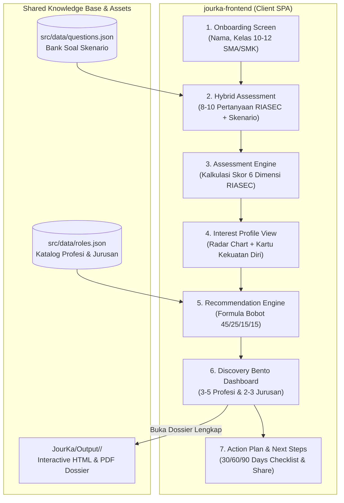

# [JK-FE-011] Student Career Discovery Web Frontend & Hybrid Assessment Engine

> **Ticket / Issue ID:** `[JK-FE-011]` (`#38`) — `feat(jk-fe-011): Student Career Discovery Web Frontend & Hybrid Assessment Engine`
> **GitHub Issue Link:** https://github.com/prayogizan/JourKa/issues/38
> **Epic:** `EPIC-JK-DISCOVERY` — Student Onboarding, Hybrid RIASEC Assessment, & Explainable Career Recommendation
> **Git Branch:** `feat/jk-fe-011-student-discovery-app` (branched from `origin/pre-master`)
> **Target Branch:** `pre-master`
> **Component Location:** `jourka-frontend/` (Decoupled React+Vite Frontend selevel dengan folder `JourKa/`)
> **Priority:** `P1 (High)` · **Status:** `In Progress / Scaffolding`

---

## 1. 🚀 Executive Summary & Overview

Tiket ini menghadirkan antarmuka web interaktif mandiri (*Interactive Web Frontend*) bagi siswa SMA/SMK dan guru BK di dalam folder `jourka-frontend/`. 

Sistem ini melengkapi engine otomatisasi UiPath yang sudah ada dengan menambahkan 3 pilar yang sebelumnya belum ada di repositori:
1. **Interactive Student Onboarding & Hybrid Assessment Flow:** Kuesioner bertahap (RIASEC 6 dimensi + pertanyaan skenario aktivitas nyata + preferensi lingkungan kerja & jalur kelulusan).
2. **Transparent & Explainable Recommendation Engine:** Algoritma pembobotan objektif (RIASEC 45%, Aktivitas 25%, Lingkungan 15%, Jalur 15%) yang menghasilkan 3–5 rekomendasi profesi relevan dan 2–3 pilihan jurusan kuliah/vokasi lengkap dengan alasan rekomendasi (*Why Recommended*).
3. **Seamless Dossier Integration:** Menghubungkan kartu rekomendasi profesi langsung ke dossier karier interaktif dan PDF A4 yang diproduksi oleh robot UiPath JourKa.

---

## 2. 📋 Ticket & Review Metadata

| Field | Value |
|---|---|
| **Ticket / Issue ID** | `[JK-FE-011]` |
| **Epic** | `EPIC-JK-DISCOVERY` |
| **Priority** | `P1 (High)` |
| **Source Branch** | `feat/jk-fe-011-student-discovery-app` |
| **Target Branch** | `pre-master` |
| **Stack / Runtime** | React 18, Vite, Tailwind CSS, Lucide Icons, Chart.js / Recharts |
| **Scope of Impact** | Frontend Web App (`jourka-frontend/`), Shared Data Contracts, Documentation |

---

## 3. 📌 Problem Statement & Context

### Latar Belakang:
Audit repositori JourKa menunjukkan bahwa backend otomatisasi RPA berbasis UiPath di `JourKa/` sudah sangat baik dalam mengumpulkan intelijen karier dari LinkedIn/YouTube dan mempublikasikan laporan dossier karier bilingual (.md, .html, .pdf). Namun:
- Sistem saat ini mengasumsikan profesi siswa sudah diketahui dan diinput manual lewat Excel (`Desire Role List.xlsx`).
- Siswa belum memiliki portal mandiri untuk mengeksplorasi minatnya dari nol (Pilar *Discover Yourself*).
- Belum ada jembatan antara profil minat siswa dengan katalog profesi dan jurusan pendidikan.

### Solusi:
Membangun web app modern di direktori terpisah `jourka-frontend/` (selevel dengan `JourKa/`), yang mengisolasi kode web dari ekosistem UiPath Studio, sekaligus menyediakan pengalaman pengguna yang cepat, responsif, dan edukatif bagi siswa.

---

## 4. 🏗️ Architecture & Pipeline Flow

---

## 5. 🧩 Specification of Core Engines

### 5.1 Hybrid Assessment Engine (`src/engines/assessmentEngine.js`)
- **6 Dimensi RIASEC:**
  - `R (Realistic)`: Minat praktikal, hardware, permesinan, aktivitas fisik.
  - `I (Investigative)`: Logika, analisa data, riset, pemecahan masalah teknis.
  - `A (Artistic)`: Kreativitas visual, desain, penulisan, media, eksplorasi estetika.
  - `S (Social)`: Edukasi, kolaborasi tim, kepedulian sosial, mendampingi orang lain.
  - `E (Enterprising)`: Kepemimpinan, pitching, wirausaha, komunikasi persuasif.
  - `C (Conventional)`: Keteraturan, manajemen berkas, data administratif, presisi prosedur.
- **Skala Jawaban:** Skala 1 (Sangat Tidak Tertarik) hingga 4 (Sangat Tertarik) + opsi 0 (*Belum Pernah Coba / Ingin Tahu Lebih Banyak*).
- **Normalisasi:** Skor akhir tiap dimensi dinormalisasi ke persentase 0–100% untuk visualisasi Radar Chart.

### 5.2 Recommendation Engine (`src/engines/recommendationEngine.js`)
- **Formula Skor Kecocokan:**
  $$\text{MatchScore} = (0.45 \times S_{\text{RIASEC}}) + (0.25 \times S_{\text{Activity}}) + (0.15 \times S_{\text{Environment}}) + (0.15 \times S_{\text{Pathway}})$$
- **Alasan Rekomendasi (*Explainability*):**
  Setiap rekomendasi wajib menyertakan 2–3 poin alasan konkret, misal:
  - *"Sesuai dengan skor Investigative (88%) dan Realistic (75%) kamu."*
  - *"Mendukung preferensi kerja fleksibel/remote yang kamu pilih."*
  - *"Terhubung dengan rencana kuliah jurusan S1 Teknik Informatika."*
- **Prinsip Non-Locking:** Menampilkan 3–5 profesi *"Relevan untuk Dieksplorasi"* dan 2–3 jurusan terkait tanpa vonis mutlak.

---

## 6. 🖥️ User Experience & Wireframes

### Layar 1: Onboarding
- Pesan selamat datang yang menenangkan: *"Eksplorasi minatmu tanpa tekanan, tidak ada jawaban benar atau salah."*
- Input singkat: Nama panggilan dan tingkat sekolah (Kelas 10, 11, 12 SMA/SMK).

### Layar 2: Interactive Assessment
- Kartu pertanyaan bergaya kartu modern dengan progress bar persentase.
- Opsi jawaban berbasis skenario konkret sekolah/kehidupan sehari-hari.
- Tombol navigasi "Sebelumnya", "Lewati", dan "Selanjutnya".

### Layar 3: Profil Minat Siswa (Interest Profile)
- Visualisasi **Radar Chart 6 Dimensi RIASEC**.
- Badge tipe minat utama (contoh: *Investigative-Artistic Explorer*).
- Penjelasan naratif ringkas mengenai kekuatan dan potensi diri siswa.

### Layar 4: Bento Discovery Dashboard
- **Tab Profesi:** 3–5 kartu profesi (Gelar S1 verdict, estimasi gaji awal, tombol buka dossier HTML JourKa).
- **Tab Jurusan Kuliah:** 2–3 kartu program studi (Deskripsi kompetensi, mata kuliah utama, korelasi karier).
- **Tab Jalur Alternatif:** Pelatihan kerja, sertifikasi industri, atau politeknik vokasi.

### Layar 5: Action Plan & Konsultasi BK
- Rencana aksi 30/60/90 hari persiapan kelulusan.
- Checklist keterampilan yang bisa mulai dipelajari secara mandiri.
- Tombol cetak ringkasan atau salin tautan ringkasan untuk didiskusikan dengan Guru BK/Orang Tua.

---

## 7. 🧪 Acceptance Criteria (DoD)

- [ ] Folder `jourka-frontend/` terisolasi rapi di root repositori (selevel dengan `JourKa/`).
- [ ] Berjalan mulus di Node.js lokal (`npm run dev`) tanpa error kompilasi.
- [ ] Bank soal mencakup 6 dimensi RIASEC, 2 pertanyaan preferensi lingkungan kerja, dan 1 pertanyaan jalur kelulusan.
- [ ] Skor asesmen terhitung akurat dan ditampilkan dalam bentuk Radar Chart visual.
- [ ] Recommendation engine menghasilkan minimal 3 profesi dan 2 jurusan terkait dengan alasan kecocokan yang jelas.
- [ ] Tombol "Buka Dossier" terhubung dengan artefak dossier JourKa yang sudah ada (`JourKa/Output/`).
- [ ] Responsif untuk layar smartphone (mobile-friendly untuk siswa) dan desktop.
- [ ] Perubahan file `.gitignore` mencegah `node_modules/` dan `dist/` ter-commit ke git.
