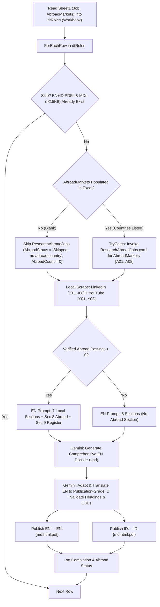

# JourKa (Journey Kita) — Automated Career Intelligence & Bilingual Role Dossier RPA

> **Journey Kita (`JourKa`)** — An end-to-end **UiPath Studio** RPA process that transforms a list of target entry-level roles into evidence-backed **English (`EN`)** and **Bahasa Indonesia (`ID`)** **Markdown (`.md`)**, **styled HTML (`.html`)**, and **publication-ready PDF (`.pdf`)** career dossiers using live job-board scraping, verified abroad visa-sponsored job filtering, YouTube daily-routine extraction, and Google AI Studio (`gemini-3.5-flash`).

---

## Table of Contents

1. [Process Overview](#1-process-overview)
2. [Process Architecture & Flowchart](#2-process-architecture--flowchart)
3. [UiPath Technical Specifications & Dependencies](#3-uipath-technical-specifications--dependencies)
4. [Repository Structure](#4-repository-structure)
5. [Input & Output Data Contracts](#5-input--output-data-contracts)
6. [Generated Dossier Structure (8 or 9 Sections, Bilingual EN/ID)](#6-generated-dossier-structure-8-or-9-sections-bilingual-enid)
7. [Abroad Visa-Sponsored Job Discovery & Verification Gates](#7-abroad-visa-sponsored-job-discovery--verification-gates)
8. [Prerequisites & Environment Setup](#8-prerequisites--environment-setup)
9. [Running & Validating the Process](#9-running--validating-the-process)
10. [Resiliency, Security & UiPath Best Practices](#10-resiliency-security--uipath-best-practices)

---

## 1. Process Overview

Choosing an entry-level tech career path often suffers from scattered information, unrealistic tutorial expectations, and opaque salary data. **JourKa** automates the research pipeline for each target role in `Desire Role List.xlsx`:

1. **Reads Target Roles License-Free:** Uses UiPath's OpenXML-based **Workbook** activities (`Read Range Workbook` / `Write Range Workbook`) so the automation runs without requiring a Microsoft 365 / Excel desktop license or launching `EXCEL.EXE`.
2. **Scrapes Local Entry-Level Job Board Skillsets (`[J01]..[J08]`):** Queries public LinkedIn Indonesia entry-level job listings (`f_E=2`) and fetches each posting's detail view to extract real technical skillset requirements, tools, and qualifications.
3. **Scrapes YouTube Daily Routines (`[Y01]..[Y08]`):** Queries YouTube for `"day in the life of <Role> entry level"` videos and extracts creator titles, URLs, and routine metadata snippets.
4. **Conditionally Collects Verified Abroad Visa-Sponsored Jobs (`[A01]..[A08]`):** Reads the per-row `AbroadMarkets` input column directly from `Desire Role List.xlsx`. If `AbroadMarkets` is blank/empty, `Workflows/ResearchAbroadJobs.xaml` is skipped completely (`AbroadStatus = "Skipped - no abroad country"`, `AbroadCount = 0`, zero international HTTP requests). When `AbroadMarkets` specifies one or more target countries (e.g., `"Singapore, Germany, Japan"`), `Main.xaml` invokes `Workflows/ResearchAbroadJobs.xaml` inside an isolated `TryCatch` to query only those target international markets via LinkedIn Guest Search (`f_E=1,2`) and the **Arbeitnow API**, applying a strict 5-gate filter (role relevance, entry-level title/experience check, positive sponsorship proof quote, negative no-sponsorship exclusion, and deduplication).
5. **Synthesizes Comprehensive, Human-Readable Bilingual Dossiers via LLM (`gemini-3.5-flash`):**
   - **English (`EN`) Dossier:** Generates a thorough, deeply explained 8-section dossier (or 9-section dossier when verified abroad jobs exist) written in a warm, candid, and authoritative senior-mentor voice. Combines structured reference tables with rich narrative paragraphs covering role overview, Bachelor's degree (`S1/D4`) requirement verdict & academic majors, required skillsets, learning roadmaps, realistic daily workdays, Indonesian starting salaries (IDR), end-to-end career progression (`Entry -> Junior -> Mid -> Senior -> Staff/Lead`), pros/cons with **AI Sentiment & Future Outlook**, 30/60/90-day onboarding playbook, conditional abroad visa-sponsored opportunities, and verified evidence register.
   - **Bahasa Indonesia (`ID`) Dossier:** Adapts and translates the English dossier into natural, publication-grade Bahasa Indonesia career journalism (preserving standard technical terms, full narrative depth, exact `## ` heading counts, and 100% of source URLs) before publishing.
6. **Exports Publication-Grade Bilingual PDFs:** Renders both `EN` and `ID` Markdown dossiers into localized editorial HTML templates (`ChrW(&H2014)` em-dash safe) and converts each to an A4 PDF via Headless Google Chrome (`--headless --print-to-pdf`).

---

## 2. Process Architecture & Flowchart



---

## 3. UiPath Technical Specifications & Dependencies

| Property | Value |
|---|---|
| **Project Name** | `JourKa` (*Journey Kita*) |
| **Output Type** | `Process` |
| **Studio Version** | `26.10.0` |
| **Target Framework** | `Windows` (`.NET 10.0`) |
| **Expression Language** | `VisualBasic` (VB.NET) |
| **Entry Point** | `JourKa/Main.xaml` |

### NuGet Package Dependencies (`JourKa/project.json`)

| Package | Version | Usage in Process |
|---|---|---|
| `UiPath.System.Activities` | `[26.10.0]` | Core control flow (`ForEachRow`, `If`, `TryCatch`, `Assign`, `InvokeCode`, `InvokeWorkflowFile`, `LogMessage`) |
| `UiPath.Excel.Activities` | `[3.6.1]` | License-free OpenXML Workbook I/O (`ui:ReadRange`, `ui:WriteRange`) |
| `UiPath.UIAutomation.Activities` | `[26.10.7]` | UI & browser automation support |
| `UiPath.Mail.Activities` | `[2.12.10]` | Mail notification extensibility |
| `UiPath.Testing.Activities` | `[25.10.3]` | RPA workflow verification & test cases |

---

## 4. Repository Structure

```text
JourKa/
├── .env.example                                  # Template for Google AI Studio API key
├── .gitignore                                    # Ignores .env secrets, .local/ cache, and temp logs
├── README.md                                     # Project documentation (this file)
├── UiPath_Desire_Role_List_Automation_Guide.md   # Detailed step-by-step Studio implementation guide
├── PDF_Results/                                  # Consolidated output directory for final role PDFs
│   ├── <Role> - EN.pdf
│   └── <Role> - ID.pdf
└── JourKa/                                       # UiPath Studio Project Root
    ├── Main.xaml                                 # Primary end-to-end orchestrator workflow
    ├── project.json                              # UiPath project manifest & dependency definitions
    ├── entry-points.json                         # Entry point schema definition
    ├── AGENTS.md                                 # Agentic development & validation rules
    ├── Input/
    │   └── Desire Role List.xlsx                 # Sample input workbook copy
    ├── Templates/                                # Decoupled HTML templates
    │   └── DossierInteractiveTemplate.html       # Interactive Web Frontend v2 template (token-injected)
    ├── Workflows/                                # Modular sub-workflows
    │   ├── ResearchAbroadJobs.xaml               # Verified abroad visa-sponsored entry-level job scraper (Invoked by Main.xaml)
    │   ├── ResearchJobBoards.xaml                # Standalone LinkedIn Guest Search reference workflow
    │   ├── ResearchYouTubeRoutine.xaml           # Standalone YouTube routine reference workflow
    │   ├── GenerateDossier.xaml                  # Standalone Gemini REST reference workflow
    │   └── PublishDossier.xaml                   # Standalone HTML/PDF publisher reference workflow
    └── Output/                                   # Per-role generated bilingual artifacts (.md, .html, .pdf)
        ├── Android Developer/
        │   ├── Android Developer - EN.md
        │   ├── Android Developer - EN.html
        │   ├── Android Developer - EN.pdf
        │   ├── Android Developer - ID.md
        │   ├── Android Developer - ID.html
        │   └── Android Developer - ID.pdf
        ├── Android Engineer/
        ├── Kotlin Multiplatform/
        ├── Mobile Developer/
        └── Mobile Engineer/
```

---

## 5. Input & Output Data Contracts

### Input Workbook Schema v2.0 (`D:\UiPathProject\Desire Role List.xlsx` — `Sheet1`)

The input workbook uses an 11-column **v2.0 schema** anchored by `RecipientEmail` in **Column A (Primary Key)**, with `Job` in Column B and `AbroadMarkets` in Column C:

| Column | Index | Name | Direction | Default / Fallback | Description |
|---|---|---|---|---|---|
| `A` | `0` | `RecipientEmail` | **In (Mandatory — Primary Key)** | *(Row skipped as BRE once pre-flight validation is enabled)* | Student and/or parent/guardian email address(es). Multiple recipients in a single cell are separated by `;` or `,` (e.g., `student@mail.com; parent@mail.com`). |
| `B` | `1` | `Job` | **In (Mandatory)** | *(Row skipped if blank; missing column raises BRE)* | Target role title (e.g., `Android Developer`, `Apoteker`, `Video Editor`). |
| `C` | `2` | `AbroadMarkets` | **In (Optional)** | `""` *(Skipped if blank)* | Comma- or semicolon-separated target abroad countries per role (e.g., `"Singapore, Malaysia, United Kingdom"`, or left blank for local-only research). |
| `D` | `3` | `StudentName` | **In (Optional)** | `"Valued Student"` | Student display name used for personalized email salutation. |
| `E` | `4` | `Level` | **In (Optional)** | `"Entry level"` | Seniority level override for job-board scraping and LLM prompts. |
| `F` | `5` | `Location` | **In (Optional)** | `"Indonesia"` | Local job-market override. |
| `G` | `6` | `SearchKeywords` | **In (Optional)** | `""` | Additional priority keywords for scraping and dossier synthesis. |
| `H` | `7` | `Status` | **In/Out (Optional)** | `""` | Row processing status (`"Completed"` enables idempotent skip when artifacts already exist). |
| `I` | `8` | `EmailStatus` | **Out (System-populated)** | `""` | Automated email dispatch status (`"Sent"`, `"Skipped - BRE"`, `"Failed - System"`). |
| `J` | `9` | `EmailTimestamp` | **Out (System-populated)** | `""` | ISO-8601 timestamp of the email dispatch attempt. |
| `K` | `10` | `ErrorMessage` | **Out (System-populated)** | `""` | Redacted error or Business Rule Exception summary if dispatch/validation failed. |

*(All `Main.xaml` and `Workflows/ResearchAbroadJobs.xaml` lookups resolve columns strictly by header name via `CurrentRow("<ColName>")` — never by hardcoded index or cell address.)*

### Output Artifacts Per Role

For every processed role (`<Role>`), the bot produces **6 files** in `JourKa/Output/<Role>/` plus **2 consolidated PDFs** in `PDF_Results/`:
- **English (`EN`):** `<Role> - EN.md`, `<Role> - EN.html`, `<Role> - EN.pdf` (and `PDF_Results/<Role> - EN.pdf`)
- **Bahasa Indonesia (`ID`):** `<Role> - ID.md`, `<Role> - ID.html`, `<Role> - ID.pdf` (and `PDF_Results/<Role> - ID.pdf`)

---

## 6. Generated Dossier Structure (8 or 9 Sections, Bilingual EN/ID)

Each generated English (`EN`) and Bahasa Indonesia (`ID`) dossier follows a strict evidence-backed template combining **structured reference tables** with **rich, well-explained narrative paragraphs** in a warm, candid, and authoritative senior-mentor voice:

1. **Role Description & Executive Overview (`Deskripsi Peran & Ringkasan Eksekutif`)** — Engaging narrative overview of what the role actually does behind the scenes, entry-level deliverables, squad collaboration, plus an explicit **Education & Bachelor's Degree (`S1/D4`) Verdict**:
   - Whether a Bachelor's degree is Required, Strongly Preferred, or Optional in Indonesia.
   - Target academic majors when required/preferred (*Computer Science / Teknik Informatika*, *Software Engineering / Rekayasa Perangkat Lunak*, *Information Systems / Sistem Informasi*, *Computer Engineering*, or domain-specific degrees) and why they matter in daily work.
   - Alternative non-degree entry paths (bootcamps, certifications, Play Store / GitHub portfolio proof).
2. **Entry-Level Skillset & Tech Stack Demand (`Kebutuhan Skill & Tech Stack Entry-Level`)** — Categorized table of mandatory vs. high-demand skills synthesized from scraped LinkedIn postings (`[J01]..[J08]`), paired with a **Hiring Manager's Perspective on the Stack** narrative explaining how the tools fit together in production and which core skills carry the most interview weight.
3. **What You Need to Learn: Step-by-Step Roadmap & Portfolio Projects (`Peta Jalan Belajar & Proyek Portofolio`)** — Visual roadmap diagram + narrative walkthrough of 3 learning phases, plus 3 concrete, non-trivial portfolio project blueprints with full architecture and hiring-manager evaluation criteria.
4. **Realistic Daily Routine: Day in the Life (`Rutinitas Harian Realistis: Keseharian Kerja`)** — Hour-by-hour morning, midday, and afternoon schedule table synthesized from routine videos (`[Y01]..[Y08]`), accompanied by a multi-paragraph narrative walkthrough of how a typical workday feels.
5. **Expected Starting Salaries & Career Progression (`Estimasi Gaji Awal & Peta Perjalanan Karier`)** — Gross monthly salary bands (IDR) in Indonesia across Local Agencies/SMEs, IT Consultancies, and Tech Unicorns/Multinationals (with practical context on BPJS, PPh 21, and THR), plus an **End-to-End Career Journey & Progression Map** (`Entry-Level -> Junior -> Mid-Level -> Senior -> Staff/Lead`) with stage-by-stage narrative on scope, mindset shifts, promotion triggers, and skill transitions.
6. **Career Guidance: Real Pros, Real Cons & Honest Industry Realities (`Panduan Karier: Pro, Kontra, Sentimen AI & Realita Industri`)** — Side-by-side Pros/Cons matrix, a dedicated **AI Sentiment & Future Outlook** subsection (evaluating AI replacement risk vs. augmentation potential, how AI coding assistants/copilots shift entry-level hiring bars toward debugging and system design, and 3–5 year career resilience), plus candid mentor essays on legacy codebases, production constraints, interview loops, and who thrives vs. who struggles.
7. **First 30 / 60 / 90-Day Onboarding Action Plan (`Rencana Aksi Onboarding 30 / 60 / 90 Hari Pertama`)** — Visual milestone overview and mentor playbook for a junior's first quarter on the job.
8. *(Conditional — Included ONLY when `AbroadMarkets` is populated AND `AbroadCount > 0`)* **Abroad Entry-Level Opportunities with Visa Sponsorship (`Peluang Kerja Entry-Level di Luar Negeri dengan Sponsor Visa`)** — Verified table of `[A01]..[A08]` postings for the row's configured `AbroadMarkets` with direct sponsorship proof quotes, disclosed salaries, country-specific work visa pathways (EU Blue Card, Singapore EP, Japan Engineer visa, UK Skilled Worker, etc.), international vs. local hiring bar comparison, and an Indonesian fresh-graduate relocation checklist. *(If `AbroadMarkets` is blank or 0 postings pass verification, this section is omitted completely without empty placeholders.)*
9. **Verified Evidence & Source Register (`Daftar Bukti & Sumber Terverifikasi`)** *(Section 8 when no abroad jobs; Section 9 when abroad jobs exist)* — Complete audit table of all scraped `[J01]..[J08]`, `[Y01]..[Y08]`, and `[A01]..[A08]` URLs.

---

## 7. Abroad Visa-Sponsored Job Discovery & Verification Gates

Abroad job discovery is strictly driven by the per-row `AbroadMarkets` input column in `Desire Role List.xlsx` (`Sheet1`, Column `B`):
- **When `AbroadMarkets` is blank/empty:** `Main.xaml` skips `Workflows/ResearchAbroadJobs.xaml` completely (`0` international HTTP requests), sets `AbroadStatus = "Skipped - no abroad country"` and `AbroadCount = 0`, and generates the 8-section local dossier.
- **When `AbroadMarkets` contains one or more target countries (e.g., `"Singapore, Germany, Japan"`):** `Main.xaml` invokes `JourKa/Workflows/ResearchAbroadJobs.xaml` dynamically for only those specified countries via **LinkedIn Guest Search** (`f_E=1,2`) and (when European/UK markets are included) the **Arbeitnow API**.

Every candidate posting must pass all **5 deterministic verification gates** before inclusion:

| Gate | Rule |
|---|---|
| **1. Role Relevance** | Dynamic token decomposition extracts primary domain anchors (e.g. `Android`, `Video`, `Data`) while dynamically treating discipline nouns (`Developer`, `Editor`, `Analyst`) as role stop-words for standalone matching. Supports role aliases (e.g., `Apoteker` -> `Pharmacist`, `Mobile` -> `iOS/Android/Flutter`). |
| **2. Entry-Level Check** | Job title must **not** match senior keywords (`Senior`, `Sr.`, `Lead`, `Principal`, `Staff`, `Head`, `Director`, `Expert`, with role disciplines dynamically exempted if part of the target role) and description must **not** require `3+` years of experience (`\b([3-9]\|1\d)\+?\s*(years\|yrs)\b`). |
| **3. Positive Sponsorship Proof** | Full job description must explicitly match visa sponsorship support (`visa sponsorship`, `sponsor your work visa`, `we will/can/do sponsor`, `relocation package/support ... visa`, `work permit support/sponsorship`, `blue card support`). |
| **4. Negative Exclusion** | Full job description must **not** match anti-sponsorship clauses (`no visa sponsorship`, `cannot/unable to/do not provide sponsorship`, `do not require ... sponsorship`, `prioritising applicants who have a current right to work`, `must already have the right/authorization to work`, `citizens or permanent residents only`). |
| **5. Deduplication & Caps** | Deduplicated by job ID and normalized `Company + Title`. Rate-limited with 1.2s request spacing, 429 exponential backoff (5s retry), max 10 cards/market, and max 30 detail fetches/role. |

---

## 8. Prerequisites & Environment Setup

1. **UiPath Studio (`26.10.0` or newer)** on Windows.
2. **Google Chrome** installed at `C:\Program Files\Google\Chrome\Application\chrome.exe` (used for zero-cost headless HTML-to-PDF rendering).
3. **Google AI Studio API Key:**
   - Copy `.env.example` to `.env` in both the repository root (`D:\UiPathProject\JourKa\.env`) and project folder (`D:\UiPathProject\JourKa\JourKa\.env`):
     ```ini
     GEMINI_API_KEY=your_google_ai_studio_api_key_here
     ```
   - Or set a Windows User Environment Variable:
     ```powershell
     [Environment]::SetEnvironmentVariable("GEMINI_API_KEY", "your_google_ai_studio_api_key_here", "User")
     ```
4. **Input Workbook Location:**
   - Ensure `D:\UiPathProject\Desire Role List.xlsx` exists and is **closed** in any spreadsheet viewer before starting a run.

---

## 9. Running & Validating the Process

### Run in UiPath Studio
1. Open `D:\UiPathProject\JourKa\JourKa\project.json` in **UiPath Studio**.
2. Open `Main.xaml`.
3. Click **Run File** (`Ctrl+F6`) or **Run** (`F5`).

### Validate & Compile via Command Line
To verify that all XAML workflows and VB.NET expressions compile cleanly without opening the Studio UI:

```powershell
& "C:\Program Files\UiPathPlatform\Studio\26.10.0-cloud.25715\UiPath.ActivityCompiler.CommandLine.exe" help studio
```

---

## 10. Resiliency, Security & UiPath Best Practices

- **Zero Office License Dependency:** Uses `UiPath.Excel.Activities.ReadRange` and `UiPath.Excel.Activities.WriteRange` (Workbook engine) rather than `ExcelProcessScopeX` / COM Interop.
- **Dual-Layer Fault Isolation:**
  - Each role row in `ForEachRow` is wrapped in a outer `TryCatch` block.
  - Abroad job research (`ResearchAbroadJobs.xaml`) runs inside its own inner `TryCatch` block so an international network timeout or rate limit sets `AbroadStatus = "Error"` and never blocks local Indonesian EN/ID dossier generation.
- **Automatic Multi-Model LLM Failover & Translation Validation:** Automatically iterates through `gemini-3.5-flash`, `gemini-3.8-flash`, `gemini-3.1-flash-lite`, and `gemini-3.5-flash-lite`. The Bahasa Indonesia (`ID`) output is structurally validated against the English (`EN`) output (matching `## ` heading count and 100% of cited URLs) before PDF publication.
- **Idempotent Re-Runs (`skipCompleted`):** Skips roles only when `Status = "Completed"`, both `<Role> - EN.pdf` and `<Role> - ID.pdf` exist, and both EN and ID Markdown files exceed `2,500` bytes.
- **Credential Hygiene & Log Redaction:** API keys are loaded from git-ignored `.env` files or User Environment Variables, passed via HTTP request headers (`x-goog-api-key`), and redacted (`exception.Message.Replace(geminiApiKey, "[REDACTED]")`) before writing any error messages to Excel.
