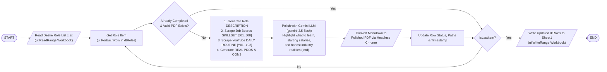

# JourKa (Journey Kita) — Automated Career Intelligence & Role Dossier RPA

> **Journey Kita (`JourKa`)** — An end-to-end **UiPath Studio** RPA process that transforms a list of target entry-level roles into evidence-backed **Markdown (`.md`)**, **styled HTML (`.html`)**, and **publication-ready PDF (`.pdf`)** career dossiers using live job-board scraping, YouTube daily-routine extraction, and Google AI Studio (`gemini-3.5-flash`).

---

## Table of Contents

1. [Process Overview](#1-process-overview)
2. [Process Architecture & Flowchart](#2-process-architecture--flowchart)
3. [UiPath Technical Specifications & Dependencies](#3-uipath-technical-specifications--dependencies)
4. [Repository Structure](#4-repository-structure)
5. [Input & Output Data Contracts](#5-input--output-data-contracts)
6. [Generated Dossier Structure (8 Sections)](#6-generated-dossier-structure-8-sections)
7. [Prerequisites & Environment Setup](#7-prerequisites--environment-setup)
8. [Running & Validating the Process](#8-running--validating-the-process)
9. [Resiliency, Security & UiPath Best Practices](#9-resiliency-security--uipath-best-practices)

---

## 1. Process Overview

Choosing an entry-level tech career path often suffers from scattered information, unrealistic tutorial expectations, and opaque salary data. **JourKa** automates the research pipeline for each target role in `Desire Role List.xlsx`:

1. **Reads Target Roles License-Free:** Uses UiPath's OpenXML-based **Workbook** activities (`Read Range Workbook` / `Write Range Workbook`) so the automation runs without requiring a Microsoft 365 / Excel desktop license or launching `EXCEL.EXE`.
2. **Scrapes Entry-Level Job Board Skillsets (`[J01]..[J08]`):** Queries public LinkedIn Indonesia entry-level job listings (`f_E=2`) and fetches each posting's detail view to extract real technical skillset requirements, tools, and qualifications.
3. **Scrapes YouTube Daily Routines (`[Y01]..[Y08]`):** Queries YouTube for `"day in the life of <Role> entry level"` videos and extracts creator titles, URLs, and routine metadata snippets.
4. **Synthesizes & Polishes via LLM (`gemini-3.5-flash`):** Feeds the grounded `[J01]..[J08]` and `[Y01]..[Y08]` evidence into Google AI Studio to generate a structured 8-section Markdown dossier covering role descriptions, required skillsets, learning roadmaps, daily schedules, Indonesian starting salaries (IDR), and candid industry pros/cons.
5. **Exports Publication-Grade PDFs:** Renders the Markdown dossier into a styled editorial HTML template and converts it to an A4 PDF via Headless Google Chrome (`--headless --print-to-pdf`).
6. **Updates Execution Status:** Writes the final status (`Completed`, `Failed`, `Skipped`), file paths, and timestamps back to `Desire Role List.xlsx`.

---

## 2. Process Architecture & Flowchart



---

## 3. UiPath Technical Specifications & Dependencies

| Property | Value |
|---|---|
| **Project Name** | `JourKa` (*Journey Kita*) |
| **Output Type** | `Process` |
| **Studio Version** | `26.10.0` |
| **Target Framework** | `Windows` (`.NET 10.0`) |
| **Expression Language** | `VisualBasic` (VB.NET) |
| **Entry Point** | `JourKa/Main.xaml` |

### NuGet Package Dependencies (`JourKa/project.json`)

| Package | Version | Usage in Process |
|---|---|---|
| `UiPath.System.Activities` | `[26.10.0]` | Core control flow (`ForEachRow`, `If`, `TryCatch`, `Assign`, `InvokeCode`, `LogMessage`) |
| `UiPath.Excel.Activities` | `[3.6.1]` | License-free OpenXML Workbook I/O (`ui:ReadRange`, `ui:WriteRange`) |
| `UiPath.UIAutomation.Activities` | `[26.10.7]` | UI & browser automation support |
| `UiPath.Mail.Activities` | `[2.12.10]` | Mail notification extensibility |
| `UiPath.Testing.Activities` | `[25.10.3]` | RPA workflow verification & test cases |

---

## 4. Repository Structure

```text
JourKa/
├── .env.example                                  # Template for Google AI Studio API key
├── .gitignore                                    # Ignores .env secrets, .local/ cache, and temp logs
├── README.md                                     # Project documentation (this file)
├── UiPath_Desire_Role_List_Automation_Guide.md   # Detailed step-by-step Studio implementation guide
├── PDF_Results/                                  # Consolidated output directory for final role PDFs
│   ├── Android Developer.pdf
│   ├── Android Engineer.pdf
│   ├── Kotlin Multiplatform.pdf
│   ├── Mobile Developer.pdf
│   └── Mobile Engineer.pdf
└── JourKa/                                       # UiPath Studio Project Root
    ├── Main.xaml                                 # Primary end-to-end orchestrator workflow
    ├── project.json                              # UiPath project manifest & dependency definitions
    ├── entry-points.json                         # Entry point schema definition
    ├── AGENTS.md                                 # Agentic development & validation rules
    ├── Input/
    │   └── Desire Role List.xlsx                 # Sample input workbook copy
    ├── Workflows/                                # Modular reusable sub-workflows
    │   ├── ResearchJobBoards.xaml                # LinkedIn Guest Search & job-detail skillset scraper
    │   ├── ResearchYouTubeRoutine.xaml           # YouTube day-in-the-life routine scraper
    │   ├── GenerateDossier.xaml                  # Google AI Studio (Gemini) REST integration
    │   └── PublishDossier.xaml                   # Markdown -> Styled HTML -> Headless Chrome PDF exporter
    └── Output/                                   # Per-role generated artifacts (.md, .html, .pdf)
        ├── Android Developer/
        ├── Android Engineer/
        ├── Kotlin Multiplatform/
        ├── Mobile Developer/
        └── Mobile Engineer/
```

---

## 5. Input & Output Data Contracts

### Input Workbook Schema (`D:\UiPathProject\Desire Role List.xlsx` — `Sheet1`)

| Column | Name | Direction | Default / Fallback | Description |
|---|---|---|---|---|
| `A` | `Job` | **In (Required)** | *(Row skipped if blank)* | Target role title (e.g., `Android Developer`) |
| `B` | `Level` | **In (Optional)** | `"Entry level"` | Target seniority level |
| `C` | `Location` | **In (Optional)** | `"Indonesia"` | Target geographic job market |
| `D` | `SearchKeywords` | **In (Optional)** | `""` | Priority tech stack keywords (e.g., `Kotlin, Jetpack Compose`) |
| `E` | `Status` | **In/Out** | `"Pending"` | Execution status: `Pending`, `Completed`, `Failed`, `Skipped` |
| `F` | `MarkdownPath` | **Out** | `""` | Absolute path to generated `.md` dossier |
| `G` | `PdfPath` | **Out** | `""` | Absolute path to generated `.pdf` dossier |
| `H` | `ProcessedAt` | **Out** | `""` | Timestamp (`yyyy-MM-dd HH:mm:ss`) |
| `I` | `ErrorMessage` | **Out** | `""` | Redacted exception details if row processing fails |

### Output Artifacts

For every processed role, the bot produces:
- **Markdown Dossier:** `JourKa/Output/<Role>/<Role>.md`
- **Styled HTML Report:** `JourKa/Output/<Role>/<Role>.html`
- **Polished PDF Dossier:** `PDF_Results/<Role>.pdf` (and `JourKa/Output/<Role>/<Role>.pdf`)

---

## 6. Generated Dossier Structure (8 Sections)

Each generated PDF and Markdown dossier follows a standardized 8-section template:

1. **Role Description & Executive Overview** — Core mission, entry-level deliverables, and cross-functional squad collaboration.
2. **Entry-Level Skillset & Tech Stack Demand** — Categorized table of mandatory vs. high-demand skills synthesized from scraped LinkedIn postings (`[J01]..[J08]`).
3. **What You Need to Learn: Step-by-Step Roadmap & Portfolio Projects** — 3-phase learning progression plus 3 concrete portfolio project blueprints with hiring-manager evaluation criteria.
4. **Realistic Daily Routine: Day in the Life** — Morning, midday, and afternoon schedule synthesized from developer routine videos (`[Y01]..[Y08]`).
5. **Expected Starting Salaries & Career Progression** — Gross monthly salary bands (IDR) in Indonesia across Local Agencies/SMEs, IT Consultancies, and Tech Unicorns/Multinationals.
6. **Career Guidance: Real Pros, Real Cons & Honest Industry Realities** — Side-by-side Pros/Cons matrix plus candid insights on legacy codebases, device fragmentation, interview loops, AI tooling impact, and who thrives vs. who struggles.
7. **First 30 / 60 / 90-Day Onboarding Action Plan** — Concrete milestones for a junior engineer's first quarter on the job.
8. **Verified Evidence & Source Register** — Complete audit table of all scraped `[J01]..[J08]` and `[Y01]..[Y08]` URLs.

---

## 7. Prerequisites & Environment Setup

1. **UiPath Studio (`26.10.0` or newer)** on Windows.
2. **Google Chrome** installed at `C:\Program Files\Google\Chrome\Application\chrome.exe` (used for zero-cost headless HTML-to-PDF rendering).
3. **Google AI Studio API Key:**
   - Copy `.env.example` to `.env` in both the repository root (`D:\UiPathProject\JourKa\.env`) and project folder (`D:\UiPathProject\JourKa\JourKa\.env`):
     ```ini
     GEMINI_API_KEY=your_google_ai_studio_api_key_here
     ```
   - Or set a Windows User Environment Variable:
     ```powershell
     [Environment]::SetEnvironmentVariable("GEMINI_API_KEY", "your_google_ai_studio_api_key_here", "User")
     ```
4. **Input Workbook Location:**
   - Ensure `D:\UiPathProject\Desire Role List.xlsx` exists and is **closed** in any spreadsheet viewer before starting a run.

---

## 8. Running & Validating the Process

### Run in UiPath Studio
1. Open `D:\UiPathProject\JourKa\JourKa\project.json` in **UiPath Studio**.
2. Open `Main.xaml`.
3. Click **Run File** (`Ctrl+F6`) or **Run** (`F5`).

### Validate & Compile via Command Line
To verify that all XAML workflows and VB.NET expressions compile cleanly without opening the Studio UI:

```powershell
& "C:\Program Files\UiPathPlatform\Studio\26.10.0-cloud.25715\UiPath.ActivityCompiler.CommandLine.exe" help studio
```

---

## 9. Resiliency, Security & UiPath Best Practices

- **Zero Office License Dependency:** Uses `UiPath.Excel.Activities.ReadRange` and `UiPath.Excel.Activities.WriteRange` (Workbook engine) rather than `ExcelProcessScopeX` / COM Interop, eliminating failures when Microsoft Office is unactivated or absent.
- **Row-Level Fault Isolation:** Each role row in `ForEachRow` is wrapped in a dedicated `TryCatch` block (`Try Process Role Research & Dossier Generation`). If a network or API error occurs on one role, the row is marked `Failed` with a timestamp and the batch continues to the next role.
- **Automatic Multi-Model LLM Failover:** Automatically iterates through `gemini-3.5-flash`, `gemini-3.8-flash`, `gemini-3.1-flash-lite`, and `gemini-3.5-flash-lite` so temporary `503 UNAVAILABLE` demand spikes or model deprecations never break execution.
- **Idempotent Re-Runs (`skipCompleted`):** Skips roles where `Status = "Completed"`, the target PDF exists, and the Markdown dossier exceeds the minimum polished content threshold (`> 2,500` bytes).
- **Credential Hygiene & Log Redaction:** API keys are loaded from git-ignored `.env` files or User Environment Variables, passed via HTTP request headers (`x-goog-api-key`) rather than URL query parameters, and explicitly redacted (`exception.Message.Replace(geminiApiKey, "[REDACTED]")`) before writing any error messages to Excel.
