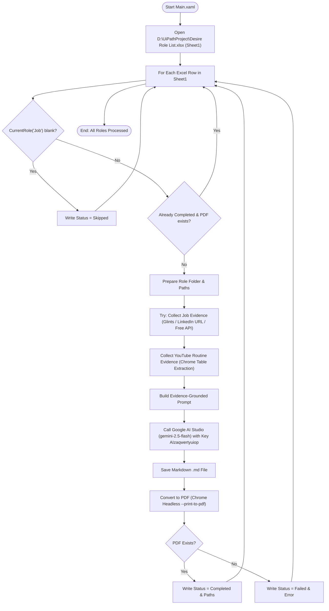

# UiPath Studio Desktop Community Edition: Complete Zero-Cost ($0) Automation Guide

## Automating the Desire Role List (`JourKa`) into Researched Markdown Dossiers and PDFs Using Google AI Studio (`gemini-2.5-flash`)

**Guide version:** 2.1 (Refined for 100% Free Execution with Google AI Studio API Key `AIzaqwertyuiop` & Aligned with `JourKa` Workspace)  
**Prepared:** 14 November 2026  
**Target environment:** UiPath Studio Desktop Community Edition (`26.10.0`, Windows, `.NET 10.0`, Visual Basic)  
**Active Project Path:** `D:\UiPathProject\JourKa\JourKa`  
**Active Workbook Path:** `D:\UiPathProject\Desire Role List.xlsx`

---

## 0. Executive Summary: 100% Free Execution ($0.00) with Google AI Studio

This plan is tailored specifically to your existing `JourKa` project, your `Desire Role List.xlsx` workbook, and your **Google AI Studio API key (`AIzaqwertyuiop`)**:

| Component | Refined 100% Free Solution in This Plan | Cost |
|---|---|---:|
| **RPA Platform** | **UiPath Studio Community Edition (`26.10.0`)** running locally in Attended mode | **$0** |
| **LLM Dossier Generator** | **Google AI Studio Free Tier (`gemini-2.5-flash`)** using your API key `AIzaqwertyuiop` via `UiPath.WebAPI.Activities` (`HTTP Request`) | **$0** |
| **Job-Board Research** | **Direct URL Parameter Navigation** (`Go To URL` on public **Glints Indonesia**, **LinkedIn Guest Search**, or **JobStreet**) + **Free No-Auth Job APIs** (Remotive JSON API) | **$0** |
| **YouTube Routine Evidence** | **Browser Table Extraction** directly on YouTube search results (`https://www.youtube.com/results?search_query=...`) — zero Google Cloud billing or API quota required | **$0** |
| **Markdown to PDF Conversion** | **Styled HTML + Google Chrome Headless (`--headless --print-to-pdf`)** using Chrome already installed on your PC (`C:\Program Files\Google\Chrome\Application\chrome.exe`) | **$0** |
| **Excel Integration** | Aligned with `D:\UiPathProject\Desire Role List.xlsx` (`Sheet1`, column `Job`: `Android Developer`, `Mobile Developer`, `Kotlin Multiplatform`, `Android Engineer`, `Mobile Engineer`) | **$0** |

---

## 1. What You Are Going to Build (Aligned with Your `JourKa` Project)

Your existing workflow at `D:\UiPathProject\JourKa\JourKa\Main.xaml` already opens `D:\UiPathProject\Desire Role List.xlsx`, reads `Sheet1`, and loops through the 5 roles in the `Job` column.

For each role (`Android Developer`, `Mobile Developer`, `Kotlin Multiplatform`, `Android Engineer`, `Mobile Engineer`), the refined workflow will:

1. Read the role name (`Job`) and optional research settings from `D:\UiPathProject\Desire Role List.xlsx`.
2. Skip blank rows or roles whose final PDF already exists.
3. Collect entry-level job evidence via direct search URLs (no fragile search-box typing) or free JSON job APIs.
4. Collect YouTube "day in the life" routine evidence using free browser table extraction.
5. Call **Google AI Studio (`gemini-2.5-flash`)** using your API key `AIzaqwertyuiop` to generate a 14-section evidence-backed Markdown dossier.
6. Save the Markdown dossier as `Output\<Role>\<Role>.md`.
7. Convert the `.md` file into `Output\<Role>\<Role>.pdf` using Chrome Headless PDF printing (or Pandoc + Word).
8. Update the Excel row with `Status`, `MarkdownPath`, `PdfPath`, `ProcessedAt`, and any `ErrorMessage`.



---

## 2. Configure Your Google AI Studio API Key (`AIzaqwertyuiop`)

> [!IMPORTANT]
> If `AIzaqwertyuiop` is a placeholder for your real 39-character Google AI Studio key (which starts with `AIzaSy...` from [aistudio.google.com/apikey](https://aistudio.google.com/apikey)), substitute your real key in the step below before running the HTTP request. Never commit a live API key to a public Git repository.

### 2.1 Option A (Recommended — Secure Environment Variable)

Run this one-line command in **PowerShell** to store the key in your Windows User Environment Variables so it is kept out of your `.xaml` source files:

```powershell
[Environment]::SetEnvironmentVariable("GEMINI_API_KEY", "AIzaqwertyuiop", "User")
```

*(Restart UiPath Studio after setting the environment variable so Studio loads it.)*

In UiPath, read it into your `geminiApiKey` variable with this VB default expression:

```vb
If(
    String.IsNullOrWhiteSpace(Environment.GetEnvironmentVariable("GEMINI_API_KEY", EnvironmentVariableTarget.User)),
    "AIzaqwertyuiop",
    Environment.GetEnvironmentVariable("GEMINI_API_KEY", EnvironmentVariableTarget.User).Trim()
)
```

### 2.2 Option B (Quick Direct Variable in UiPath Studio)

For rapid local testing inside `Main.xaml`, you can set the default value of the `geminiApiKey` (`String`) variable in the Variables panel directly to:

```vb
"AIzaqwertyuiop"
```

### 2.3 Google AI Studio Free Tier Limits (`gemini-2.5-flash`)

- **Cost:** Free ($0.00, no credit card required).
- **Rate Limits:** 15 Requests Per Minute (RPM) and 1,500 Requests Per Day (RPD).
- Since your workbook has **5 roles**, a full run uses only **5 requests** (0.3% of your daily free quota). Adding a `5`-second `Delay` between rows guarantees you never trigger a rate-limit error.

---

## 3. Prepare Your Existing `Desire Role List.xlsx` Workbook

Your workbook is located at:
`D:\UiPathProject\Desire Role List.xlsx`

Currently, `Sheet1` has header `Job` in cell `A1` and 5 roles in `A2:A6`. Add columns `B1:I1` to track progress and output paths:

| Cell | Column Header | Required? | Default if Blank | Purpose |
|---|---|---:|---|---|
| `A1` | `Job` | **Yes (Existing)** | *(skip row if blank)* | Role name to research |
| `B1` | `Level` | Optional | `Entry level` | Target seniority |
| `C1` | `Location` | Optional | `Indonesia` | Market used for job & salary research |
| `D1` | `SearchKeywords` | Optional | Empty | Extra keywords (e.g., `Kotlin, Jetpack Compose`) |
| `E1` | `Status` | **Recommended** | `Pending` | `Pending`, `Processing`, `Completed`, `Failed`, `Skipped` |
| `F1` | `MarkdownPath` | **Recommended** | Empty | Saved `.md` file path |
| `G1` | `PdfPath` | **Recommended** | Empty | Saved `.pdf` file path |
| `H1` | `ProcessedAt` | **Recommended** | Empty | Timestamp of last run |
| `I1` | `ErrorMessage` | **Recommended** | Empty | Safe error details if row fails |

Example rows in `Sheet1`:

| Job | Level | Location | SearchKeywords | Status | MarkdownPath | PdfPath | ProcessedAt | ErrorMessage |
|---|---|---|---|---|---|---|---|---|
| Android Developer | Entry level | Indonesia | Kotlin, Android SDK, Jetpack Compose | Pending | | | | |
| Mobile Developer | Entry level | Indonesia | Flutter, React Native, Kotlin | Pending | | | | |
| Kotlin Multiplatform | Entry level | Indonesia | KMP, Kotlin, Compose Multiplatform | Pending | | | | |
| Android Engineer | Entry level | Indonesia | Kotlin, MVVM, REST API | Pending | | | | |
| Mobile Engineer | Entry level | Indonesia | Android, iOS, CI/CD | Pending | | | | |

Save and close Excel before running the automation.

---

## 4. Install the Free `UiPath.WebAPI.Activities` Package

Your project (`D:\UiPathProject\JourKa\JourKa\project.json`) already has `UiPath.Excel.Activities`, `UiPath.System.Activities`, and `UiPath.UIAutomation.Activities` installed.

To call Google AI Studio via HTTP:
1. Open `JourKa` in **UiPath Studio**.
2. Click **Manage Packages** in the top ribbon.
3. Go to **Official** -> search for **`UiPath.WebAPI.Activities`**.
4. Click **Install** and **Save**.

---

## 5. Create Variables in `Main.xaml`

Open the **Variables** panel in `Main.xaml` (scope: `Main Sequence`) and create these variables:

| Variable Name | Variable Type | Default Value | Purpose |
|---|---|---|---|
| `strExcelPathDesireRole` | `String` | `"D:\UiPathProject\Desire Role List.xlsx"` | Existing workbook path |
| `outputRoot` | `String` | `Path.Combine(Environment.CurrentDirectory, "Output")` | Root folder for generated files |
| `geminiApiKey` | `String` | `"AIzaqwertyuiop"` | Your Google AI Studio API key |
| `geminiModel` | `String` | `"gemini-2.5-flash"` | Free-tier Gemini model |
| `geminiEndpoint` | `String` | `"https://generativelanguage.googleapis.com/v1beta/models/gemini-2.5-flash:generateContent"` | Official Google AI Studio REST endpoint |
| `roleName` | `String` | `""` | Current row's `Job` name |
| `roleLevel` | `String` | `"Entry level"` | Current row's `Level` |
| `roleLocation` | `String` | `"Indonesia"` | Current row's `Location` |
| `extraKeywords` | `String` | `""` | Current row's `SearchKeywords` |
| `safeRoleName` | `String` | `""` | File-system-safe role name |
| `roleFolder` | `String` | `""` | `Output\<safeRoleName>` |
| `markdownPath` | `String` | `""` | Destination `.md` path |
| `htmlPath` | `String` | `""` | Intermediate `.html` path for PDF printing |
| `pdfPath` | `String` | `""` | Final `.pdf` path |
| `currentStatus` | `String` | `""` | Current row's `Status` |
| `skipCompleted` | `Boolean` | `True` | Skip rows where `Status = Completed` and PDF exists |
| `dtJobEvidence` | `System.Data.DataTable` | `New System.Data.DataTable()` | Extracted job postings |
| `dtYoutubeEvidence` | `System.Data.DataTable` | `New System.Data.DataTable()` | Extracted YouTube videos |
| `jobEvidenceText` | `String` | `""` | Formatted `J01..J10` text block |
| `youtubeEvidenceText` | `String` | `""` | Formatted `Y01..Y08` text block |
| `systemPrompt` | `String` | `""` | System instruction for Gemini |
| `userPrompt` | `String` | `""` | Role evidence prompt |
| `requestBody` | `String` | `""` | JSON request payload |
| `responseText` | `String` | `""` | Raw JSON response from Gemini |
| `statusCode` | `Int32` | `0` | HTTP status code (expect `200`) |
| `dossierMarkdown` | `String` | `""` | Parsed Markdown text from Gemini |
| `htmlContent` | `String` | `""` | Styled HTML wrapper for PDF conversion |
| `pdfExists` | `Boolean` | `False` | Final PDF verification |

---

## 6. Build the Excel Loop in `Main.xaml`

1. At the top of `Main Sequence`, add a **Create Folder** activity with Path = `outputRoot`.
2. Inside your existing `Excel Process Scope` -> `Use Excel File` (`ExcelDesireRole` pointing to `strExcelPathDesireRole`), replace the inner `Read Range` + `For Each Row` with **For Each Excel Row**:
   - **For each:** `CurrentRole`
   - **In range:** `ExcelDesireRole.Sheet("Sheet1")`
   - **Has headers:** Checked (`True`)
   - **Save after each row:** Checked (`True`)
   - **Empty row behavior:** `Skip`

3. Inside `For Each Excel Row`, add a **Multiple Assign** activity:
   ```vb
   roleName = Convert.ToString(CurrentRole("Job")).Trim()
   roleLevel = If(String.IsNullOrWhiteSpace(Convert.ToString(CurrentRole("Level"))), "Entry level", Convert.ToString(CurrentRole("Level")).Trim())
   roleLocation = If(String.IsNullOrWhiteSpace(Convert.ToString(CurrentRole("Location"))), "Indonesia", Convert.ToString(CurrentRole("Location")).Trim())
   extraKeywords = Convert.ToString(CurrentRole("SearchKeywords")).Trim()
   currentStatus = Convert.ToString(CurrentRole("Status")).Trim()
   ```

4. Add an **If** activity to check for blank rows:
   - **Condition:** `String.IsNullOrWhiteSpace(roleName)`
   - **Then:** Add **Write Cell** -> Where: `CurrentRole.ByField("Status")`, What: `"Skipped"`
   - **Else:** Continue below.

5. Inside the **Else** branch, add a **Multiple Assign** to build the file paths:
   ```vb
   safeRoleName = System.Text.RegularExpressions.Regex.Replace(roleName, "[\\/:*?""<>|]", "_").Trim()
   roleFolder = System.IO.Path.Combine(outputRoot, safeRoleName)
   markdownPath = System.IO.Path.Combine(roleFolder, safeRoleName & ".md")
   htmlPath = System.IO.Path.Combine(roleFolder, safeRoleName & ".html")
   pdfPath = System.IO.Path.Combine(roleFolder, safeRoleName & ".pdf")
   ```

6. Add a **Create Folder** activity with Path = `roleFolder`.

7. Add an **If** activity to skip roles that are already completed:
   - **Condition:**
     ```vb
     skipCompleted AndAlso currentStatus.Equals("Completed", StringComparison.OrdinalIgnoreCase) AndAlso System.IO.File.Exists(pdfPath)
     ```
   - **Then:** Add **Log Message** -> `"Skipping completed role: " & roleName`
   - **Else:** Add **Write Cell** (`CurrentRole.ByField("Status")` = `"Processing"`) followed by a **Try Catch** activity.

---

## 7. Collect Entry-Level Job Evidence (Free & Reliable)

In your original `Main.xaml`, typing into `<webctrl id='_r_3_' tag='INPUT' />` on LinkedIn breaks whenever React regenerates IDs or shows a login prompt. Instead, navigate directly via URL parameters inside the **Try** block:

### 7.1 Option A (Browser Extraction via Public URL)

1. Build the direct search URL in an **Assign** activity:
   - **Glints Indonesia (Public, no login wall, great for Android/Mobile/Kotlin):**
     ```vb
     searchUrl = "https://glints.com/id/opportunities/jobs/explore?keyword=" & Uri.EscapeDataString(roleName) & "&country=ID"
     ```
   - **Or LinkedIn Public Guest Search with Entry-Level Filter (`f_E=2`):**
     ```vb
     searchUrl = "https://www.linkedin.com/jobs/search?keywords=" & Uri.EscapeDataString(roleName) & "&location=" & Uri.EscapeDataString(roleLocation) & "&f_E=2&position=1&pageNum=0"
     ```
2. Inside **Use Application/Browser** (Chrome), add **Go To URL** (`Url = searchUrl`).
3. Add **Extract Table Data** (`NExtractData`):
   - Extract `JobTitle`, `Company`, `Location`, `SalaryOrSnippet`, and `SourceURL` (max 10 rows) into `dtJobEvidence`.

### 7.2 Option B (Zero-Browser Free JSON Job API Backup)

You can also fetch real job postings without opening a browser using **HTTP Request**:
- **Method:** `GET`
- **URL:** `"https://remotive.com/api/remote-jobs?search=" & Uri.EscapeDataString(roleName) & "&limit=10"`

### 7.3 Format `jobEvidenceText` (`J01`..`J10`)

```vb
jobEvidenceText = If(
    dtJobEvidence IsNot Nothing AndAlso dtJobEvidence.Rows.Count > 0,
    String.Join(Environment.NewLine & Environment.NewLine,
        dtJobEvidence.AsEnumerable().Take(10).Select(Function(row, idx)
            "[J" & (idx + 1).ToString("00") & "] " &
            "Title: " & Convert.ToString(row("JobTitle")).Trim() & " | " &
            "Company: " & Convert.ToString(row("Company")).Trim() & " | " &
            "Location: " & Convert.ToString(row("Location")).Trim() & " | " &
            "Details/Salary: " & Convert.ToString(row("SalaryOrSnippet")).Trim() & " | " &
            "URL: " & Convert.ToString(row("SourceURL")).Trim()
        End Function)
    ),
    "No job postings extracted in this sample."
)
```

---

## 8. Collect YouTube Routine Evidence (Free Browser Extraction)

1. Build the YouTube search URL in an **Assign** activity:
   ```vb
   youtubeSearchUrl = "https://www.youtube.com/results?search_query=" & Uri.EscapeDataString("day in the life of " & roleName & " entry level")
   ```
2. Inside **Use Application/Browser** (Chrome), add **Go To URL** (`Url = youtubeSearchUrl`).
3. Add **Extract Table Data**:
   - Indicate the video cards on the YouTube search results page.
   - Extract `Title`, `VideoURL`, `ChannelName`, and `Snippet` (max 8 rows) into `dtYoutubeEvidence`.
4. Format `youtubeEvidenceText` (`Y01`..`Y08`) with an **Assign** activity:
   ```vb
   youtubeEvidenceText = If(
       dtYoutubeEvidence IsNot Nothing AndAlso dtYoutubeEvidence.Rows.Count > 0,
       String.Join(Environment.NewLine & Environment.NewLine,
           dtYoutubeEvidence.AsEnumerable().Take(8).Select(Function(row, idx)
               "[Y" & (idx + 1).ToString("00") & "] " &
               "Title: " & Convert.ToString(row("Title")).Trim() & " | " &
               "Channel: " & Convert.ToString(row("ChannelName")).Trim() & " | " &
               "Snippet (Metadata-based): " & Convert.ToString(row("Snippet")).Trim() & " | " &
               "URL: " & Convert.ToString(row("VideoURL")).Trim()
           End Function)
       ),
       "No YouTube videos extracted in this sample."
   )
   ```

---

## 9. Call Google AI Studio (`gemini-2.5-flash`) with Key `AIzaqwertyuiop`

Google AI Studio supports **two** REST formats. Below is the **Official Native Google AI Studio `generateContent` format** (recommended because it uses the `x-goog-api-key` header directly), followed by the **OpenAI-Compatible format** if you prefer.

### 9.1 Assign `systemPrompt` and `userPrompt`

Add a **Multiple Assign** activity:

```vb
systemPrompt =
"You are an evidence-based career researcher and technical writer. " &
"Create a practical entry-level career dossier in GitHub-Flavored Markdown using ONLY the supplied evidence plus clearly labelled general career reasoning. " &
"Rules: " &
"1. Cite job-board claims with [J01], [J02], etc., and YouTube claims with [Y01], [Y02], etc. " &
"2. Do not invent employers, URLs, salary figures, or transcript claims. If YouTube evidence only includes titles/snippets, explicitly label the routine summary as metadata-based. " &
"3. If disclosed salary data is absent or sparse, explicitly state 'Insufficient disclosed salary data in collected sample'. " &
"4. Include these 14 numbered sections: " &
"(1) Title & Research Metadata, (2) Role Overview, (3) Entry-Level Responsibilities, (4) Core & Nice-to-Have Skillset with frequency counts from J-sources, " &
"(5) Evidence Summary & Sample Limitations, (6) Realistic Day-to-Day Routine (with Y-source citations & variability caveat), " &
"(7) Prioritized Beginner Learning Roadmap, (8) 3 Portfolio Project Ideas tailored to this role, " &
"(9) Starting Salary Outlook in Target Market, (10) Real Pros & Cons, (11) Who Thrives vs. Who Gets Frustrated in This Role, " &
"(12) First 30/60/90-Day Action Plan, (13) Complete Source Register Table (ID, Title, Publisher/Channel, URL), (14) Key Verification Questions. " &
"Output ONLY raw Markdown without outer triple-backtick fences."
```

```vb
userPrompt =
"TARGET ROLE: " & roleName & Environment.NewLine &
"LEVEL: " & roleLevel & Environment.NewLine &
"MARKET: " & roleLocation & Environment.NewLine &
"EXTRA KEYWORDS: " & extraKeywords & Environment.NewLine &
"RESEARCH DATE: " & DateTime.Now.ToString("yyyy-MM-dd") & Environment.NewLine & Environment.NewLine &
"=== COLLECTED JOB-BOARD EVIDENCE ===" & Environment.NewLine &
jobEvidenceText & Environment.NewLine & Environment.NewLine &
"=== COLLECTED YOUTUBE ROUTINE EVIDENCE ===" & Environment.NewLine &
youtubeEvidenceText & Environment.NewLine & Environment.NewLine &
"Generate the complete 14-section Markdown dossier now."
```

### 9.2 Build the Native Google AI Studio JSON Request Body

Add an **Assign** activity for `requestBody` (this uses `Newtonsoft.Json.JsonConvert.SerializeObject` so all quotes, newlines, and special characters in scraped job descriptions are safely escaped):

```vb
requestBody =
    "{""system_instruction"":{""parts"":[{""text"":" & Newtonsoft.Json.JsonConvert.SerializeObject(systemPrompt) & "}]}," &
    """contents"":[{""role"":""user"",""parts"":[{""text"":" & Newtonsoft.Json.JsonConvert.SerializeObject(userPrompt) & "}]}]," &
    """generationConfig"":{""temperature"":0.2}}"
```

### 9.3 Configure the `HTTP Request` Activity for Google AI Studio

Drag **HTTP Request** into the workflow and configure its properties:

| Property | Value |
|---|---|
| **Request URL (Endpoint)** | `geminiEndpoint` (`"https://generativelanguage.googleapis.com/v1beta/models/gemini-2.5-flash:generateContent"`) |
| **Request Method** | `POST` |
| **AcceptFormat** | `JSON` |
| **Body** | `requestBody` |
| **BodyFormat** | `"application/json"` |
| **Timeout (milliseconds)** | `120000` |
| **Headers -> `x-goog-api-key`** | `geminiApiKey` (`"AIzaqwertyuiop"`) |
| **Headers -> `Content-Type`** | `"application/json"` |
| **Output -> Result (Response Content)** | `responseText` |
| **Output -> StatusCode** | `statusCode` |

> [!TIP]
> Passing `x-goog-api-key: AIzaqwertyuiop` in **Headers** instead of `?key=AIzaqwertyuiop` in the URL keeps your API key out of URL logs!

### 9.4 Parse the Gemini Response

1. Add an **If** activity to verify the HTTP call succeeded:
   - **Condition:** `statusCode <> 200`
   - **Then:** Add a **Throw** activity:
     ```vb
     New Exception("Google AI Studio API Error (" & statusCode.ToString() & "): " & responseText)
     ```
2. After the `If`, add an **Assign** activity to extract the generated Markdown from Gemini's JSON response:
   ```vb
   dossierMarkdown = Newtonsoft.Json.Linq.JObject.Parse(responseText)("candidates")(0)("content")("parts")(0)("text").ToString().Trim()
   ```
3. Add a **Delay** activity set to `00:00:05` (5 seconds) to stay comfortably within Google AI Studio's 15 RPM free limit.

*(Alternative: If you prefer Google AI Studio's OpenAI-compatible endpoint `https://generativelanguage.googleapis.com/v1beta/openai/chat/completions`, pass Header `Authorization = "Bearer " & geminiApiKey` and read `JObject.Parse(responseText)("choices")(0)("message")("content").ToString().Trim()`.)*

---

## 10. Save the Markdown File & Convert to PDF for Free

### 10.1 Write the `.md` File

Add **Write Text File**:
- **FileName:** `markdownPath`
- **Text:** `dossierMarkdown`
- **Encoding:** `"UTF-8"`

### 10.2 Convert to `.pdf` Using Installed Google Chrome Headless (Zero Cost, Zero Extra Installs)

1. Add an **Assign** activity to build `htmlContent`:
   ```vb
   htmlContent =
   "<!DOCTYPE html><html><head><meta charset='utf-8'><title>" & System.Net.WebUtility.HtmlEncode(roleName) & " Dossier</title>" &
   "<style>" &
   "body { font-family: 'Segoe UI', Arial, sans-serif; line-height: 1.6; color: #1f2937; max-width: 850px; margin: 32px auto; padding: 0 24px; }" &
   "h1, h2, h3 { color: #111827; border-bottom: 1px solid #e5e7eb; padding-bottom: 6px; }" &
   "table { border-collapse: collapse; width: 100%; margin: 16px 0; font-size: 13px; }" &
   "th, td { border: 1px solid #d1d5db; padding: 8px 10px; text-align: left; vertical-align: top; }" &
   "th { background: #f3f4f6; }" &
   "code, pre { background: #f9fafb; padding: 2px 6px; border-radius: 4px; font-family: Consolas, monospace; white-space: pre-wrap; }" &
   "</style>" &
   "<script src='https://cdn.jsdelivr.net/npm/marked/marked.min.js'></script>" &
   "</head><body>" &
   "<div id='content'></div>" &
   "<textarea id='raw-md' style='display:none;'>" & System.Net.WebUtility.HtmlEncode(dossierMarkdown) & "</textarea>" &
   "<script>document.getElementById('content').innerHTML = marked.parse(document.getElementById('raw-md').value);</script>" &
   "</body></html>"
   ```
2. Add **Write Text File**:
   - **FileName:** `htmlPath`
   - **Text:** `htmlContent`
   - **Encoding:** `"UTF-8"`
3. Add **Start Process**:
   - **FileName:** `"C:\Program Files\Google\Chrome\Application\chrome.exe"`
   - **Arguments:**
     ```vb
     "--headless --disable-gpu --no-pdf-header-footer --virtual-time-budget=3000 --print-to-pdf=""" & pdfPath & """ """ & htmlPath & """"
     ```
4. Add a `3`-second **Delay** (`00:00:03`) and verify the PDF file:
   ```vb
   pdfExists = System.IO.File.Exists(pdfPath) AndAlso (New System.IO.FileInfo(pdfPath).Length > 0)
   ```

---

## 11. Update `Desire Role List.xlsx` & Handle Errors

### 11.1 At the End of the `Try` Block (When `pdfExists = True`)

Use **Write Cell** activities inside `For Each Excel Row`:

| Where to Write | What to Write |
|---|---|
| `CurrentRole.ByField("Status")` | `"Completed"` |
| `CurrentRole.ByField("MarkdownPath")` | `markdownPath` |
| `CurrentRole.ByField("PdfPath")` | `pdfPath` |
| `CurrentRole.ByField("ProcessedAt")` | `DateTime.Now.ToString("yyyy-MM-dd HH:mm:ss")` |
| `CurrentRole.ByField("ErrorMessage")` | `""` |

### 11.2 Inside the `Catch` Block (`System.Exception`)

If any step fails for the current role, catch `exception As System.Exception` and use **Write Cell**:

| Where to Write | What to Write |
|---|---|
| `CurrentRole.ByField("Status")` | `"Failed"` |
| `CurrentRole.ByField("ProcessedAt")` | `DateTime.Now.ToString("yyyy-MM-dd HH:mm:ss")` |
| `CurrentRole.ByField("ErrorMessage")` | `exception.Message.Replace(geminiApiKey, "[REDACTED]")` |

Notice `.Replace(geminiApiKey, "[REDACTED]")`—this guarantees your API key (`AIzaqwertyuiop`) is never accidentally written into the Excel error column.

---

## 12. Quick Test Checklist for Google AI Studio (`AIzaqwertyuiop`)

1. **Test the Key & Endpoint in UiPath (Single Role):**
   - Set `geminiApiKey = "AIzaqwertyuiop"` (or your full 39-character `AIzaSy...` key from Google AI Studio if `AIzaqwertyuiop` is a placeholder).
   - Run `HTTP Request` for `Android Developer`.
   - If `statusCode = 400` (`API_KEY_INVALID`), verify that the full 39-character key from [aistudio.google.com/apikey](https://aistudio.google.com/apikey) was copied without trailing spaces.
2. **Verify Markdown & PDF Output:**
   - Check `D:\UiPathProject\JourKa\JourKa\Output\Android Developer\Android Developer.md` and `Android Developer.pdf`.
3. **Verify Excel Update:**
   - Open `D:\UiPathProject\Desire Role List.xlsx` and confirm Row 2 (`Android Developer`) shows `Status = Completed` with both file paths filled in.
