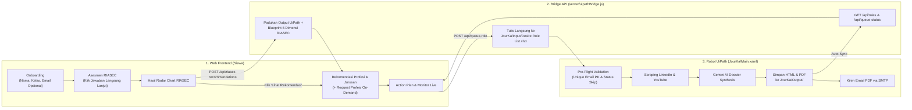

# 📘 Note Lengkap: Arsitektur, Cara Kerja & Integrasi JourKa (Frontend ↔ Robot UiPath)

Dokumen ini merangkum seluruh penjelasan teknis, alur kerja *end-to-end*, cara menjalankan demo lokal di Windows, skema deployment (Vercel vs Cloud Orchestrator), serta strategi menghadapi penilaian juri Hackathon **ONE x drife x UiPath x Indosat**.

---

## 1. Gambaran Besar Sistem (Pembagian Peran)

Ekosistem **JourKa** menggabungkan **Web Frontend interaktif** untuk siswa dengan **Robot RPA UiPath + AI** sebagai mesin riset pasar kerja di belakang layar:

| Lapisan | Lokasi Proyek | Tugas Utama |
| :--- | :--- | :--- |
| **1. Web Discovery Portal** | `jourka-frontend/` (React + Vite) | Menguji minat siswa (RIASEC), menampilkan Radar Chart, menyusun rekomendasi profesi & jurusan terurut, dan menerima request riset. |
| **2. Two-Way Bridge API** | `jourka-frontend/vite.config.js` & `server/uipathBridge.js` | Jembatan Node.js murni (tanpa dependensi eksternal) yang menyinkronkan katalog dari `JourKa/Output/` ke web serta menulis antrean request web langsung ke `JourKa/Input/Desire Role List.xlsx`. |
| **3. Robot Otomasi RPA** | `JourKa/Main.xaml` (UiPath Studio) | Membaca `Desire Role List.xlsx`, validasi Primary Key & status email, scraping lowongan LinkedIn & YouTube, merangkum Dossier via Gemini AI, ekspor HTML/PDF, dan kirim email SMTP ke siswa & orang tua. |

---

## 2. Alur Kerja End-to-End (Two-Way Dynamic Loop)



### Detail Langkah Pengalaman Pengguna (User Journey):
1. **Onboarding (`Onboarding.jsx`):** Siswa memasukkan nama, jenjang sekolah (Kelas 10/11/12/Fresh Grad), dan email (opsional).
2. **Asesmen Auto-Next (`Assessment.jsx`):** Terdapat 8 pertanyaan (6 dimensi RIASEC + lingkungan kerja + rencana kelulusan). Begitu siswa mengklik salah satu opsi, sistem menyimpan jawaban dan **otomatis berpindah ke soal berikutnya (~220ms)** tanpa tombol *Selanjutnya*.
3. **Profil Minat RIASEC & Acuan ke UiPath (`InterestProfile.jsx`):**
   * Menampilkan **Radar Chart SVG** dan rincian skor `R, I, A, S, E, C`.
   * Terdapat panel **Acuan Rekomendasi & Sinkronisasi ke Robot UiPath**: skor RIASEC ini dipakai sebagai acuan penyusunan daftar profesi. Jika email terisi, klik **`Lihat Rekomendasi Profesi & Jurusan →`** akan memanggil `POST /api/riasec-recommendations` sekaligus **otomatis mengantrekan profesi #1 hasil RIASEC ke `Desire Role List.xlsx`**.
4. **Rekomendasi Terurut & On-Demand (`Recommendations.jsx`):**
   * Profesi & jurusan diurutkan dari skor tertinggi ke terendah (bobot **45% RIASEC + 25% Aktivitas + 15% Lingkungan + 15% Jalur**) dengan akordion *Show/Hide* untuk skor lebih rendah dan *multi-select checkbox*.
   * **Buka Dossier Lengkap:** Membuka HTML dossier dari `JourKa/Output/` langsung di dalam modal (tidak mereset sesi).
   * **Request Profesi Baru On-Demand:** Siswa bisa mengetik profesi apa saja yang belum ada di katalog untuk diriset khusus oleh Robot UiPath.
5. **Action Plan & Zero-Touch Queue (`ActionPlan.jsx`):**
   * Menampilkan milestone 30/60/90 hari dan panduan diskusi Guru BK.
   * Klik **`🚀 Kirim Langsung ke Robot UiPath (Otomatis)`** untuk menulis seluruh profesi pilihan ke `Desire Role List.xlsx` tanpa download CSV manual.
   * Jika siswa memilih >1 profesi, Bridge otomatis menambahkan alias `+tag` pada email baris ke-2 dst (misal `rina+videoeditor@gmail.com`) agar lolos aturan **Primary Key unik Kolom A** di `Main.xaml` sementara email tetap masuk ke inbox yang sama.
   * Tabel **Monitor Antrean Live** menampilkan status baris Excel (`Pending`, `Sent`, `Skipped - BRE`).

---

## 3. Spesifikasi Endpoint Bridge API (`vite.config.js`)

| Endpoint | Method | Fungsi |
| :--- | :--- | :--- |
| `/api/roles` | `GET` | Memindai `JourKa/Output/` secara real-time (`scanJourkaOutput`), mengekstrak ringkasan peran, gaji IDR, status gelar, dan jurusan. |
| `/api/riasec-recommendations` | `POST` | Menerima profil RIASEC siswa, menggabungkan dossier `JourKa/Output/` dengan blueprint 6 dimensi RIASEC (`buildCatalogFromRiasec`), dan opsional auto-queue profesi teratas ke Excel. |
| `/api/queue-role` | `POST` | Memperbarui/menambahkan baris langsung ke `JourKa/Input/Desire Role List.xlsx` (`upsertDesireRolesExcel`) dengan format ZIP OpenXML yang valid. |
| `/api/queue-status` | `GET` | Membaca isi Sheet1 `Desire Role List.xlsx` (`readDesireRolesExcel`) untuk ditampilkan di tabel Monitor Antrean Live. |
| `/dossiers/*` | `GET` | Menyajikan file HTML/PDF hasil robot langsung dari `JourKa/Output/`. |

---

## 4. Cara Menjalankan Demo Integrasi Penuh (Windows / Mac)

1. **Jalankan Frontend + Bridge API:**
   ```bash
   cd jourka-frontend
   npm install
   npm run dev
   ```
   Buka `http://localhost:3000` (pastikan di header muncul **`🟢 Live Bridge`**).

2. **Persiapan Robot UiPath (`JourKa`):**
   * Pastikan `.env` atau Environment Variable Windows sudah terisi `GEMINI_API_KEY`, `SMTP_USER`, dan `SMTP_PASSWORD`.
   * **Penting (Cek Path Input di `Main.xaml`):** Secara default `Main.xaml` mengecek `D:\UiPathProject\Desire Role List.xlsx` terlebih dahulu sebelum fallback ke `<ProjectDir>\Input\Desire Role List.xlsx`. Pastikan saat demo tidak ada file lama di `D:\UiPathProject\Desire Role List.xlsx` agar UiPath Studio membaca file yang sama dengan yang ditulis oleh frontend!

3. **Eksekusi Demo:**
   * Jalankan `npm run dev` **sebelum** mulai merekam layar video demo (supaya di video tidak perlu menampilkan terminal).
   * Di browser: Isi asesmen $\rightarrow$ lihat Radar RIASEC $\rightarrow$ klik *Lihat Rekomendasi* $\rightarrow$ pilih profesi $\rightarrow$ klik *Kirim Langsung ke Robot UiPath*.
   * Buka **UiPath Studio** $\rightarrow$ klik **Run** pada `Main.xaml`.
   * Kembali ke browser: klik **`🔄 Refresh Status`** pada Monitor Antrean (`Pending` $\rightarrow$ `Sent`), lalu klik **`🔄 Sinkronkan Output UiPath`** di Rekomendasi untuk membuka dossier baru yang baru saja dibuat robot.

---

## 5. Deployment (Vercel) & Pertanyaan "Apakah UiPath Harus Selalu Nyala?"

| Skenario | Kondisi Web Frontend | Kondisi Robot UiPath |
| :--- | :--- | :--- |
| **Web di Vercel (`npm run build`)** | **Aktif 24/7 di Cloud.** Siswa bisa asesmen, lihat Radar Chart, rekomendasi, baca 7 dossier statis (`public/dossiers/`), dan download CSV backup tanpa laptop Anda nyala. | Karena Vercel berada di cloud, bridge lokal tidak terhubung ke disk laptop. Untuk koneksi otomatis full-cloud dari Vercel, gunakan **Google Sheets + Apps Script Webhook** (dibaca UiPath via GSuite Activities) atau **Vercel Serverless Function $\rightarrow$ UiPath Orchestrator Queue API**. |
| **Mode Demo / Sekolah (Studio Desktop)** | Berjalan di `localhost:3000` terhubung langsung ke Excel lokal. | **Attended / Batch:** Laptop Windows menyala dan Guru BK/admin klik **Run** (bisa dijadwalkan 1x sehari di sore hari untuk memproses semua antrean siswa). |
| **Mode Produksi (Orchestrator Cloud)** | Berjalan di Vercel 24/7. | **Unattended Automation:** Robot dipublish ke UiPath Orchestrator dan berjalan otomatis di VM Windows lewat **Queue Trigger / Time Trigger** tanpa campur tangan manusia. |

---

## 6. Strategi Penilaian & Checklist Pengumpulan Hackathon

### Poin Nilai Juri (Total 100%)
* **Relevansi Use Case (25%) & Dampak Praktis (20%):** Siswa SMA/SMK tidak lagi menebak jurusan/karier tanpa data; riset manual 1–2 jam oleh Guru BK dipangkas menjadi proses otomatis beberapa menit sekaligus ditembuskan ke orang tua.
* **Logika Automation (25%):** Alur *end-to-end* terukur—bukan input Excel statis, melainkan digerakkan oleh skor RIASEC siswa, dilengkapi *Pre-Flight Schema Validation*, normalisasi multi-email (`siswa;ortu`), deteksi duplikat PK, *idempotent skip* (`EmailStatus = Sent`), dan *secret redaction*.
* **Prototype / Demo (20%) & Presentasi (10%):** Deploy `jourka-frontend` ke Vercel sebagai link showcase opsional di Pitch Deck (agar juri bebas klik tanpa terminal), dan gunakan `npm run dev` + UiPath Studio di Windows untuk merekam Video Demo Zero-Touch.
* **Kemandirian Robot di `.zip`:** Robot `JourKa/Main.xaml` tetap bisa dijalankan mandiri langsung dari UiPath Studio tanpa mewajibkan reviewer menyalakan `npm run dev`.

### Checklist Wajib Sebelum Deadline (25 November 2026, 23.59 WIB)
1. **Final Pitch Deck (`.pptx`):** Identitas tim, masalah, proses sebelum vs sesudah otomasi (sertakan diagram *Two-Way Loop*), dampak terukur, dan link demo Vercel (jika di-deploy).
2. **Source Project Robot (`.zip`):** Compress folder project lengkap + `README.md` (tools, koneksi, cara jalan, contoh input/output). **WAJIB hapus `.env` / API Key / password sebelum mengompres `.zip`!**
3. **Video Demo (`.mp4`, max 100 MB):** Rekam cara memulai, proses web + robot berjalan, hasil akhir (email PDF + modal dossier), lengkap dengan voiceover/teks narasi.
4. **Akses File:** Pastikan seluruh link/file di Google Form (`https://bit.ly/Submit_AutomationHackathon`) diset **Anyone can view** (atau accept akses `@oneindonesia.id`).
