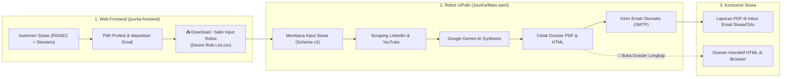

# JourKa Web Frontend (`jourka-frontend`)
> **Interactive Career & Education Discovery Web Platform for SMA/SMK Students**  
> Bagian dari ekosistem **JourKa (Journey Kita / Journey Merdeka)** — Hackathon IM3 x UiPath.

---

## 📌 1. Gambaran Umum

`jourka-frontend` adalah antarmuka web interaktif yang dirancang sebagai pintu gerbang (*front-facing discovery portal*) bagi siswa SMA/SMK dan Guru Bimbingan Konseling (BK). 

Aplikasi ini memandu siswa mengenali minatnya melalui **Hybrid Assessment (RIASEC 6 Dimensi + Skenario Nyata)**, menampilkan **Radar Chart Visual**, memberikan **Rekomendasi Profesi & Jurusan Berbobot (45/25/15/15)**, serta menghubungkan pilihan siswa langsung ke **Robot Otomasi UiPath** untuk riset pasar kerja dan pengiriman laporan dossier PDF.

---

## 🔗 2. Status Integrasi dengan Robot UiPath

Apakah modul ini sudah terintegrasi dengan UiPath? **YA, SUDAH TERINTEGRASI SECARA DUA ARAH:**



### Bentuk Integrasi Konkret:
1. **Integrasi Input (Frontend $\rightarrow$ UiPath):**  
   Di layar **Action Plan**, terdapat modul *RPA Handoff*. Siswa memasukkan email penerima, lalu mengklik tombol **"📥 Download Desire Role List.csv"** atau **"📋 Salin Baris Data"**. Data ini dibuat 100% presisi sesuai schema 7-kolom yang dibaca robot UiPath (`RecipientEmail | Job | AbroadMarkets | StudentName | EmailStatus | EmailTimestamp | ErrorMessage`).
2. **Integrasi Output (UiPath $\rightarrow$ Frontend):**  
   Di layar **Rekomendasi**, setiap kartu profesi dilengkapi tombol **"📖 Buka Dossier Lengkap"**. Tombol ini langsung membuka file HTML interaktif Bento Grid yang dihasilkan oleh robot UiPath di direktori `JourKa/Output/<Role>/<Role> - ID.html`.
3. **Integrasi Pengiriman Laporan (UiPath $\rightarrow$ Siswa & Ortu):**  
   Robot UiPath membaca data dari input, mengompilasi dossier ke format PDF A4, dan mengirimkannya via email SMTP formal ke siswa dan orang tua.

---

## 🚀 3. Cara Menjalankan Frontend secara Lokal

### Prasyarat:
- Komputer dengan **Node.js v18 atau v22** terpasang.
- Web Browser modern (Google Chrome / Edge / Safari).

### Langkah-langkah:
1. **Buka terminal dan masuk ke direktori `jourka-frontend`:**
   ```bash
   cd /Users/bayurn/ui-path-project/jourka-frontend
   ```

2. **Pastikan path Node.js aktif (jika menggunakan fnm):**
   ```bash
   export PATH="/Users/bayurn/.local/share/fnm/node-versions/v22.23.2/installation/bin:$PATH"
   ```

3. **Install dependencies (cukup 1x di awal):**
   ```bash
   npm install
   ```

4. **Jalankan local development server:**
   ```bash
   npm run dev
   ```

5. **Buka aplikasi di browser:**  
   Buka alamat: `http://localhost:3000` (atau port yang tertera di terminal).

---

## 📦 4. Cara Build untuk Produksi (Static Hosting / Vercel)

Jika ingin mempublikasikan aplikasi ke hosting gratis seperti **Vercel**, **Netlify**, atau **GitHub Pages**:

```bash
npm run build
```
Perintah ini akan menghasilkan folder `dist/` yang berisi file HTML, CSS, dan JS statis murni yang siap disajikan tanpa perlu server Node.js aktif.

---

## 🧭 5. Alur Penggunaan (User Journey)

1. **Layar 1 — Onboarding:**
   - Menyambut siswa dengan pendekatan ramah tanpa tekanan ujian (*"Tidak ada jawaban salah"*).
   - Input nama panggilan dan jenjang sekolah (Kelas 10, 11, 12 SMA/SMK, atau Fresh Graduate).
2. **Layar 2 — Hybrid Assessment:**
   - 8 Pertanyaan berbasis skenario konkret kehidupan sekolah & teknologi (6 dimensi RIASEC, 1 preferensi lingkungan kerja, 1 jalur rencana kelulusan).
   - Progress bar persentase dan navigasi mudah.
3. **Layar 3 — Profil Minat Siswa:**
   - Visualisasi **Radar Chart RIASEC** berbasis grafik vektor SVG murni.
   - Penentuan Arketipe Minat (misal: *Teknolog & Problem Solver Analitis*) beserta kartu penjelasan kekuatan diri.
4. **Layar 4 — Dashboard Rekomendasi Terurut:**
   - Tab 1: Pilihan Profesi diurutkan dari korelasi RIASEC tertinggi ke terendah, dilengkapi estimasi gaji awal, kebutuhan gelar, dan poin alasan transparansi (*Why Recommended*).
   - Tab 2: Program Studi / Jurusan Kuliah terkait.
   - **Show/Hide Dropdown:** Opsi dengan skor lebih rendah tetap dapat dilihat melalui tombol akordion *"▼ Lihat Opsi Lainnya"*.
   - **Multi-Selection Checkbox:** Siswa dapat mencentang lebih dari 1 profesi dan jurusan untuk difokuskan.
5. **Layar 5 — Action Plan & Handoff UiPath:**
   - Rangkuman profesi dan jurusan yang dipilih siswa.
   - Kotak ekspor data ke robot UiPath (Input email & download/salin CSV).
   - Milestone rencana aksi 30/60/90 hari dan panduan diskusi dengan Guru BK.
   - Fitur cetak ringkasan PDF.

---

## 📁 6. Struktur Direktori Proyek

```text
jourka-frontend/
├── index.html                   # HTML Entry point dengan styling tokens JourKa
├── package.json                 # Konfigurasi dependensi (React 18, Vite, Lucide Icons)
├── vite.config.js               # Konfigurasi port dev server (port 3000)
├── README.md                    # Dokumentasi ini
└── src/
    ├── main.jsx                 # React root mount
    ├── App.jsx                  # Master flow state machine
    ├── index.css                # Scoped design tokens, Bento grid, & typography identik dengan JourKa
    ├── data/
    │   ├── questions.json       # Bank 8 soal inti RIASEC + skenario lingkungan & jalur
    │   └── roles.json           # Katalog data profesi & jurusan (terkoneksi ke output JourKa)
    ├── engines/
    │   ├── assessmentEngine.js  # Perhitungan skor normalisasi RIASEC & arketipe minat
    │   └── recommendationEngine.js # Formula bobot 45/25/15/15 & poin alasan rekomendasi
    └── components/
        ├── Onboarding.jsx       # Form input identitas & tingkat kelas
        ├── Assessment.jsx       # Kartu pertanyaan kuesioner interaktif bertahap
        ├── RadarChart.jsx       # Visualisasi grafik radar RIASEC SVG (responsif & ringan)
        ├── InterestProfile.jsx  # Tampilan profil kekuatan & dimensi minat siswa
        ├── Recommendations.jsx  # Bento dashboard profesi & jurusan dengan multi-select & show/hide
        └── ActionPlan.jsx       # Milestone 30/60/90 hari, prompt Guru BK & modul ekspor ke UiPath
```
