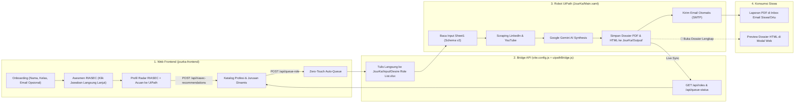

# JourKa Web Frontend (`jourka-frontend`)
> **Interactive Career & Education Discovery Web Platform for SMA/SMK Students**  
> Bagian dari ekosistem **JourKa (Journey Kita / Journey Merdeka)** — Hackathon IM3 x UiPath.

---

## 📌 1. Gambaran Umum

`jourka-frontend` adalah antarmuka web interaktif yang dirancang sebagai pintu gerbang (*front-facing discovery portal*) bagi siswa SMA/SMK dan Guru Bimbingan Konseling (BK). 

Aplikasi ini memandu siswa mengenali minatnya melalui **Hybrid Assessment (RIASEC 6 Dimensi + Skenario Nyata)**, menampilkan **Radar Chart Visual**, memberikan **Rekomendasi Profesi & Jurusan Berbobot (45/25/15/15)**, serta menghubungkan pilihan siswa langsung ke **Robot Otomasi UiPath** untuk riset pasar kerja dan pengiriman laporan dossier PDF.

---

## 🔗 2. Status Integrasi dengan Robot UiPath

Apakah modul ini sudah terintegrasi dengan UiPath? **YA, SUDAH TERINTEGRASI SECARA DUA ARAH:**



### Bentuk Integrasi Konkret (Two-Way Dynamic Loop):
1. **RIASEC sebagai Acuan & Auto-Queue (Profil Minat $\rightarrow$ UiPath):**  
   Di layar **Profil Minat (RIASEC)**, skor 6 dimensi (`R, I, A, S, E, C`) dikirim ke `POST /api/riasec-recommendations`. Bridge API menyusun daftar profesi & jurusan yang paling relevan dengan profil RIASEC siswa (menggabungkan dossier yang sudah ada di `JourKa/Output/` dan blueprint RIASEC yang siap diriset robot). Jika siswa mengisi email, profesi peringkat #1 langsung ditulis otomatis ke `JourKa/Input/Desire Role List.xlsx`.
2. **Integrasi Input Zero-Touch & Monitor Live (Action Plan $\rightarrow$ UiPath):**  
   Di layar **Action Plan**, siswa menekan **"🚀 Kirim Langsung ke Robot UiPath (Otomatis)"**. Frontend memanggil `POST /api/queue-role` yang otomatis menulis seluruh profesi pilihan siswa (termasuk request profesi kustom *On-Demand*) ke `JourKa/Input/Desire Role List.xlsx` menggunakan alias `+tag` email bila memilih >1 profesi agar lolos aturan Primary Key unik di `Main.xaml`. Tabel **Monitor Antrean Live** (`GET /api/queue-status`) menampilkan status real-time (`Pending` / `Sent`).
3. **Katalog Dinamis & Preview Dossier (UiPath $\rightarrow$ Frontend):**  
   Frontend membaca live folder `JourKa/Output/` lewat `GET /api/roles`. Begitu robot UiPath selesai menghasilkan dossier baru, tombol **"🔄 Sinkronkan Output UiPath"** langsung memunculkan profesi tersebut dan tombol **"📖 Buka Dossier Lengkap"** menampilkannya di modal interaktif tanpa me-reset sesi.

---

### Panduan Praktis Menjalankan Integrasi End-to-End (Untuk Demo Hackathon):
1. **Siapkan Konfigurasi Robot UiPath (`JourKa`):**
   - Pastikan `.env` atau Environment Variable berisi `GEMINI_API_KEY`, `SMTP_USER`, dan `SMTP_PASSWORD` (jangan di-commit ke Git).
   - Catatan `Main.xaml`: Secara default `Main.xaml` mengecek `D:\UiPathProject\Desire Role List.xlsx` terlebih dahulu, lalu fallback ke `<ProjectDir>\Input\Desire Role List.xlsx`. **Pastikan di laptop Windows saat demo file `D:\UiPathProject\Desire Role List.xlsx` tidak ada (atau arahkan ke `JourKa\Input\Desire Role List.xlsx`)** agar UiPath Studio membaca file Excel yang sama dengan yang ditulis oleh frontend!
2. **Jalankan Frontend + Bridge API:**
   ```bash
   cd jourka-frontend
   npm install
   npm run dev
   ```
3. **Jalankan Alur di Browser (`http://localhost:3000`):**
   - Isi **Onboarding** (Nama, Kelas, dan Email aktif Anda).
   - Jawab 8 pertanyaan **Asesmen** (cukup klik opsi jawaban, layar otomatis lanjut).
   - Di halaman **Profil RIASEC**, klik **"Lihat Rekomendasi Profesi & Jurusan →"** (daftar profesi otomatis disusun dari profil RIASEC Anda & profesi #1 langsung masuk antrean Excel).
   - Pilih profesi tambahan / ketik profesi baru di kotak **Request ke Robot** $\rightarrow$ lanjut ke **Action Plan** $\rightarrow$ klik **"🚀 Kirim Langsung ke Robot UiPath (Otomatis)"**.
4. **Jalankan Robot di UiPath Studio:**
   - Buka `JourKa/Main.xaml` di UiPath Studio $\rightarrow$ klik **Run**.
   - Robot otomatis membaca baris baru berstatus kosong di `JourKa/Input/Desire Role List.xlsx`, melakukan scraping LinkedIn/YouTube + Gemini AI, menyimpan HTML/PDF ke `JourKa/Output/<Role>/`, mengirim email ke inbox Anda, dan mengupdate kolom `EmailStatus = Sent`.
5. **Verifikasi Balik di Frontend:**
   - Klik **"🔄 Refresh Status"** di **Monitor Antrean Live** (status berubah menjadi `Sent`).
   - Kembali ke **Rekomendasi** dan klik **"🔄 Sinkronkan Output UiPath"** untuk langsung membuka dossier baru di modal browser!

---

## 🚀 3. Cara Menjalankan Frontend secara Lokal

### Prasyarat:
- Komputer dengan **Node.js v18 atau v22** terpasang.
- Web Browser modern (Google Chrome / Edge / Safari).

### Langkah-langkah:
1. **Buka terminal dan masuk ke direktori `jourka-frontend`:**
   ```bash
   cd /Users/bayurn/ui-path-project/jourka-frontend
   ```

2. **Pastikan path Node.js aktif (jika menggunakan fnm):**
   ```bash
   export PATH="/Users/bayurn/.local/share/fnm/node-versions/v22.23.2/installation/bin:$PATH"
   ```

3. **Install dependencies (cukup 1x di awal):**
   ```bash
   npm install
   ```

4. **Jalankan local development server:**
   ```bash
   npm run dev
   ```

5. **Buka aplikasi di browser:**  
   Buka alamat: `http://localhost:3000` (atau port yang tertera di terminal).

---

## 📦 4. Cara Build untuk Produksi (Static Hosting / Vercel)

Jika ingin mempublikasikan aplikasi ke hosting gratis seperti **Vercel**, **Netlify**, atau **GitHub Pages**:

```bash
npm run build
```
Perintah ini akan menghasilkan folder `dist/` yang berisi file HTML, CSS, dan JS statis murni yang siap disajikan tanpa perlu server Node.js aktif.

---

## 🧭 5. Alur Penggunaan (User Journey)

1. **Layar 1 — Onboarding:**
   - Menyambut siswa dengan pendekatan ramah tanpa tekanan ujian (*"Tidak ada jawaban salah"*).
   - Input nama panggilan, jenjang sekolah (Kelas 10, 11, 12 SMA/SMK, atau Fresh Graduate), dan email siswa (opsional).
2. **Layar 2 — Hybrid Assessment:**
   - 8 Pertanyaan berbasis skenario konkret kehidupan sekolah & teknologi (6 dimensi RIASEC, 1 preferensi lingkungan kerja, 1 jalur rencana kelulusan).
   - **Auto-Advance:** Mengklik opsi jawaban langsung menyimpan pilihan dan berpindah otomatis ke pertanyaan berikutnya.
3. **Layar 3 — Profil Minat Siswa:**
   - Visualisasi **Radar Chart RIASEC** berbasis grafik vektor SVG murni.
   - Penentuan Arketipe Minat beserta panel **Acuan Rekomendasi & Sinkronisasi ke Robot UiPath** (mengubah skor RIASEC menjadi daftar profesi target & opsional auto-queue ke `Desire Role List.xlsx`).
4. **Layar 4 — Dashboard Rekomendasi Terurut:**
   - Tab 1: Pilihan Profesi dinamis sesuai profil RIASEC & output UiPath (diurutkan tertinggi ke terendah), plus kotak **Request Profesi Baru On-Demand**.
   - Tab 2: Program Studi / Jurusan Kuliah terkait.
   - **Show/Hide Dropdown & Multi-Selection:** Opsi skor rendah tetap bisa dibuka di akordion, dan siswa bisa memilih lebih dari 1 profesi/jurusan.
5. **Layar 5 — Action Plan & Handoff UiPath:**
   - Rangkuman profesi dan jurusan pilihan siswa.
   - Tombol **"🚀 Kirim Langsung ke Robot UiPath (Otomatis)"**, tabel **Monitor Antrean Live**, plus opsi backup CSV offline.
   - Milestone rencana aksi 30/60/90 hari, panduan diskusi Guru BK, dan cetak ringkasan PDF.

---

## 📁 6. Struktur Direktori Proyek

```text
jourka-frontend/
├── index.html                   # HTML Entry point dengan styling tokens JourKa
├── package.json                 # Konfigurasi dependensi (React 18, Vite, Lucide Icons)
├── vite.config.js               # Dev server (port 3000) & Bridge API routes (/api/*, /dossiers/*)
├── README.md                    # Dokumentasi ini
├── server/
│   └── uipathBridge.js          # Pure Node.js Bridge: live scan JourKa/Output & R/W Desire Role List.xlsx
└── src/
    ├── main.jsx                 # React root mount
    ├── App.jsx                  # Master flow state machine
    ├── index.css                # Scoped design tokens, Bento grid, & typography identik dengan JourKa
    ├── data/
    │   ├── questions.json       # Bank 8 soal inti RIASEC + skenario lingkungan & jalur
    │   └── roles.json           # Katalog data profesi & jurusan (terkoneksi ke output JourKa)
    ├── engines/
    │   ├── assessmentEngine.js  # Perhitungan skor normalisasi RIASEC & arketipe minat
    │   └── recommendationEngine.js # Formula bobot 45/25/15/15 & poin alasan rekomendasi
    └── components/
        ├── Onboarding.jsx       # Form input identitas & tingkat kelas
        ├── Assessment.jsx       # Kartu pertanyaan kuesioner interaktif bertahap
        ├── RadarChart.jsx       # Visualisasi grafik radar RIASEC SVG (responsif & ringan)
        ├── InterestProfile.jsx  # Tampilan profil kekuatan & dimensi minat siswa
        ├── Recommendations.jsx  # Bento dashboard profesi & jurusan dengan multi-select & show/hide
        └── ActionPlan.jsx       # Milestone 30/60/90 hari, prompt Guru BK & modul ekspor ke UiPath
```
